# 第9章指标与监控(1)

部署的分布式系统上线以后，如何知道其是否运行正常？我们需要得到系统的反馈信息，从而确保其正常运行，同时可以根据反馈不断提升系统的性能。监控系统就是最好的反馈手段，它就像一双眼睛，我们通过这双眼睛来“观察”系统。对于分布式系统来说，由于服务和应用分散部署在不同的网络节点，因此监控应用间的调用以及服务器间的关系都相对复杂。本章内容围绕分布式系统的监控展开，首先介绍为什么需要监控系统以及有哪些监控指标。接着对监控系统的功能、分类和分层展开讲解，介绍监控分布式系统的一般过程，并且将监控系统分为日志类、调用链类和度量类。在监控系统的分层中，从下到上有 5 层，分别是网络层、系统层、应用层、业务层、客户端。最后，根据监控系统的不同层次讲述不同的最佳实践，包括 Zabbix（网络层、系统层）、Prometheus（网络层、系统层、应用层、业务层）的原理与实现。总结一下，本章将介绍以下内容。

- 为什么需要监控系统

- 监控系统的指标

- 创建监控系统的步骤

- 监控系统的分类

- 监控系统的分层

- Zabbix 实现监控系统

- Prometheus 实现监控系统

## 9.1　为什么需要监控系统

从字面意思理解，监控就是对系统产生的数据进行收集、处理和汇总，并且将这些数据通过某种途径以量化的形式展示出来。一旦系统出现问题，就可以通过报警的方式通知系统维护人员，从而保证系统稳定运行。

开发任何一个分布式系统的目的都是为客户提供高质量和高稳定性的应用。应用不可用、服务器死机、服务调用缓慢都会影响客户体验，所以我们要快速收集、汇总、分析信息，从而定位并解决问题。既然是分布式系统，就会面临以下问题。

- 应用服务的分散性。由于应用服务部署在不同的网络节点，导致产生的日志也是四处分散，因此需要从不同的服务器中收集和分析日志信息。比起单机时代，分布式时代的日志收集实现起来更加困难。

- 业务流程的复杂性。在对业务了解得越来越深入的同时，对业务所做的抽象也越来越多，对业务进行拆分和复用便成为家常便饭。微服务就是一个典型的例子，某一个业务流程通常需要多个服务协同完成，如何协调好服务之间的关系也是需要考虑的问题。

- 调用关系的烦琐性。正如上一条提到的，通常由多个服务协同完成一个流程，此时服务之间的调用关系其实也是错综复杂。一次响应用户请求的过程可能需要调用几个甚至十几个服务，这种调用形成了一个调用链，为了更好地跟踪服务调用，就需要跟踪调用链上的每个环节。

- 事故反应的及时性。在对系统故障进行定义以后，一旦出现问题就需要第一时间通知运维工程师，进行故障排查，及时性是不容小觑的。

上面提到的问题导致分布式系统是分散、复杂、烦琐的，系统出现任何问题都需要及时进行修复。从长远发展来看，分析系统的运行数据可以帮助我们优化系统，从而提高系统性能、用户体验和运行稳定性。从当前来说，通过系统异常报警能够发现并解决当下的问题。因此，一个合格的监控系统应该包括以下几个因素。

- 数据收集。每个网络节点或者应用节点都需要配有信息收集机制，在收集运行数据的同时建立传输通道，保持与服务器连接的畅通，从而将数据收集汇总起来。必要时还需进行过滤、分类、聚合等操作，并且提供展示平台，把数据以图形（例如柱状图、饼状图、雷达图、曲线图等）或表格的方式展示出来。

- 数据分析。对获取到的数据进行数据趋势分析。例如分析数据库记录的增长趋势、用户数的增长趋势。这些是硬件扩容和服务扩展的重要参考依据，也是每年制定服务器预算的重要依据。对比实施新技术或者架构前后，系统性能是否得到提升，例如对比加入缓存机制之后，响应请求的速度是否提升了。

- 异常报警。实时监控服务的运行情况和技术指标，提供异常反馈与修复机制。或者对指标设定阈值，在问题发生之前进行预见性的维修。

## 9.2　监控系统的指标

上一节讲了为什么需要监控系统，说明了在分布式系统监控中会面临的 4 个问题，并且有 3个因素需要我们关注。那么监控系统主要监控什么内容呢？说到这里，很容易让人联想到服务器指标，诸如 CPU 利用率、内存利用率、应用响应时间、数据库读写速度等。如果推广到应用层，还有可能是服务的调用链情况，到业务层可以是用户访问某个业务模块的 QPS 数。估计大家能够说出很多需要监控的指标。本书引用 Google SRE（Site Reliability Engineering，站点可靠性工程）手册中关于分布式监控指标的描述，将监控指标抽象为 4 个黄金信号，代表衡量系统的重要指标。我们接下来将讨论这 4 个特征。

- 延迟延迟（latency）用来衡量完成某一具体操作所需的时间。这个具体操作有可能是用户请求，也有可能是服务之间的调用，还有可能是一次数据库请求。衡量方式取决于具体的使用场景，通常有处理时间、响应时间、传输时间等。延迟通常还和组件（如服务、数据库等）息息相关，因此获取组件的延迟信息可以构建整个系统的性能特征模型。如果知道了整个系统调用链上所有组件的延迟信息，就可以找到系统的瓶颈，了解每个组件或者资源的访问时间，并且获知哪些组件花费的时间超出了预期，进而提出改进意见。

- 需要注意，计算延迟的时候要区分请求成功的延迟和请求不成功的延迟。比如数据库如果连接错误，就会触发调用失败，很快便会返回错误信息，所以响应延迟很低。可是这种情况并不属于请求成功的延迟，所以在统计服务延迟的时候需将其区分。特别是微服务时代提倡“快速失败”，更要注意那些延迟较大的错误请求，错误请求的延迟越长，越会更多地消耗系统资源，影响系统性能，因此追踪错误请求的延迟也显得很重要。

- 流量流量（traffic）度量的是系统负载，一般指流入系统的请求数量，能够获取系统的容量需求，推而广之也可以理解为获取系统中各个组件的容量需求。对于不同类型的组件而言，流量或许代表不同的含义，比如对 Web 服务器来说，流量指每秒的 HTTP 请求数。可以通过流量来衡量组件和系统的繁忙程度。如果在单位时间内，流量一直较高，则表示这段时间内的用户请求数在持续增加，系统需要提供更多资源进行响应。因此，在系统设计之初，就需

- 要评估其能够承受多少流量。一定量资源能够承受流量的上限是一定的，当检测到流量超过或者接近上限的时候，需要考虑进行限流，从而保证系统的可用性。

- 错误通过监控分布式系统中发生错误的请求数量，从而得到单位时间内的错误发生频率。这里的错误（error）分为显式错误和隐式错误，前者如返回 HTTP 状态码 500 表示错误，后者如返回 HTTP 状态码 200 表示成功，但是对应的业务却并未完成。不仅需要获取显式错误，还要通过日志或者服务调用链获取隐式错误。

- 通过跟踪错误能够了解系统的运行状况，以及系统中的组件是否都能正常响应请求。正如上面提到的错误分为显式和隐式，有些服务器会通过现成的接口抛出错误信息，也有一些服务器是不提供类似的错误接口的，因此需要付出额外的心血来收集。最后，需要对错误进行分类，针对不同类型的错误设置报警级别，当发生某类错误时需要通知相应的运维人员去处理。

- 饱和度饱和度（saturation）衡量的是当前系统资源的使用量，通常用百分比表示，例如 CPU 利用率为 90%。因此对饱和度的监控主要聚焦于资源信息，这些资源需要支撑上层服务或者应用，使它们能够正常运行。说白了就是监控能够影响服务运行状态，且受限制的资源，如果服务需要占用更多的内存，就要关注内存的饱和度；如果系统受限于磁盘 I/O 的读写速度，就要关注磁盘 I/O 的饱和度。一旦这些受限制的资源达到或者即将达到饱和度，对这些资源有依赖的服务的性能就会明显下降。

## 9.3　创建监控系统的步骤

前面两节回答了监控分布式系统的意义和需要监控的内容，那么如何获得监控指标呢？通过哪些步骤实现对系统的监控呢？我们将在这一节介绍这部分内容。

应用一旦被部署到实际的生产环境，程序员对此应用的控制就会受限，不能再随意地升级或者回滚。由于分布式的发展，特别是微服务开发模式带来了服务应用的多样性，并且针对同一服务还可以做水平扩展，这些都使平台和系统变得异常复杂。

在 IT 运维过程中，常会遇到这样的情况：某个业务模块出现了问题，但运维人员不知道，等发现的时候问题已经很严重了；系统出现瓶颈了，CPU 占用率持续升高，内存不足，磁盘被写满；网络请求突增，超出网关承受的压力。

以上这些问题一旦发生，将会对我们的业务产生巨大影响，因此每个公司或者 IT 团队都会针对这些情况建立自己的 IT 监控系统。下面将创建监控系统需要完成哪些步骤做一个梳理，如图 9-1 所示。

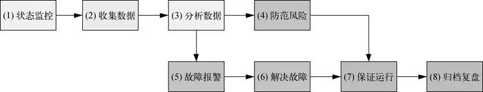

- 图 9-1　监控系统的工作流程图

每个步骤的具体描述如下。

(1) 实时监控服务、系统、平台的运行状态。

(2) 收集服务、系统、平台的运行数据。

(3) 分析收集到的信息，预知存在的故障和风险，并采取行动。

(4) 评估和防范风险。

(5) 对故障进行预警，一旦故障发生，第一时间发出告警信息。

(6) 通过监控数据，定位故障，协助生成解决方案。

(7) 保证系统持续、稳定、安全运行。

(8) 使监控数据可视化，这样便于统计，并且按照一定周期将数据导出、归档，用于数据分析和问题复盘。

## 9.4　监控系统的分类

上一节介绍的监控系统的步骤为创建监控系统提供了思路，在实际工作中针对不同的组件和场景，会使用不同的监控手段。这里根据组件和场景的不同列举三类不同的监控分类，分别是日志类、调用链类、度量类。

### 9.4.1　日志类监控

这种方式比较常见，程序员会在业务代码中加入一些日志代码，记录异常或者错误信息，方便在发现问题的时候进行查找。这些信息会与具体事件相关联，例如用户登录、下订单、浏览某件商品，近一小时的网关流量、用户的平均响应时间等。

这类记录和查询日志的解决方案是比较多的，比如 ELK 方案（Elasticsearch＋Logstash＋Kibana）。下面我们用 ELK 和 Redis、Kafka、RabbitMQ 来搭建一个日志系统。如图 9-2 所示，系统内部通过 Spring AOP 记录日志，通过 Beats 收集日志文件，然后用 Redis、Kafka、RabbitMQ 将日志文件发送给 Logstash，Logstash 再把日志写入 Elasticsearch。最后使用 Kibana 将存放在 Elasticsearch 中的日志数据可视化呈现出来，形式可以是实时数据图或表。

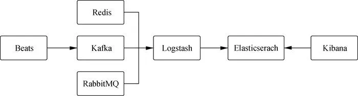

- 图 9-2　ELK 结合 Redis、Kafka、RabbitMQ 实现日志类监控

1. ELK 的系统架构上面提到以 ELK 架构作为日志类监控方案，因此这里有必要把它的整体结构梳理一次。ELK 是 Elasticsearch、Logstash、Kibana 的缩写，这三个都是开源软件。

- Elasticsearch 是一个开源分布式搜索引擎，提供收集数据、分析数据、存储数据三大功能，其特点有分布式、零配置、自动发现、索引自动分片、索引副本机制、RESTful 风格接

- 口、多数据源和自动搜索负载等。主要负责将建立日志索引并把日志存储起来，以便业务方检索查询。

- Logstash 是一个用来收集、过滤、转发、分析日志的中间件，支持大量获取数据的方式。其一般工作模式是 C/S 架构，客户端安装在需要收集日志的主机上，服务端负责过滤、修改接收到的各节点日志，再将结果一并发往 Elasticsearch 进行下一步处理。

- Kibana 也是一个开源且免费的工具，可以为 Logstash 和 Elasticsearch 的日志分析提供友好的 Web 界面，帮助汇总、分析和搜索重要的数据日志。

- 上述三个工具的组合将收集、过滤、搜索、展示日志的过程融为一体，提供了一套良好的监控系统。现在在原有架构的基础上，新增一个 Filebeat，这是一个轻量级的日志收集处理工具（Agent），占用的资源少，适合在各个服务器上收集日志后传输给 Logstash，官方也推荐此工具。Filebeat 组件属于 Beats 系列，针对日志文件进行收集和传输。值得一提的是在Beats 系统中，还有 Metricbeat（指标数据）、Packetbeat（网络数据）、Winlogbeat（Windows 日志）、Auditbeat（审计数据）等组件，能够涵盖网络层、系统层、应用层的监控。引申一下就是可以覆盖 Zabbix 完成的功能，只是 Zabbix 产生得更早，用它的企业也较多，我们在 9.6 节会单独提出来介绍。

- 从功能上来说，Filebeat 和 Zabbix 这两种工具是有交集的。如图 9-3 所示，Filebeat 通过服务或者服务器收集日志文件，由于服务可能分布在不同服务器上，因此在收集日志的时候会造成高并发，需要利用 Kafka 减轻这个压力。收集好的日志文件会交给 Logstash 进行过滤和分析，Logstash 分析完毕后把结果传递给 Elasticsearch，作为日志搜索的依据。最后，由 Kibana 把日志可视化展示给用户。

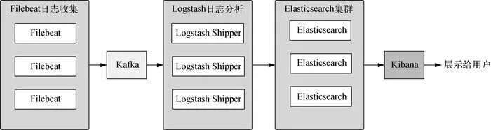

- 图 9-3　ELK 的工作流程图

2. FileBeat 体系结构详解由于 ELK 由多种工具和组件共同实现，限于篇幅无法一一介绍，因此这里将重点放到日志收集部分。本节分别以 Filebeat 和 Logstash 为切入点介绍日志收集和日志分析过滤的实现原理。

- FilebeatFilebeat 包含 Input 和 Harvester 两个组件，它在启动时生成一个或多个 Input，由 Input定位需要收集的日志文件。如图 9-4 所示，左边的大框就是 Filebeat，大框中的 Input1和 Input2 是 Filebeat 在启动时生成的两个 Input 组件，为这两个组件制定日志路径，分别是 /var/log/*.log 和 /var/log/apache，作用是让两个组件监控这两个目录下的日志文件。针对每个日志，Filebeat 都会启动一个与之对应的 Harvester，Harvester 会管理日志文件中的内容。假设图 9-4 中 Input1 组件监控的目录下面有两个文件，分别是system.log 和 wifi.log，因此对应有两个 Harvester 对文件进行读取。Harvester 负责聚合日志文件中的数据和事件等信息，并将聚合以后的信息输出给外部应用，例如Elasticsearch、Logstash、Kafka、Redis 等。

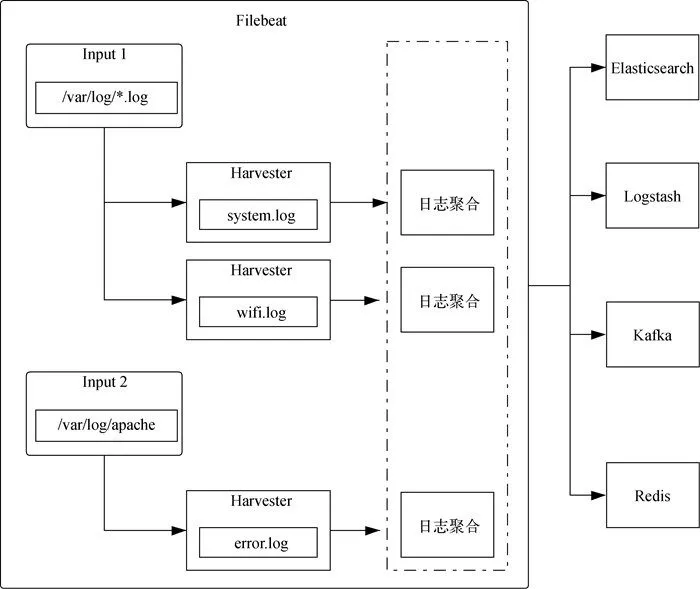

- 图 9-4　Filebeat 处理日志文件的原理

- 上文提到了 Input 和 Harvester 两个组件，它们协同工作将文件变动发送到指定的输出中，下面看看它们是如何定义的。

- Input：负责发现和管理 Harvester 将要读取的资源。Input 会找到指定目录下的所有日志文件，并为每个文件各启动一个 Harvester。Input 会检查每个文件，看对应的Harvester 是否已经启动。简单点讲，Input 负责发现要读取的日志文件，并启动Harvester 对其进行读取。在 Filebeat 中可以设置 Input 的类型，这里设置的 Input 类型是 Log，因此 Input 会搜索所有磁盘上对应目录的文件。当然也可以将监控内容设置为不同的类型，例如 Azure Event Hub、Docker、HTTP JSON 等。

- Harvester：负责读取文件内容。每个文件都会对应一个 Harvester，在 Harvester 运行的时候，文件描述符处于打开状态，在 Harvester 关闭之前，磁盘不会被释放。默

```
认情况下 Filebeat 会保持文件打开的状态，直到达到 close_inactive（启用此选
```

- 项后，如果在指定时间内未收获文件，Filebeat 将关闭文件句柄）规定的值。一旦到

```
达 close_inactive 规定的值，Filebeat 在指定时间内就不会再更新文件。如果文
```

- 件被关闭，就认为该文件发生了变化，会为其启动一个新的 Harvester。

- Filebeat 将文件状态记录在 /var/lib/filebeat/registry 里，记录的是 Harvester 收集文件的偏移量。如果某时连接不上输出目标，例如 Elasticsearch、Filebeat，就会记录发送前的最后一行，当再次连接上 Elasticsearch 的时候便可以继续发送文件。Filebeat 还会将每个事件的传递状态都保存在文件中，如果未得到输出目标的确认，Filebeat 就会主动发送请求，直到得到响应。

3. Logstash 体系结构详解Logstash 是一个开源的数据收集引擎，通过实时管道功能动态地收集来自不同数据源的数据，将这些数据标准化之后传输到目的地。如图 9-5 所示，Logstash 收集和处理数据的流程分三个阶段，依次是 Input → Filter → Output。这个三个阶段形成了一个 PipeLine，也就是 Logstash 的管道，数据就在这个管道中流动。

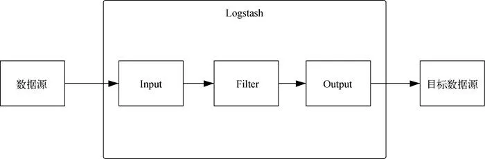

- 图 9-5　Logstash 处理流程

- Input：负责接收输入数据到 Logstash。数据的源头多种多样，有文件、系统日志、Redis 等。这个流程通过 Logstash 的插件实现，包括 Stdin（标准输入）、File（读取文件）、TCP（网络数据）、Generator（测试数据）等。

- Filter：负责对接收到的数据进行处理，其实就是一些过滤和分析工作。例如转换文本格式、对数据进行结构化处理、删除、替换、修改字段等。Filter 的插件包括 Grok（正则

- 表达式）、Date（时间处理）、Mutate（字符串的类型转换处理）、GeoIP（IP 地址查询）、JSON 解码、Split（拆分事件）等。

- Output：负责将数据输出到目标数据源。同样也是通过插件的方式实现，包括 Stdout（标准输出）、File（保存成文件）、输出到 Elasticsearch、输出到 Redis、输出到网络TCP。

- 如果把一次 Logstash 数据处理流程理解为一个 Event，那么数据在进入 Input 的时候就会被转换成一个 Event，完成 Output 以后，这个 Event 又会被转换成目标数据格式，这个过程经历了 Event 的整个生命周期。由于分布式系统中的数据源可能多种多样，因此Logstash 在采集数据环节可能会面对多种类型的数据，为了让这些数据都能在 Logstash 的Pipeline 中顺利传递，需要将它们转化成统一的 Logstash Event。如图 9-6 所示，将图 9-5中的 Input、Filter 以及 Output 三个步骤做了进一步拆解。数据源 1、2、3 提供给 Input 不同类型的 Raw Data（原始数据），Input 通过 codec-decode 模块对这些数据进行解码，将它们统一构建成 Logstash Event，再交由 Filter 进行过滤。最后通过 Output 中的 codec-encode 模块将过滤以后的 Event 编码成目标数据需要的格式，并输出到目标数据中。

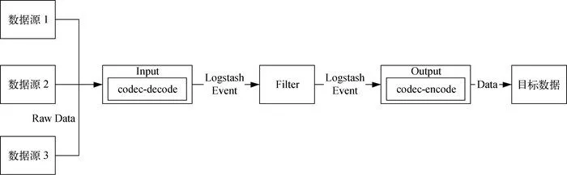

- 图 9-6　改进后的 Logstash 处理流程

- 由图 9-6 可知，Logstash 在采集日志信息的时候，会定义需要处理的数据源信息，并将其交给 Input 模块进行编码操作，再将生成好的 Event 信息交给 Filter 进行筛选，最后交给Output 模块根据目标数据的格式完成输出。整个流程可以理解为对 Input、Filter 和 Output进行定义和执行的过程。我们继续对这个流程进行拆解，如图 9-7 所示。Logstash 通过配置文件来定义 Input、Filter 和 Output，然后通过 Logstash 命令执行配置文件中的内容。

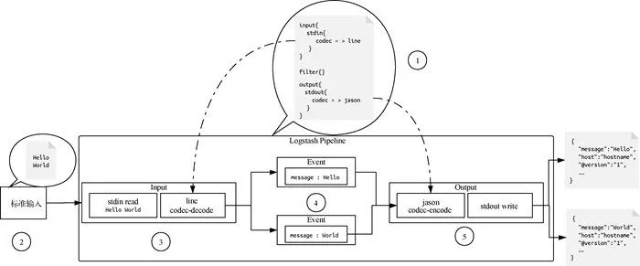

- 图 9-7　Logstash 通过配置文件处理日志流程

- 下面简单介绍一下图 9-7 中的各步骤。

```
① 配置文件将 input 的内容定义为 stdin（标准输入），也就是通过控制台输入需要采集
的日志内容，在 codec 定义的部分选择 line，意思是通过行的方式对输入内容进行解
析；filter 部分为空，也就是不做任何过滤和筛选操作；output 部分使用的是 stdout
```

- （标准输出），其格式为 Jason 文件。顺着从配置文件发出的虚线方向可以看到，该配置文件影响着 Input 和 Output 组件编码和解码的配置。

```
② 定义完 Logstash 的配置文件以后，在控制台输入 Hello\nWorld 字符串，注意两个单
词之间有一个回车符 \n。
```

- ③ 输入的字符串先通过 Input 模块的 stdin 组件，再根据 codec-decode 组件的行读取方

```
式，被分为 Hello 和 World 两条记录。
④ 针对 Hello 和 World 两条记录，会分别生成两个 Event，每个 Event 分别记录一行日
```

- 志的内容。将这两个 Event 交给 Filter 模块处理，由于本例中的 Filter 模块为空，因此直接转交给 Output 模块。

- ⑤ Output 模块接收到两个 Event 后，根据配置的输出格式 Jason，对 Event 进行编码，然后以 stdout 的标准输出将数据以 Jason 格式打印到控制台。

- 讲完 Logstash 的详细处理流程之后，再来看看同时处理多个 Input 的情况。分布式架构下的日志收集会在不同的终端进行，因此会有多个 Input 操作，产生的大量日志需要通过队列以及批处理的方式进入 Filter 中，处理完后输出到 Output 中。如图 9-8 所示，左边有 3 个Input 模块，Logstash 为每个 Input 都申请了单独的 Input 线程。假设这 3 个 Input 同时完成了日志采集工作，并将 Event 消息发送给 Filter 模块处理。为了让 Event 消息能够发送到对应的 Filter 中，首先要将这些 Event 放到队列中，然后针对每个 Filter 分别启动一个Batcher，它负责从队列中批量获取 Event 数据，同时根据时间和收集的 Event 数目两个参数进行判断，如果达到预期的值（比如达到 5 分钟或者 10 个 Event），就将 Event 发送到Filter 中去。Output 模块处理完毕以后会通知队列已经处理了哪些 Event，队列会对这些Event 进行标记。这里需要注意的是 Batcher、Filter 和 Output 模块都是在 Pipeline worker线程中实现的，所以启动的 Pipeline worker 线程越多，能够处理的 Event 就越多，也越能面对高并发的日志收集。

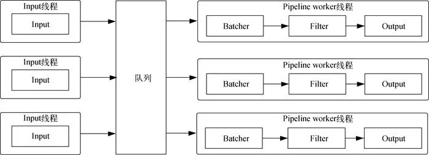

- 图 9-8　多线程下 Logstash 的工作流程

### 9.4.2　调用链监控

上一节讲的日志类监控是一种比较传统的监控方式。在微服务时代，由于服务关系的复杂性增加了服务之间的调用，一个服务既可能依赖别的多个服务，也可能被别的多个服务所依赖，因此一次服务调用有可能涉及多个服务，从而形成调用链。例如调用 A 服务就需要调用 B 服务，调用 B 服务又需要调用 C 服务。

调用链用于记录一个请求经过所有服务的过程：从请求开始进入服务，然后经过不同的服务节点，再返回给客户端。通过调用链参数来追踪全链路行为能够明确请求在哪个环节出了故障，以及系统的瓶颈在哪儿。调用链监控可以通过两种方式实现，分别是字节码增强和请求拦截，下面针对这两种方式展开说明。

1. 字节码增强，Java 探针：ASM在介绍这种方式之前，我们先来复习一下 Java 代码的运行原理，如图 9-9 所示。

- ① 我们通常会把 Java 源代码文件传给 Java 编译器进行编译操作。

- ② Java 编译器把 Java 源代码编译成 .Class 文件，也就是字节码文件。

- ③ 把 .Class 文件对应的 Java 字节码发送给 Java 类装载器进行字节码的验证。

- ④ 把验证过后的字节码发送给 Java 解释器和及时解释器，生成可以执行的程序。

- ⑤ 在 Java 虚拟机（JVM）加载 .Class 二进制文件 / 在把 Java 字节码传入 Java 类装载器的时候，利用 ASM 动态地修改加载的 .Class 文件，在所监控的方法前后添加需要监控的内容。

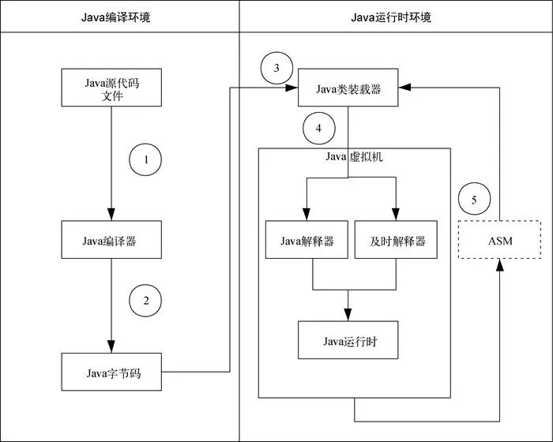

- 图 9-9　Java 代码运行原理图

- 字节码增强，Java 探针的方式利用的就是 Java 代理，这个代理是指运行方法前面的拦截器。图 9-9 中是在第 ⑤ 步进行的方法拦截，例如添加计时语句记录方法耗时，然后将方法耗时存入处理器，利用栈先进后出的特性处理方法调用顺序。

- 根据 ASM Guide 文档给出的定义，ASM 这个名称不代表任何含义，只是对 C 语言中__asm__ 关键字的引用，它允许使用汇编语言实现某些功能。ASM 是一个 Java 字节码操纵框架，具有动态生成类或者增强既有类的功能。ASM 可以直接产生 .Class 二进制文件，也可以在类被载入 Java 虚拟机之前改变类的行为。Java 类存储在 .Class 文件里，在.Class 文件中包含元数据，这个元数据用来定义类中的元素：类名称、方法、属性以及Java 字节码（指令）。ASM 从类文件中读出信息后，能改变类行为，分析类信息，甚至生成新类。针对日志类监控，是在对应的方法上打上日志，具体是截获对应的方法，然后在该方法执行前或者执行后的位置加入需要的日志内容。那么下面就进一步看看 ASM 是如何处

```
理 .Class 文件的。如图 9-10 所示，.Class 文件从左边进入 ClassReader，然后交给
Visitor 进行处理，最后通过 ClassWriter 生成修改以后的 .Class 文件，从而被装载
```

- 到 Java 虚拟机中。

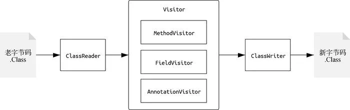

- 图 9-10　ASM 处理 .Class 文件

```
下面看看图 9-10 中几个 ASM 核心 API（ClassReader、Visitor、ClassWriter）的
```

- 功能。

```
ClassReader：用于读取编译好的 .Class 文件。
Visitor：从上到下依次处理生成的 .Class 文件，由于这些文件是 Java 源代码文件编
译所得的产物，因此其中也会包含 Method（方法）、Field（字段）、Annotation
（注释）等信息。针对这些信息，会有不同的 Visitor 与之对应，例如使用
MethodVisitor 访问 Method、使用 FieldVisitor 访问 Field、使用
AnnotationVisitor 访问 Annotation。在日志类监控中，会有更多种方法，因此
对 MethodVisitor 的使用会多一些。
ClassWriter：它的工作比较简单，只需要将 Visitor 处理过的文件写到新.Class 文
```

- 件中即可，也就是生成新的字节码文件。

- 上面讲解了 ASM 是如何处理 .Class 文件的，其中使用了访问者模式中获取 .Class 文件的方法，并且对文件进行了修改。这里对访问者模式不做展开描述，只通过一个修改日志方法的例子帮助大家体会这种用法。如图 9-11 所示，从左往右一共有三条泳道，代表这个例子

```
中的三个类：第一条泳道中的 TestClass 是我们的目标类，我们会对该类生成的 .Class
文件进行修改；ASMGenerator 是我们自己写的类，用来读取 .Class 文件，我们会将其关
联上 ASMClassVisitor 类，并且通过 ClassWriter 写到新 .Class 文件中；
ASMClassVisitor 也是我们的自建类，它通过 MethodVisitor 来访问 TestClass 对
```

- 应的方法，并且修改方法的内容。

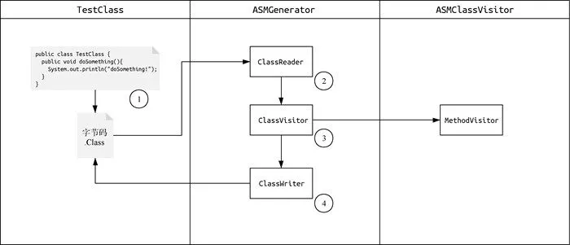

- 图 9-11　修改 TestClass 类中的 doSomething 方法

- 图 9-11 中的具体步骤如下。

```
① TestClass 类中有一个方法叫作 doSomething，其功能是在控制台打印出字符串
doSomething。这一步先将 TestClass 类编译成 .Class 文件。
② 在 ASMGenerator 类中初始化 ClassReader，由 ClassReader 读取 TestClass
类的字节码文件，然后交给 ClassVisitor 处理。
③ ClassVisitor 接收到 .Class 文件以后，交给 MethodVisitor 处理，对要修改的
doSomething 方法进行修改。
④ 通过 ClassWriter 把修改的结果写入到新 .Class 文件中，运行这个文件显示修改后的
```

- 结果。

```java
下面将以上四步实现为代码，TestClass 类里只有一个方法 doSomething，且已经呈现
在图 9-11 中，因此我们主要把目光放到 ASMClassVisitor 类和 ASMGenerator 类
上。ASMClassVisitor 类的代码如下：
public class ASMClassVisitor extends ClassVisitor implements Opcodes {
1
   public ASMClassVisitor(ClassVisitor cv) {
2
       super(ASM5, cv);
3
   }
4
   @Override
5
   public void visit(int version, int access, String name, String signature,
6
                     String superName, String[] interfaces) {
7
       cv.visit(version, access, name, signature, superName, interfaces);
8
   }
9
   @Override
10
   public MethodVisitor visitMethod(int access, String name, String desc, Stri
11
                                    signature, String[] exceptions) {
12
       MethodVisitor mv = cv.visitMethod(access, name, desc, signature, except
13
       if (name.equals("doSomething") ) { ①
14
           mv = new ASMMethodVisitor(mv);
15
       }
16
       return mv;
17
   }
18
   class ASMMethodVisitor extends MethodVisitor implements Opcodes { ②
19
       public ASMMethodVisitor(MethodVisitor mv) {
20
           super(Opcodes.ASM5, mv);
21
       }
22
23
       @Override
24
       public void visitCode() {
25
           super.visitCode();
26
           mv.visitFieldInsn(GETSTATIC, "java/lang/System", "out",
27
                             "Ljava/io/PrintStream;");
28
           mv.visitLdcInsn("start log");
29
           mv.visitMethodInsn(INVOKEVIRTUAL, "java/io/PrintStream", "println"
30
                              "(Ljava/lang/String;)V", false);
31
       }
32
       @Override
33
       public void visitInsn(int opcode) {    ③
34
           if (opcode == Opcodes.RETURN) {
35
               mv.visitFieldInsn(GETSTATIC, "java/lang/System", "out",
36
                                 "Ljava/io/PrintStream;");
37
               mv.visitLdcInsn("end log");
38
               mv.visitMethodInsn(INVOKEVIRTUAL, "java/io/PrintStream", "print
39
                                  "(Ljava/lang/String;)V", false);
40
           }
41
           mv.visitInsn(opcode);
42
       }
43
   }
44
}
45
这里的 ASMClassVisitor 类继承于 ClassVisitor 类，并且实现了 Opcodes 接口。
```

- 上述代码大致分为以下 3 个步骤。

```
① 首先需要重写 ClassVisistor 类中的 visitMethod 方法。这里需要明确两件事
情，第一是针对哪个方法进行修改，通过 name.equals("doSomething") 这句可以看
出要修改的是 doSomething 方法；第二是使用哪个 MethodVisitor 对方法进行修改，
再深入一点就是要明确修改的具体内容是什么，因此这里新建了一个 ASMMethodVisitor
```

- 类与之对应，这个类在第 ② 步中定义。

```java
② 此步定义的 ASMMethodVisitor 类继承于 MethodVisitor 类，重写了其两个方
法：visitCode 和 visitInsn。visitCode 方法包含 visitFieldInsn、
visitLdcInsn、visitMethodInsn 这三条语句，分别对应三条字节码指令，字节码指
令是在栈上操作。visitFieldInsn 对应的 GETSTATIC 操作是取出变量的值然后放入栈
中；visitLdcInsn 实际是 Ldc 指令，用来访问运行时常量池中的值，后面跟的 start
log 就是这里访问的字符串常量；visitMethodInsn 对应的是调用方法，参数
INVOKEVIRTUAL 代表要调用的方法，这里的方法就是控制台的 println。总结一下这三
句字节码指令，要表达的意思就是 System.out.println("start log!");。我们通
过重写 visitCode 方法，将这句指令加到了 doSomething 方法
中“System.out.println("doSomething");”的前面。
③ 最后，在 visitInsn 方法中在 doSomething 方法返回之前加入代码段，这里通过判
断 RETURN 获取方法的返回点。和在 visitCode 中加入打印 start log 指令的操作一
样，这里也是使用 visitFieldInsn、visitLdcInsn、visitMethodInsn 这三句，
只不过打印的是 end log 字符串。
ASMClassVisitor 用于继承 ClassVisitor 类和 MethodVisitor 类，目的是修改类
中的方法。而 ASMGenerator 类主要是让 ReadClass、ClassVisitor、
ASMClassVisitor 协同工作的，该类的代码如下：
public class ASMGenerator {
1
   public static void main(String[] args) throws Exception {
2
       ClassReader classReader = new ClassReader("com/asm/TestClass");   ①
3
       ClassWriter classWriter = new ClassWriter(ClassWriter.COMPUTE_MAXS);  ②
4
       ClassVisitor classVisitor = new ASMClassVisitor(classWriter);  ③
5
       classReader.accept(classVisitor, ClassReader.SKIP_DEBUG);
6
       byte[] data = classWriter.toByteArray();
7
       File file = new File("/Users/demo3/com/asm/TestClass.class");  ④
8
       FileOutputStream fout = new FileOutputStream(file);
9
       fout.write(data);
10
       fout.close();
11
       TestClass testClass = new TestClass();   ⑤
12
       testClass.doSomething();
13
   }
14
}
15
ASMGenerator 类执行的内容大致分为以下 5 个步骤。
① 通过 ClassReader 初始化要修改的目标类，这里的目标类就是 TestClass，在传入
```

- 参数中输入类名。注意传入参数要包括 namespace 部分，而且要使用字节码格式，因此把

```
. 替换成 /。目的是读取 .Class 文件（字节码文件），并传给 ClassVisitor 类进行后续
```

- 的修改工作。

```
② 初始化 ClassWriter 类，此类用于在 ClassVisitor 修改类文件之后，输出 .Class
```

- 文件。

```
③ 初始化 ClassVisitor 类，这里使用我们编写的 ASMClassVisitor 类将
ClassWriter 作为初始化参数传入。对 TestClass 类中 doSomething 方法的修改就
是在 ASMClassVisitor 类中完成的。
```

- ④ 在这里确定要写的文件，通过初始化文件地址的方法设置，能够将最终的 .Class 文件输出到对应的目录下。

```
⑤ 初始化 TestClass 类，并且调用 doSomething 方法查看结果。
分析完以上代码后，运行 ASMGenerator 类中的 main 函数，调用 TestClass 类中的
doSomething 方法，此时的 doSomething 方法已经是 ASMClassVisitor 类修改过
的，并且覆盖了之前的 .Class 文件。所以会得到如图 9-12 所示的结果，doSomething 字
符串的前面和后面分别多了 start log 和 end log 字符串，也就是我们修改类方法时插
```

- 入的打印语句。

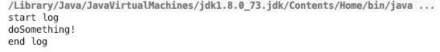

- 图 9-12　调用 ASM 修改后的方法

2. 拦截请求：Zipkin业界有许多分布式服务跟踪的架构，例如 Twitter 的 Zipkin、大众点评的 CAT，这些最佳实践的理论基础主要来自于 Google 的一篇论文“Dapper, a Large-Scale Distributed SystemsTracing Infrastructure”。拦截请求就是在调用链的各个节点上，通过拦截调用请求的方式记录调用过程，以及调用结果。

- 如图 9-13 所示，记录了分布式服务跟踪系统中由一次用户请求引发的服务调用过程，涉及一个用户请求和若干个服务调用。从上往下看，用户对服务 A 发起调用请求，而服务 A 对服务 B 有依赖，因此服务 A 需要对服务 B 发起一次 RPC 请求，服务 B 返回对应的结果，这次服务调用被记作 RPC1。同时服务 A 还对服务 C 有依赖，因此对其发起了请求RPC2。在调用服务 C 的时候发现 C 依赖于服务 D 和服务 E，因此服务 C 分别发起 RPC3和 RPC4 两次请求。这里需要注意在请求服务 A 的时候，服务 A 会同时发起 RPC1 和RPC2 两个请求，分别请求服务 B 和服务 C，服务 B 会马上响应 RPC1 请求，因为它不依赖其他服务，而服务 C 不会马上返回结果，因为它依赖服务 D 和服务 E。服务 C 只能等服务 D 和服务 E 分别返回 RPC3 和 RPC4 的请求结果以后才能响应服务 A 的 RPC2 请求。

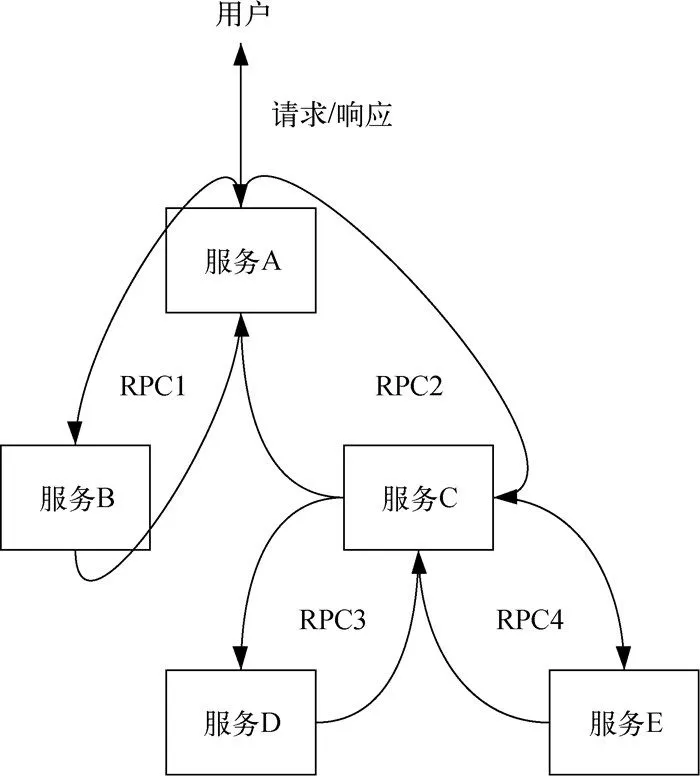

- 图 9-13　服务之间的调用链

- 拦截请求说白了就是记录服务节点每次发送的信息和接收的信息中的标识符和时间戳。由于一个请求可能涉及多个服务之间的调用，而这种调用往往呈链式结构，经过层层调用以后才会返回请求结果，因此常使用拦截请求的方式追踪整个调用过程，以便厘清服务间的调用关系。我们把分布式调用链路称作 Trace，可以这么理解，每次请求都会生成一个 Trace，针

```
对这个 Trace 会有一个 TraceID 作为唯一标识。一次请求可能会调用很多不同的服务或者
```

- 方法，我们把每次调用分别称作一次 Span，用来跟踪服务或者方法的调用轨迹，同样用

```
SpanID 来唯一标识一个 Span。这里可以把 Span 看作最小的调用单元，每个 Span 调用
```

- 都有对应的请求源头和依赖目标，即 Span 的调用方和被调用方，它们之间通过

```
ParentID 连接起来。为了能把这部分表述清楚，我们对图 9-13 做进一步的拆解，如图 9-
```

- 14 所示，依旧是用户向服务 A 发起请求，服务 A 根据依赖情况分别调用服务 B、C、D、

```
E。由于服务跟踪系统的介入，在调用过程中会记录 TraceId、SpanId 和 ParentId 的
```

- 信息，下面就根据调用的步骤来看看它们是如何工作的吧。

- ① 先看服务 A 的表格。用户对服务 A 发起请求，因此生成一个 Trace，服务 A 中便会定义

```
TraceId: 1，作为这一次请求的标识，后面只要是与这次请求相关的链路调用都会沿用
```

- 这个标识。由于这里产生了一次方法的调用，因此对应产生一个 Span，同理服务 A 中会定

```
义 SpanId: 1。再看服务 A 表格的下方，由于服务 A 依赖服务 B 和服务 C，因此需要对
```

- 这两个服务分别发起 RPC 请求，针对这两次服务调用会生成两个 Span。表格中左下角记

```
录了 TraceId: 1、ParentId: 1 和 SpanId: 2，其中 TraceId 没有发生变化，说
明还是同一次用户请求引起的调用；ParentId: 1 说明这个 Span 对应的调用方是服务 A
表格中上方的第一次 Span 调用，图中通过一条虚线连接 SpanId: 1 表示调用关系；
SpanId: 2 表示的是服务 A 调用服务 B，产生的一次服务调用。同理，表格中右下角记录
了 TraceId: 1、ParentId: 1（同样通过虚线连接 SpanId: 1）和 SpanId: 3。其
中和左下角内容唯一不同之处在于 SpanId: 3，说明这是一次新调用，调用目标是服务
```

- C。综上，服务 A 通过定义三个 Span，清楚说明了用户向服务 A 发出调用请求

```
（TraceId: 1、SpanId: 1），以及服务 A 调用服务 B 和 C（SpanId: 2 和 SpanId:
3），还通过 ParentId: 1 将两个 Span 调用进行了关联。
② 服务 A 调用服务 B 和服务 C，服务 B（SpanId: 2）立即就返回了响应。而服务 C
（SpanId: 3）由于依赖服务 D 和 E，因此先向这两个服务发起调用，于是服务 C 中又
有了三个表格。其中上方的表格表示服务 A 向服务 C 发起的调用，TraceId: 1 表示这次
调用依然在同一次用户请求中、ParentId: 3 表示这次调用的发起方是服务 A 中的
SpanId: 3 这个调用、SpandId: 4 表示服务 C 对服务 D 和服务 E 发起的调用。
③ 服务 C 中左下角的 SpanId: 5 用来调用服务 D，TraceId 还是和之前保持一致，
ParentId: 4 通过虚线和 SpanId: 4 关联起来。由于服务 D 不依赖其他服务，因此服
务 C 直接就得到了响应，继续通过 SpandId: 6 调用服务 E。
④ 右下角的 SpanId: 6 用来调用服务 E。服务 E 是调用链中最终的一个服务，不会再调
用其他服务，因此只有一个 Span 的定义。其中 TraceId 依旧不变，ParentId: 6 用来
和服务 C 中的 SpanId: 6 进行关联，最后一个是服务 E 自身的调用 SpanId: 7。服务
```

- E 调用完成以后，会响应服务 C，服务 C 获得响应以后响应服务 A，服务 A 接着响应用户请求，这样就完成了整个调用链的监控。

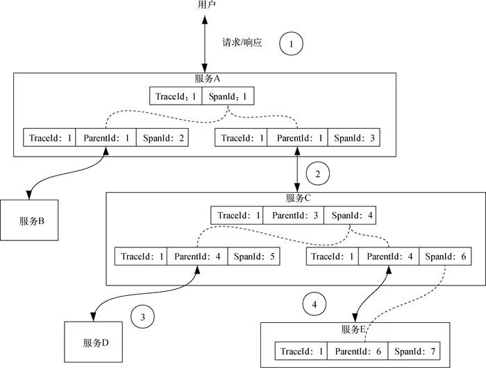

- 图 9-14　服务调用追踪图

- 注意，为了简化图例，没有画服务 B 和服务 D 的 Span，可以参考服务 E 中的 Span 记录。

- 上面介绍了分布式服务之间的调用过程，以及如何通过拦截请求的方式获取调用链上每个服务点的信息，下面通过最佳实践——Zipkin，来看看如何收集监控信息。

- Zipkin 是一款开源的分布式实时数据追踪系统，它就是根据 Google Dapper 的论文设计而来，主要用于收集来自各个应用服务的实时监控数据。其架构相对简单，这里还是通过上面服务 A、B、C、D、E 的例子给大家展开说明。如图 9-15 所示，图中左边是我们要监控的分布式应用系统，包含 5 个服务。

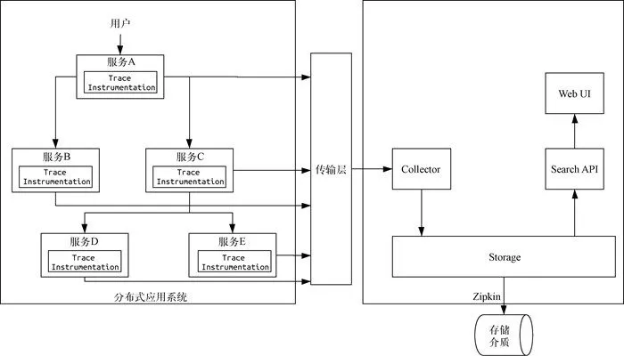

- 图 9-15　Zipkin 架构图

```
Zipkin 会在每个服务中都安装一个 Trace Instrumentation 作为跟踪器，跟踪器会根
据服务的调用情况生成追踪信息，例如上面提到的 TraceId、ParentId 和 SpanId，并
```

- 且将这些信息通过中间的传输层发送至右边的 Zipkin 系统。

```
右边的 Zipkin 系统包含好几个组件，首先是 Collector，这是 Zipkin 服务端的信息收集
器，以守护进程的形式存在。当 Trace Instrumentation 收集的信息传递到
Collector 以后，Collector 会对数据进行验证，同时将需要存储的信息通过
Storage 组件保存到存储介质中，并且为存储的信息创建索引以便查询。Storage 作为
```

- 存储组件，可以将数据存储到内存或者磁盘数据库中，支持 Cassandra、Elasticsearch 和

```
MySQL 等存储方式。Storage 组件的上方是 Search API，这是为外部提供的一个查询
```

- 监控信息的接口，可以通过 JSON API 的方式对其进行调用，它会返回对应的监控数据信

```
息。Web UI 作为 Zipkin 的前端展示平台，位于 Search API 的上方，通过调用 Search
API 以图表形式展示链路信息。
```

- 上面大致描述了 Zipkin 架构的组成部分，以及如何通过 Zipkin 的几个组件对监控信息进行收集、存储、展示。想必大家一定好奇 Zipkin 具体是如何收集监控信息的，如图 9-16 所示，这里以服务 A 调用服务 B 为例，通过 4 个简单的步骤说明如何在调用过程中记录监控信息。

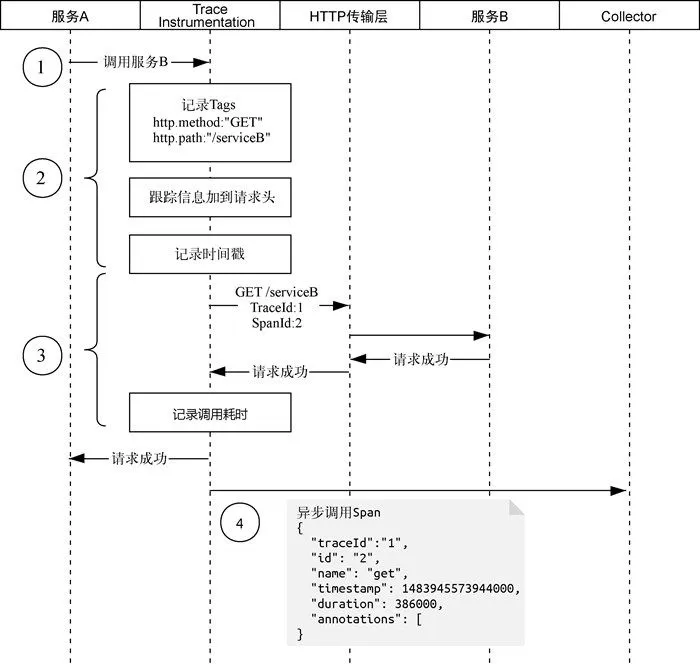

- 图 9-16　服务跟踪时序图

- 正如图 9-15 中提到的，为了跟踪服务间的调用关系，Zipkin 会在每个服务中安装跟踪器

```
Trace Instrumentation，通过这个跟踪器记录服务调用相关的信息。当服务 A 向服务
B 发起调用的时候，就会触发 Trace Instrumentation，收集相关数据。
① 服务 A 调用服务 B 之前，先通过 Trace Instrumentation 记录相关的调用信息，这
```

- 里假设使用 HTTP 传输层对服务 B 发起 GET 请求。

```
② Trace Instrumentation 会通过记录 Tags 的方式将 HTTP 的请求方式 GET 和请求
```

- 服务 B 的路径一起记录下来，并且将跟踪信息放入 HTTP 的请求头中，这里的跟踪信息包

```
括 TraceId 和 SpanId，根据图 9-14 中的描述，此时是 TraceId: 1 和 SpandId:
2。此外还会加入时间戳信息。
③ 保存完上面的调用信息以后，服务 A 就开始调用服务 B 了，假设调用成功，则 Trace
Instrumentation 中会记录调用耗时信息。
④ 请求成功的信息返回给服务 A 以后，Trace Instrumentation 会用上面记录的所有
```

- 关于调用服务 B 的 Span 信息生成 Jason 格式的文件，并传给 Zipkin 系统的收集器

```
Collector，从而完成这次服务调用的收集工作。之后面流程就和图 9-15 描述的一样
```

- 了，进行存储、查询、展示等操作。

### 9.4.3　度量类监控：LSM Tree 和 LevelDB

度量类监控是从事件的发生时间和指标的取值角度来监控系统信息的，通过对时间或者取值信息进行聚合汇总，来表现所监控信息的走势。度量类监控的代表是时序数据库（Time SeriesData，TSD）的监控方案，其实就是记录一串以时间为维度的数据，然后通过聚合运算查看指标数据和指标趋势，说白了就是描述某个被测主体在一段时间内的测量值变化（度量）。

按理来说，时序数据库本质上也是用于存放数据的，和其他数据库的区别在于使用场景不同。特别是在监控系统中，其数据量大、并发承担高等特点尤为突出，下面总结几点。

- 并发量高、写入频率一定：时序数据的写入依赖于监控系统要采集的数据点，一般这些数据点的数量是一定的，采集频率也一定，例如每分钟采集一次，因此把监控数据写入时序数据

- 库的频率也是一定的。但是由于采集点众多，可能多个采集点会在同一时间写入时序数据库，产生高并发，因此需要考虑如何提高写数据的效率。

- 写入场景多于读取场景：作为保存监控数据的时序数据库，应用场景多数是与写操作相关的，读取数据的场景多是展示报表或者显示趋势图，因此是典型的写多读少型数据库。

- 实时追加数据：时序数据的写入具有实时性，数据随时间的推移不断产生，因此数据量会持续增大，于是通过追加的方式将数据顺序保存在数据库中。换句话说，即便是针对同一字段的描述信息，也只能做新增操作，而不能更新。

鉴于 IT 基础设施、运维监控和互联网监控的特性，时序数据库的存储方式方式得到了广泛应用。聊完其特点后，再来看看其数据结构，这里将时序数据分别为主体、时间点和测量值。我们通过一个监控服务器平均进、出流量的例子来看一下时序数据库的数据模型，如图 9-17 所示。

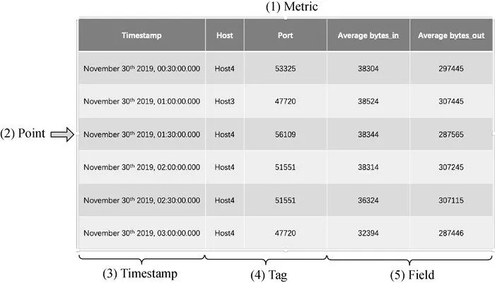

- 图 9-17　时序数据库数据模型图例

下面顺着图中的编号来看看时序数据库的组成结构和各自代表的含义。

(1) 监控的整个数据库称为 Metric，它包含所有需要监控的数据，类似于关系型数据库中的Table。

(2) 每条监控数据分别称为 Point，类似于关系型数据库中的 Row。

(3) 每个 Point 都会定义一个 Timestamp（时间戳），其作为 Point 的索引，表明数据的采集时间。

(4) Tag 作为维度列，表示监控数据的属性。这里的 Tag 是 Host（主机）和 Port（端口），可以根据实际需要监控的目标自定义 Tag。

(5) Field 表示指标列，也就是测量值，可以理解为测量的结果。

接下来讲解时序数据库的存储原理，众所周知关系型数据库存储采用的是 B Tree，虽然能够降低查询数据时的磁盘寻道时间，但是无法提高写入大量数据时的磁盘效率。而监控系统经常会大批量地写入数据，所以我们选择 LSM Tree（Log-Structured Merge-Tree）来存储时序数据库。

LSM Tree 从字面意义上理解，就是把记录的数据按照日志结构（Log Structured）追加到系统中，然后通过合并树（Merge Tree）的方式合并这些数据。这里有一个前提是假设内存足够大，监控数据每次先写入到内存中，等积累到一定程度时，再通过归并排序的方式合并，并且追加到磁盘中。由于 LSM Tree 的数据是连续写入磁盘中的，而对于磁盘来说，连续写入的效率要高于随机写入，因此 LSM Tree 的数据写入速度往往高于 B Tree，其非常适合需要大量写入数据的应用场景。不过查询的时侯因为涉及多个磁盘中数据的合并操作，所以 LSM Tree 的数据查询速度一般低于 B Tree，于是会使用 Bloom Filter。如图 9-18 所示，图中右边 C tree

- 0

保存的数据在 Memory（内存）中，而 C tree 保存的数据在 Disk（磁盘）中。当 Memory 中

- 1

C tree 的数据达到一定阈值需要合并的时候，就将其叶子结点上的数据与磁盘中 C tree 叶子0

- 1

结点上的数据合并到一起。

图 9-18 中的 C tree 常驻内存中，可以是任何方便通过键值查找的数据结构，如红黑树、

- 0

MAP 之类等。C tree 则常驻在磁盘中，具体结构类似于 B Tree。

- 1

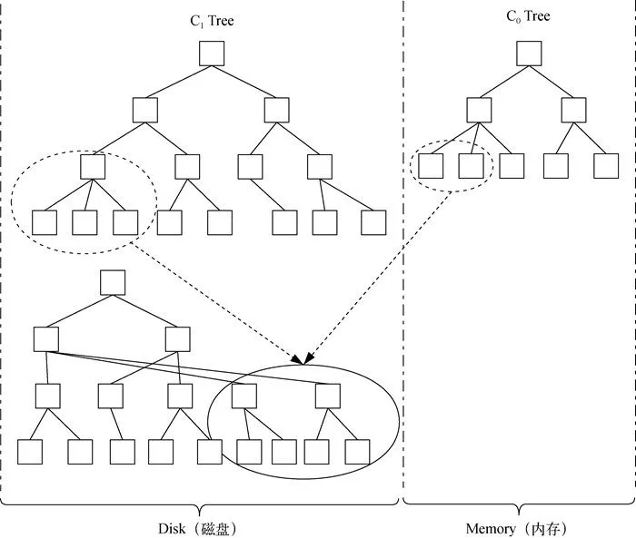

- 图 9-18　LMS 原理图

当监控系统插入一条新纪录到 LSM 时，在把这条记录插入到内存之前会先插入到日志文件中。目的是防止内存崩溃，以及数据的恢复。日志记录是以追加的方式插入的，所以速度非常快。与此同时，还要将新纪录的索引插入到 C tree 的叶子结点中，这个操作是在内存中完

- 0

成，不涉及磁盘的 IO 操作。当 C tree 的容量达到某一阈值时或者又过了指定的一段时间

- 0

时，LSM 会将 C tree 中的记录合并到磁盘的 C tree 中。随着 C tree 的容量慢慢变大，可

- 011

以将其合并到 C 、C 甚至是 C 中。

- 23K

很多数据库采用了 LSM Tree 的存储思想，包括 LevelDB、HBase、Google BigTable、Cassandra、InfluxDB 等。下面以 LevelDB 为例来介绍如何实现 LSM Tree 的设计思想。

LevelDB 是专注于写数据的存储引擎，是典型的 LSM Tree 实现，我们首先了解它的组成结构。LevelDB 包括六个主要构成部分：内存中的 MemTable 和 Immutable MemTable 以及磁盘上的 Current 文件、Manifest 文件、Log 文件和 SSTable 文件。如图 9-19 所示，顺着LevelDB 处理写数据请求的步骤把这六个组成部分仔细过一遍。

```
① 由于在 LevelDB 中存储的数据都是以键值对形式存在，因此当写入一条 Key:Value 记录
```

时，LevelDB 会先将保存到 Log 文件中，保存成功后再将记录插进 MemTable 中，这样才算完成了写入操作。从这个过程可以看出一次写入操作包括一次磁盘写入和一次内存写入，其中写入 Log 文件属于磁盘写入，由于是通过追加的方式写入到磁盘中，因此速度较快。LevelDB设计 Log 文件的目的是方便系统崩溃后快速恢复，假如记录只是保存到了内存中，内存中的数据还未保存到磁盘，而此时系统崩溃了，如果没有 Log 文件，便会造成数据的丢失。所以在 LevelDB 把数据写入到内存之前，需要先将记录保存到 Log 文件中。

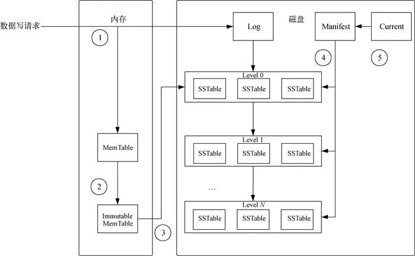

- 图 9-19　LevelDB 处理写数据请求

② Log 文件保存成功以后，就将数据插入到 MemTable 中，当内存中的数据量达到一个界限或者过一定时间后，LevleDB 会生成新的 Log 文件和 MemTable，原先的 MemTable 则转化为 Immutable Memtable。Immutable MemTable 中保存的内容是不可更改的，只能读取不能写入或者删除。如果有新的数据写入，只能被保存到 Log 文件和 MemTable 中。

③ LevelDB 的后台调度器会将 Immutable MemTable 中的数据导出到磁盘，形成一个新的SSTable 文件（Sorted String Table），也就是一个有序字符串表，这个有序的字符串就是数据的键。SSTable 文件是不断地将内存数据合并到磁盘后形成的，而且所有 SSTable 文件形成了一种层级结构，从上到下依次为 Level 0、Level 1 到 Level N。越往下层级越高，存放的文件容量也越大。

④ SSTable 文件保存了级别信息，并且本身是一个有序的字符串表，因此需要用一个文件去描述这些信息。这便是 Manifest，它保存着 SSTable 所在的层级（Level）、对应的 SSTable 文

```
件名（以 sst 为后缀），以及文件中的起始 Key 值和结束 Key 值。这些说白了就是 SSTable
```

文件的 metadata 信息。

⑤ 最后轮到了 Current 文件，它用来记录 Manifest 文件名。前面提到每个层级由于文件容量的阈值问题会定期进行合并，合并后的文件会保存到下一层中（Level 加 1）。这些合并操作会使 SSTable 文件发生变化，Manifest 文件中记录的内容也会随之发生变化，此时会产生新生成 Manifest 文件来记录这种变化，Current 文件则用来记录 Manifest 文件的。

上面通过 LevelDB 的处理数据写请求的过程，描述了其包含的几个组件。接下来看看LevelDB 是如何读取数据的，如图 9-20 所示，LevelDB 读取数据分为三个部分，我们顺着序号进行讲解。

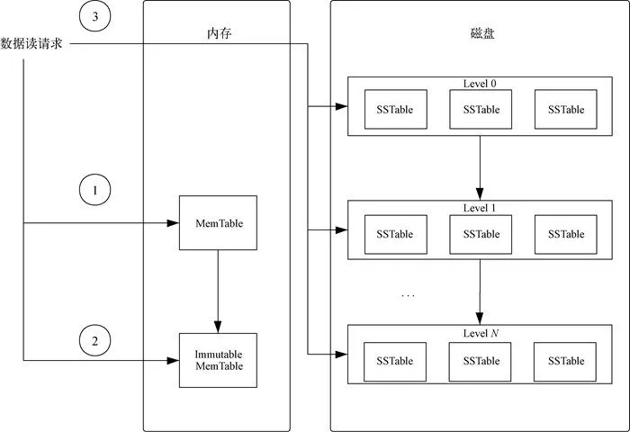

- 图 9-20　LevelDB 处理读数据请求

① MemTable 作为数据写入的入口，里面存放着最“新鲜”的数据，又由于 LevelDB 中数据是以键值对形式存放的，因此最开始要在 MemTable 中查找与键对应的值信息。如果能够找到，就可以直接返回给用户。

② Immutable MemTable 中的信息是由 MemTable 合并形成的，如果第 ① 步在 MemTable 中无法找到对应的值，就去 Immutable MemTable 中查找。换个角度来讲，MemTable 和Immutable MemTable 都在内存中，数据内容相对较新，离用户也是最近的，所以根据就近原则也应该先从这两个文件开始查找。

③ 假设在 Immutable MemTable 文件中依旧无法命中信息，就需要到磁盘中查找了，也就是从 Level 0、Level 1 到 Level N 层级中的 SSTable 文件中查找。由于层数太多，SSTable 文件的数量较大，因此查找过程会相对曲折。还是根据就近原则，首先从最上层的 Level 0 开始，如果其中的 SSTable 中保存着对应的键，就返回其值，否则继续往下（Level 1）查找。

如此循环往复，直到在某层的 SSTable 文件中找到键对应的值。如果遍历完所有的层级，都无法找到数据，那么直接返回无数据的信息。

上述读数据的过程，遵循的原则有逐级向下；优先读取内存中的数据，再读取磁盘上的数据；先读取合并之前的数据，再读取合并之后的数据。隐含意思都是读取新鲜的数据，假设把数据保存到了 LevelDB 中，由于数据量在不断增加，这条数据会不断往下层合并。一段时间之

```
后，插入数据 ，这条数据和上一条数据具有同样的键，值的内容由 "world" 变为了
"space"。理论上后一条数据是通过插入的方式添加到 LevelDB 中的，而且 "space" 那条
数据应该位于 "world" 那条的上层。换句话说，LevelDB 中现在存在两条数据，它们的键都
是 "hello"，值是不相同的。在读取数据的时候，会先遍历上层数据集合，因此较新的数据
"space" 会首先被查找到，并且返回。在实时监控的场景中，我们也希望返回更及时的信
```

息。

需要注意 Level 0 层的 SSTable 文件可能存在键重合情况，此时应该先搜索文件编号大的SSTable。文件编号越大，其中存放的数据越新。非 Level 0 层的 SSTable（Level 1~N）文件，不会出现键重合现象，可以通过 Manifest 文件获取 SSTable 的 metadata 信息，该文件

```
中保存着最小和最大的 Key，这种定位方式有助于快速找到对应的键。
```
