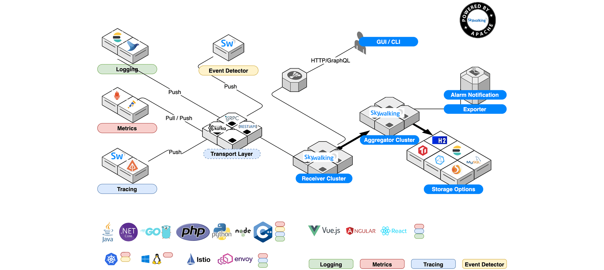

# 13 | 关联后端：如何通过Skywalking把接口关联到后端服务？

你好，我是三桥。

前面几节课，我们一直围绕着前端技术栈之间的链路关系学习，例如交互行为、脚本运行错误等等。除了这些，在前端全链路的概念里还有一条链路也是非常重要的，它就是前后端请求调用链路。

什么是前后端请求调用链呢？

前后端的请求调用链，是指请求从前端页面发起，经过后端服务的处理，再返回到前端页面的整个过程。整个过程中，无论是前端还是后端的调用路径，我们都应该清楚地知道各个模块之间的传递情况，以及它们最终传达到用户的视图上的过程。

例如，在经过的后端服务里，其内部通常都是一个非常复杂的调用链，涉及的服务范围很广，包含分布式系统，RPC 调用、数据库和缓存的读写等等。

这样，当我们在遇到问题时，就能有效地跟踪这个调用链过程，快速定位和解决问题。

## 为什么要做前后端调用链路？

我的前端团队曾经解决过一个上传图片兼容性的问题。

我们当时制作了一个 H5 页面，允许用户在安卓系统的产品 App 内访问，并提供了海报制作的功能。其中一位用户反馈，每次选择手机相册图片后，H5 页面都没有更新显示，无法继续往后操作，生成海报。

最初，我们怀疑是图片上传失败导致的无法读取图片地址。接着，我们通过前后端全链路日志的排查，发现后端接收到图片的大小为 0 字节，初步判断问题不在后端服务。

另一边，前端全链路日志获取的图片大小也是 0 字节。由于我们的“选择图片方案”采用的是App 原生能力，是在选择完图片之后把图片数据返回给前端，再上传到后端。所以，我们认为原生 APP 存在兼容性的问题。

最终，前端同学、App 同学以及后端同学一起通过日志以及特定设备重现了问题，发现原因是App 某个版本的实现逻辑存在兼容性问题，无法成功读取图片数据。

正是由于有了前后端的全链路日志，我们才能快速判断并非后端问题，而是其它方面的原因。再通过三方联调，结合链路日志就能快速地定位问题了。

作为前端全链路的关键链路环节，前后端调用链路主要有 3 个作用。

第一，它能帮助我们打通前端和后端的链路日志，在复杂的服务体系中，帮助我们快速地定位问题发生在哪个服务环节，提高问题排查的效率。

第二，链路能让我们更容易发现性能的问题，通过每个链路环节找出性能瓶颈，帮助我们做针对性的优化。

第三，后端接口都有具有用户和画像的特性，例如电商平台的购物车。每个接口数据的一致性都影响着前端处理数据的逻辑，包括同步、渲染等等。通过前后端调用链路，我们可以快速发现链路数据问题，甚至还能够发现数据的安全性问题。

接下来，我们通过两个方案来学习怎么实现前端侧的前后端调用链路。

## 方案一：使用 SkyWalking 官方 JS 库

我们先用 Apache 的 SkyWalking 解决方案实现前端和后端之间的有效调用链路。

### 什么是 SkyWalking？

Apache SkyWalking 是一款专门为云原生和基于容器架构设计的应用性能监控工具。它提供了实时应用拓扑分析、应用性能指标监控、调用链路追踪、慢服务检测、性能优化建议等功能。你可以通过官方提供的架构图了解 SkyWalking 的整个原理。



- 图片来源于网络

其中，调用链路追踪的能力是帮助程序员深入了解服务之间的依赖关系，并通过链路关系判断出可能出现问题的环节或性能瓶颈。如果后端服务接入了 SkyWalking，再结合前端项目实现的前端全链路，我们就能生成一条唯一的请求调用链路。

我们知道，现在微服务架构特别流行，但也带来了一些问题，例如系统的复杂性高，运维难度大等等。SkyWalking 就是为了解决这些问题而诞生的实时监控系统解决方案。可是，这些解决方案都是围绕着后端技术而设计的。

直到 8.2 版本，SkyWalking 支持了浏览器端的监控，官方也提供了一套前端埋点上报插件：skywalking-client-js 库。它提供了 3 大核心功能：性能追踪，错误追踪，网络请求追踪。

### 前端应用与 SkyWalking 的关系

```
skywalking-client-js 库的性能追踪采用了 window.performance 的原生方案，而我们的前
```

端全链路方案使用的是 WebVitals 方案。另外，由于 skywalking-client-js 库提供的错误追踪信息可扩展性比较小，我们很难按照前端全链路的解决方案去设计前端页面的链路关系。

至于网络请求追踪功能，它是通过重写 Fetch 和 Ajax 实现的。从源码来看，其内部核心功能

```
是通过公式生成 traceId ，然后以 sw8 请求头传递给后端。关于这个逻辑的具体实现方
```

式，我会在这节课的后面继续探讨。

虽然官方 JS 库也提供了错误追踪的能力，但在数据结构的设计方面却无法满足前端全链路的解决方案。

### 具体实现

理清了前端应用和 SkyWalking 的关系，再说 skywalking-client-js 库的用法。我们只需要用到网络请求追踪功能，就能满足前端和后端的链路关系。

```
使用 SkyWalking 的第一步，就是引入 skywalking-client-js 库，然后使用 register 方法注
```

册监控对象。你可以参考如下代码。

```python
import ClientMonitor from 'skywalking-client-js';
ClientMonitor.register({
 collector: 'http://127.0.0.1:12800',
 service: 'geekbang-h5',
 pagePath: '/column/intro/100759401',
 serviceVersion: 'v1.0.0',
});
如果你的前端项目是基于 Vue 技术栈的 SPA 项目，那么执行 register 函数时，还要增加
```

一些参数才能支持单页面的特性。例如下面的参考代码。

```
ClientMonitor.register({
 collector: 'http://127.0.0.1:12800',
 service: 'geekbang-h5',
 pagePath: '/column/intro/100759401',
 serviceVersion: 'v1.0.0',
 enableSPA: true
 // 此处的值为Vue对象
 vue: Vue
});
```

那我们如何将 ClientMonitor 对象集成在前端全链路的 SDK 里面呢？

```
很简单，我们只要把 register 方法的执行放在 init 函数里，通过运行 init 函数，就能注
```

册监控对象 ClientMonitor。参考的代码如下。

```java
import ClientMonitor from 'skywalking-client-js';
export class BaseTrace implements BaseTraceInterface {
 public static init(options: TraceOptions): BaseTrace {
   // 其它业务逻辑
   ClientMonitor.register({
     collector: 'http://127.0.0.1:12800',
     service: 'geekbang-h5',
     pagePath: '/column/intro/100759401',
     serviceVersion: 'v1.0.0',
     jsErrors: false,
     resourceErrors: false,
   });
   // 其它业务逻辑
 }
}
```

```
在这里，我们看到了两个新参数 jsErrors 和 resourceErrors，它们代表的是是否收集
```

JS 错误和资源错误。由于我们已经在 SDK 里实现了这两种错误的捕获，因此在监控中就不用再监听它们了。

至于 ClientMonitor 对象的其它功能，例如主动上报性能数据、主动报告错误等方法就不在这里继续探讨。

现在，我们换个思维来看下上面的例子。在上面的例子中，我们通过官方 JS 库集成到 SDK里，但实际上只用到了网络请求追踪的功能，其余的功能我们都已经实现了，而且看上去没有什么问题。那是不是可以不用考虑使用官方 JS 库呢？

### 分析 SkyWalking 的链路原理

在回答是不是可以不用官方 JS 库之前，我们先来分析下它是如何实现网络请求追踪功能的。

我们先以 Fetch 作为例子，来看下它的整个外层的源码。

```bash
export default function windowFetch(
 options: CustomOptionsType,
 segments: SegmentFields[]
) {
 const originFetch: any = window.fetch;
 setFetchOptions(options);
 window.fetch = async (...args: any) => {
   // 具体实现逻辑
 };
}
```

从代码可以看出来，它也是直接重写覆盖 Fetch 函数。还有，在请求之前，它给请求头增加了

```javascript
一个 sw8 请求头属性。这个 sw8 是 SkyWalking 官方推荐使用的，能够打通前端和后端的链
路 ID，实际上就是 traceId。
我们看下 sw8 属性值是怎么生成的，参考如下源码。
window.fetch = async (...args: any) => {
 const startTime = new Date().getTime();
 const traceId = uuid();
 const traceSegmentId = uuid();
 let segment = {
   traceId: '',
   service: customConfig.service,
   spans: [],
   serviceInstance: customConfig.serviceVersion,
   traceSegmentId: '',
 } as SegmentFields;
 // 中间省略部分源码
 if (hasTrace) {
   const traceIdStr = String(encode(traceId));
   const segmentId = String(encode(traceSegmentId));
   const service = String(encode(segment.service));
   const instance = String(encode(segment.serviceInstance));
   const endpoint = String(encode(customConfig.pagePath));
   const peer = String(encode(url.host));
   const index = segment.spans.length;
   const values = `${1}-${traceIdStr}-${segmentId}-${index}-${service}-${instanc
   if (!args[1]) {
     args[1] = {};
   }
   if (!args[1].headers) {
     args[1].headers = {};
   }
   args[1].headers['sw8'] = values;
 }
 const response = await originFetch(...args);
 // 省略后面的逻辑
}
从源码可以看出，sw8 属性值是由 8 个字段值组成的，每个字段都代表着不同的含义。我们
```

来一个个的看下实现逻辑。

```
traceIdStr 和 segmentId 两个字段，实际上就是生成一串 UUID 字符串，然后再转码成
```

短码。也就是说，每当发起一次请求时，这两个字段值都会重新生成一个新字符串。

```
service 和 instance，实际上是用来记录应用名字和应用版本号的，同样的也是经过一次
转码，最后提供给 sw8。
endpoint 就是具体的页面路径，peer 就是页面地址的 Host 值。再来看下 index，它就
是 segment 对象的 span 数组的长度。
```

最后，把这些字段值通过 “-” 连接符，结合第一个值 1，就形成了一串可以识别每一次请求的

```
唯一 traceId。这就是生成 traceId 的公式。
接着，就是通过执行 originFetch 函数得到新的 response 对象。
```

怎么样？有没发现，其实在重写 Fetch 的逻辑当中，大部分的代码都是围绕生成 traceId 字符串的。其余的代码都是围绕着 SkyWalking 日志结构规范进行数据封装。

```
那么，只要我们按照官方 traceId 的生成公式，我们是不是也可以自己实现一模一样的 sw8
```

字符串呢？

## 方案二：自定义封装 Fetch 的 sw8

现在，我们就来根据 traceId 的生成公式，尝试生成字符串，再整合到之前课程中已经实现过

```
的 Fetch 封装函数里。
```

首先，我们先来定义 4 个变量。其中使用 appId 和 appVersion 替代 service 和 instance。由于我们设计的 SDK 中没有包含版本号，因此这里默认为 v1.0.0，参考代码如下。

```javascript
const traceId = uuid();
const traceSegmentId = uuid();
const appId = uuid();
const appVersion = 'v1.0.0'
```

接着，参考 SkyWalking 官方逻辑，优化当前页面 URL 地址，参考代码如下。

```
if (Object.prototype.toString.call(args[0]) === '[object Request]') {
 url = new URL(url.url);
} else {
 if (args[0].startsWith('http://') || args[0].startsWith('https://')) {
   url = new URL(args[0]);
 } else if (args[0].startsWith('//')) {
   url = new URL(`${window.location.protocol}${args[0]}`);
 } else {
   url = new URL(window.location.href);
   url.pathname = args[0];
 }
}
```

然而，我们还缺一个页面路径属性，那我们就在封装的函数中增加一个外部传入参数

```bash
pagePath ，例如下面代码。
export type InterceptFetchType = {
 pagePath: string
 onError: (error: OnFetchError) => void;
 onBefore?: (props: OnBeforeProps) => void;
 onAfter?: (result: any) => void;
}
const interceptFetch = ({
 pagePath,
 onError,
 onBefore,
 onAfter
}: InterceptFetchType) => {
 // 省略代码
}
好了，依赖的变量一切准备就绪后，我们就可以生成 traceId 了，参考如下代码。
const interceptFetch = ({
 pagePath,
 onError,
 onBefore,
 onAfter
}: InterceptFetchType) => {
 // 省略代码
 return async (...args: any) => {
   let [url, options] = args;
   // 省略代码
   const traceIdStr = String(encode(traceId));
   const segmentId = String(encode(traceSegmentId));
   const service = String(encode(appId));
   const instance = String(encode(appVersion));
   const endpoint = String(encode(pagePath));
   const peer = String(encode(url.host));
   const index = 1;
   const values = `${1}-${traceIdStr}-${segmentId}-${index}-${service}-${instanc
   if (!options) {
     options = {};
   }
   if (!options.headers) {
     options.headers = {};
   }
   options.headers['sw8'] = values;
   // 省略代码
 }
}
```

通过参考官方的逻辑实现后，我们终于实现了具有 sw8 请求头功能的自定义 Fetch 函数。

```
有了 traceId，前端页面的每一次请求就能关联上后端接收到的请求记录，从而打通具备前
```

后端关系的完整服务调用链路。

有了服务调用链路，我们就能准确地判断出每个节点的流转情况，只要接口出现异常，就可以通过节点状态快速地确定问题出现在哪个节点。

## 前后端链路的局限性

通过约定的 sw8 请求头，我们能把前端和后端接口请求关联起来，再配合 SkyWalking 的架构能力，就能够高效地发现和解决问题，确保服务的稳定、可用和健康。然而，在实施前后端链路时，还是会存在较多的限制。

首先，国内很多的后端服务还没有集成链路追踪的功能，更不用说 SkyWalking 的技术了。没有了后端链路的能力，即使前端和后端接口打通链路功能，整个服务链路还是不完整的。

另外，在很多大厂的后端服务里，全链路的系统通常都是自研开发，又或者是基于SkyWalking 这类型开源项目定制。sw8 请求头这种方案并不一定适合自研场景，但是，无论是哪一种设计，其链路原理基本上是一样的，无非就是在请求头或者请求参数提供 traceId。

还有一个问题需要注意的是，使用 sw8 请求头的方案，需要依赖后端接口的限制性。我曾遇到过 PHP 系统，它对请求头属性有很严格的要求，只要是不在白名单内，他就拒绝前端访问。所以，前端封装 sw8 请求头发起接口请求前，还要确定接口是否支持 sw8。

## 总结

这节课我们重点学习了打通前端和后端的链路功能的方法，其主要作用是前端每发起一次请求，都能在后端找到唯一的后端链路日志。

要打通前后端的链路能力，就要了解如何使用 SkyWalking，并且根据 SkyWalking 约定的规

```
范，使用 sw8 请求头作为链路的 traceId。同时，我们还实践了使用 SkyWalking 官方 JS 库
```

和自定义实现链路两种方法。

不过呢，使用 SkyWalking 的技术方案还存在着不少的局限性。其中，后端服务是否已经支持链路追踪的能力是整个全链路的关键，如果没有这条链路追踪，我们的日志就不完整，如果前端和后端一起排查问题，就没法拿出足够的日志判断问题的节点。

```
当然，使用 sw8 请求头只是实现方案之一，是 SkyWalking 推荐的约定。我认为，前端和后
```

端同学可以根据业务的实际情况，一起协商一套满足前后端全链路的调用链设计方案，也是一种不错的选择，因为我们最终目的就是服务业务，保证业务的稳定性、可用性和服务健康。

## 思考题

在这节课的最后，相信你会有很多的想法或者不同的思路。现在给你一道思考题，你觉得使用sw8 请求头的方案存在有哪些利弊？如果不使用 sw8 方案，你认为还有哪些更好的方案呢？为什么？

欢迎你在留言区和我交流。如果觉得有所收获，也可以把课程分享给更多的朋友一起学习。我们下节课见！
