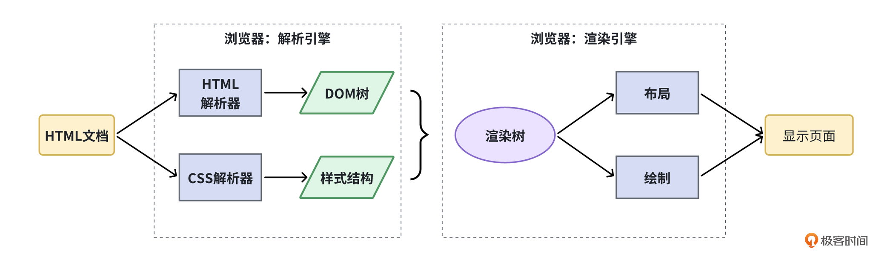
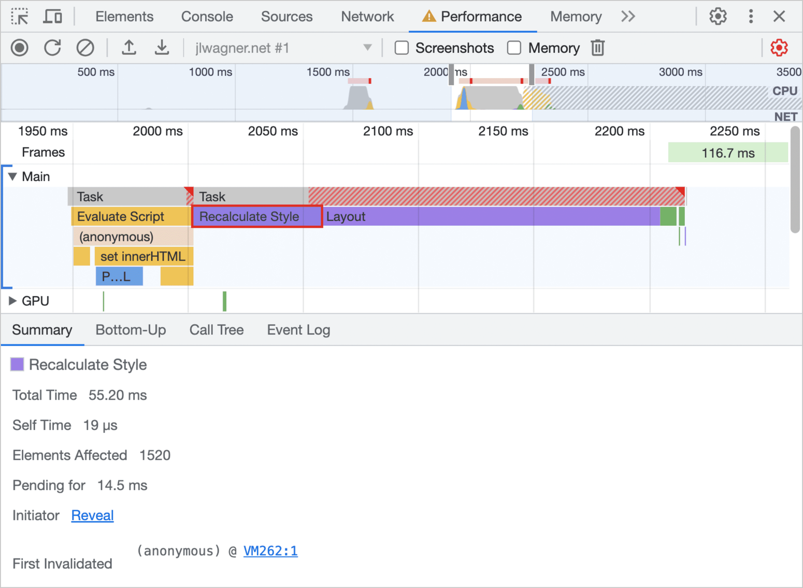
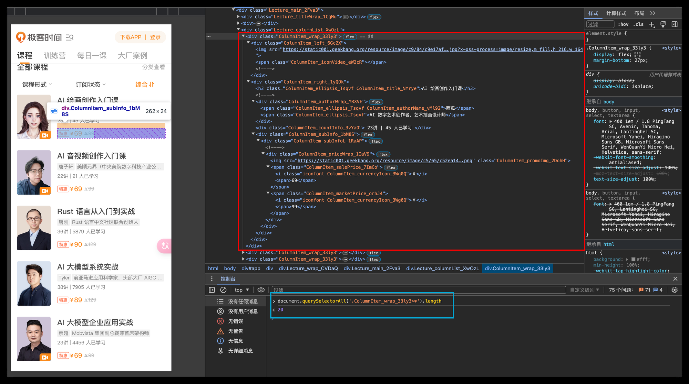
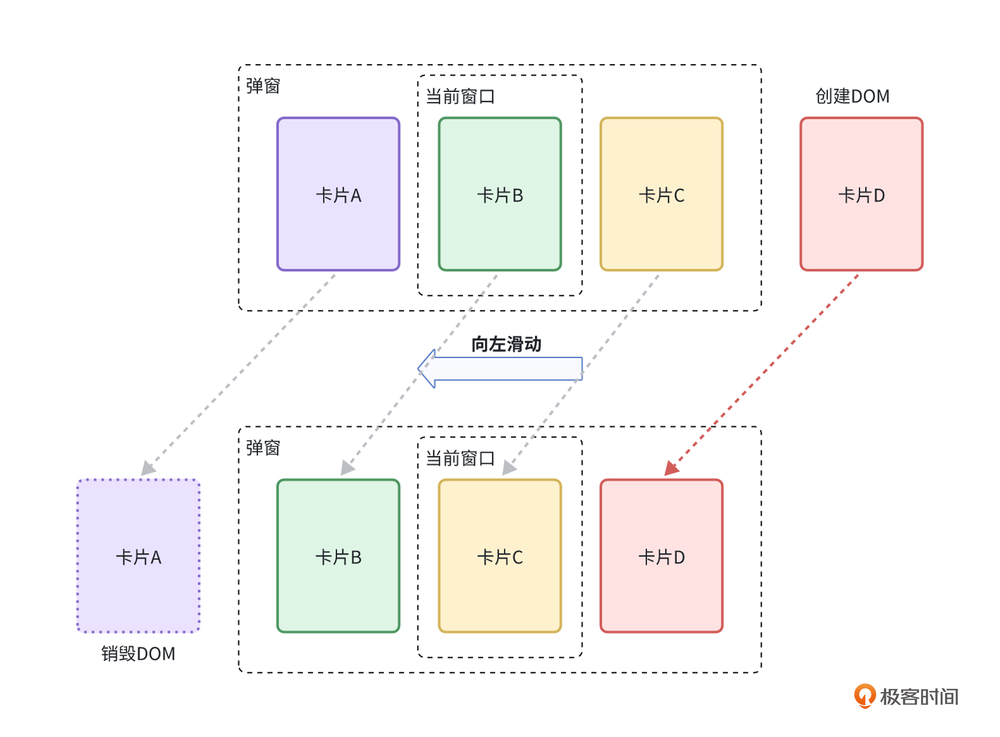

# 20 | 渲染：如何优化布局和渲染，提升网页响应速度？

你好，我是三桥。

上节课，我们探讨了如何通过拆分长任务来优化 INP 指标，解决页面卡顿的问题。实际上，不仅是长任务会影响 INP 指标，页面布局、渲染和解析 HTML 会影响 INP 指标。

## 浏览器工作流程

我们先回顾一下浏览器是如何布局和渲染 HTML 的。下面是一张浏览器工作原理的流程图。



从上图可以看出，浏览器的工作流程主要分为两部分：解析文档和渲染页面。

### 解析文档

首先，浏览器会从服务器获取 HTML 文档并解析其代码，包括识别 HTML 标签、属性和文本内容，然后生成一个 DOM 树。

其次，浏览器会根据 CSS 样式表确定每个元素的样式规则，如字体、颜色、大小和布局等。然后，将这些样式规则与 DOM 树结合，最终生成一个渲染树。

也就是说，整个过程里，浏览器会将原始 DOM 树解析成渲染树。虽然它们都是树，但实际上有所不同。DOM 树包含可见和不可见两大类元素，而渲染树只包含需要显示的元素和样式信

```
息，不包含不可见的元素。例如，如果元素的 CSS 样式为display:none，那么该元素不会
```

被包含在渲染树中。

浏览器在转换过程中是需要一定的计算时间，这个时间根据 DOM 树和样式表的复杂度而变化。需要特别注意的是，以下因素会影响转换耗时。

- DOM 树越深，遍历耗时越长。

- 需要计算每个元素的高度、宽度、边框、边距等。

- 元素的可视属性，如特殊字体、颜色渐变、动画等。

### 渲染页面

在渲染树构建完成后，浏览器渲染引擎会结合用户环境，通过布局和渲染，创建用户可见的页面内容。

首先，浏览器渲染引擎根据渲染树的元素和层级以及样式信息，确定每个元素在屏幕上的位置和大小。然后，根据这些布局信息，将页面内容绘制到屏幕上，展示给用户。

在渲染过程中，计算布局信息和绘制内容都需要时间，而这个时间长度取决于用户设备的性能。例如：

- CPU 渲染和 GPU 渲染的时间不同。

- 在低配置移动设备上渲染页面的时间通常比高配置设备长。

- 渲染树越复杂，渲染时间越长。

尤其是基于 Vue 或 React 的 SPA 单页应用，大部分 JavaScript 逻辑处理都在浏览器环境中完成，因此这种应用程序对 JavaScript 的性能和效率要求很高。

每当浏览器发现新 DOM 树后，就会触发重新布局或渲染。这些布局和渲染触发都在浏览器主线程上执行，是主线程任务的一部分。频繁的布局和渲染会使主线程忙碌，可能会导致页面卡顿或无响应。

总的来说，解析、布局和渲染以及 JavaScript 脚本的执行都在一个主线程上共享，如果这些操的耗时过长，就会降低 INP 指标。

## 布局优化

知道了浏览器的工作原理，我们应该如何提升网页响应速度呢？

先从布局优化入手，主要有三个优化方向：样式计算、重绘和重排和布局抖动。

### 样式计算

在前端技术领域，基于 Vue 或 React 技术栈的 UI 框架很多。由于这些 UI 框架默认带有样式风格，这些框架实现的前端项目很少会再自定义 CSS 样式布局或进行二次修改。

不过，具有独特风格的产品，其 UI 界面都需要我们自定义样式界面。有时这些界面的设计样式非常复杂，例如定制化的排行榜、动效多的抽奖活动页等。在某些特殊情况下，我们还需要

```
谨慎使用 CSS 的计算样式属性，比如 calc()。
```

现在，让我们来看一下通过 Google 开发者工具发现的一个样式问题。



从上图中我们可以看到，前端页面执行了一个长任务，其中有一个名为“Recalculate Style”的紫色块。“Recalculate Style”意味着浏览器需要重新计算元素的样式信息，从而重新布局和重绘。

通过这个紫色块的详细信息（Summary），我们可以看到有两个明显影响性能的地方。

第一个是 Total Time，它显示了这个紫色块总共耗时了 55.2 毫秒，即使只是重新计算样式信息就需要 50 多毫秒。

第二个是 Elements Affected，它显示了有 1520 个元素被影响，这意味着重新计算样式后，有1520 个元素等待被重新布局。

也就是说，前端应用肯定进行了一些改变 CSS 样式属性的操作，而且这个影响面很广，达到1520 个元素。好了，现在我们要做的就是在前端代码中找出相应的代码并进行优化。

这里的优化建议是尽量避免 CSS 样式表的样式规则计算。具体三个方向。

```
减少 calc() 函数的使用频率。
```

- 避免频繁更新页面元素的宽度、高度、间距等改变元素大小的操作。

```
除非必要，尽量不使用定位元素的伪类选择器。例如 nth-last-child、nth-
child()、not() 等。
```

### 重绘和重排

不过，有时我们无法避免上面说的三种场景，当样式计算影响性能时，我们应该怎么办呢？

首先，我们有必要了解两个常见的概念：重排和重绘。

重排指的是当页面布局发生变化时，浏览器重新计算元素的几何属性，然后更新布局的过程。重绘是指在布局计算完成后，浏览器根据元素的样式信息重新绘制页面内容的过程。

它们的工作原理和布局和绘制几乎相同，只是重排在布局变化时触发，重绘在布局计算完成后触发。

我们知道，元素的位置和大小的变化，会触发重排，其重新布局的操作资源是比较昂贵的，是影响页面性能的重要因素之一。

既然知道重排会影响性能，现在让我们看一个例子。

```javascript
// 缓存样式属性
var bodyStyle = document.body.style;
// 设置padding，触发重排和重绘
bodyStyle.padding = "18px";
// 设置border，触发重排和重绘
bodyStyle.border = "4px solid red";
// 修改颜色，只触发重绘
bodyStyle.color = "red";
// 修改背景色，只出发重绘
bodyStyle.backgroundColor = "#fad";
// 在body元素下插入一个新元素，触发重排和重绘
document.body.appendChild(document.createTextNode('dude!'));
```

我相信在不少前端历史项目中，这类代码经常出现。代码通过持续改变 body 元素的 style 属性来满足业务场景。然而，这样的代码逻辑随时可能会引起频繁地重排和重绘，这并不是最佳的方法。

最好的做法应该有两种，一种是设置样式类名，另一种是修改 cssText 属性值。例如下面的代码。

```
// body.css
.new_class {
 padding: 18px;
 border: "4px solid red";
 color: red;
 background-color: #fad;
}
// 通过类名方法，减少多次更改样式属性
document.body.className += "new_class"
```

如果某些样式是动态生成的，我们可以采用第二种方法。例如下面的代码。

```javascript
const paddingVal = '18px';
const borderVal = '4px solid red';
const colorVal = 'red';
const backgroundColorVal = '#fad'
document.body.cssText += '; padding: ' + paddingVal
 '; border: ' + borderVal
 '; color: ' + colorVal
 '; backgroundColor: ' + backgroundColorVal
```

### 布局抖动

需要特别注意的一种情况是循环体内执行的更新样式属性，如下面的代码所示。

```javascript
const len = document.getElementsByName('.list').length;
const el = document.getElementById('relayout');
for (const i = 0; i < len; i++ ) {
 el.style.left = el.offsetLeft + 10 + 'px';
 el.style.top = el.offsetTop + 10 + 'px';
}
这段代码在循环体中不断更新 el 元素的 left 和 top 的偏移位置，同时又读取最新
offsetLeft 和 offsetTop 偏移值，导致浏览器必须进行重新布局，我们称之为布局抖
```

动。

```
更好的做法是，提前读取 offsetLeft 和 offsetTop 偏移值并缓存到 left 和 top 变
```

量，不再在循环体中读取实时元素的偏移值。例如参考以下代码。

```javascript
const len = document.getElementsByName('.list').length;
const el = document.getElementById('relayout');
let left = el.offsetLeft;
let top = el.offsetTop;
const elStyle = el.style;
for (const i = 0; i < len; i++ ) {
 left += 10;
 top += 10;
 elStyle.left = left + 'px';
 elStyle.top = top + 'px';
}
```

总的来说，我第二个建议的优化方案是降低重排和重绘的频率。包括几个方面。

- 减少在 JavaScript 代码中更改元素的位置、大小、间距、边距。

- 避免在循环体内触发浏览器重排。

- 尽可能采用样式名称，而不是直接使用 JavaScript 修改样式。

- 对于延迟加载的块，可以考虑使用骨架屏作为块的占位符，以避免重新布局。

然而，现在大多数新的前端项目都使用 Vue 或 React 技术栈来实现 Web 应用程序。它们依赖于虚拟 DOM 技术，可以防止上述样式规则的频繁更新引起的重绘和重排。

这里再说一个大家都容易忽略的优化方向：DOM 元素数量对浏览器的布局和渲染速度的影响。

## 绘制优化

接下来，我们将进一步探讨如何优化页面渲染。

### 如何优化 DOM 大小

在我们学习如何优化 DOM 大小之前，首先需要理清两个概念：DOM 大小和 DOM 深度。

通常，我们可以将第一种树（DOM 树）视为 DOM 大小，表示网页的结构。这是因为浏览器需要知道 DOM 树的变化，以便更新渲染树，并最终重新渲染页面。

我们知道树形结构有一个属性叫做深度，这表示树的复杂程度。所以，DOM 深度就是从根节点到最深层节点的最长路径的长度，同时也显示了节点在 DOM 树中的层次关系。

因此，我们可以得出一个结论：DOM 大小越大，DOM 深度越深，意味着页面越复杂，响应速度就越慢。

怎么判断页面 DOM 大小是否过大呢？

在谷歌的 Lighthouse 报告中，如果页面 DOM 超过 800 个节点，它会提供警告信息。当节点数量超过 1400 时，就认为 DOM 过大了。

```
对于前端同学来说，我们可以使用querySelectorAll方法查询所有 DOM 元素，参考代码
```

如下。

```
document.querySelectorAll('*').length;
```

虽然我们可以用脚本查询 DOM 元素数量，但全链路数据结构并没有要求记录这个值。这是因为 DOM 的大小只是一个参考值，DOM 多并不意味着有性能问题。

如果有此需求，我们可以在每次上报数据时，使用 querySelectorAll 来查询当前的 DOM 数量，并把它作为一个性能检测的指标加入到链路数据中。

通常，常规的 Web 应用很少会有大量的 DOM，除非在一些大型 Web 应用程序中，它们才会由很多页面构成。

另外，DOM 深度的问题实际上与 Web 应用程序的复杂性有关系，DOM 大小也会影响着其深度。因此，优化 DOM 的大小也是在优化 DOM 的深度。

对于 DOM 大小的优化，我有两个建议。

### 建议一：减少无用层级元素

首先，我们要明确什么是无用层级元素。

通常，这些元素在页面结构中无实际作用或者不必要的元素。这些元素可能会增加页面的复杂性，降低页面性能，或者使代码难以理解和维护。例如以下情况。

```
空容器元素，没有实际内容，如 <div></div>。
```

- 冗余的元素。这些元素在页面中没有实际作用，只是为实现样式而存在。

- 过度嵌套元素。在某些情况下，前端同学可能无意中使用嵌套元素来满足排版需要，导致页面结构复杂化。过度嵌套会增加 DOM 树深度，可能还会影响性能。

```
无意义标记元素。例如，用 div 而不是 button 作为按钮根元素。
```

- 无效的注释。

明确了这些标准，优化的方向就很清晰了。现在，我们用 React 的 jsx 语法为例，来看看这段代码。

```xml
// app.js
class App extends React.Component {
 constructor(props) {
   super(props);
 }
 render() {
   return (
     <div className="center">
       <header className="header">
       </header>
       <div className="content">
         <section><!-- section content --></setcion>
         <section><!-- section content --></setcion>
         <section><!-- section content --></setcion>
       </div>
       <footer className="footer">
         <div>
           <ul>
             <li><!-- footer list --></li>
             <li><!-- footer list --></li>
           </ul>
         </div>
       </footer>
     </div>
   )
 }
};
ReactDOM.render(
 <App />,
 document.getElementById('app')
);
```

从上述代码中，我发现有两个不必要的元素。

```
首先，第 12 行的 div 元素是不必要的。通常，前端同学都会自然而然地使用 div 来包裹三
个 section，认为它们都属于正文内容。实际上，它只是为了排版和布局而已。
其次，第 18 行的 div 元素也是多余的。div 和 ul 都是块元素，我们可以直接用ul来替
```

代。

虽然这只是一个代码示例，真实的项目代码可能会更复杂，但优化的思路是一致的，那就是找

```
出并去掉那些在网页中没有作用的元素，特别是 div 元素。
```

还有一种容易忽略的情况，让我们先来看看这段代码。

```bash
export default function Header() {
 return (
   <div>
     <ul>
       <li>
         <a href="https://time.geekbang.org/">极客时间</a>
       </li>
       <li>
         <a href="https://time.geekbang.org/">极客时间</a>
       </li>
     </ul>
     <div>
       <a href="https://time.geekbang.org/">用户协议</a>
       <a href="https://time.geekbang.org/">隐私政策</a>
     </div>
   </div>
 );
}
```

从代码分析来看，逻辑上并没有任何问题。但是，如果从优化 DOM 层级的角度考虑，最顶层

```
的 div 元素是可以省略的。
```

由于 React 的 jsx 语法要求组件必须只能有一个根元素，前端同学在实现组件的时候也会很自

```bash
然地就直接使用 div 元素。Vue 同理。
那如果不用 div 元素作为根元素，最佳的方案应该是下面这样。
export default function Header() {
 return (
   <>
     <ul>
       <li>
         <a href="https://time.geekbang.org/">极客时间</a>
       </li>
       <li>
         <a href="https://time.geekbang.org/">极客时间</a>
       </li>
     </ul>
     <div>
       <a href="https://time.geekbang.org/">用户协议</a>
       <a href="https://time.geekbang.org/">隐私政策</a>
     </div>
   </>
 );
}
```

因此，第三个优化建议是，减少无用的 DOM 元素。

1. 删除不必要的空容器和冗余的元素。

2. 避免元素过度嵌套，尽量使页面结构简洁。

```
如果 React 或 Vue 项目，尽可能使用 <></> 作为组件的根元素。
```

4. 使用语义化的 HTML 元素，避免使用无意义标签。

这样做可以减少无用的 DOM 元素，简化页面结构，提高页面性能，并使代码更易于理解和维护。

### 建议二：只渲染可视区内容。

有些前端同学可能认为优化 DOM 数量的效果并不明显，对于一些复杂 Web 应用程序来说，可能更是如此。那还有什么优化建议吗？

通常，大量 DOM 元素的出现主要有几种情况。

- 页面有一个无限加载的列表，每个列表项都有复杂的层级结构。

- 在单页面应用（SPA）中，存在多个可切换的列表，每个列表都有不同数量的层级结构。

- 基于 swiper 实现的长列表，或弹窗式的 swiper 列表。

你可能已经注意到，长列表是导致大量 DOM 的主要原因，因为长列表通常是产品的核心功能。

我们以极客时间官网为例，看看一个列表卡片具体有多少个 DOM。



从图中的红色框可以看出，一个列表卡片包含很多元素和数据。再根据蓝色框的脚本统计，这个卡片有 20 个 DOM 元素。

虽然，DOM 结构设计看起来并没有什么问题。不过，有一种特殊的需求，它是这样的。

首先，需求中的列表总共有 100 条，产品希望能够一次性显示出来。

其次，点击列表卡片可以弹窗显示卡片详情。关闭弹窗后，可以立即看到原来的列表和当前位置。

最后，弹窗需要支持左右滑动翻页功能，例如显示上一条和下一条数据。

假设每个卡片有大约 10 个 DOM 元素，那么 100 条数据就是 1000 个 DOM 元素。这还不包括弹窗的翻页功能。如果加上弹窗还要显示 100 条数据，又是 1000 个 DOM 元素。

还有，弹窗还要支持 swiper 左右切换功能，这又涉及 CSS 切换动画。

结果，一个简单的列表功能就有了 2000 个 DOM 元素。页面性能肯定很差，特别是弹窗后的左右切换效果，会明显卡顿。

遇到这种需求场景如何解决？我认为解决这个需求场景并不难。优化的核心思想是用最少DOM 数量来确保浏览器可视区域的信息显示，并且不降低用户体验。

有两种方案可以解决这个问题。

第一个方案就是虚拟化列表。

虚拟化列表是指在列表中仅渲染用户可见的卡片内容。

实际上，用户浏览器可视区域内不可能展示所有的 100 条数据。我们可以采取一定的策略，只渲染可视区域内的数据，例如 5 条，其余的 95 条会根据用户滚动时间，只加载可视区域内的列表项。

这种方案可以保证列表的 DOM 数量长期稳定，而且还能改善渲染和滚动性能。

```
如果你的项目是 React，可以考虑使用 react-window  库来实现列表虚拟化。如果是 Vue
项目，也有很多列表虚拟化组件库可以使用，比如 vue-virtual-scroll-list。
```

第二个方案是预加载。

关于前面提到的弹窗后的卡片切换功能，如果只是显示一个卡片，其实并不会有什么性能问题。

但问题就在于，需求里需要左右翻页切换不同卡片，这时候如果一下子就把 100 条数据全部渲染到 swiper 列表上，那 DOM 树自然就会变得超级大。而且还有左右切换卡片的动画，自然容易出现卡顿现象。

要解决这个问题，我们就需要用到预加载的策略了。

swiper 列表的预加载其实就是在用户滑动列表的时候，提前加载一部分内容，这样当用户滚动到新内容时就能无缝地看到数据。

具体到我们这个例子，每次打开卡片窗口时，除了加载当前卡片数据，还要预先加载上一条和下一条卡片的数据。然后再监听左右滑动的事件，当触发该事件时，更新当前卡片数据，同时立即更新上一条和下一条数据。这样就能够保证以最少的 DOM 数量实现流畅的左右滑动体验。

你可以通过下面的滑动操作流程图来更好地理解具体的实现逻辑。



在前端技术社区中，已经有一套成熟的 swiper 列表框架，这些框架基本都有预加载功能。前端同学在使用时，记得开启这个功能。

同理，React 和 Vue 社区也有许多类似的框架，使用时注意列表数量。具体哪些 swiper 框值得使用，这里就不再详述了。

这就是我们这节课最后的优化建议，通过虚拟化列表或预加载的策略来优化长列表。

## 总结

总结一下，这节课我们继续学习了 INP 指标的优化。在浏览器主线程中，除了执行 JavaScript任务，还包括浏览器的布局和渲染，它们每次的重排和重绘都会对性能产生负面影响。

在这节课中，我提出了个布局和渲染的优化方案：降低样式计算的使用率、减少重排重绘的频率、减少 DOM 数量和优化长列表。

事实上，大型前端项目通常非常复杂，很难使用标准化的优化方案解决性能问题。特别是布局和渲染这两种场景中，需要通过开发者工具分析，找出问题根源并提出解决方案。

不过，无论前端用的是哪种框架，只要有性能问题或交互卡顿，一定是前端业务逻辑导致，绝不会是底层问题。

一句话总结，性能优化就是换一种实现方案解决业务问题。

下节课，我们继续学习前端全链路优化的另一个指标，TTFB。

## 思考题

现在，给你布置一道思考题。

以你当前维护的前端项目作为实践对象，尝试查找并解决前端页面是否存在布局和渲染问题，同时尝试努力优化你的项目。

欢迎你在留言区和我交流。如果觉得有所收获，也可以把课程分享给更多的朋友一起学习。我们下节课见！
