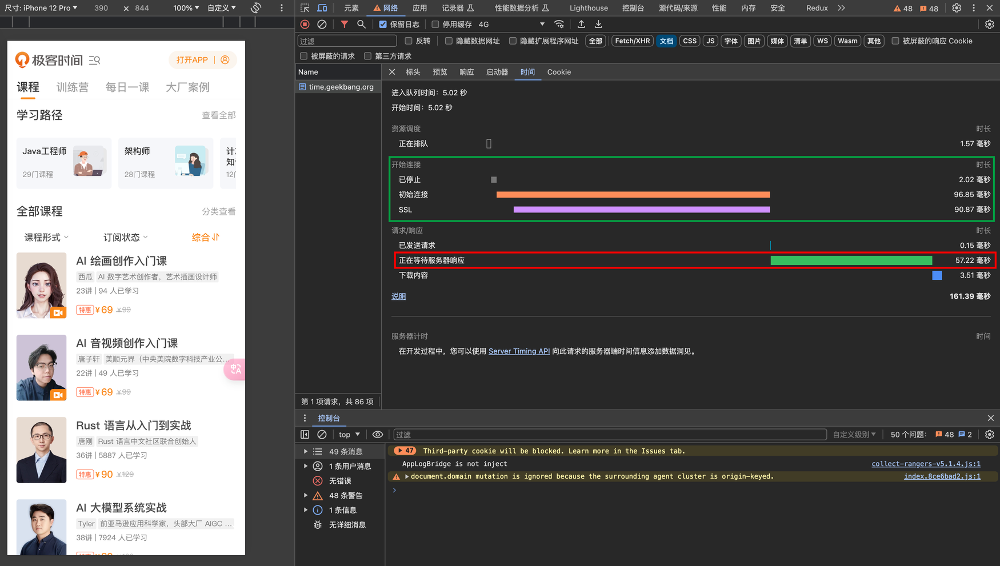
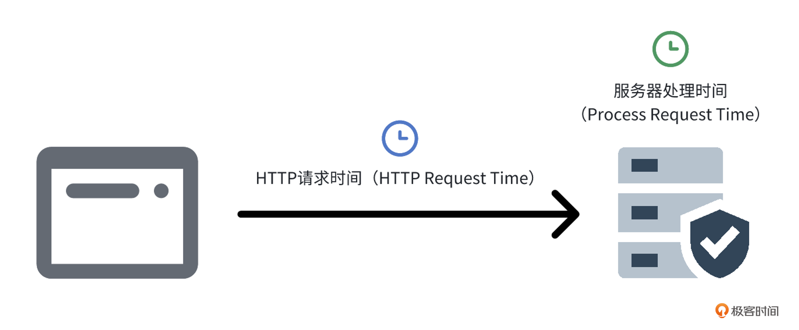
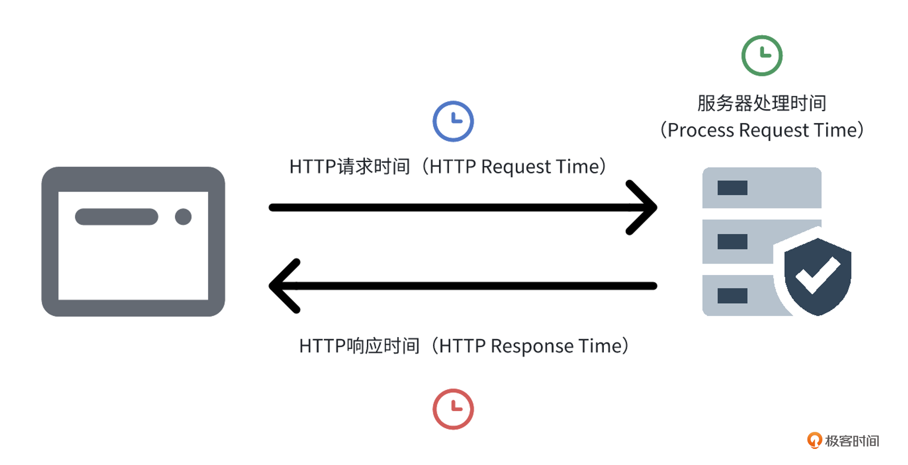
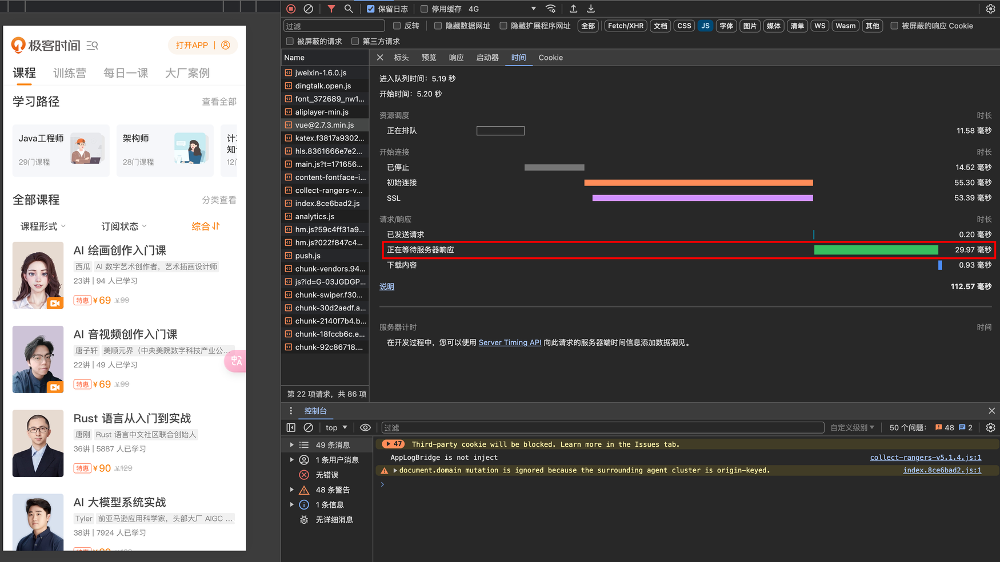
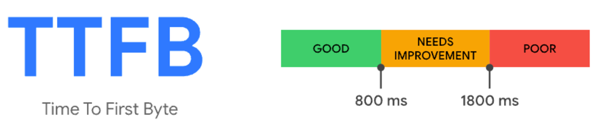

# 21 | 首字节：有效衡量网页首字节时间指标

你好，我是三桥。

这节课，我们使用首字节时间作为参考指标，优化跟网络相关的全链路。

我们在第 7 节课中已经简单介绍了首字节时间指标，即从资源请求到响应的第一个字节开始，一直到请求到达所经过的时间。

虽然首字节时间在 WebVitals 中并非核心网页指标，但从用户角度来看，它是一个重要的指标，且与用户网络环境有着密切的关系。

## 关于 TTFB 时间的误解

我们首先来看一个例子，以极客时间官网为例，它在 Chrome 开发者工具的 Lighthouse 报告中是怎样表现的呢？



在上图红框中显示，极客官网首页的 TTFB 时间约为 60 毫秒，浏览器获取第一个字节的时间很短。

你有没发现，工具上显示的文案是”正在等待服务器响应“，问题来了，TTFB 是指服务器响应时间吗？实际上，这是关于 TTFB 的一个常见误解。

### TTFB 时间

我们来直接看看 TTFB 是如何衡量从开始到结束的这个过程的。

假设，用户访问前端应用时，他的浏览器会向服务器发送 HTTP 请求。在这个阶段，浏览器需要向服务器发送一次页面请求。就像下面的图示。


在第二个阶段，服务器收到通信请求后，会开始生成页面或数据。这个过程可能涉及数据库调用、缓存读取、页面文档生成等多种情况。所以需要一些时间来生成响应页面。

这里的服务器并不一定是物理机。例如，CDN 节点就是一台缓存服务器，而前端 SSR 应用就是托管的服务器。

请参考下图。



服务器处理完成后，它会将页面内容返回给浏览器，这就是 HTTP 响应的过程。由于两端位于不同的区域，因此在响应传输阶段也需要一定的时间才能返回到用户那里。请参考下图。



由此我们可以得出一个结论，三个时间段的总和几乎就是一个完整的 TTFB 时间，具体公式如下：

## TTFB ≈HTTPRequestTime + ProcessRequestTime + HTTPResponseT

### TTFB 重要吗？

有些前端同学可能认为这只是一个普通的公式，TTFB 似乎没有多大的参考价值。但如果我们从解决问题的角度来看待这个公式，这三个时间对我们前端同学有什么帮助呢？

首先，HTTP 请求时间取决于两个节点之间的距离和网络速度。也就是说，如果服务器部署在北京，北京用户的访问速度肯定比在加拿大的用户访问速度要快。因此，如果 TTFB 时间过长，我们可以判断用户到服务器之间的网络是否存在长时间的请求。

其次，服务器处理时间主要跟后端服务有关。后端服务通常都会记录每次的请求信息、时间、参数、长度等。如果接了 SkyWalking，就更能详细地了解每个请求的信息，包括处理时间。通过这个时间，我们可以清晰地判断服务的性能状况。

最后，响应时间与请求时间类似。主要受距离和网络速度的影响。如果服务器离用户很近，响应时间也会很短，反之会有一定的传输时间。

总的来说，一个 TTFB 时间依赖于用户的网络状况、网络传送速度和服务器的处理时间。如果TTFB 时间较长，我们就可以从这三个方面来识别问题的根源，并提出有效的解决方案。

这就是 TTFB 的最大价值所在。

## 任何资源的 TTFB 指标

TTFB 是一个需要发起请求后才会出现的网页指标。因此，TTFB 适用于所有请求，包括HTML 主文档请求和资源文件请求。

### HTML 主文档请求

所谓 HTML 主文档，是指浏览器在加载网页时使用的 HTML 文件。这些文件包含了构建网页的基本元素，比如文字、图片、链接等。

我们可以将现在的前端页面主要分为三种类型：纯静态页面、单页应用（SPA）、服务端渲染（SSR）的前端应用。

- 纯静态页面主要由固定的 HTML 代码构成，不包含任何动态内容。这是早期常见的 HTML文档类型。通常适用于长期不需要变更的页面，比如博客页面。这类文档通常采用 CDN 方式来提升 TTFB 指标。

- 单页应用（SPA）主要由 JavaScript 和 CSS 构建，不需要刷新就可以访问多个页面。这种应用只需加载一次 HTML 主文档即可体验完整功能。因此，TTFB 指标基本上只会出现一次。

- 服务端渲染（SSR）的前端应用能够在服务器端直接生成完整的 HTML 页面，提升页面的加载速度。不过它提供的是具备动态能力的页面，因此 TTFB 时间可能会比前两者稍长。

这三种页面的实现方案存在较大差异，我们可以通过分析他们的 TTFB 时间来评估其性能。下图展示了这三种页面在 TTFB 指标上的比较。


### 资源文件请求

资源文件主要包括需要请求的 CSS、JS、图片、音频、视频等文件。这些文件的 TTFB 时间主要取决于文件的大小和服务器的响应速度。如果文件过大，可能会影响 TTFB 时间。此外，服务器的处理能力也是影响 TTFB 的一个重要因素。

还是以极客官网为例，加载 Vue 框架的时间约为 30 毫秒。这个时间可以告诉我们，这个 JS文件是从 CDN 节点上读取的缓存文件。下面这张图就是红框标出来的地方。



资源文件主要由两部分组成，一部分是用于布局和排版的静态资源，另一部分是带有用户属性的动态资源。如果需要监控，我们更倾向于监控动态资源，因为这些资源很难被浏览器多次命中缓存，例如用户的作品集图片、音频和视频。

可能有些同学会发现，前端全链路并没有设计关于资源文件的 TTFB 指标。这主要是出于两个原因。

首先，大多数浏览器都具有资源缓存机制，如果成功命中缓存，TTFB 时间就为 0，那统计TTFB 指标意义不大。

其次，资源文件数量通常很多，我们需要考虑是否真的需要对每一个资源文件进行全链路监控。

不过，每个前端项目的性质都不同，因此需要监控的需求也有差异。如果在全链路监控的需求中，你确实需要对每个资源文件进行详细的监控，也可以自己实现的。

具体监控的实现方案，你可以参考第 10 节课中实现的 handleObserverResource 函数，增加记录资源文件的 TTFB 指标值。参考代码如下。

```javascript
public handleObserverResource(entry: PerformanceResourceTiming) {
   if (entry.entryType === 'resource') {
     // 省略记录请求耗时
     // 记录ttfb时间
     let ttfbLevel = TraceDataSeverity.Info
     if (entry.responseStart > 800 && entry.responseStart < 1800) {
       ttfbLevel = TraceDataSeverity.Warning
     } else  if (entry.responseStart > 1800) {
       ttfbLevel = TraceDataSeverity.Error
     }
     entry.responseStart > 800 && this.resources.push({
       url: entry.name,
       name: `${entry.entryType}-duration-${entry.initiatorType}`,
       type: TraceDataTypes.PERF,
       level,
       message: `responseStart:${Math.round(entry.responseStart)}`,
       time: getTimestamp(),
       dataId: hashCode(`${entry.entryType}-${entry.name}`),
     })
   }
 }
```

## 指标的衡量标准

虽然 TTFB 是以用户为中心的指标，但它并非是核心网页指标。在前端应用中，其衡量的参考标准不多，需要根据实际情况判断。

TTFB 指标值是以毫秒为单位。谷歌建议大多数前端应用的 TTFB 应尽量控制在 800 毫秒以内。如果是 800 毫秒到 1800 毫秒之间，那么就被认为稍慢，需要改进。超过 1800 毫秒则表明性能很差。下图清晰地展示了时间区间的关系。



虽然官方建议了该指标的标准范围，但实际界限很难一致。因为该指标受到用户距离、网络环境等因素影响。

比如，大部分纯静态页面都部署在 CDN 节点上，其 99% 以上的 TTFB 指标应该低于 800 毫秒，甚至更少。

SPA 单页面和纯静态页面类似，这些资源文件通常部署在服务器上，并通过 CDN 加速。然而，SPA 页面是由 JavaScript 和 CSS 驱动 HTML 主文档的 DOM 结构变化，所以 HTML 主文档内容是很小，TTFB 应该更低。比如极客官网的例子，由于采用 Vue 技术栈，其 TTFB 只有 30 毫秒。

还有服务端渲染（SSR）的前端应用。服务端渲染的前端应用通常是由 Node.js 驱动在服务器端生成 HTML。在 HTML 主文档到达用户之前，服务器端需要运行一些计算，比如读取接口数据、DOM 生成等。

因此，衡量 TTFB 指标不能完全按照官方标准，我们需要根据实际情况适当调整标准基线。

在此，我提供一种衡量标准，你可以参考。

首先，以天为单位，统计每天的 TTFB 平均值、最小值和最大值，并输出折线图。然后持续观察一周到一个月的数据，并分析这三份数据在哪个标准范围。

其次，要把每天的 TTFB 数据排序，然后分析第 60 百分位、75 百分位、90 百分位以及 99 百分位在哪个标准范围。

最后，要用 4 种百分位、平均值、最大值去评估 TTFB 性能情况。再结合前端项目的重要性和优先级，以决定是否需要优化 TTFB 指标。

还有一点需要注意，就是不能仅根据单个用户的指标来判断性能。刚才说过，用户网络环境是影响 TTFB 指标时间的因素之一，也就是说，TTFB 指标相当于千人千面。所以，我们不能因为单个用户的指标不佳就认为存在前端性能问题。

换个角度来看，TTFB 指标能预测用户的网络环境，所以这个指标应该作为解决用户问题时的一个参考。

## 总结

总结一下，我们这节课围绕 TTFB 指标的重要性、指标、衡量标准进行了讨论。还是强调一点，虽然 TTFB 指标并非网页核心指标，但它仍然是以用户为中心的参考指标。因此，在进行监控时，我们应该重点关注指标的整体情况，而不是单个案例。

还有，TTFB 指标还可以帮助我们深入了解速度较慢的设备或用户以及性能问题，因此它是一个有价值的指标。总的来说，优化 TTFB 是一个需要长期观察且具体情况具体分析的任务。

下节课，我们继续学习具体有哪些方法能优化首字节时间（TTFB）这个指标。

## 思考题

现在，给你布置一道思考题。

从你负责维护的前端项目开始，尝试统计 TTFB 指标的平均值、最小值、最大值，以及第 60百分位、75 百分位、90 百分位以及 99 百分位。然后，与官方的建议值进行对比，看看你的前端项目处于哪个性能水平。

欢迎你在留言区和我交流。如果觉得有所收获，也可以把课程分享给更多的朋友一起学习。我们下节课见！
