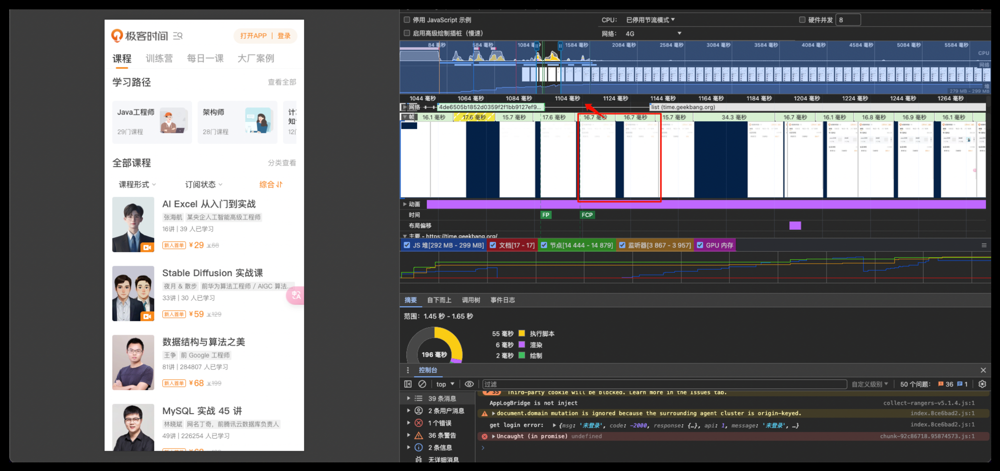
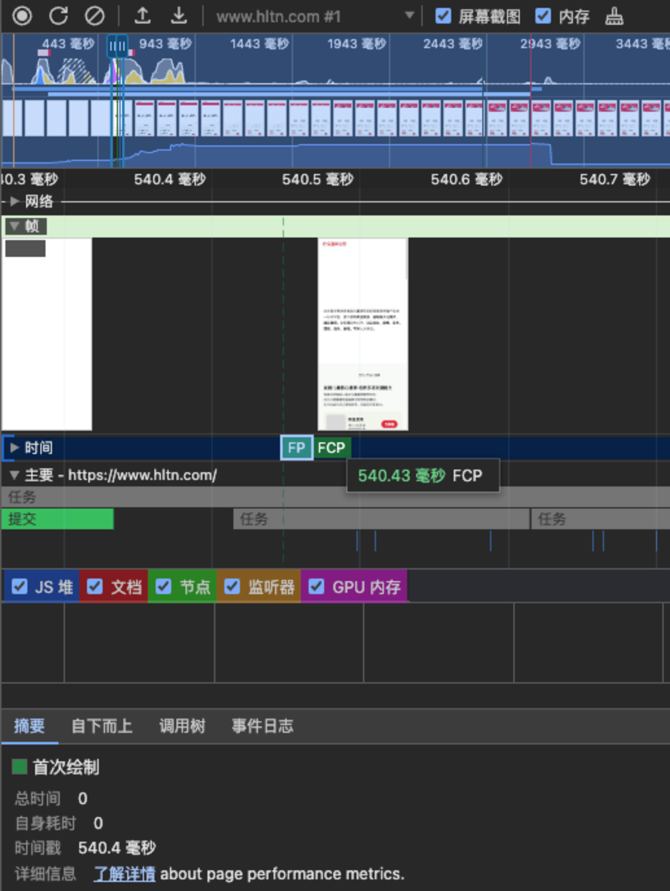
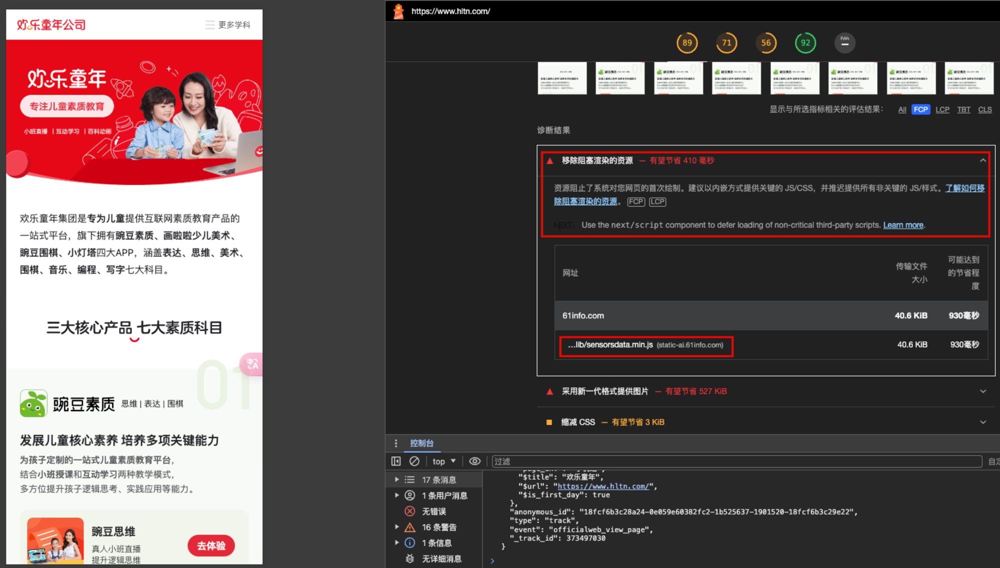
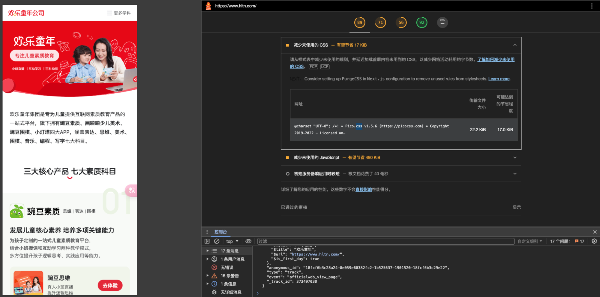
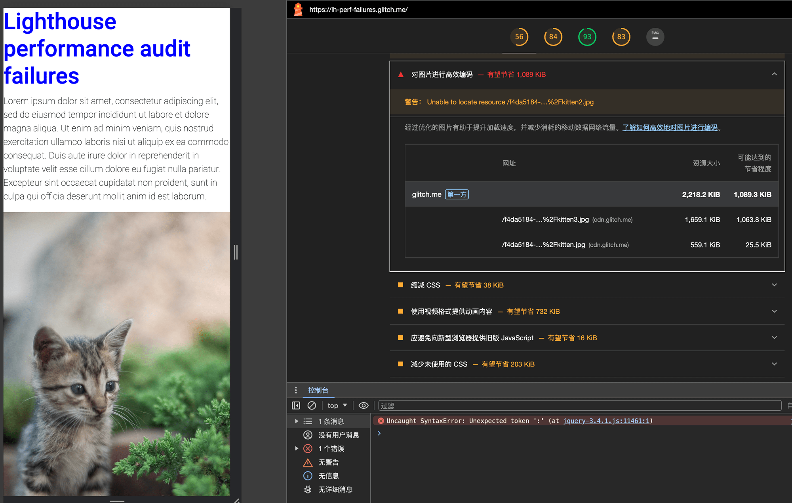

# 24 | 跳出率：如何快速显示页面内容，降低跳出率？

你好，我是三桥。

首次内容绘制（FCP）是网页核心指标，也是前端全链路中的关键节点之一。这节课，我们将重点探讨如何优化这个首次内容绘制指标。

## 首次内容绘制和首次绘制的区别

首先，我们要先理解什么是首次内容绘制（FCP）和首次绘制（FP）。

### FCP 的概念

首次内容绘制 (FCP) 衡量的是从页面加载到页面的一部分内容呈现在屏幕上的时间。通俗来说，这个指标显示了用户从输入链接到看到第一个画面的时间。

首次内容绘制的时间单位是毫秒，谷歌建议 FCP 应控制在 1800 毫秒以内。如果是 1800 毫秒到 3000 毫秒，就被认为稍慢，需要改进。超过 3 秒，说明首屏内容绘制时间过长。

根据我的经验，即使是 1800 毫秒，我都认为太长了。FCP 时间越长，用户看到的内容就越久，退出率就越高。而用户的耐心是有限的，没有人愿意等待一个需要等待很长时间加载的网站。所以我认为，最终的目标要做到秒开。

好，我们回顾一下上节课提到的以极客官网为例的示图。



这是一份开发者工具的性能报告，记录了 4G 网络访问官网首页时的性能。图中红框圈出的部分，对应的是页面顶部的图片和文字部分经过首次内容绘制之后看到的内容。

在此过程中，FCP 指标的时间包括了 TTFB 时间（白屏时间）、资源下载时间、浏览器解析DOM 时间以及浏览器渲染页面时间。

具体的计算公式如下：

## FCP ≈TTFB + ResourceDownloadTime + HandleDomTime + RenderT

关于浏览器解析 DOM、渲染页面和白屏时间，我们在前面的章节已经详细讨论过，这里不再详述。

关于资源下载时间，我们会在本节课的后半部分进行详细讲解。接下来说说首次绘制。

### FP 的概念

首次绘制（FP）是衡量用户访问页面后，浏览器渲染第一个像素所需的时间。它的发生时刻在首次内容绘制（FCP）之前，是一个关键的时间点。

首次绘制和首次内容绘制指标的定义有所不同。简单来说，FP 是绘制第一个像素的时间，而FCP 是首次绘制内容（如文本或图片）的时间。

它们的主要区别在于，FP 关注的是像素，是浏览器的行为；而 FCP 关注的是内容，是面向用户体验的。

对于那些响应速度快且简洁的网站，FP 和 FCP 的时间差异可能非常小。然而，如果是复杂的网站或在低端设备上使用，两者的时间差可能会更明显。参考下图所示。



需要注意的是，如果 HTML 文档定义了自定义背景，那么 FP 时间也会包含绘制背景的时间。否则背景的绘制时间是默认不会被计算在内的。

### 全链路指标和优化

在全链路指标定义里，我们只记录了 FCP 而没有记录 FP。因为前端全链路的核心目的是解决用户问题，而 FCP 明显更具有参考价值。至于 FP，可以作为排查问题时的参考依据。

上节课我们提到过 FCP 时间接近白屏时间，它由 TTFB 和浏览器解析绘制时间组成。这意味着优化 TTFB 时间和解析绘制的同时，也是在优化 FCP 时间。优化方法包括 10 种。

- CDN 加速

- 采用 HTTP2 协议

- 优化资源大小，如图片

- 预解析和预连接所需的源文件

- 优化接口请求

- 使用缓存读取数据

- 避免多次网页重定向

- 构建时生成静态页

- PWA 方案

- APP 热更新方案

但是，优化 TTFB 就一定等于优化 FCP 吗？我认为并非如此，上述这些只是最基础的方法理论，实际上，我们还需要用工具辅助来分析问题。

分析 FCP 指标问题，最好的工具还是 Chrome 开发者工具，它有三个板块可以帮助我们从三种不同的角度分析问题，包括 Lighthouse、性能、网络。

通过开发者工具，我总结了 7 个可以优化 FCP 指标的有效方法。

- 移除阻塞渲染的资源

- 移除未使用的 CSS 和 JavaScript 代码

- 避免网络负载庞大

- 采用高效的缓存策略来提供静态资源

- 最大限度地缩短关键请求资源深度

- 尽量减少请求数量，减少传输大小

- 确保文本在网页字体加载期间保持可见状态

下一节课我们会详细解析最后三个方法。这节课我们说说前四个优化方法。

## 移除阻塞渲染的资源

为了优化 FCP 并快速显示首屏内容，一种优化方法是优化 head 标签内的脚本文件和样式文件引入的顺序。

我们可以使用 Chrome 开发者工具来快速判断哪些脚本和样式文件会阻塞 FCP 时间，如下图所示。



图中展示的是我曾经负责的官网项目首页，报告是通过 Lighthouse 监控访问首页后得到的结果。

报告中红框部分的诊断结果显示存在资源阻塞情况。具体来说，阻塞的资源是 script 标签引入的外部第三方 JavaScript 文件。

该文件大约 40K。如果不引入或者延迟引入这个 JavaScript，大约可以节省 410 毫秒的时间。

经过分析，这个 JavaScript 文件是用于统计埋点的，但在首次绘制内容阶段，我们并不需要提供埋点功能。即使需要曝光埋点，也可以延迟加载 JavaScript 和延迟埋点上报来实现。

该项目是基于 Next.js 实现的网站，通过检查代码可以发现，它是直接在 head 内导入的第三方 JavaScript，如下面的真实的 React 代码。

```bash
import Head from 'next/head'
export default function PublicHeader() {
 return (
   <Head>
     <script
       dangerouslySetInnerHTML={{
         __html: `
               (function(para) {
                 if(typeof(window['sensorsDataAnalytic201505']) !== 'undefined')
                   return false;
                 }
                 window['sensorsDataAnalytic201505'] = para.name;
                 window[para.name] = {
                   para: para
                 };
               })({
                 name: 'sensors',
                 server_url: '${process.env.SENSOR_URL}',
                 show_log: true,
               });
           `,
       }}
     />
     <script src='https://static-ai.61info.com/pjx/ai/lib/sensorsdata.min.js' />
   </Head>
 )
}
代码分析显示，该 JavaScript 文件的下载时并未使用 defer 和 async 属性。
```

这两个属性的主要作用是控制 HTML 文档中的 JavaScript 脚本的加载和执行方式。具体来

```
说， defer 属性告诉浏览器应该在文档解析完成后再执行脚本。而 async 属性则告诉浏览
```

器在下载脚本的同时，继续解析 HTML 文档，一旦脚本下载完成，就立即执行它。

因此，通过 script 引入外部文件时，最好利用这两个属性，提高页面加载速度和用户体验。

以下代码写法是更好的 script 引入方式。

```xml
<script defer src='https://static-ai.61info.com/pjx/ai/lib/sensorsdata.min.js' />
```

好，再说第二种方法，将 script 引入更改为 NPM 安装到项目工程中，并与业务逻辑代码集成。虽然这会增加初始代码的大小，但可以减少 script 引入的额外连接消耗。

以下是通过 ES6 模块化 NPM 引入的示例代码。

```python
// 以下例子来自 https://manual.sensorsdata.cn/sa/latest/zh_cn/tech_sdk_client_web_u
import sensors from './sensorsdata.es6.min.js'
sensors.init({
 server_url: '数据接收地址',
 is_track_single_page:true,
 use_client_time:true,
 send_type:'beacon',
 heatmap: {
    clickmap:'default',
    scroll_notice_map:'not_collect'
 }
});
sensors.quick('autoTrack');
第三种方法是使用 Next.js 的 next/script  组件来引入外部链接，这样 Next.js 能够识别
```

JavaScript 文件的加载顺序。

以下是参考代码：

```bash
import Script from 'next/script'
import Head from 'next/head'
export default function PublicHeader() {
 return (
   <Head>
     <script
       dangerouslySetInnerHTML={{
         __html: `
               (function(para) {
                 if(typeof(window['sensorsDataAnalytic201505']) !== 'undefined')
                   return false;
                 }
                 window['sensorsDataAnalytic201505'] = para.name;
                 window[para.name] = {
                   para: para
                 };
               })({
                 name: 'sensors',
                 server_url: '${process.env.SENSOR_URL}',
                 show_log: true,
               });
           `,
       }}
     />
     <Script
       src="https://static-ai.61info.com/pjx/ai/lib/sensorsdata.min.js" />
   </Head>
 )
}
```

## 减少 JavaScript 和 CSS 内容

优化 FCP 另一个最常见方法是减少下载 JavaScript 和 CSS 文件的下载大小。

有些同学觉得，减少文件大小真的有用吗？HTTP2 多路复用不是已经解决多文件下载问题了吗？还要减少文件大小吗？

是的，HTTP2 确实可以解决这个问题，但无论文件数量还是大小，都需要网络请求。文件越大，请求的时间就越长。这是一个基本道理。

通过 Chrome 开发者工具，我们可以在 FCP 阶段找出哪些地方需要缩小文件大小。

以下是官网首页加载后，Lighthouse 给出的报告建议。



报告中显示在 FCP 阶段下载 CSS 文件时，有一些无用的 CSS 代码，建议进行优化。而且提示优化后可能只能减少了 5KiB。可能你会想，这么小的优化是否值得？

但需要注意的是，用户的网络环境是不稳定的，尤其是移动网络，经常出现不稳定的网络状态。对于 3G 或 4G 用户来说，减少 5KiB 的下载量可以大大缩短下载时间。

因此，这个优化目的是提升网络较慢的用户的页面加载速度和用户体验。如果你的前端项目的用户中有很多网速较慢的用户，那么这种优化就显得尤为重要。

## 避免网络负载庞大

为了加快 FCP 时间，我们除了需要减少 JavaScript 和 CSS 文件的大小，也要减少首屏内容中的资源大小。

例如，在 FCP 时间内，首次绘制内容是包括文字和图片等用户可见的元素，如果此时加载一张 1M 以上的图片，将会严重影响用户的首屏体验。请参考下面的例子。



Lighthouse 报告显示，FCP 阶段下载了两张较大的图片，大小分别 1659KiB 和 559KiB。这无疑会延长用户等待页面渲染的时间。

因此，如果 FCP 时间较长，其中一个衡量的方法就是判断首屏绘制时是否存在较大的资源问题，例如图片、视频等。

如果真的遇到此类情况，可以根据实际情况决定是否优化，优化方法有三种。

- 和设计师沟通，优化并压缩图片大小。

- 更换图片格式，建议使用 WebP 等格式，不建议使用 JPEG 或 PNG 格式。

- 对视频等媒体类文件，改为延迟加载，通过占位符等方式预留播放位置。

## 采用高效的缓存策略提供静态资源

我们知道，使用 HTTP 缓存策略可以缩短重复访问网页的加载时间，尤其适合频繁访问的网页。

这种策略的原理是，当浏览器请求资源时，服务器可以指示浏览器临时存储或缓存该资源多长时间。在此之后，对该资源的所有请求，浏览器都会使用本地副本，而不是从网络获取。

```
要设置资源缓存，需要配置服务器返回  Cache-Control HTTP 响应标头，如下面的示例代
```

码：

```
Cache-Control: max-age=31536000
其中，max-age  指令告知浏览器应该缓存资源多长时间，时间以秒为单位。示例中的
 31536000，相当于缓存 1 年时间。
```

前端图片如果永久不更改，通常缓存 1 年就足够了。对于 JavaScript 和 CSS，你也可以根据实际情况调整其缓存策略，例如 1 天、7 天等。

总的来说，FCP 指标反映了用户的第一视觉感受。下载文件大小和首屏绘制内容的资源都会影响用户体验，无论用户网络状况如何，我们应该保持对用户的体验的一致性。

## 总结

总结一下，我们在这节课探讨了 FCP 指标和优化的策略。在网络速度快的情况下，首次内容绘制（FCP）和首次绘制（FP）的值非常接近，甚至可以视为相同。

然而，用户的网络不一定总是快速的，因此 FCP 主要关注用户，而 FP 主要衡量浏览器开始渲染的那一刻。整个优化过程的核心就是找出并解决影响用户的问题。

优化 FCP 的目标是缩短用户请求网页资源的时间。无论是文件大小还是缓存，都是我们需要考虑的优化策略。

那些只能使用低速网络的用户，一定是产品的忠实用户，我们要为他们提供长期高质量的产品体验。

下节课，我们将从另一个角度来探讨 FCP 优化的一个重要例子，也就是引入自定义字体后，如何解决 FCP 增大的问题。

## 思考题

现在，给你布置一道思考题。

不妨从挑选一个复杂的项目开始，通过 Lighthouse 查看报告中关于 FCP 指标的优化建议。通过这些建议，看看项目的哪些方面有待改进？

欢迎你在留言区和我交流。如果觉得有所收获，也可以把课程分享给更多的朋友一起学习。我们下节课见！
