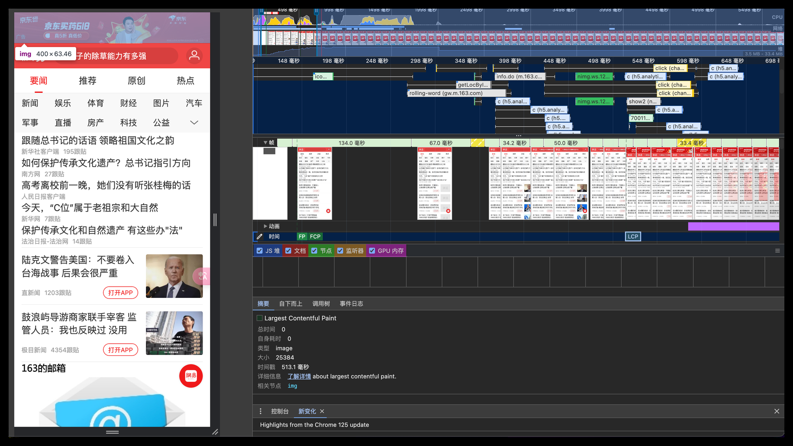
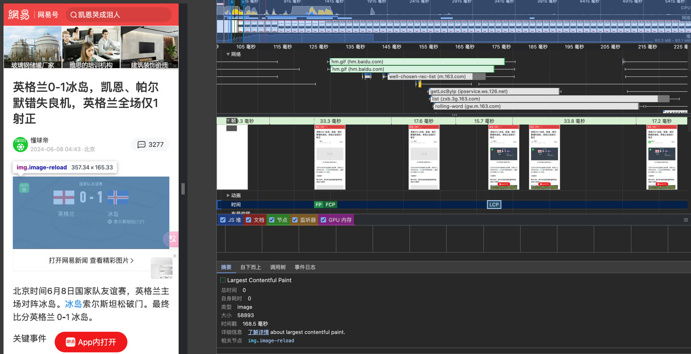
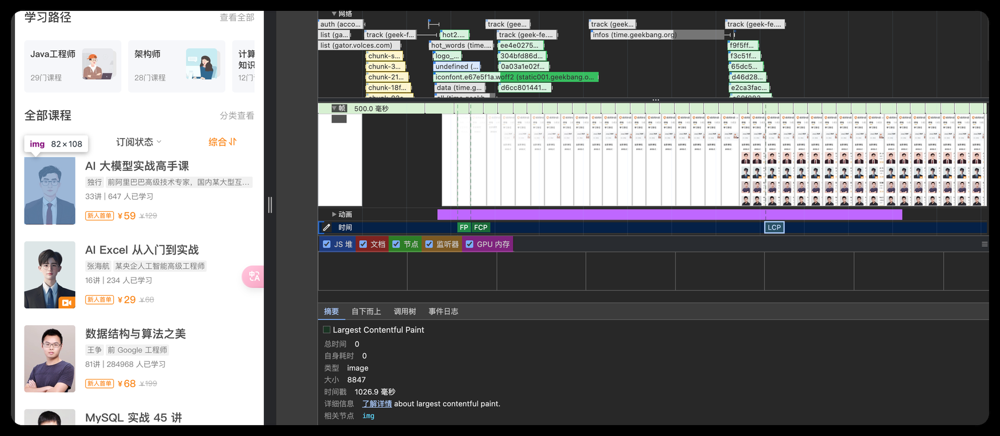
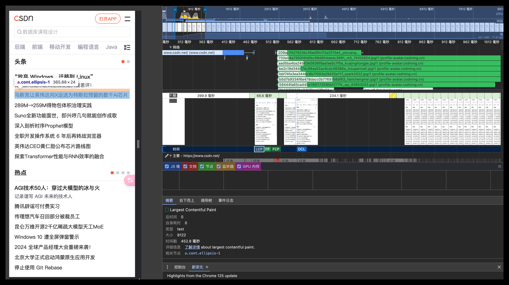
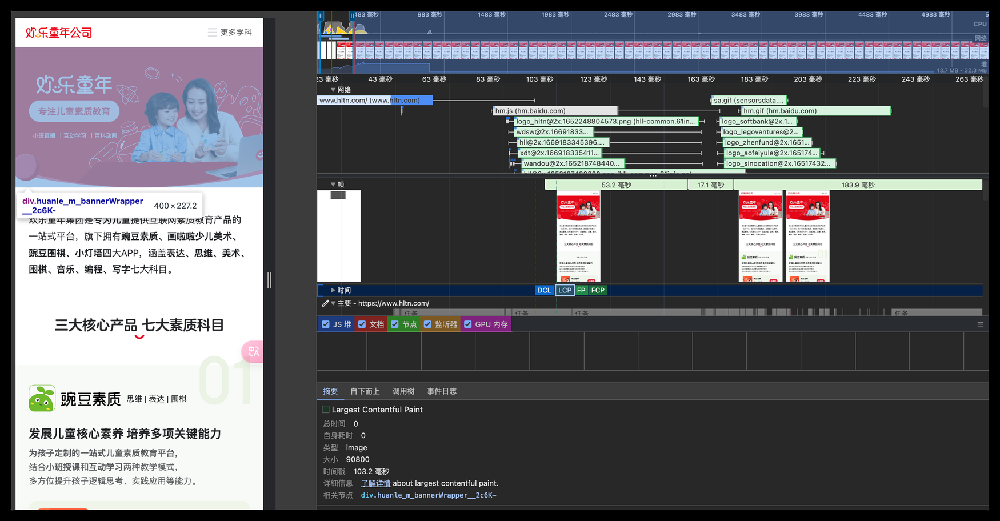
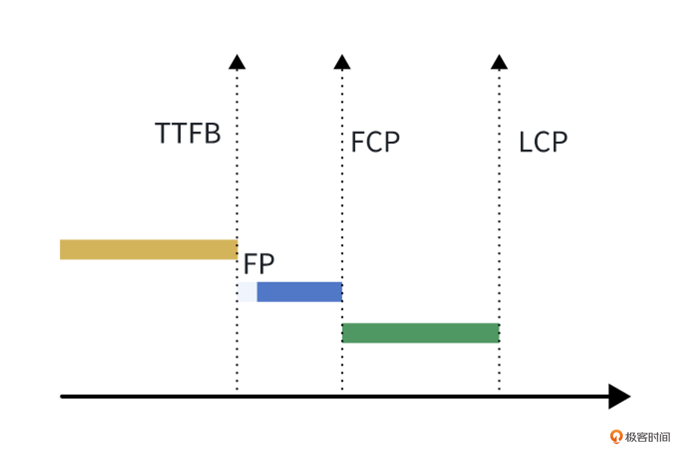
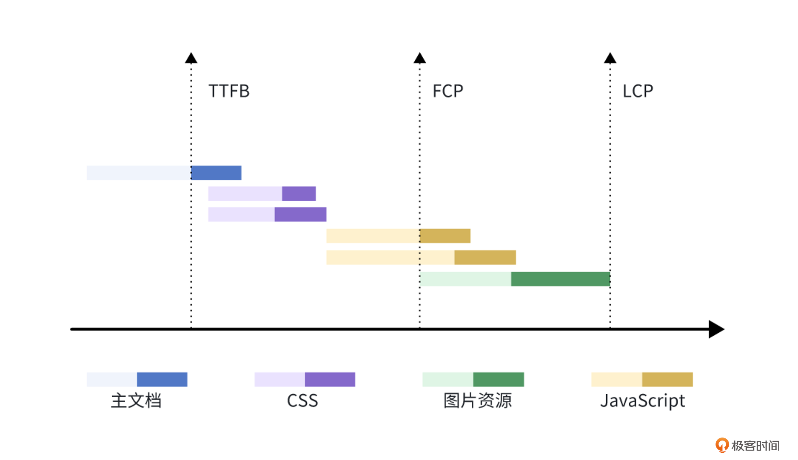
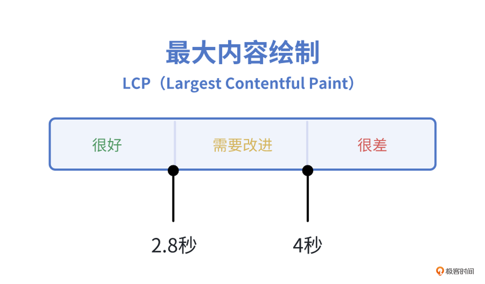

# 26 | 视口：可视内容对全链路的重要性

你好，我是三桥。

这节课，我们继续讨论前端全链路优化的另一个环节，最大内容绘制（LCP）。LCP 是 WebVitals 的网页核心指标，可以帮助我们衡量网页内容“准备好”给用户需要多长时间。

## 什么是最大内容绘制？

这个准备好是什么意思呢？我们先通过一些例子来观察开发者工具中 LCP 的特点，再下定义。

### 如何观察 LCP 指标？

我们以网易新闻 H5 版本为例，观察首页和文章详情页的 LCP 的具体信息。以下是网易新闻首页的性能报告。



从图中可以看出，LCP 报告的时间比 FCP 晚约 300 毫秒。性能报告还显示，LCP 标记的节点是 img 元素，时间约为 550 毫秒。

我们继续观察新闻详情页的性能报告。



详情页的性能报告显示 LCP 在 FCP 后面约 50 毫秒。报告还显示，FCP 标记的节点也是 img元素，时间约为 168 毫秒。

我们再以极客时间官网为例，看一下它的性能报告。



报告显示，LCP 时间与网易新闻的结果几乎相同，LCP 在 FCP 之后，而且 LCP 标记的节点也是 img 元素，耗时约为 1 秒。

这三个例子中，LCP 最终标记的节点都是图片元素，但真的是这样吗？让我们来看下第四个例子。



这次我们以 CSDN 的 H5 版本为例，通过性能报告发现，LCP 标记的位置是文本链接，这个链接不在页面的顶部或底部，而是在中间位置。

另外，你是否注意到，FP、FCP 和 LCP 都在同一个时间节点出现？这是什么意思呢？让我们看看第五个例子。



这是我负责过的产品官网项目，使用的技术栈是 Next.js，性能报告显示三个指标在同一个时间节点。

这意味着，无论是首次内容绘制（FCP）还是最大内容绘制（LCP），都发生在同一时刻，浏览器的任务是下载资源、解析和渲染 DOM 文档，这就是服务端渲染的优点。

通过五个例子，你会发现 LCP 的三个特点。

1. LCP 指标记录的时间一定是在 FCP 时刻或之后。

2. LCP 标记的 DOM 元素可能是文本或图片。

3. LCP 指标时间没有时长标准，最快可以达到 1 秒或以内。

根据这三个特点，我们给 LCP 下个定义。

### 什么是 LCP ？

最大内容绘制（Largest Contentful Paint，简称 LCP）指的是加载页面最大视觉部分所需的时间。

这个时间对应的是最大资源或文本块呈现在用户可见视口区域时的时间点。

最大资源一般是指图片资源，如果可视区内没有图片，LCP 记录的就是最后一次显示内容的区域，比如文本块区域。

我们对比一下 LCP、FCP、TTFB 三者之间的关系。从例子中可以看到，请求网页加载时，LCP 和 FCP 之间，FCP 和 TTFB 之间默认存在时间差。它们之间的关系如下图。



从指标角度来看，LCP 指标已经包含了四个部分，主文档首字节时间（TTFB）、首次绘制时间（FP）、首次内容绘制时间（FCP）和 LCP 元素渲染时间。

也就是说，每个网页的 LCP 指标值都是由三个指标组成的。在进行优化时，需要评估每个链路指标节点的指标值，从而确定 LCP 问题的位置。

如果从加载资源的角度来看，LCP 实际上记录的是可视区域加载时间最长的一个元素，通常是图片。例如下面这张资源加载图。



这张图直观地展示了前三个例子中 LCP 标记图片元素的时间线。

总的来说，LCP 的时间段主要包括主文档的加载、LCP 资源的请求和渲染。特别是 LCP 资源，如果 TTFB 和 FCP 稳定，那么图片的数量和大小就会直接影响 LCP 的时间。

### LCP 在全链路中是核心指标

无论是网页核心指标还是前端全链路指标，LCP 都是以用户为中心去观察的关键指标。为什么它这么重要呢？

首先，我们要认识到 Web 在移动设备的重要性。

根据统计，全球互联网用户中，大约有 54% 选择使用移动设备访问互联网。这些设备包括平板电脑、手机和大屏设备等。由于这些设备的屏幕大小和分辨率的差异，我们在设计网页时需要考虑使用响应式设计或优先考虑移动设备。

尤其是手机，在网络不稳定的情况下，不能像 PC 桌面那样完整地显示所有内容。我们需要考虑如何在小屏幕上快速显示内容。换句话说，要重点考虑在移动设备可视区域内快速显示重要的内容。

而我们也能通过 LCP 判断用户屏幕上内容的显示情况，并标记最慢渲染的元素和时间。通过这个最慢的元素，我们可以分析哪些页面内容需要优化和改善。

其次，LCP 对 SEO 至关重要。

大量海外网站的流量来自搜索引擎。这些网站对 SEO 重视程度极高，因为每减少 100 毫秒的加载时间，都会大幅影响跳出率和转化率，从而影响网站利润。

LCP 是由 Google 推出的网页指标，Google 希望通过这个指标，鼓励网站提高加载速度，并将其作为搜索引擎排名算法的重要考量因素之一。

因此，优化 LCP 指标和提升网页加载速度，可以提升网站在 Google 等搜索引擎的排名，从而提搞网站的流量。

第三点，就是我一直强调的以用户为中心解决问题。

我们知道，前端全链路的核心思想是以用户为中心，解决用户问题。LCP 指标在全链路中的衡量主要包括三种。

1. 衡量当前用户是否已开始可交互的时刻。

2. 通过 LCP 标记的最后一个渲染元素，快速了解用户的实际感受。

3. LCP 包含了 TTFB 和 FCP 指标，结合这两个指标的参考，我们可以更全面地分析用户链路问题。

### LCP 与 FCP 的区别

不过现在有个问题，在优化前端全链路的过程中，FCP（首次内容绘制）和 LCP（最大内容绘制）都是关键指标，但关注的内容和侧重点有所不同。

FCP 关注的是网页开始渲染的时间，也就是内容开始可视化的时刻。而 LCP 关注的是视口中最大的图像或文本块完成渲染的时间。因此，LCP 能更好地体现出网页内容合适“准备好”给用户。

简单来说，就是 FCP 关注内容开始可见的时刻，LCP 关注视口中完整内容的时刻。

当我们在做链路优化时，究竟是让用户先快速看到可见内容还是完整内容，需要根据业务情况而定。

我认为，如果是 SPA 单页面网站，FCP 比 LCP 更重要。如果是多页面网站，如基于 SSR 网站或静态网站，LCP 比 FCP 更重要。

当然，这只是参考建议，具体的优化方案还要看实际情况。

## 指标衡量

现在，我们来看看如何衡量最大内容绘制（LCP）指标值以及如何进行分析。

### 指标

Google 建议，为了提供良好的用户体验，LCP 指标应尽量控制在 2.5 秒以内。如果在 2.5 秒到 4 秒之间，就认为体验稍差，需要改进。

如果指标超过 4 秒，就需要分析是 TTFB 问题还是 FCP 问题。如果两者的时间都在合理范围内，那就说明视口区域的资源加载时间太长，需要找到慢的原因。

下图清晰地展示了指标区间的关系。



根据我的经验，衡量指标需要区分移动设备和 PC 设备两种场景。

由于 PC 桌面在网络稳定性、设备性能上更好一些，屏幕分辨率大，页面可以显示更多的内容，因此我们可以适当地放宽指标的衡量范围。

对于移动设备，由于屏幕分辨率小，设备上能显示的内容有限，且用户网络不稳定，所以我们需要尽量优化 LCP 指标，确保控制在 2 秒以内。

虽然没有明文规定，但前端开发的一个普遍标准是，页面的打开速度应保持在 1 秒内，才能实现最佳的用户体验。

### 如何分析指标？

在多页面项目中，每个页面都有一个 LCP 指标。也就是说，PV 值接近于 LCP 指标数量。如果是 SPA 单页面项目，那么 LCP 指标数量就会相对少很多。

当前端页面访问量大时，多页面项目记录的 LCP 次数就会增多，这会对服务器存储造成压力。但是，如果不进行全量记录，我们就无法全面统计链路指标。

我认为，如果 PV 量不到百万级别，建议全量统计 LCP。如果超过，可以考虑以下两种方案。

第一种是采用比率采样方案，通过记录采样量来衡量指标的整体情况。

第二种是超过阈值时上报方案，只记录 LCP 值较大的部分，帮助我们找出问题。

第一种方案是从整体上分析问题，更偏向比例统计，通过比例来分析项目的整体性能情况。第二种方案则是面向用户的问题分析，偏向问题记录，它是解决用户问题的有效途径。

这两种方案各有优劣，你可以根据项目的实际情况选择适合自己的方案。

有了数据和统计，接下来就是分析了。Google 建议使用第 75 百分位作为衡量标准。但我认为，要全面分析 LCP 指标，应该同时考虑第 60、75、90、99 这四个百分位。

此外，还可以每天统计一次 LCP 的平均值、最小值和最大值，然后绘制成折线图。再结合四个百分位，就能衡量出 LCP 是否存在的问题。

这种分析方法跟我之前讲解的 TTFB 方法是一样的。

事实上，优化 LCP 到哪个程度并没有固定的要求，我们还是需要根据前端项目的实际情况来定。不过前提是有数据供我们分析和判断，才能提出有效的优化方案。

最后，LCP 也受到 TTFB 和 FCP 指标的影响。优化这两个指标也可以有效降低 LCP 时间。至于如何优化 FCP 和 LCP 之间的耗时，我会在下一节课详细讲解。

## 总结

总结一下，这节课我们详细讲解了 LCP 的基本概念以及衡量指标的方法。再次强调，LCP 指标是前端全链路中的关键指标，它主要体现在网页内容何时“准备好”给用户。

LCP 和 FCP 都是以内容显示作为衡量标准。FCP 关注的是视口重要内容块元素首次出现的时间，而 LCP 关注的是视口中最大内容块元素的加载时间。一般来说，LCP 标记的最大内容绘

```
制元素是 img 元素，这可能意味着在浏览器视口中有一张加载时间较长或可见尺寸较大的图
```

片。

同时，LCP 也是衡量移动设备视口区域中页面显示速度的一个标准。在过去，我们常常使用load 或 DOMContentLoaded 等旧指标来衡量网页主要内容的显示，但这些旧方法并不总是与用户实际看到的内容相符。此外，鉴于移动设备的屏幕和分辨率与传统 PC 桌面不同，LCP 更适合应用于移动设备场景。

下节课，我们将继续探讨 LCP 指标，通过分析指标寻找可优化的方法。

## 思考题

现在，给你布置一道思考题。

挑选一个前端项目，尝试统计 LCP 指标的平均值、最小值额、最大值，以及第 60 百分位、75 百分位、90 百分位以及 99 百分位。然后，与官方的建议值进行对比，看看你的前端项目处于哪个性能水平。

欢迎你在留言区和我交流。如果觉得有所收获，也可以把课程分享给更多的朋友一起学习。我们下节课见！
