# 27 | 图片：调整策略，优化图片加载问题

你好，我是三桥。

上节课，我们学习了如何衡量 LCP 指标。通过比较平均值、最小值、最大值和百分位，我们可以判断问题的严重程度。

那判断之后，怎么才能优化 LCP 指标呢？这节课，我们就一起来解决这个问题。

不过在深入讨论优化 LCP 之前，我们首先需要理解浏览器是如何标记 LCP 元素和时间的。

## LCP 元素标记的原理

放开 FCP 和 TTFB 的问题不谈，FCP 和 LCP 之间的时间主要用于加载前端资源，例如JavaScript、CSS 和图片。此外还包括了渲染过程，这个过程包括了 HTML 和 CSS 解析、构建渲染树、布局和绘制等多个步骤，实际上过程很复杂。

尤其是 SPA 单页面项目，浏览器绘制页面的效果会更加明显。浏览器为了能够分析出视口中最大内容绘制的元素，提供了一套判断机制。

### 标记流程

浏览器记录 LCP 的流程主要包括这么几个步骤。

首先，浏览器在完成第一帧的绘制后开始记录 LCP。所谓“第一帧”，通常是在 FCP 之后，FMP 之前。FMP 指的是浏览器首次绘制页面上有意义的内容的时间点，即用户认为页面开始有用内容的时间。

```
其次，当第一帧绘制完后，浏览器会创建一个类型为 largest-contentful-paint 的
PerformanceEntry 对象，并标记当前的最大内容元素。
如果网页中有文本和图片，那浏览器通常会先显示文本。此时，PerformanceEntry 对象会
标记最大的文本元素，例如 <p> 或 <h1> 元素。
```

随后，浏览器在绘制更多帧的过程中，如果最大的内容发生改变，就会再创建一个新的

```xml
PerformanceEntry 对象，同时更新最新的 LCP 值。如果此时是图片，那么就会标记为
 元素。
```

最后，当浏览器视口内容完全加载完后，LCP 就会停止记录，并以最后一次标记作为 LCP 的指标值。

在特殊情况下，如果视口内容尚未加载完成，用户就开始与网页进行交互（如点按、滚动

```
等），浏览器就会停止记录 PerformanceEntry 对象，因为用户的交互通常会改变显示的内
```

容。

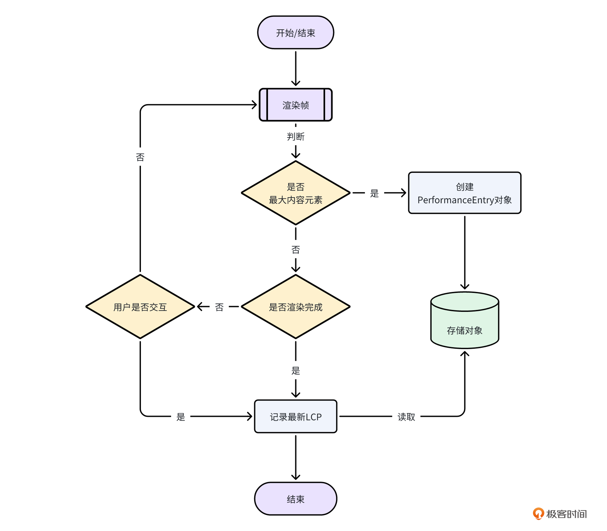

- 监听最大内容元素变化流程图

### 如何确定 LCP 元素？

根据 LCP 指标的规定，目前最大内容的元素类型有四种。

```xml
图片元素。 是 LCP 中最常见的元素，也最常影响范围最大的元素。另外还包括
SVG 中的 <image> 元素。
<video> 视频元素。浏览器会根据 <video> 元素定义的 poster 属性值或第一帧视频画
```

- 面作为最大内容。

```
使用 CSS 的 url() 函数的图片背景样式元素。
```

4. 包含文本节点的块级元素。

但是，最大内容的元素是有前提条件的。

首先，元素内容必须在视口可见。如果在加载过程中被移出视口，或者尺寸大小超出视口，就不符合 LCP 标记条件了。

其次，LCP 标记的是视口内最大的内容块，即使最后加载完成的是图片，如果图片尺寸小于文本块，那么 LCP 标记的仍然是文本块。

不过在一些情况下，页面的最大内容元素并非重要元素。产品通常关心的是重要元素，而非最大内容元素。所以这时我们不能只关注 LCP 标记的元素而忽略其它内容。

尤其是在移动设备中，需要全面分析视口内所有的文本和图片元素，包括它们的加载速度和渲染时间线。

## 缩短 FCP 与 LCP 的链路距离

我们的目标是优化 LCP，缩短 FCP 与 LCP 之间的链路距离。

我会用谷歌浏览器开发者工具快速找出 LCP 的最大内容元素，并根据加载时间线找出优化方案。我们将在不缓存资源和模拟 4G 网络用户的条件下，尝试减少 FCP 和 LCP 之间的距离。

### 性能报告

我们以豌豆思维学科官网为例，观察一下官网加载后的性能报告，特别是 LCP 指标的位置和时间，如下图所示。

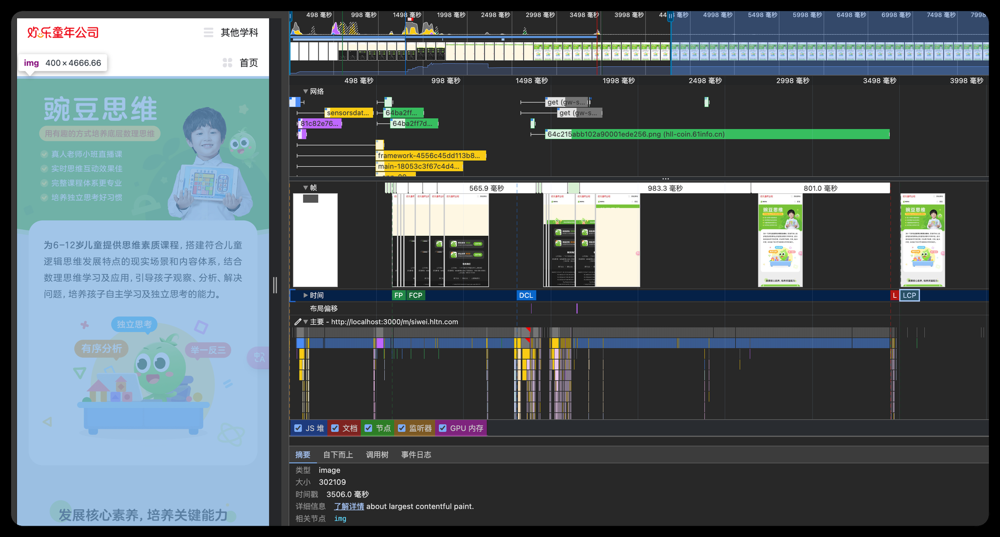

这个网站的技术栈是 Next.js，通过 Node 端获取后台配置数据，然后服务器端生成页面，并在浏览器直接渲染内容。

我们在前一节课已经讨论了使用服务器端渲染（SSR）生成页面的情况，其中 FCP 和 LCP 指标几乎相同。那么，为什么在这里会有比较长的时间差？

我们通过时间线来清晰地理解上面的报告图。

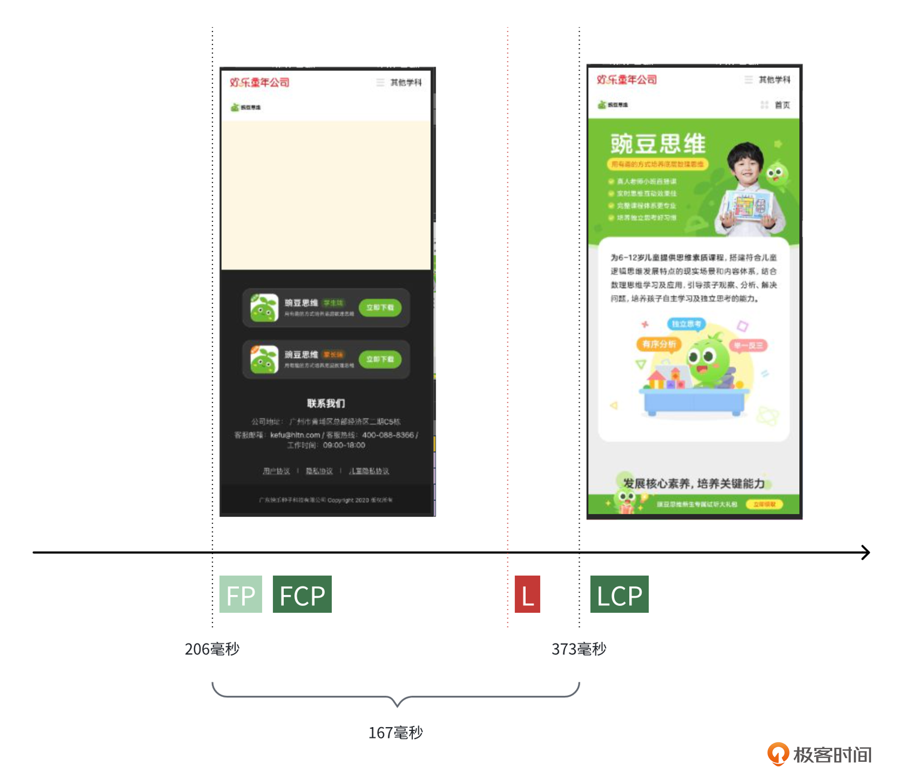

实际上，浏览器在渲染页面时，请求了一张 400*4666 的长图片。在图片请求过程中，其它的元素和内容都先加载完成了，只有这张图片加载时间最长，导致视口页面出现一片空白，如上图左侧的屏幕截图。

当图片加载完并渲染完成后，黑色区域的内容会自定移出屏幕视口，这时就会出现短暂的内容闪烁效果。

### Lighthouse 报告

我们看看 Lighthouse 的分析报告里指出的 LCP 存在的问题点。

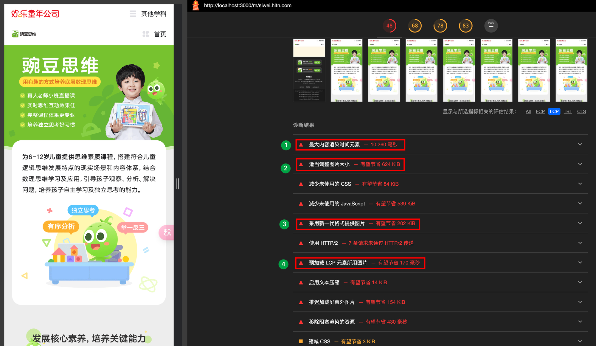

诊断结果显示，有 10 个问题点对 LCP 产生了一定影响，其中包括一些我们在学习 TTFB 和FCP 时已经讨论过的部分。

我们重点关注下图中四个红色框部分，报告展开后的详细内容如下图所示。

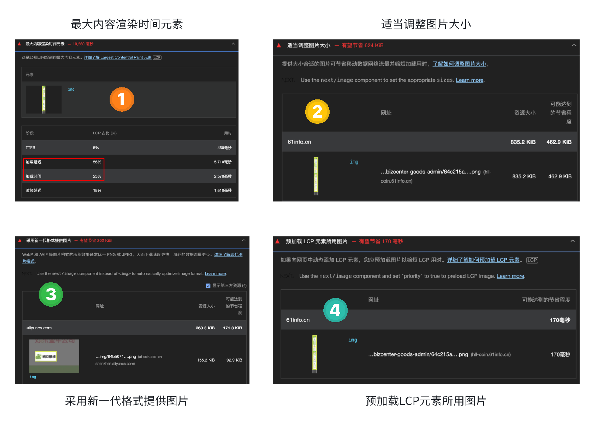

首先，确定最大内容渲染时间元素。

图 1 显示，这张图片的加载延迟和加载时间占比超过 80%。这说明加载 LCP 最大内容元素的时间过长。

其次，适当调整图片大小。

图 2 显示，最大内容元素的图片大小为 835KB，对于 4G 网络而言，加载时间会更长。因此，报告建议提供适当大小的图片，节省移动网络流量，减少加载时间。

```
同时，报告还建议使用 Next.js 的 next/image 组件加载图片，由 Next.js 内部决定如何加载
```

图片以及使用何种大小。

第三，使用新一代格式提供图片。

图 3 显示，加载的图片使用了 png 格式，这里建议使用 WebP 和 AVIF 格式，因为这些格式的压缩效果优于 PNG，所以下载速度更快。

```
和第二点一样，报告还建议使用 next/image 组件方式加载图片。
```

最后，预加载 LCP 元素图片。

图 4 提示，如果在视口区域动态添加内容，比如图片，应考虑预加载图片以缩短 LCP 时间，预计可节省 170 毫秒的时间。

### 优化过程

分析完报告，我们动手优化。报告明确指出，长图片是影响 LCP 的主要原因。要解决这个问题，需要采取三个步骤。

第一步，增加预加载策略。

这个策略的目的是尽早下载最大内容元素图片（如上述的长图片），使其请求下载的时间尽可能提前。下图是优化前的加载时序图。

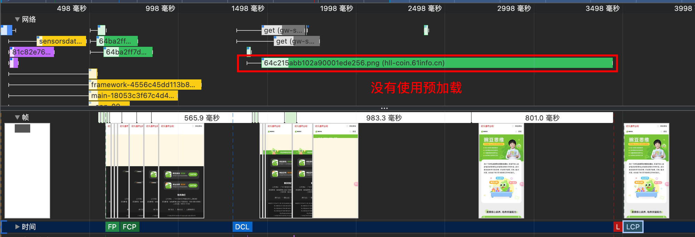

时序图显示，长图片的加载开始时刻在 FCP 之后，请求图片总共花了 2 秒，最终在 3.5 秒时记录了 LCP。

主要原因是，最大内容元素是一张大图，占据了 90% 的视口内容区域。当显示图片时，屏幕会出现闪烁，这是需要优化的用户体验问题。

```bash
为了实现预加载，我们使用 <link> 元素来指定预加载的具体资源，具体的代码实现如下。
import Head from 'next/head'
export default function PublicHeader() {
 return (
   <Head>
     <!-- 省略部分代码 -->
     <link rel="preload" href="https://hll-coin.61info.cn/prod/bizcenter-goods-a
   </Head>
 )
}
在上述代码中，需要同时使用 rel="preload"  和  as="image" ，这样浏览器才能知道需
```

要提前加载资源。

增加了预加载代码后，我们重新测试 LCP 的长图片，观察优化后的结果如下图所示。

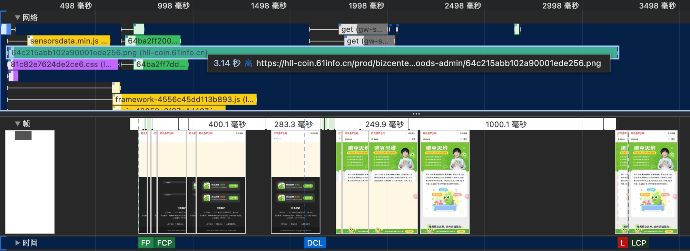

时序图显示，长图片下载的时间已经提前到了 FP 之前。

```
这意味着，浏览器在接收到渲染树后，发现含有 rel="preload" 的 link 标签，就会立即
```

请求该图片，与 HTML 主文档的请求同时进行。

遗憾的是，这张图片尺寸大小为 835KB，在 4G 网络下需要较长的下载时间。即使使用了预加载，下载时间仍远超过 FCP 时间，所以 LCP 时间并未有明显改善。

要解决这个问题，我们需要采用第二步的优化策略。

```xml
第二步，采用 next/image 组件。
在这一步中，我们将这张图片的加载方式更改为使用 next/image 组件。参考代码如下。
<Image
 src="http://hll-coin.61info.cn/prod/bizcenter-goods-admin/64c215abb102a90001ede
 width={400}
 height={4667}
 quality={80}
 priority={true}
 alt='LCP of Image'
/>
```

经过改造后，我们观察到 LCP 并未有明显变化，性能并未因为我们使用了组件加载而提高。这是因为根本原因在于图片加载速度过慢。下面是它的时序图。

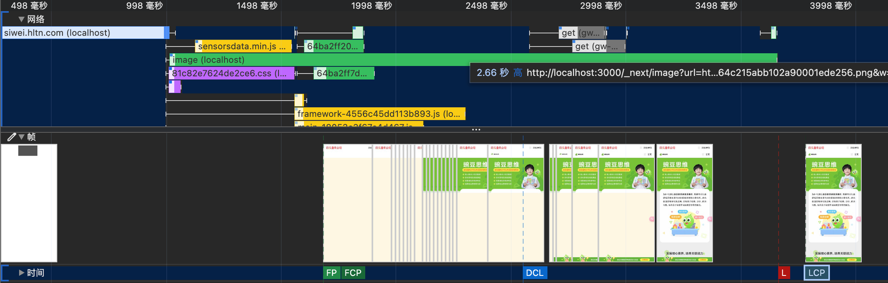

那就只能进行第三步，将大图切割为小图。

要模拟 FCP 内容，我们将使用一张完全覆盖视口的图片，大小约 400k。继续采用预加载和

```
znext/image 组件，以观察 LCP 时间的变化。
```

结果显示，由于图片是通过 4G 网络下载，尽管图片大小减少到 400k 并且下载时间减少，但下载时间依然超过 1 秒。时序图的效果如下。

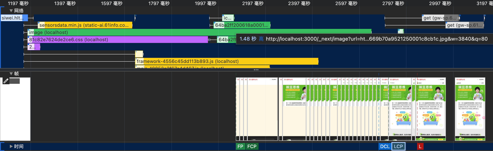

接下来我们继续优化，目前最大的问题依然是图片尺寸大小。

```
这一次，我们再把已切割的图片再次切割成四张小图，分别用预加载和 next/image 组件两
```

种不同组合方式观察 LCP 时间的变化。以下是两种组合的时序图。

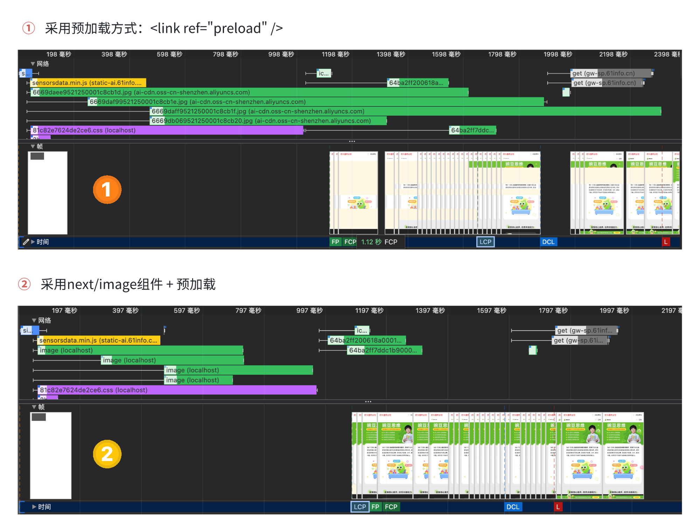

通过时序图可以看出，尽管在图 1 中我们使用预加载 4 张大约 100 多 KB 左右的小图，但图片并未经过压缩，其下载时间仍然较长，最后一张图的加载完成时间在 2.4 秒。

图 1 还有一个特点是，在 FCP 时刻开始，视口逐渐渲染了已下载的图片，直到最后一张图下载完成，LCP 标记才结束。

```
再来观察图 2，我们采用 Image 组件加载 4 张小图，并设置 Image 组件的加载优先级。结
```

果很明显，LCP 和 FCP 同时出现在了一个时刻上，这说明优化方法取得了明显效果。

最终，我们通过一个小视频来回顾缩短 FCP 和 LCP 时间的优化效果。

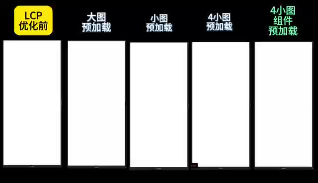

### 优化小结

我们总结出 LCP 图片元素的六个优化建议。

1. 避免在浏览器视口使用大尺寸图片，因为大尺寸图片会降低低速网络用户的体验。

2. 尽可能减少浏览器视口的最大内容块区域，以减少下载和渲染时间。

3. 如果使用服务器渲染模式，最好使用框架提供的图片组件和优先级属性，方便框架提前预判视口内容元素并提前下载重要图片。

```
如果使用了 Image 组件，并设定了优先级模式，就没有必要设置预链接。
```

5. 如果视口区域中的图片内容是通过富文本加载的，那么建议提取内容中的图片，并提前设置预加载图片。

6. 关于图片尺寸问题，如果图片存储在云端，那么可以根据不同的设备设置图片的大小、格式、尺寸等参数，减少图片的加载时间。

总的来说，在复杂的前端项目中，优化 LCP 并不容易，建议在优化时同时考虑多种方案，尤其要想清楚是 FCP 时间优先还是 LCP 时间优先。

## 总结

总结一下，这节课我们重点讲了两部分，LCP 元素的标记原理，以及优化 FCP 和 LCP 之间的链路时间。

浏览器视口的页面内容是用户最直观的画面。浏览器标记 LCP 元素的原理是通过逐帧渲染来判断最大的面积块，然后选出最终元素。如果画面频繁出现闪烁、渲染、图片移出视口等情况，用户体验就会受影响。

我们需要从多个角度和层次来优化，包括减小图片尺寸，使用新一代图片格式，预加载 LCP图片，图片组件等方法。结合这些方法，可以有效地缩短 FCP 与 LCP 之间的链路时间，提升用户体验。

要完全优化 LCP，除了优化 TTFB 和 FCP 之外，还要不断地尝试，通过多次试验找出有效的解决方案。虽然每个项目都是不同的，但优化的思路是一致的，总能找出最佳的解决方案。

你可能已经注意到，视口中元素的闪烁效果实际上是 CLS 指标的布局偏移。下节课我们就来学习如何分析和避免 CLS 的布局偏移。

## 思考题

现在，我给你布置一道思考题。

挑选一个前端项目，找出 LCP 最大内容元素，并尝试缩短 FCP 和 LCP 之间的链路时间。

欢迎你在留言区和我交流。如果觉得有所收获，也可以把课程分享给更多的朋友一起学习。我们下节课见！
