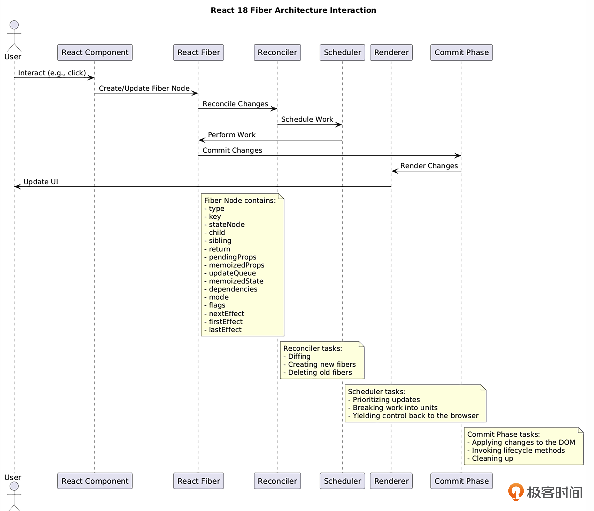

# 01 | 工欲善其事：课程中用到的NodeJS与React

你好，我是柳博文。欢迎和我一起学习前端工程师的 AI 实战课。

从这节课开始，我们就正式进入这门课程的学习了，正如开篇词说的那样，课程整体更加注重实践。我将和你一起学习 AI 结合前端的创新实践，并动手完成最小化的可运行实例，让你切身感受到 AI 在前端领域的魅力和巨大潜力。

在后续的实践过程中，我们不仅要用 AI 的原理知识和技术，为了完成工程链路的部分，还需要选择出恰当的前端框架和工程链路开发工具，课程里会用到 React(^18.0.0) 以及NodeJS(^20.15.1)。因为课程的核心主题是 AI+ 前端，所以，今天我们先来了解一下后续会用到的相关知识和技术算法。

## 课前准备 / 框架选择

课程中我选择了 React-18 作为实践部分的前端框架。众所周知，React 和 Vue 是国内使用占比较高的框架。

同时，课程实践部分涉及到代码的自动生成。因此，文件的操作是必不可少的，需要用到具有服务器开发功能的库或者框架。那么，选择 NodeJS 就再合适不过了。

至于前端框架和实现工程链路的库，你可以使用自己更合熟悉和擅长的框架，不必拘泥于React 和 NodeJS，课程讲解的是一些创新的想法和解决方案的实践。但使用和课程同样的技术框架和库会更加省心和方便。

那么，接下来我们一起来复习一下 React 和 NodeJS 的必要知识点，以及课程中我们会使用到的技术原理和库。

## 前端基础库 React

React 由脸书开发并开源，是一个能够高效构建动态的用户界面的 JavaScript 库，注意 React是一个库，而不是一个框架。

脸书团队的设计理念是将 React 作为一个核心的 Core 来进行开源，使得大家都能够在这个核心 core 的基础上，自行定制一些特性功能。

我们这就来看看 React 的一些基础设计及原理，首先是 React 的重要设计。

### React 的重要设计

在我们第三章讲 AI 布局助手的实践时，我们将会充分使用 React 的单向数据流、虚拟 Dom等特性来自动完成代码的生成和实时预览。我们一起来看看 React 的一些重要细节。

首先是声明式编程，React 采用声明式编程范式，使得构建交互式 UI 变得更加直观。开发者只需描述应用在各种状态下应该如何呈现，React 就会自动管理所有 UI 更新。在实践章节中，我们通过借助 React 的这个特性就能节约不少精力，只需要关注生成的数据，以及通过数据自动构造出来的代码。

其次是组件化，React 会通过通过组件化的方式来构建 UI，每个组件代表了页面上的一部分UI。这使得代码更加模块化，易于维护和复用。第三章的实践就是围绕组件识别来展开。

然后是虚拟 DOM 概念，这是一个编程概念，通过这个概念，React 在内存中创建了一个DOM 树的副本。每当应用的状态变化时，React 都会在虚拟 DOM 上进行操作，而不是直接操作浏览器的 DOM。然后，React 会计算出虚拟 DOM 与当前 DOM 之间的最小差异，并仅将这些差异应用于真实的 DOM 上，这让开发变得更加高效，同时也提高了页面性能。

最后是单向数据流，React 强调单向数据流的概念。在 React 中的数据以及状态的变化只能影响子组件，不直接影响父组件，这使得数据流向清晰，易于理解和调试。

### React 的重要组成部分

复习并理解了 React 的重要设计，我们一起来看看 React18 的重要组成部分以及各部分是如何协同工作的。这里有一张简化的架构流程图，这里不会完全展开讲，只会提及几个和课程有关的点。



首先是 React 元素和组件，React 元素是 React 应用的最小单位，是对一个 UI 单位的轻量级描述。React 元素通常通过 JSX 语法创建，然后使用 React.createElement() 方法进行返回。组件则是构建 React 应用的基础构成，可以是类组件或函数组件。组件接收 props 作为输入，并返回用于描述 UI 部分的 React 元素。

其次是虚拟 DOM，它是 React 元素的内存表示。React 使用虚拟 DOM 来优化 UI 的更新过程。通过比较新旧虚拟 DOM 树的差异（称为“diffing”），React 可以找到实际 DOM 需要进行的最小更新，再以最快的速度和最低的开销完成 DOM 的更新。

然后是 Reconciler，它是 React 的核心算法，负责协调或对比新旧虚拟 DOM 树的差异，并计算出实际 DOM 需要进行的更新。Reconciler 的工作方式可以是同步的，也可以是异步的（在React 16 中引入的 Fiber 架构下）。这里开始涉及 React 的部分核心源码设计，感兴趣的同学可以阅读 React16 及以后版本的 React 源码。

React 的源码是一个复杂且高度优化的代码库，它包含了许多重要的部分，每个部分都承担着特定的职责，并且相互之间紧密协作，来提供 React 的核心功能。

然后我们再简单了解一下 Fiber 架构。Fiber 是 React 16 版本开始引入的一种新的内部架构，为了提高 React 的性能（特别是在动画、布局和手势等需要高响应性的应用中）。Fiber 架构使得 React 可以将渲染工作分割成小的单位，实现任务的中断、重用和优先级排序。Fiber 的实现原理可以参考协程原理。

React 实现了一套自己的事件处理系统，它在 React 元素上定义的事件处理器会被统一管理。React 的事件系统确保了跨浏览器的一致性，并且通过事件委托机制提高了性能。

Hooks 是 React 16.8 引入的新特性，它允许在函数组件中使用状态和其他 React 特性（如生命周期钩子）。Hooks 提供了一种更简洁直观的方式来编写组件，同时保持了组件逻辑的可复用性。

接下来，我们看一下这些重要组成部分是如何相互联系、协同工作的。

组件通过返回 React 元素来描述 UI，而 React 元素构成了虚拟 DOM 树。当组件状态变化时，Reconciler 负责比较新旧虚拟 DOM 树的差异，并计算出需要对实际 DOM 进行的最小更新。

Fiber 架构改进了 Reconciler 的工作方式，使其能够更高效地处理 UI 更新，特别是在大型应用和动画等场景下。

事件系统为 React 组件提供了一种处理用户交互的方式，组件可以通过定义事件处理函数来响应用户的操作。

## 工程链路 NodeJS

Node.js 是一个开源且跨平台的 JavaScript 运行时环境，它允许开发者在服务器端运行JavaScript 代码。

Node.js 是基于 Google 的 V8 JavaScript 引擎构建的。V8 引擎负责编译 JavaScript 代码到本地机器代码，这使得 Node.js 能够以接近原生的速度执行代码。Node.js 的标准库提供了一系列的异步 I/O 原语，这些都是非阻塞的，确保了 Node.js 在处理网络请求、文件操作等 I/O 密集型任务时足够高效。此外，Node.js 通过模块系统支持 CommonJS 规范，使得组织和复用代码变得更简单。

Node.js 的出现极大地丰富了 JavaScript 的应用场景，除了用在客户端开发，服务器端编程时用起来也很高效，可以满足我们课程实践部分的需要。

### 使用 FS 模块实现文件变化更新

Node.js 在服务端的编程应用中，监听文件内容的变化是一项常见的任务，尤其在开发需要实时更新或响应文件变化的应用时。Node.js 的 fs 模块提供了几种方法来实现这一功能，其中fs.watchFile 和 fs.watch 是最常用的两种。

首先是 fs.watchFile 方法，通过轮询的方式来检查文件的变化。这意味着它会在一定的时间间隔内读取文件的元数据（如修改时间），并比较其变化。虽然这种方法在不同操作系统上表现相对一致，但因其轮询机制，可能会导致较高的 CPU 和内存占用，尤其是在监听大量文件时。

在这个示例中，每当 example.txt 文件的修改时间发生变化时，就会打印出“文件已修改”的消息，并读取文件的新内容。

```javascript
const fs = require('fs');
const filePath = './example.txt';
// 使用 fs.watchFile 监听文件变化
fs.watchFile(filePath, { interval: 1000 }, (curr, prev) => {
   // 检查文件的修改时间是否发生了变化
   if (curr.mtime !== prev.mtime) {
       console.log('文件已修改');
       // 读取文件内容
       fs.readFile(filePath, 'utf8', (err, data) => {
           if (err) {
               console.error('读取文件时发生错误:', err);
               return;
           }
           console.log('文件新内容:', data);
       });
   }
});
相比fs.watchFile，fs.watch方法更加高效，因为它依赖于底层操作系统的文件变化通
```

知机制（如果可用）。这通常意味着更低的 CPU 和内存占用，并且能更及时地响应文件变化。

```javascript
然而，需要注意的是，fs.watch在某些操作系统或特定情况下可能不可用或表现不一致。
const fs = require('fs');
const filePath = './example.txt';
// 监听文件变化
fs.watch(filePath, (eventType, filename) => {
   if (eventType === 'change') {
       console.log('文件已更改:', filename);
       // 读取文件内容
       fs.readFile(filePath, 'utf8', (err, data) => {
           if (err) {
               console.error('读取文件时发生错误:', err);
               return;
           }
           console.log('文件新内容:', data);
       });
   }
});
console.log('正在监听', filePath);
在这个示例中，每当 example.txt 文件发生变化时（如内容被修改），就会触发回调函数，
```

并打印出“文件已更改”的消息和文件的新内容。

两者都可以用来实现实践部分的文件内容变化监听，我们对比一下它们的不同和适用环境。

```
fs.watch 的性能通常优于 fs.watchFile，但在某些操作系统上可能不可用或表现不一
```

- 致。

```
在使用 fs.watch 时，确保监听路径存在且文件或目录的权限设置正确。
监听大量文件或目录时，可能会遇到性能问题，尤其是使用 fs.watchFile。
```

- 监听文件内容变化时，如果需要精确控制（如仅当文件内容实际变化时才触发），可能需要结合文件内容比较（如 MD5 校验）来实现。

```
通过上面的学习和示例演示，我们就能够使用 Node.js 的 fs 模块来监听文件内容的变化，并
```

在实践部分的应用程序中根据需要进行相应的处理。

### 为什么要引入 MD5

我们先来看一段第三章实践部分用于监听文件内容变化的部分实现代码：

```javascript
const fs = require('fs')
const md5 = require('md5');
const path = require('path');
const process = require("child_process");
let preveMd5 = null;
let fsWait = false;
const filePath = path.join(__dirname, '/AILayout/');
fs.watch(filePath, (event, filename) => {
   if (filename) {
       if (fsWait) return;
       fsWait = setTimeout(() => {
           fsWait = false;
       }, 100)
       var currentMd5 = md5(fs.readFileSync(filePath + filename))
       if (currentMd5 == preveMd5) {
           return
       }
       preveMd5 = currentMd5
       console.log(`${filePath}${filename} updated`);
       process.exec('npm run codegen', (error, stdout, stderr) => {
           if (!error) {
               // 成功
           } else {
               // 失败
           }
       });
   }
})
```

可以看到使用了 FS 模块的 watch 方法，对比文件内容前后变化时，比较的是经过 MD5 进行hash 计算后的 hash 串，而不是直接对比的内容。这是为什么呢？

想弄明白这个问题，就不得不了解一下 Hash 和基于 Hash 原理的 MD5 算法。

首先是 Hash，通常被称为“哈希”或“散列”，是一种将任意长度的输入（如字符串、文件内容等）通过特定的算法转换为固定长度（如 128 位、256 位等）的输出值的过程。这个输出值就是所谓的“哈希值”或“摘要”。Hash 算法的设计目标是使得不同的输入产生不同的哈希值，并且从哈希值几乎无法反推出原始输入（即“单向性”）。

MD5（Message-Digest Algorithm 5）是一种广泛使用的哈希函数，它产生一个 128 位（16字节）的哈希值，通常用 32 位的十六进制数表示。MD5 算法由 Ronald Rivest 在 1991 年设计，最初是为了与 RSA 加密技术一起使用，但后来由于其高效性和易用性，被广泛应用于文件校验、数字签名等领域。

其实，在文件内容变化的监听过程中，直接比较文件内容可能会非常耗时、占用大量资源，特别是当文件很大时。而使用 Hash 算法，我们可以将文件内容转换为一个相对较小的哈希值，然后只比较这些哈希值。如果哈希值不同，那么文件内容一定不同；如果哈希值相同，则文件内容在很大程度上是相同的（尽管存在极小的哈希碰撞概率，但在实际应用中几乎可以忽略不计）。

因此，通过引入 Hash 算法，我们可以高效、快速地检测文件内容的变化，而无需对文件本身进行全面的读取和比较。这对于需要实时响应文件变化的应用来说尤为重要，如代码编辑器、版本控制系统、文件同步工具等。

## 总结

React 作为一个流行的现代前端库，它拥有单向数据流、虚拟 Dom、Diff 算法、事件系统等设计，使得 React 能够快速高效第实现高性能的前端页面，尤其是庞大的 SPA（single pageapplication）应用。同时，得益于 Fiber 算法的出现，将渲染工作分割成小的单位，实现任务的中断、重用和优先级排序，再一次极大提高了 React 应用的运行时性能。

NodeJS 作为以 JavaScript 为基础编程语言的服务端平台，对前端工程师十分友好。在其提供的核心模块中 FS 的功能强大，使用频率高。使用 FS.watchFile 可以很好地监听文件内容的变化。MD5 是一类 hash 算法，可以将不定长的字符串编码为定长字符串，这样可以更加高效、快速地检测文件内容的变化，而无需对文件本身进行全面的读取和比较。

## 思考题

MD5 算法在今天这节课里的作用是什么，你还知道它的哪些应用呢？

欢迎你在留言区和我交流互动，如果这节课对你有启发，也推荐分享给身边更多朋友。
