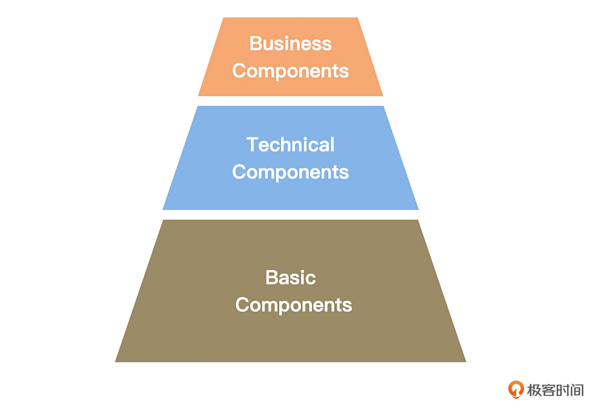
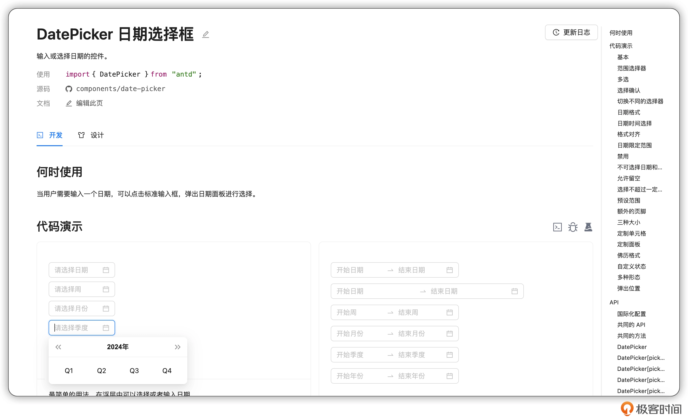
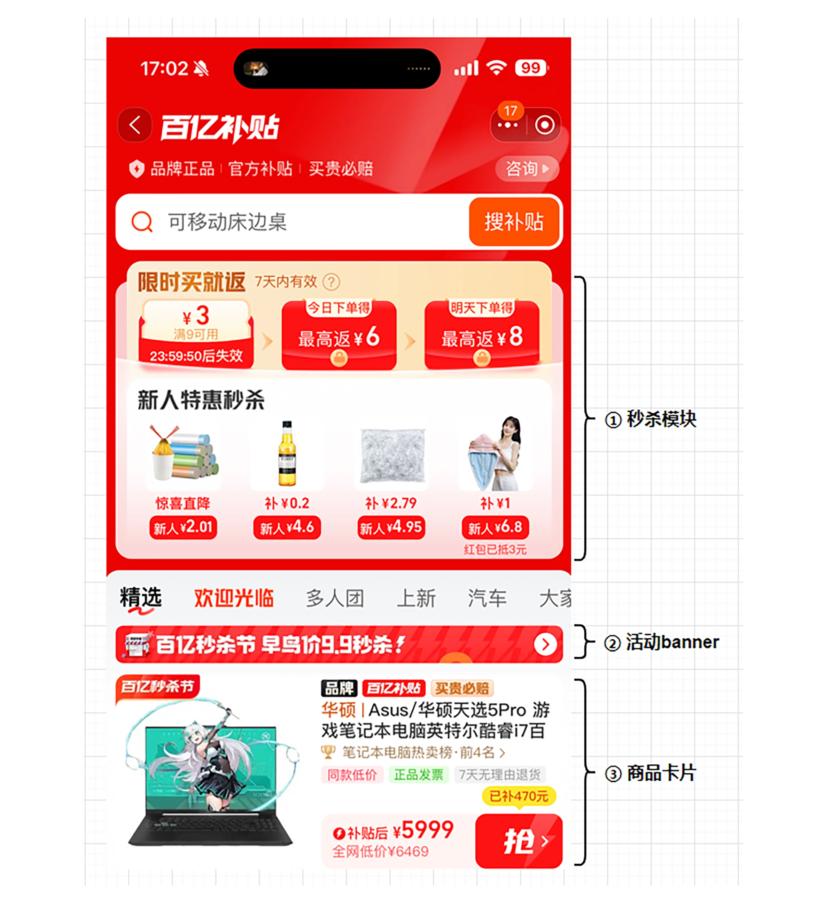

# 02 | AI如何读懂组件：组件的划分粒度及可解释性

你好，我是柳博文，欢迎和我一起学习前端工程师的 AI 实战课。

作为前端工程师，我们用过许多成熟且优秀的组件库（AntDedign， MaterialUI 等），甚至自己开发并封装过不少业务范围内的组件库。久而久之，你也会对组件划分粒度建立自己的思考。

这节课，我们就来深入聊聊组件的划分粒度，还有怎么设计出清晰易用的组件，这些将会为我们后续训练 AI 组件识别模型打下一个良好的基础。

## 组件库组件粒度划分设计

前端组件库的粒度划分是一个重要的话题。从工程层面看，它直接关系到组件的可复用性、灵活性和项目的整体结构，AI 模型能够识别到的粒度，也就是作为模型训练工程师的你，对组件粒度的理解程度。

工欲善其事，必先利其器，我们深入理解一下什么是组件粒度。

### 什么是粒度

首先，从定义上，在前端开发中，组件粒度指的是组件所封装功能的粗细程度。粒度大的组件封装了较多的功能和逻辑，而粒度小的组件则专注于更细粒度的功能。

通常来说，我们会对页面组件进行划分，这里我想和你一起梳理一下这些过往经验，也就是组件划分思路和方法。

### 如何有效地划分粒度

大体来说，常见的组件划分方法包括功能需求法、代码结构法和用户体验法，根据这些方法会划分出不同粒度的组件，我们依次来看看。

首先是功能需求法，这需要我们先进行需求分析，一般来说你会拿到设计师产出的设计稿，根据稿子和具体功能就能确定出需要划分为哪些组件了，同时基于独立性和重复性会再拆分或封装一些组件。

其次是代码结构法，多数情况我们是在维护一个旧有代码库，在此基础上维护项目和实现需求。这个时候我们考虑得更多的是现有代码结构，再加上一些需求分析和功能设计来划分组件粒度，将可以拆成组件的代码进行封装。

最后是用户体验法，为了开发出用户体验更好的前端页面，我们会优先考虑用户体验，将相似但略有不同的界面元素或功能拆分成独立的组件。这样做虽然可能会造成代码层面的冗余，并且牺牲一些工程效率，但能够显著提升用户的交互体验。

总结来说，三种方法没有孰好孰坏，只是关注点不同，而且三种方法都会或多或少相互影响、共同作用。

### 组件相关的工程化

在实际项目中，我们会依据工程化的规范标准选择合适的划分方法。我简化了一些工程化的流程。一般来说，组件划分通常要经过以下这些步骤。

我们通常会从定义组件规范开始，也就是制定组件的命名规范、属性规范、事件规范等，确保组件的一致性和可维护性。

然后是编写组件代码。根据划分结果，编写相应的组件代码。这一步我们要注意保持代码的清晰和简洁，避免过度封装或冗余代码。

接着是测试组件。对编写好的组件进行测试，确保它们的功能正常且符合需求。同时，也需要进行性能测试和兼容性测试，确保组件在不同环境下都能稳定运行。

最后还有文档化。我们需要为组件编写详细的文档说明，包括组件的功能、属性、事件、使用方法等。这有助于其他开发者更好地理解和使用组件。

组件划分过程中，我们可以依据上述方法论来完成，但也需要注意一些点。

### 注意事项

封装代码虽然可以提高代码的复用性和可维护性，但过度封装会导致组件过于庞大和复杂，难以理解和维护。为此，我们在划分组件时需要注意保持适度的封装程度。

复用性也十分重要，是衡量其好坏的重要标准之一。在划分组件时需要考虑其复用性，尽量将具有通用性的功能和逻辑封装成组件，以便在其他项目中复用。

保持组件的一致性也同样重要，这包括命名规范、属性规范、事件规范等方面的一致性。这有助于其他开发者理解和使用组件，并减少潜在的错误和冲突。

总之，通过合理的划分和实现，可以提高组件的复用性、可维护性和项目的整体质量。

### 三层组件粒度

基于以上的设计原则和工程化要求，我们一般会将组件粒度划分为三层结构，基础组件、技术组件和业务组件。

基础组件是跟业务和技术完全无关的组件，属于最基础最底层的组件，像按钮、输入框、图标Icon 等，这类组件几乎接近于原生元素。

技术组件则是在基础组件之上，对特定基础组件进行一定基础的技术能力封装，比如常用的搜索框。对于基础组件来说这是一个输入框，但现在具备了搜索属性，我们就可以在基础输入框之上加入搜索按钮、模糊匹配等样式功能，这就完成了技术组件的封装。

业务组件则是在技术组件之上，针对特定业务范围内的通用使用场景，定制跟业务紧密相关的组件。例如在搜索框的基础上，提供公司内部数据预加载等特定范围内的功能设定。

## 可解释性组件

《计算机程序构造与解释》中曾说“代码是写给人看的，不是写给机器看的，只是顺便计算机可以执行而已” 。这段话同样也适用于组件。有了好的组件粒度，为了更好地使用，我们需要让组件具备足够的可解释性。

可解释性意味着组件的设计、命名、文档、实现方式以及使用场景都应该能够清晰地传达其用途和功能。这能有效提高开发效率、减少误解，并促进团队协作。

划分后的组件，无论是基于功能还是使用场景，它都具备了一定条件下的语义标签。这个语义标签在 AI 层面能够对 AI 模型理解组件起到很大的帮助，或者说这就是 AI 模型理解组件的入口，我们如果想在前端开发全流程上都使用到 AI 模型，可解释性更是不可或缺的。

所以，无论是工程化层面还是 AI 层面，一个清晰的可定义可解释的组件都是必不可少的。接下来，我们就来看下如何做到一个组件的可解释性。

通常意义来说，一个好的组件库会有一个清晰明了的组件使用文档（Storybook）。在这个使用文档中，会有当前组件的使用示例和效果展示，还有更详细的组件功能文档（包含组件说明、属性与方法和最佳实践等）。

AntD 是一款很优秀的前端组件库，我们来看看其中 DatePicker 日期组件的 storybook 的信息组成。

首先是一个清晰的命名，通过命名能够直接反映出组件的功能和用途，DatePciker 清楚地表达出它是一个日期选择器。第二就是组件说明，目的是编写简洁明了的说明，解释组件的设计目的、应用场景以及它解决了什么问题。第三是组件的使用示例，让使用者充分了解组件使用方法。最后还有一个属性与方法的具体文档，这能方便我们直接查询组件的特性。

我们可以看到，通过这样一个 storybook，组件就具备了工程化层面的可解释性。

接下来我们再看看业务层面的可解释性。换句话说，就是我们希望组件可以很好地表达业务，甚至表达数据结果。

前面我们在组件划分粒度部分，说到了组件的三层结构。第三层划分为业务组件，这类组件与业务进行了强绑定，是为特定业务特殊制定的功能和界面设计。

比如电商环境的秒杀模块、活动 banner 商品卡片等。这类组件专门为秒杀和电商活动场景设计，非常贴近用户的使用习惯，且能够代表一定的数据结果。你可以参考后面这张图。

我们以秒杀模块为例，秒杀模块一经透出，用户就能感知到这里面商品大概率是十分便宜的，所以用户愿意点进来。对产品来说，这个模块的点击率一定是比较高的，漏斗的每一层都会变粗，那么最后成交的数据自然也比较可观。这就是这个组件的可解释性，在用户层面能够很好地抓住用户心智，在商品层面能够表达出一定程度的数据结果。

基于此，我们其实可以将组件的可解释性分为两个部分。一部分比较常规，是组件工程化的可解释性，这可以有效提高组件库组件的可解释性，使它们更加易于理解和使用。这有助于提升开发效率、减少错误，并促进团队协作。

第二部分则是与业务强相关的可解释性，组件能够很好地表达和承接用户和产品双方的意愿、需求以及背后数据的意义，这也是 AI 模型需要理解的可解释性，这在后面课程的实战环节会细讲。

## 总结

前端组件库的粒度划分是提升开发效率和项目质量的关键。通常，我们将组件划分为三层——基础组件（如按钮、输入框）、技术组件（在基础组件上增加特定技术能力，如搜索框的搜索功能）和业务组件（针对特定业务场景定制的高级组件）。

合理的粒度划分能确保组件既不过于庞大复杂，也不过于细碎，从而提高复用性、可维护性和用户体验。

组件的可解释性也很重要，它能让我们更容易地理解和使用组件库中的组件，提升开发效率，并促进团队协作。想要实现可解释性，关键在于清晰命名、详尽文档、直观设计、灵活 API 以及通过 Storybook 等工具展示组件。

组件在业务上的可解释性需要我们特别关注，这样组件才能在成为业务组件的同时，与业务属性强绑定，并且更好地理解和承接用户的心智需要以及产品的业务表达。这也是 AI 模型需要学习和理解的组件可解释性。

这里我想提醒你，三层设计中的业务组件与组件在业务上的可解释性，是两个不同维度的定义。举例来说，在 H5 的页面中顶部有一个搜索模块，这个搜索如果归类到业务组件范围内，那么百亿补贴、闲鱼、盒马这些 App 里面的 H5 页面搜索框都能够直接使用。而在业务上的可解释性说的是像秒杀组件，这种一看就能知道是用在百亿补贴这类页面中的组件，并且它会绑定一些专属属性，比如将百亿补贴的数据直接进行一个预加载。

## 思考题

如果我们要设计实现一个顶部搜索栏，你认为这是什么粒度的组件，应该具有哪些功能集成。

欢迎你在留言区和我交流互动，如果这节课对你有启发，也推荐分享给身边更多朋友。
