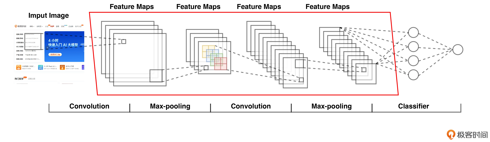

# 03-MachineVision：理解计算机视觉

你好，我是柳博文。欢迎和我一起学习前端工程师的 AI 实战课。

从这节课开始我们就正式进入 AI（artificial intelligence）的学习部分了，AI 作为人工智能的简写和统称，又细分了多种领域，包括机器学习、深度学习、自然语言处理、计算机视觉（Computer Vision， 简称 CV）、机器人学、知识表示与推理、认知计算等等。

其中，计算机视觉（CV）是 AI 里一个重要分支。随着机器学习和深度学习的发展，计算机视觉的应用场景也越来越广泛。这节课，我们将会重点了解计算机视觉领域的发展脉络与核心技术原理，最后还会讨论计算机视觉在前端方面的创新应用。

## 计算机视觉的发展

首先，我们一起了解一下计算机视觉的发展过程。

计算机视觉的相关技术出现在上个世纪 50 年代，受限于物理计算设备的计算效率，这个时候的研究主要集中于图像处理和识别模式上，而且技术和算法也处于原始时期。

经过 30 年的发展，计算机视觉的研究开始集中于如何提取图像中的特征并用于模式识别。这个阶段出现了边缘检测、角点检测等基础算法，基于这些算法，光流、立体视觉等技术慢慢出现，主要用于分析图像序列和 3D 场景。

计算机视觉技术发展需要大量的计算资源，但那时这些条件都很有限，因此技术的发展并不迅速，直到机器学习的出现。

大概在 2000 年的时候，随着机器学习的发展，计算机视觉领域开始引入支持向量机（SVM）等算法进行图像分类和识别。

于是，计算机视觉开始从规则和模型驱动转向数据驱动，也就是这个时候，计算机视觉开始将注意力放在了大量的数据集上。但大量的数据需要更好的算法原型和更高计算效率的物理计算设备，所以这个时期仍然受限于算法的发展和物理计算设备的计算效率。

直到 2012 年，深度学习崛起，卷积神经网络（CNN）成为计算机视觉的主流方法。基于卷积核的矩阵运算能够大大提高图像特征提取效率，能极大地提高图像分类和目标检测等任务的性能。至今，计算机视觉的研究领域使用的仍然是各类深度学习的 AI 模型。

因此，后面课程里的实践同样会基于深度学习的 AI 模型完成，我们的学习重点也将放在深度学习的 AI 模型上。

## 计算机视觉的核心技术

了解了计算机视觉的发展脉络，我们再了解一下这个领域的核心技术，主要包括特征提取、目标检测、图像分割、3D 重建等方面。

但这是个比较宽泛的范围，我们本着学以致用的原则，把重点放在和后面实战项目强相关的特征提取和目标检测技术上。

### 特征提取

首先是特征提取。顾名思义就是需要我们对图片做一些处理，处理的目标就是提取图像的特征。实际上，与计算机视觉相关的计算都是在对图像的特征进行提取，进而完成图像的分类、识别等任务。所以，特征提取可以说是计算机视觉 AI 模型发挥作用的第一步。

图像的特征提取有许多成熟且优秀的算法，比如边缘检测、角点检测、直方图描述、深度学习特征提取等等。课程里我们会用到深度学习特征提取方法。至于其他方法，你有兴趣的话，课后可以自行查阅其他资料。

深度学习特征提取方法是利用深度神经网络，特别是卷积神经网络（Convolutional NeuralNetwork）来自动学习和提取图像特征，不需要我们手动设计特征提取器。这是一个模型自我学习的过程，我们只用指定学习的目标和方法即可。

我打个比方来帮助你理解。你可以想象存在这样一个黑盒，你可以把一张图像作为输入扔进这个黑盒，并设定黑盒的一些参数。最后黑盒就能够给出输入图像的一些特征。实际上，深度学习至今仍然是一个不可解释的黑盒过程。

这个黑盒我们称为深度神经网络，这个网络具有多层结构，层与层之间具有不同种类的卷积核，每一次计算都可以认为是进行了一次特征提取。下一层的输入，就是上一层与上一层的卷积核进行运算后的输出。那么经过多层计算下来，图像的特征就能很好地以数字化形式保存下来，用于分类、识别等任务了。

为了能够更加具象化地理解深度学习特征提取的过程，我画了一张简化图。



可以看到最左侧以一张图像作为输入，经过多层特征提取计算后，最后能够得到一组特征值。这组特征值就能够用来进行分类、识别等计算机视觉任务了。

图中的 Convolution 以及 Max-pooling 你都可以认为是在做特征提取计算操作。

同样，我们也可以通过 tensorflow.js 来实现一个深度学习的特征提取实例，请看下面的代码。

```xml

<script src="https://cdn.jsdelivr.net/npm/@tensorflow/tfjs@latest"></script>
<script>
async function loadModelAndPredict() {
 // 加载预训练的MobileNet模型
 const model = await tf.loadLayersModel('https://storage.googleapis.com/tfjs-mod
 // 获取图像元素
 const image = document.getElementById('image');
 // 将图像转换为Tensor
 let tensor = tf.browser.fromPixels(image)
   .resizeNearestNeighbor([224, 224]) // 改变图像大小以匹配模型的输入尺寸
   .toFloat()
   .expandDims(); // 增加一个维度以匹配模型的输入
 // 使用MobileNet模型提取特征
 const prediction = model.predict(tensor);
 // 输出特征
 prediction.print();
 // Tensor :[[1e-7, 0.0002893, 0.0000012, ..., 0.0000016, 0.0004594, 0.0000652],
}
loadModelAndPredict();
</script>
```

这是一段需要跑在网页中的实例代码，用来对一张图片做特征提取。首先需要新建一个test.html 文件，并在 HTML 文件中以 script 方式引入 tensorflow.js 文件，并编写loadModelAndPredict 函数来进行图片特征提取。

我们一起来梳理一下这段代码做了什么。首先是加载了 MobileNet 模型。然后，获取页面上的图像元素，并将其转换为 TensorFlow.js 可以处理的 Tensor 格式。接着，我们调整了图像大小以匹配模型的输入尺寸，并将其传递给模型进行预测。最后，我们打印出预测结果，这些结果可以看作图像的特征表示。因为上图所示的计算过程，tensorflow.js 已经帮我们实现了，所以你看到的代码是十分简洁的，调用相应接口方法即可。

### 目标检测

理解了深度学习的特征提取原理和方法，我们再一起来看下什么是目标检测。

目标检测通常需要完成两个主要任务，一是识别图像中的对象类型（目标分类），二是确定每个对象的位置（目标定位）。

深度学习方法通过训练神经网络自动学习图像特征来实现这两个任务。学习过程中的图像特征就来源于刚刚讲的深度学习特征提取。所以，深度学习特征提取与目标检测是相辅相成的。

目标检测的过程中，为了更好地完成图像目标分类和定位任务，通常需要大量的标注数据，也就是包含对象及其边界框的图像。后面课程里我们制作数据集，就需要大量标注数据。

目标检测主流的算法分为两大类：一阶段（one-stage）方法和两阶段（two-stage）。用一句话概括它们的本质区别就是，one-stage 的方法会将目标检测的分类和定位同时完成，而two-stage 则是分为两步，先进行分类，再进行定位。

one-stage 和 two-stage 各自有一些具有代表性的深度算法模型。

先看 one-stage 方法。

- YOLO（You Only Look Once）：将目标检测视为单一回归问题，直接从图像像素到边界框坐标和类别概率的映射。

- SSD（Single Shot MultiBox Detector）：在不同尺度的特征图上进行目标检测，来提高对不同大小对象的检测性能。

然后是 two-stage 方法。

- R-CNN 系列（R-CNN, Fast R-CNN, Faster R-CNN）：先生成候选区域（regionproposals），然后对每个候选区域进行分类和边界框回归。

- Faster R-CNN：引入区域提议网络（RPN），以共享卷积特征的方式高效生成候选区域。

在实践章节中我们会选择 one-stage 的 YOLO 方法。

## CV 在前端的创新应用

接下来，我们一起来看一下计算机视觉在前端上的创新应用。

首先是以图搜图，你一定用过各大电商软件的拍照搜索，这个功能的原理就是通过计算机视觉识别商品类别，得出图片信息摘要，并进行搜索。蚂蚁的 AntD 组件库，我相信你一定或多或少用到过。我们经常需要在一堆图标中寻找一个设计稿中的图标，这个时候我们就可以尝试使用设计稿中的 Icon 图片进行以图搜图，快速找到类似的图标。这是 Antd 官方真实上线过的一个 AI 实验。

提到代码生成工具，我想你一定会想到现在的 ChatGPT 和 Copilot，那你是否在这两个工具火起来之前，接触过 ImageCook 或者 CodeFun 呢？这类工具可以从设计稿直接生成代码，而且是端到端生成高可维护性的代码。

就拿 ImageCook 来说，它能通过输入图片或者设计稿生成目标框架代码。这个工具就用到了多种计算机视觉算法，算是国内 AI 结合前端创新的先驱者。当时开发维护 ImageCook 的时候，ChatGPT 和 Copilot 这一类工具均没有发布面世。

## 总结

这节课就讲到这里，我们来做一个总结吧。

人工智能（AI, artificial intelligence）是一个庞大的研究领域，包含多个不同的研究方向，我们深入探讨了计算机视觉方向。

首先是计算机视觉的发家史，计算机视觉致力于让计算机像人类一样能够看到并读懂图像的信息，对图像内容进行识别和理解。伴随相关算法、学习方法和物理计算设备的发展，计算机视觉逐渐从算法驱动发展到数据驱动。深度学习的发展也大大提高图像特征提取效率，能极大地提高图像分类，目标检测等任务的性能。

计算机视觉里包括特征提取、目标检测、图像分割、3D 重建等核心技术，我们深入探讨了特征提取和目标检测技术。

通过深度学习特征提取方法，能够做到模型算法自动进行特征提取及结果的自我矫正学习。其中卷积神经网络是目前最流行的特征提取方式。目标检测能够识别和定位图像中的对象，具体有两类主流方法——one-stage 和 two-stage。one-stage 是将识别和定位在一次计算中完成，而 two-stage 则是将识别和定位分为两步完成，先识别分类再定位。

AI 在前端的应用国内早有探索，像以图搜图、代码生成工具 ImageCook 等，这些都是实际业务场景的 AI+ 前端创新（AIGC）应用。

## 思考题

目标检测中 one-stage 和 two-stage 的区别是什么，你还知道其他的目标检测方法么？

欢迎你在留言区和我交流互动，如果这节课对你有启发，也推荐分享给身边更多朋友。
