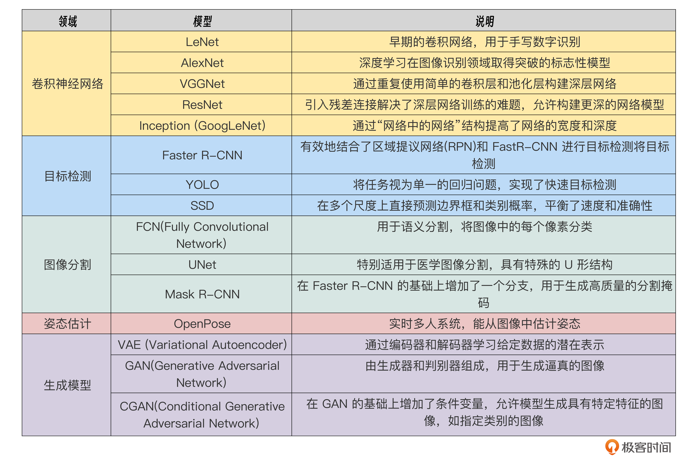
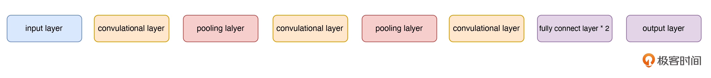
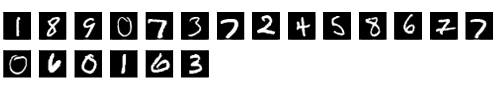
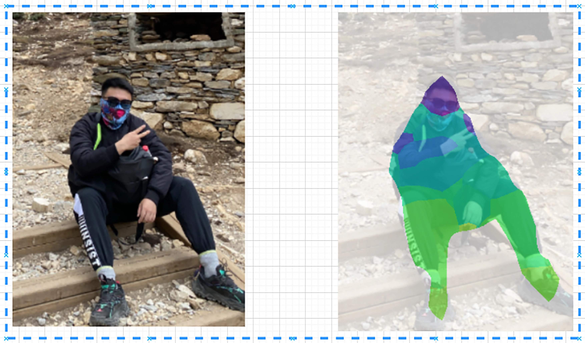

# 05 | 模型介绍：前端工程师可以玩的AI视觉模型

你好，我是柳博文，欢迎和我一起学习前端工程师的 AI 实战课。

前面我们一起梳理了计算机视觉的发展史，学习了计算机视觉核心技术中的深度学习、特征提取和目标检测技术，并对 AI 模型中用到的数学知识应用有了大致的了解。

不过前面我们关注的主要是计算机视觉和 AI 模型的技术细节，并没有实际动手尝试。这节课我们站在巨人的肩膀上看看现在流行的计算机视觉 AI 模型，亲自上手应用一下这些模型。

## 视觉 AI 模型

计算机视觉是深度学习应用最为广泛和成熟的领域之一，涵盖了从基本的图像分类到复杂的场景理解等多种任务，这些都是成熟的 AI 模型。我们可以直接使用别人训练好的模型，也可以在别人预训练好的模型基础上，再次进行自定义训练。

后面是一些在计算机视觉领域内广泛使用的深度学习模型，我以图表的形式展示出来，为你展示一下现在流行的模型集合全貌。



在这张图表中第一个是卷积神经网络，这类模型是深度学习基础模型类型，其他的视觉模型都会基于卷积神经网络进行优化和改进。

其中 ResNet 又是更加重要的一个基础模型，它通过残差单元在数学层面有效地解决了模型的梯度消失和梯度爆炸问题，使得模型的宽度和深度可以进一步扩大。这样模型能够抓到的特征就会更多，能够识别的范围就会更广。

蓝色区域的目标检测模型则是需要我们重点关注的模型了。在实践章节，我们将使用目标检测模型来识别前端组件。在众多目标检测模型中，R-CNN 是典型的 two-stage 目标检测算法，YOLO 和 SSD 则是典型的 one-stage 目标检测算法。其中，YOLO 模型在小目标识别任务上表现优异，所以，后续我们在进行组件识别时也会用到 YOLO 模型。

那么，其他应用场景的视觉模型，比如图像分割、姿态估计以及对抗生成模型等都有比较经典的模型，不过它们不在课程的讨论范围里，感兴趣的话可以自行查阅。

## 牛刀小试

看了如此琳琅满目的计算机视觉 AI 模型，你是否想动手一试或者直接看一些实际的例子呢？我们这就来一起体验几个入门实例，后面是几个基于 Tensoflow.js 的模型实例。

### LeNet 识别手写数字

首先是 AI 领域的 HelloWorld- 手写数字的识别，这个实例是想通过训练 AI 模型，让它能够识别手写数字。通过完成这个最简单的实例来感受下视觉模型，你也会体验到，AI 也不是想象中的晦涩难懂、难上手。

正如标题所写，我们要使用 LeNet 模型来识别手写数字。LeNet 是最早的卷积神经网络之一，主要用于解决图像识别问题，特别是在识别手写数字方面表现出色。同时，LeNet 也可以视为卷积神经网络模型的 HelloWorld，它具备十分简洁的结构设计，再加上输入层后仅 8 层网络结构，层结构如下图所示。



我们知道，基于深度学习的目标检测已经从规则及模型驱动来到了数据驱动，好的数据集能够帮助训练出更好的模型。MNIST 数据集是一个十分优秀的手写数字数据集，我们可以直接使用。

我们先来看一下 MNIST 数据集中的手写数字的图片，其实就是通过手写出来的 0 到 9 的数字图片作为模型的基础数据。



有了模型 LeNet 和数据集 MNIST，我们开始动手吧。

首先我们需要在 NodeJS 的运行环境下，安装 @tensorflow/tfjs-node 及 monist 两个包。@tensorflow/tfjs-node 是 tensflow.js 的 NodeJS 版本包，能够在 NodeJS 的环境下运行，使用它可以快速构建 LeNet 模型并进行模型的训练。而 mnist 包则是 MNIST 数据集包，下载后

```javascript
通我们过代码中的  loadData 就能够使用 MNIST 数据集了。整体流程代码如下：
const tf = require('@tensorflow/tfjs-node');
const mnist = require('mnist');
// 加载MNIST数据
const loadData = () => {
 const set = mnist.set(8000, 2000);
 const training = set.training;
 const test = set.test;
 const formatData = (data) => {
   return {
     images: tf.tensor(data.map(item => item.input)).reshape([-1, 28, 28, 1]),
     labels: tf.tensor(data.map(item => item.output))
   };
 };
 return {
   trainData: formatData(training),
   testData: formatData(test)
 };
};
// 构建LeNet模型
const buildLeNetModel = () => {
 const model = tf.sequential();
 model.add(tf.layers.conv2d({
   inputShape: [28, 28, 1],
   kernelSize: 5,
   filters: 6,
   activation: 'relu',
 }));
 model.add(tf.layers.maxPooling2d({poolSize: 2, strides: 2}));
 model.add(tf.layers.conv2d({
   kernelSize: 5,
   filters: 16,
   activation: 'relu',
 }));
 model.add(tf.layers.maxPooling2d({poolSize: 2, strides: 2}));
 model.add(tf.layers.flatten());
 model.add(tf.layers.dense({
   units: 120,
   activation: 'relu',
 }));
 model.add(tf.layers.dense({
   units: 84,
   activation: 'relu',
 }));
 model.add(tf.layers.dense({
   units: 10,
   activation: 'softmax',
 }));
 return model;
};
// 训练和评估模型
const run = async () => {
 const { trainData, testData } = loadData();
 const model = buildLeNetModel();
 model.compile({
   optimizer: tf.train.adam(),
   loss: 'categoricalCrossentropy',
   metrics: ['accuracy'],
 });
 await model.fit(trainData.images, trainData.labels, {
   epochs: 10,
   validationSplit: 0.1,
 });
 const evaluation = await model.evaluate(testData.images, testData.labels);
 console.log(`Test Loss: ${evaluation[0].dataSync()}, Test Accuracy: ${evaluatio
};
run().catch(console.error);
```

这段代码中包含了 mnist 数据集的获取和处理、构建 LeNet 模型结构，以及训练评估模型。在NodeJS 环境下初始化项目并安装依赖包后，运行前面这段代码，便可以看到测试数据的准确率了。

LetNet 识别手写数字作为计算机视觉模型领域的 Hello world，充分展示了 AI 视觉模型的结构和工作过程。接下来我们来看一些封装好的前端 AI 库。

### Face-API 面部识别

首先是面部识别的一个前端 JavaScript 库——Face-API.js，它是基于 Tensorflow.js core API实现的。

面部识别是一个比较成熟的应用，Face-API.js 是专注于面部检测和面部识别的 JavaScriptAPI。它可以在浏览器中实现实时面部检测、面部表情识别、面部地标检测等功能。

中提供的 Example 就可以进行检测了。

这里，我将极客时间首页的一张带有几位其他老师头像的作品图片作为输入进行测试。

首先是人脸检测。输入图片后模型给出的测试结果如下图，可以看到人脸都被正确地识别和定位了。


接着，我们来试试人脸关键点检测（Face Landmark Detection），也就是识别和定位人脸图像中的关键特征点，例如眼睛、鼻子、嘴巴、眉毛、耳朵等部位的轮廓和形状。测试结果如图，可以看到关键点被正确勾勒出来了。


### BodyPix 人体姿态识别

了解了人脸相关检测，我们再来看一个人体姿态的检测。这仍然有一个封装好的检测模型可以使用，它就是 BodyPix。

BodyPix 是 TensorFlow.js 的一个模型，可以实时在浏览器中对人体姿态进行分割和识别，它可以用于背景替换、身体部位的交互设计等，它在检测并标识身体部位方面表现良好。我们来看一个 BodyPix 完成的身体部位检测的例子。



从检测结果我们可以看到，BodyPix 能够大致将图片中的人物进行检测并标识，但是识别效果并不是很符合预期。不过问题其实不在于模型本身，而是这类结构的图像在其训练数据集中占比不高。因此优化方法就是将其作为预训练模型，使用我们做测试的这类结构的图像再次训练，然后模型就能够很好地检测识别了。

## 总结

今天的课程告一段落，我们来做个总结吧。

计算机视觉是一个发展已久且成熟的领域，从基本的图像分类到复杂的场景理解等多种任务都出现了不同的视觉模型。在这些场景中，我们需要重点关注卷积神经网络模型，这是神经网络模型的基础模型。同时，ResNet 也相当重要，它通过引入残差单元，很好地解决了因模型深度加深带来的梯度消失等问题。

同时，我们还需要重要关注目标检测模型，后续我们将会在实践环节用到 YOLO 等目标检测模型。YOLO 因其在小目标识别任务上表现优秀，在不少实际应用场景里都会用到。

另外，这节课里我们还通过三个小实例，直观感受了 AI 视觉模型的魅力。首先是 LeNet 实现的手写数字识别任务，它算是 AI 视觉模型领域的 HelloWord 了。

然后，通过 Face-API.js 和 BodyPix 的演示学习，我们了解了 AI 视觉模型在人脸识别和人体姿态识别上的实例。最后我们又尝试了 BodyPix 模型，结合它的测试结果不难发现，我们固然可以使用现成的模型，但预测结果可能会受限于数据集收集范围，解决办法就是将现有模型作为预训练模型进行二次训练。

## 问题

为什么预训练模型直接用来检测自定义图像的效果可能不理想？

欢迎你在留言区和我交流互动，如果这节课对你有启发，也推荐分享给身边更多朋友。
