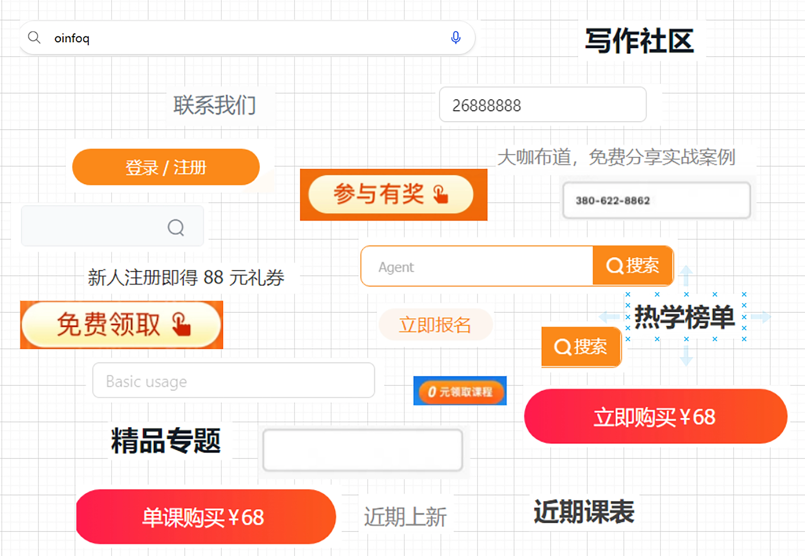
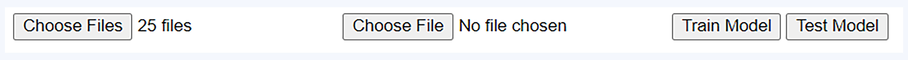
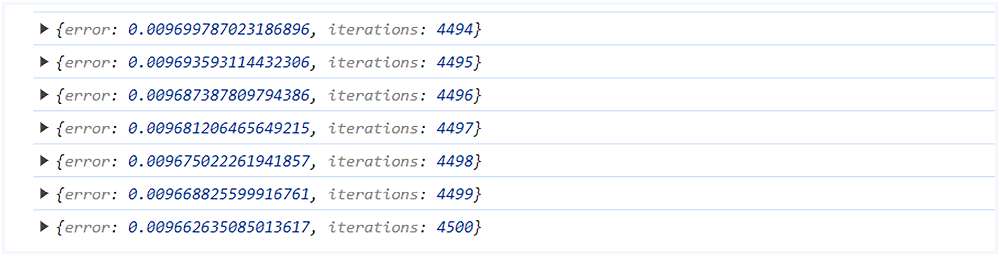
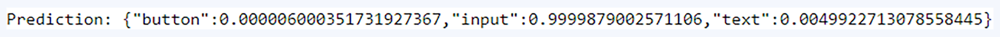

# 07 | 第一个AI小实验：让你的电脑识别组件类型

你好，我是柳博文，欢迎和我一起学习前端工程师的 AI 实战课。

上一节课中，我们了解了深度学习模型的训练计算需要的环境配置，初步掌握了 JavaScript和 Python 这两种环境的区别和联系。另外，我们在上节课也使用 Brain.js 实现了一个文本二分类任务。

那么，这节课我们来完整地完成一个小实验，使用神经网络完成组件的分类。因为是实验层面的，所以涉及的数据量会相对比较小。基于上节课的环境配置，这个小实验我们使用 JS 版本来完成。

搞定了这个实验，你对计算机视觉技术的应用也会有更深入的认识。

## 问题定义

正式动手之前，我们先来定义实验要解决的问题。

通常来说，我们希望训练出来一个通用的 AI 模型，也就是能够覆盖足够多的问题场景。但理想是丰满的，很多时候我们还是需要为 AI 模型划定一个区域，也就是定义一个清楚的问题及解决范围，然后再来解决这个问题，以这样的路径来完成 AI 模型的训练。

那么，对于组件分类需要我们训练一个 AI 模型，这个 AI 模型需要完成组件类型的识别，那么我们可以定义为这是一个多分类的任务。

看到这你可能有个疑问，结合前端的经验来看，组件类型种类繁多。这么多的组件类型，都需要识别么？

从快速上手、方便学习的角度考虑，我们可以设定为只简单识别 3 种类型的组件，也就是按钮、输入框、文本节点这三类十分简单基础的类型。

清楚了问题定义及范围划定，我们要使用什么样的模型来解决这个问题呢？后面我们将会使用一个基础的神经网络模型（多层感知器）。

接下来，我们就可以开始模型训练的第一步——收集数据集了。

## 数据收集

刚才我们定义了这个实验的任务，需要识别三种类型的组件。这里我在极客时间官网等网站上截取了 25 张图片，分别为按钮、输入框、文本节点，将其作为模型训练数据。后面的截图展示的就是这节课所用到的数据概览。



准备好数据后，我们就可以进行模型训练了。因为这个实验的数据量小，而且图像尺寸也较小，所以这里我们仍然可以选择浏览器作为实验环境，同时选用 Brain.js 来实现。

那么，要在浏览器实现这个实验，首先要考虑如何让模型读取到图像数据。

因为 JavaScript 在浏览器宿主环境下是不能直接读取图像数据的，所以这里我们需要借助input 标签来实现，并给 input 标签带上 file 的类型属性。另外，还要设置 multiple 属性为true，这样就能够通过 input 来同时选择多个图像文件。

同时为了更方便地进行模型的训练和预测，我们可以添加两个按钮，一个用于执行模型的训练，一个用于执行模型的测试，并绑定对应的方法。

具体操作就是新建一个 test.html 文件，并编写如下代码。

```xml
<!DOCTYPE html>
<html lang="en">
<head>
 <meta charset="UTF-8">
 <meta name="viewport" content="width=device-width, initial-scale=1.0">
 <title>Browser-based Neural Network</title>
 <script src="./brain.js"></script>
</head>
<body>
 <input type="file" id="trainFiles" multiple>
 <input type="file" id="testFile">
 <button id="trainButton">Train Model</button>
 <button id="testButton">Test Model</button>
 <script>
   // Event listeners for the buttons to train and test the model
   document.getElementById('trainButton').addEventListener('click', async () =>
     const trainFiles = document.getElementById('trainFiles').files;
     const trainData = await loadTrainData(trainFiles);
     const net = await trainModel(trainData);
     window.net = net; // Save the trained model to the global scope
   });
   document.getElementById('testButton').addEventListener('click', async () => {
     const testFile = document.getElementById('testFile').files[0];
     if (window.net) {
       await testModel(window.net, testFile);
     } else {
       console.log('Please train the model first.');
     }
   });
 </script>
</body>
</html>
```

我们在浏览器中运行这段代码，可以看见页面中有两个文件类型的 input 元素用于选择训练数据和测试数据，以及两个触发模型训练和测试的按钮。



## 数据处理

现在，我们可以通过 input 获取图像了，但是原始图像是无法直接“投喂”给模型做训练的。

接下来，还需要继续实现数据加载函数，用于从文件中读取图像，并将其缩放到指定尺寸，同时提取像素数据并归一化，最后返回一个包含图像像素值的数组。我们一般把这个过程称为数据的预处理，它通常用于图像识别或处理。

因此我们需要一个数据加载函数 loadImageData，在函数中我们使用 Canvas 来实现这一过程。

```javascript
const loadImageData = (file) => {
   return new Promise((resolve, reject) => {
       // Load the image data from the file
       const reader = new FileReader();
       reader.onload = (event) => {
           const img = new Image();
           img.onload = () => {
               // Draw the image onto a canvas and extract the pixel data
               const canvas = document.createElement('canvas');
               canvas.width = 28;
               canvas.height = 28;
               const ctx = canvas.getContext('2d');
               ctx.drawImage(img, 0, 0, 28, 28);
               const imageData = ctx.getImageData(0, 0, 28, 28);
               const data = [];
               for (let i = 0; i < imageData.data.length; i += 4) {
                   data.push(imageData.data[i] / 255); // Normalize the pixel va
               }
               resolve(data);
           };
           img.src = event.target.result;
       };
       reader.onerror = reject;
       // Read the file as a data URL
       reader.readAsDataURL(file);
   });
};
```

有了预处理数据后，接下来需要定义一个训练数据处理函数，用于从一系列文件中加载图像数据，并根据文件名确定其类别，将图像数据和类别标签组合成适合训练机器学习模型的格式。这个函数的代码如下所示。

```javascript
const loadTrainData = async (files) => {
   const trainData = [];
   const categories = ['text', 'input', 'button'];
   for (const file of files) {
       // Find the category of the file by its name
       const category = categories.find(cat => file.name.includes(cat));
       if (category) {
           // Load image data by the funtion:loadImageData we defined before
           const imageData = await loadImageData(file);
           if (imageData) {
               trainData.push({
                   input: imageData,
                   output: { [category]: 1 }
               });
           } else {
               console.error(`Failed to load image data for file: ${file.name}`)
           }
       } else {
           console.error(`No category found for file: ${file.name}`);
       }
   }
   // Return the loaded training data
   return trainData;
};
```

对照代码可以看到类型定义为了三类，分别是 text、input 和 button。这里需要注意在命名原始图像数据时，我们需要同时写入图像分类的类型名，便于程序读取区分。

## 模型训练

好了，数据准备完成，接下来就可以进行模型的训练了。我们需要定义一个异步函数trainModel，并使用 brain.js 库创建一个基础的神经网络模型（多层感知器）。

```javascript
const trainModel = async (trainData) => {
   const net = new brain.NeuralNetwork();
   net.train(trainData, {
       iterations: 4500,
       log: (details) => {
           console.log(details);
       },
       logPeriod: 1,
       learningRate: 0.01
   });
   return net;
};
```

我们来解读一下这段代码的意思。首先使用 brain.js 库新建了一个神经网络模型实例，然后使用这个实例进行训练，最后返回训练完成的模型。训练过程中，模型会根据训练数据调整其内部权重，最小化预测输出与实际标签之间的差异。

在调用 net.train 方法对神经网络进行训练时，首先需要传入训练数据 trainData，用于训练的数据集。然后需要我们设置一些必要的超参数。

- iterations：训练迭代次数，这里是 4500 次。

- log：日志回调函数，在每次迭代后记录训练详情，这里会将详情打印到控制台。

- logPeriod：控制日志输出频率，值为 1 表示每次迭代都输出日志。

- learningRate：学习率，决定了权重更新的速度，较小的学习率可以使训练过程更稳定，这里我们设置为 0.01。

在模型的训练过程中，打开浏览器的控制台可以实时看到不断有训练日志输出，直到完成我们所设置的迭代次数。



## 模型预测

模型完成训练以后，我们便可以进行测试了。这时同样需要通过调用 loadImageData 函数加载文件对应的图像数据，然后使用 net 对加载的图像数据进行预测处理，得到输出结果output。最后，通过控制台输出预测结果。

```javascript
const testModel = async (net, file) => {
   const testImageData = await loadImageData(file);
   const output = net.run(testImageData);
   console.log(`Prediction: ${JSON.stringify(output)}`);
};
```

这里的测试数据可以去截取一张不在训练数据中的新图像，我这里使用了一张新的搜索框图像，模型预测结果如下所示。



可以看到预测结果中，input 的概率是 99.9%，即模型认为我输入的这一张新的图像是输入框的概率是 99.9%，模型预测结果是非常准确的。

至此，这个让电脑识别组件类型的小实验就完成了。麻雀虽小，五脏俱全，通过这样一个简单的实验，我们已经对神经网络有了初步认识，而且还完整体验了问题定义、模型选择、数据收集、数据制作、模型训练以及模型预测等流程，这也为我们第三章的项目做了铺垫。

## 总结

接下来我们一起来总结一下吧。

虽然我们对 AI 的要求是能够让人一样的思考和解决问题。但就目前的深度学习算法原型和计算设计，还远远达不到人脑神经的设计和组成量，就算再怎么堆料完成这样的结构设计，最终也有可能得不偿失。

所以，无论是出于现状考虑，还是基于成本考虑，在模型训练之前，我们都需要对想要解决的问题有一个清晰的定义，并且为这个问题划定明确的解决范围。这样才能帮助模型进行收敛，更好地解决问题。

之后就是最关键的一环——模型的训练了，它有一个大致统一的流程。

首先是根据任务定义，完成初始数据集的收集以及模型的选定。组件识别是一个多分类的任务，所以我们选择了 Brain.js 来新建一个基础的网络模型（多层感知器）。

接下来的环节就是数据预处理。这里我们要将读取的图像数据缩放到制定尺寸，同时提取像素数据进行归一化。然后返回一个包含图像像素值的数组，绑定图像数据和它对应的类型标签，这样就完成了训练数据的准备。

在进行模型训练时，通常需要我们设置一些超参数，这些超参数包括迭代次数、学习率等，这是根据过往经验进行的一个设置。这里我们设置了模型的迭代次数为 4500，学习率为 0.01。

完成模型训练后，便可以进行模型预测，通过输入不同于训练数据的图像来测试模型的准确率，可以看到模型具有一个较好的预测效果。

## 思考题

如何设定模型的训练超参数，为什么说是根据过往经验来设定的？

欢迎你在留言区和我交流互动，如果这节课对你有启发，也推荐分享给身边更多朋友。
