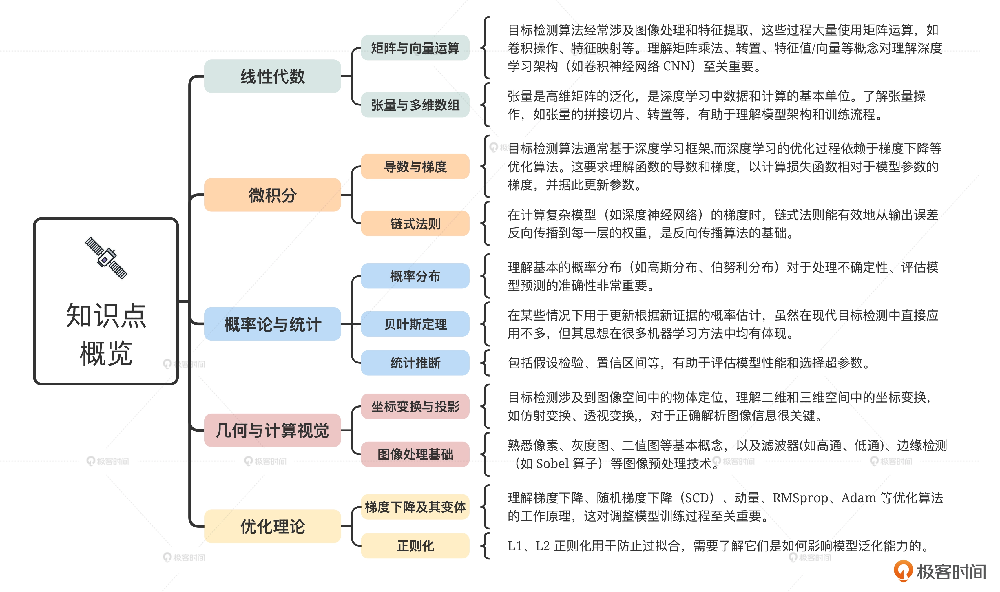

# 08 | 前端程序员应该懂的AI数学知识

你好，我是柳博文，欢迎和我一起学习前端工程师的 AI 实战课。

今天的内容是 AI 数学知识的选学篇，相信通过数学知识应用篇的学习后，你对 AI 所需要的数学知识如何应用已经有了不错的理解。

今天这节课，专为想深入学习 AI 数学知识的前端工程师量身定制，通过一系列精选的数学概念，我们会搭建起通往 AI 世界的桥梁。我们也将揭示其背后的数学原理，让你在不偏离前端开发舒适区的同时，逐步深化对 AI 技术的认识。这不仅是一次知识的拓展，更是技能升级的契机，让你在未来能够更加自信地在项目中融入 AI 元素，推动前端技术与智能科技的融合创新。

现在，就让我们揭开那些支撑 AI 奇迹的数学面纱，开启你的 AI 与计算机视觉融合之旅吧。

## 知识点概览

首先是知识概览。在实践环境，我们用到的技术是目标检测。虽然对于前端来说，日常工作可能不会直接深入到算法实现细节，但了解一些基本的数学知识对于理解算法原理、优化现有库的使用或参与相关项目的开发都是非常有帮助的。

以下是几个关键数学领域的概述，它们与 AI 目标检测算法紧密相关，你可以参考后面的思维导图。



掌握上述数学知识不仅能帮助你深入理解目标检测算法的原理，还能在实践中更加灵活地调整和优化模型。同时，利用现有的库和框架（如 TensorFlow.js、PyTorch 等），即使不深入所有数学细节，也能快速上手并实现基本的目标检测任务。

## 科学计算库介绍

现在我们明确了和目标检测紧密相关的知识点都有什么。为了让你更深入地理解它们，最有效的方式就是在本地运行一些简单示例。这时就需要用到一些科学计算库。

在 JavaScript 领域，有多个科学计算库可供我们选择，来进行数学和矩阵运算，特别适合进行数据处理、统计分析、机器学习等任务。

下面我们就来了解一下三个最为流行的科学计算库，每个库我都提供了一个矩阵乘法的运算实例，你可以通过 npm 安装对应的包，并复制运行代码查看运行结果。

### NumJS

NumJS 是一个轻量级的 JavaScript 库，提供了一系列类似 MATLAB 的数学函数，专为大规模数值计算设计的。它支持多维数组和矩阵运算，适用于浏览器和 Node.js 环境。

```javascript
const nj = require('numjs');
let A = nj.array([[1, 2], [3, 4]]);
let B = nj.array([[5, 6], [7, 8]]);
let C = nj.dot(A, B); // 矩阵乘法
console.log(C.tolist()); // 输出矩阵乘法的结果
```

### TensorFlow.js

TensorFlow.js 是 Google 开发的一个 JavaScript 库，它使开发者能够在浏览器和 Node.js 中直接运行 TensorFlow 模型。它不仅支持强大的矩阵和张量运算，还集成了机器学习模型构建、训练和推理功能，非常适合深度学习应用。

```python
import * as tf from '@tensorflow/tfjs';
async function run() {
 const a = tf.tensor2d([[1, 2], [3, 4]]);
 const b = tf.tensor2d([[5, 6], [7, 8]]);
 const c = await a.matMul(b);
 c.print(); // 打印矩阵乘法的结果
}
run();
```

### mathJS

mathJS 是一个全面的数学库，提供了从基础数学到高级数学的各种功能，包括代数、几何、概率、统计等。它支持多种数据类型，如数字、大数、分数、复数、矩阵等，非常适合进行精确的科学计算。

```javascript
const math = require('mathjs');
const A = math.matrix([[1, 2], [3, 4]]);
const B = math.matrix([[5, 6], [7, 8]]);
const C = math.multiply(A, B); // 矩阵乘法
console.log(math.format(C)); // 格式化输出矩阵乘法的结果
```

### 科学计算库使用小总结

那么这些数据计算库都适合用在什么样的场景里呢？

- NumJS 适合需要 MATLAB 风格 API 的开发者，侧重于数值计算和小型至中型规模的数据处理项目。

- TensorFlow.js 特别适用于深度学习和大型张量运算，适合机器学习项目。

- mathJS 提供了最广泛的数学功能，支持多种数据类型，适合需要高度精确和多样化的数学运算场景。

这节课我们选择 mathJS 作为示例实现的库。后面所有示例代码的环境都需要提前安装并导入mathJS 包。命令如下：

```javascript
const math = require('mathjs');
```

## 深入细节知识

接下来我们深入知识细节，首先是向量与矩阵的运算。

### 向量与矩阵及其运算

首先是线性代数中的向量与矩阵，比较重要的分别是向量运算与矩阵运算。

### 向量

向量是数学中的一个基本概念，尤其在物理学、工程学和计算机科学中应用广泛。向量可以视为既有大小又有方向的数量，通常用箭头表示。在数学上，向量可以看作是一组有序数的集合，称为分量。

向量的基本概念

首先来看向量的定义，一个 n 维向量 v 可以表示为 (v1, v2, …, vn)，其中 vi 表示向量在第 i 个维度上的分量。

向量加法

两个 n 维向量 v 和 w 的和 v + w 是另一个 n 维向量，其各分量为对应分量之和。

## v + w = (v1 + w1, v2 + w2, … , vn + wn)

使用 mathJS 进行实例演示如下：

```javascript
const v = math.vector([3, 1, 4]);
const w = math.vector([1, 5, 9]);
const sum = math.add(v, w);
console.log(sum); // 输出: [4, 6, 13]
```

向量减法

向量 v 减去向量 w 得到的新向量 v - w，其分量为对应分量之差。

## v−w = (v1−w1, v2−w2, … , vn−wn)

使用 mathJS 进行实例演示如下：

```javascript
const diff = math.subtract(v, w);
console.log(diff); // 输出: [2, -4, -5]
```

标量乘法

向量 v 乘以标量 k 得到的新向量 kv，其各分量为原分量乘以 k。

## kv = (kv1, kv2, … , kvn)

```javascript
const scalar = 2;
const scaledV = math.multiply(scalar, v);
console.log(scaledV); // 输出: [6, 2, 8]
```

点积（内积）

两个 n 维向量 v 和 w 的点积定义为它们对应分量乘积的和。

## v ⋅w = v1∗w1 + v2∗w2 + … + vn∗wn

```javascript
const dotProduct = math.dot(v, w);
console.log(dotProduct); // 输出: 32
```

叉积（外积）

仅限于三维空间中的向量，结果是一个新的向量，其方向垂直于 v 和 w 所在平面，大小为 v和 w 构成的平行四边形的面积。

## υ = （υ1, υ2, υ3）, ω = (ω1, ω2, ω3)

## υ × ω = (υ2ω3 −υ3ω2, υ3ω1 −υ1ω3, υ1ω2 −υ2ω1)

```javascript
const dotProduct = math.cross(v, w);
console.log(dotProduct); // 输出: [−11,−23,14]
```

### 矩阵

矩阵是数学中一种重要的数据结构，特别是在线性代数中扮演着核心角色。矩阵由行和列组成的数字（或其他数学对象）的矩形排列构成，通常用于表示线性变换、解决线性方程组、表示向量和进行数据分析等。

矩阵的基本概念

定义

一个 m×n 矩阵是一个由 m 行 n 列元素组成的矩形数组，记作 A = [aij]m×n，其中 aij 代表矩阵第 i 行第 j 列的元素。

加法与减法

若 A 和 B 是同型矩阵（即行数和列数相同），则它们的和 C 和差 D 定义为：

## C = A + B = [cij] = [aij + bij]

## D = A−B = [dij] = [aij−bij]

```javascript
const A = math.matrix([[1, 2], [3, 4]]);
const B = math.matrix([[5, 6], [7, 8]]);
const sum = math.add(A, B);
console.log(sum); // 输出: [[6, 8], [10, 12]]
const diff = math.subtract(A, B);
console.log(diff); // 输出: [[-4, -4], [-4, -4]]
```

标量乘法

一个矩阵 A 乘以一个标量 k 得到的新矩阵，其每个元素都是原矩阵对应元素乘以 k。

## kA = [kaij]

```javascript
const C = math.matrix([[2, 0], [0, 3]]);
const product = math.multiply(A, C);
console.log(product); // 输出: [[2, 6], [6, 12]]
```

矩阵乘法

如果矩阵 A 是 m×n 矩阵，B 是 n×p 矩阵，则它们的乘积 C 是一个 m×p 矩阵，其元素 cij 通过下述公式计算：

## ∑

## cij = k = 1

## n​aik ⋅

## bkj

矩阵转置

矩阵 A 的转置 AT 是一个 n×m 矩阵，其中元素的行索引与原矩阵的列索引互换，列索引与行索引互换。

## AT = [aji]

```javascript
const transposeA = math.transpose(A);
console.log(transposeA); // 输出: [[1, 3], [2, 4]]
```

矩阵的逆

仅当矩阵 A 是方阵（即 m=n）且行列式不为零时，A 存在逆矩阵 A⁻¹，满足 AA⁻¹ = A⁻¹A =I，I 为单位矩阵。

```javascript
const squareMatrix = math.matrix([[4, 1], [2, 3]]);
try {
   const inverse = math.inv(squareMatrix);
   console.log(inverse); // 输出: [[0.6, -0.2], [-0.4, 0.8]]
} catch (e) {
   console.error("The matrix is not invertible.");
}
```

### 导数和链式法则

### 导数理论

导数是微积分中的基本概念之一，表示函数在某一点处的瞬时变化率。如果函数 y=f(x) 在点x=a 处可导，则导数定义为极限形式：

## f(a + h) −f(a)

## f′(a) =

## lim

## h

- ​​h→0

导数也可以理解为函数图像在某点处的切线斜率。

### 链式法则

链式法则是微积分中的一个基本规则，用于计算复合函数的导数。如果 y=f(u) 且 u=g(x)，则y=f(g(x)) 的导数按照链式法则计算为：

## dy

## dy

## du

- ​ =​ ⋅​

## dx

## du

## dx

即外函数对中间变量的导数乘以中间变量对自变量的导数。

### 使用 mathJS 计算导数和链式法则

虽然 mathJS 主要关注于矩阵和向量运算，它也提供了一些基本的微积分功能，但直接计算链式法则的实例可能需要一些间接方法，因为库本身没有直接提供链式法则的函数。不过，我们可以通过计算两个简单函数的导数来展示如何使用 mathJS 进行微分计算。

计算简单函数的导数

假设要计算函数 f(x) = x²的导数。

```javascript
const f = 'x^2'; // 定义函数表达式
const derivativeF = math.derivative(f, 'x'); // 计算导数，'x'是自变量
console.log(derivativeF.toString()); // 输出: 2*x
```

间接展示链式法则

虽然直接应用链式法则不易直接通过 math.derivative 实现，但可以通过手动计算两个步骤来间接展示：

- 计算 g(x)=x+1 的导数

- 计算 f(u)=u²的导数，其中 u 是 g(x)

- 然后根据链式法则手动相乘

```javascript
const g = 'x + 1';
const derivativeG = math.derivative(g, 'x');
console.log(derivativeG.toString()); // 输出: 1
const fOfU = 'u^2';
const dfDu = math.derivative(fOfU, 'u'); // u代替了原本的x
console.log(dfDu.toString()); // 输出: 2*u
// 按照链式法则手动计算f(g(x))的导数，这里简化展示，实际上`mathJS`没有直接的链式法则应用函数
const chainDerivativeResult = derivativeG * dfDu.substitute('u', g);
console.log(chainDerivativeResult.toString()); // 替换u为g(x)后计算结果
```

请注意，最后一个步骤展示了如何间接使用 mathJS 进行链式法则的思想应用，但实际操作中，对于更复杂的函数，可能需要更精细的处理逻辑，或使用其他专门的数学软件或库来直接实现链式法则的计算。

### 概率论

概率论是研究随机事件发生的可能性的数学分支。它为统计学、机器学习、风险评估等多个领域提供理论基础。概率论中，概率是一个介于 0 和 1 之间的数，表示某个事件发生的可能性，其中 0 表示不可能发生，1 表示必然发生。

### 高斯分布（正态分布）

高斯分布（也称正态分布）是一种连续概率分布，广泛应用于自然界和社会科学中，描述了大量独立同分布变量之和的分布趋势。它由均值（μ）和标准差（σ）决定，图形呈钟形曲线。

## 1

- (x−μ)2−2

## f(x∣μ, σ ) =

- ​e2σ2​

## 2πσ2

- ​

其中，𝑥 是随机变量，是均值，𝜎2 是方差。使用 mathJS 实现实例如下所示。

```javascript
// 定义均值（μ）和标准差（σ）
const mean = 0;
const stdDeviation = 1;
// 计算x=1时的高斯分布概率密度函数值
const x = 1;
const gaussianPDF = (x, mean, stdDeviation) => {
   const exponent = -(Math.pow(x - mean, 2) / (2 * Math.pow(stdDeviation, 2)));
   const denominator = stdDeviation * Math.sqrt(2 * Math.PI);
   return Math.pow(Math.E, exponent) / denominator;
};
console.log(`在均值${mean}，标准差${stdDeviation}下，x=1的高斯分布概率密度为: ${gaussia
```

### 伯努利分布

伯努利分布是离散概率分布，用于描述只有两种可能结果的独立实验，通常指成功与失败、是与否等二元结果。它是二项分布的特例，当试验次数 n=1 时即为伯努利分布。

## P(X = k ∣p) = pk(1−p)1−k

其中，𝑋 表示随机变量，取值为 0 或 1；𝑘 是实际观察到的结果（0 或 1）；𝑝 是成功的概率，1−p 则是失败的概率。使用 mathJS 实现实例如下所示。

```javascript
// 定义成功概率p
const p = 0.7;
// 计算成功（k=1）和失败（k=0）的概率
const successProb = Math.pow(p, 1) * Math.pow(1 - p, 0);
const failureProb = Math.pow(p, 0) * Math.pow(1 - p, 1);
console.log(`成功概率（k=1）: ${successProb.toFixed(4)}`);
console.log(`失败概率（k=0）: ${failureProb.toFixed(4)}`);
```

### 几何视觉

### 坐标变换与投影

在目标检测中，坐标变换与投影技术用于改变图像中对象的位置、尺寸或视角，以便于识别和分析。这主要包括两类变换。

一类是仿射变换，也就是保持直线性且平行性的变换，包括平移、缩放、旋转和剪切。仿射变换可以用一个 3x3 的矩阵来表示，其中前两行两列代表线性变换，最后一行为平移向量。

另一类是透视变换，也就是模拟三维空间到二维图像的投影，改变图像的视角。这类变换常用于修正图像的透视失真，或实现图像的鸟瞰图效果。透视变换需要一个 3x3 的单应性矩阵。

### 图像处理基础

图像处理是一门十分庞大的学科，这里列举一些我们这门课程会涉及到的点。

- 像素：图像的基本单元，每个像素包含颜色信息，通常用 RGB 值表示。

- 灰度图：将彩色图像转换为单一亮度值表示，每个像素只有一个强度值。

- 二值图：进一步简化，每个像素非黑即白，常用于边缘检测和形状识别。

- 滤波器：用于图像处理的数学运算。常见的滤波器有两类。高通滤波器可以增强图像的细节，如边缘和噪声，常用于锐化。而低通滤波器可以平滑图像，减少噪声，如均值滤波器。

### 优化理论

### 梯度下降理论原理

梯度下降是一种迭代优化算法，主要用于寻找目标函数（如损失函数）最小值的问题。其核心思想是沿着目标函数梯度（函数在某一点的最陡峭方向）的反方向逐步调整参数，直到找到函数值最小的点。

基本步骤：

- 初始化参数：给模型参数一个初始值。

- 计算梯度：对当前参数下的损失函数计算梯度，梯度指向损失函数增大的最快方向。

- 更新参数：按照梯度的负方向，以一定的学习率（步长）调整参数。

- 重复迭代：重复步骤 2 和 3，直到满足停止条件（如梯度接近 0，迭代次数达到预设值，或损失函数变化极小）。

### 批量梯度下降（BGD）与随机梯度下降（SGD）的原理与区别

批量梯度下降（Batch Gradient Descent）

原理：BGD 在每次迭代时，会计算整个训练数据集上的损失函数关于模型参数的梯度，然后根据这个梯度更新参数。这意味着每一步更新都是全局最优的方向，但计算成本高，尤其是数据集较大时。

特点：收敛稳定，但计算效率低，不适合大规模数据集。

随机梯度下降（Stochastic Gradient Descent）

原理：SGD 在每次迭代时，仅随机选取一个样本来计算梯度并更新参数，因此每一次更新都朝着减小该样本损失的方向。虽然每一步可能不是全局最优方向，但多次迭代后，整体趋向于最小化总体损失。

特点：计算速度快，适合大数据集，但收敛过程可能会更加动荡。

使用 mathJS 实现 BGD 与 SGD 示例

- 1 ∑i=1Ni 2

## [J(θ) =

- ​) ]​(h​(x​) −

## y

- ，其中

假设我们要最小化一个简单的线性函数的损失：

- θi2N​

## hθ​(x) = θ0​+ θ1​x

- 且我们有简单的数据集。

定义数据集、损失函数、梯度计算等函数。

```javascript
// 简单数据集
const dataset = [
   {x: 1, y: 2},
   {x: 2, y: 3},
   {x: 3, y: 4},
   // 更多数据...
];
// 初始化参数
let theta0 = 0;
let theta1 = 0;
const learningRate = 0.01;
const numIterations = 1000;
// 损失函数
function loss(theta0, theta1) {
   let totalLoss = 0;
   dataset.forEach(data => {
       totalLoss += 0.5 * Math.pow((theta0 + theta1 * data.x - data.y), 2);
   });
   return totalLoss / dataset.length;
}
// 梯度计算
function gradient(theta0, theta1) {
   let dTheta0 = 0;
   let dTheta1 = 0;
   dataset.forEach(data => {
       dTheta0 += (theta0 + theta1 * data.x - data.y);
       dTheta1 += (theta0 + theta1 * data.x - data.y) * data.x;
   });
   return {theta0: dTheta0 / dataset.length, theta1: dTheta1 / dataset.length};
}
```

BGD 实现

```javascript
// 批量梯度下降
for (let i = 0; i < numIterations; i++) {
   const gradients = gradient(theta0, theta1);
   theta0 -= learningRate * gradients.theta0;
   theta1 -= learningRate * gradients.theta1;
   // 可以在此打印每轮迭代的损失，观察收敛情况
}
console.log("BGD: theta0 =", theta0, ", theta1 =", theta1);
```

SGD 实现

```javascript
// 随机梯度下降
for (let i = 0; i < numIterations; i++) {
   // 随机选择一个样本
   const randomIndex = math.randomInt(0, dataset.length);
   const data = dataset[randomIndex];
   const gradientSingle = {
       theta0: (theta0 + theta1 * data.x - data.y),
       theta1: (theta0 + theta1 * data.x - data.y) * data.x
   };
   theta0 -= learningRate * gradientSingle.theta0;
   theta1 -= learningRate * gradientSingle.theta1;
   // 同样，可以打印迭代信息
}
console.log("SGD: theta0 =", theta0, ", theta1 =", theta1);
```

这个示例简化了梯度下降的过程，实际应用中还需考虑更多因素，如学习率调整策略、梯度爆炸或消失的处理等。但对于前端工程师来说，理解这些基本概念和实现过程，有助于深入理解机器学习模型训练背后的数学原理。

## 总结

这节课对学习 AI 所需要的基本数学知识做了深入的讲解，现在我们一起做个总结吧。

前端工程师学习目标检测算法，关键在于掌握核心数学概念。理解这些原理，能使工程师更好地运用 TensorFlow.js、PyTorch 等工具，灵活优化目标检测任务，无需深入全部数学细节。

为了让你更好的理解知识点细节，在对比了多个基于 JavaScript 的科学计算库以后，我选了mathJS 作为实操演示的工具。mathJS 提供了最广泛的数学功能，支持多种数据类型，适合需要高度精确和多样化的数学运算场景。

深入细节知识，向量与矩阵操作是基础（重点要理解向量加减、点积、标量乘及矩阵运算）；微积分里面需要掌握导数和链式法则，它们用于优化模型；概率论里主要了解用于评估模型不确定性的高斯、伯努利分布；优化理论中要掌握梯度下降，特别是批量和随机梯度下降，其作用是优化模型训练，使工程师能更高效地应用和调整目标检测技术。

总之，掌握上面这些数学理论知识，能让你更加深入地理解计算机视觉和目标检测，为我们后续的学习打好理论基础。

## 思考题

请问矩阵运算以及链式求导在模型训练过程中具体作用是什么？

欢迎你在留言区发表你的看法。如果这节课对你有帮助，也推荐你分享给更多的同事、朋友。
