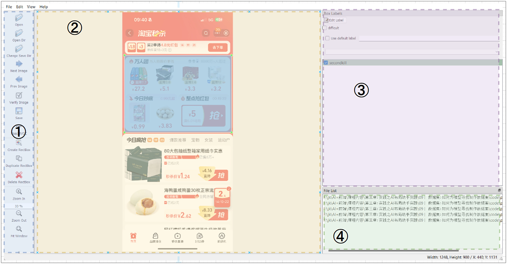
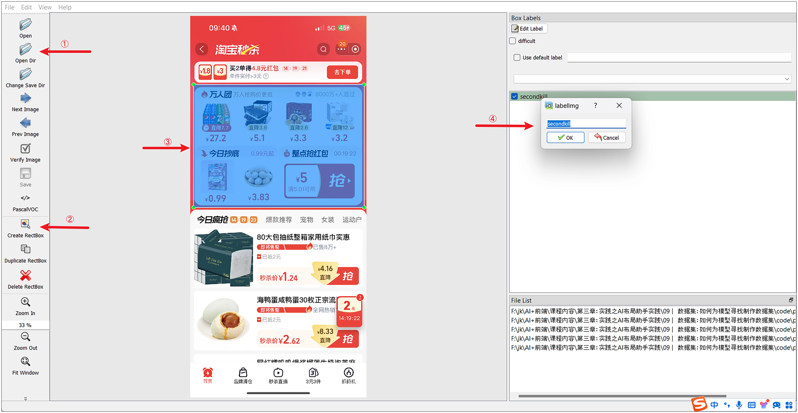
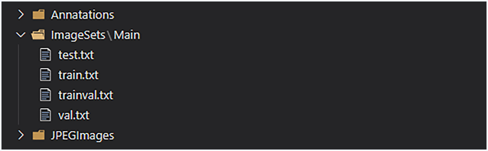

# 10 | 标签制作：模型到底理解的是什么

你好，我是柳博文，欢迎和我一起学习前端工程师的 AI 实战课。

在上一节课中，我们讨论了如何寻找并制作初始图像数据，并且学会了使用数据增广的方式来扩充数据的量级，让数据更加多样化。除了丰富的数据，我们还需要给数据制作标签。可以说，标签质量跟后续 AI 组件识别的训练效果紧密相关，这节课，我们就会学习如何完成这一步。

## 为什么需要创建标签？

对于目标检测来说，大多数时候模型进行的学习都是监督学习。用通俗的方式来理解呢，监督学习就是我们需要在给到模型训练数据的同时，告诉模型这是一个什么样的数据。换成更专业的说法就是，需要为数据集打上标签，这个标签就是告诉模型需要学习理解的目标是什么。

在训练模型，特别是目标检测模型时，模型最终理解的是如何从图像中识别和定位特定类别的物体。为了实现这一目标，数据集的制作和标签的创建至关重要。

高质量的标签对于训练一个准确和鲁棒的模型非常关键要。标签质量直接影响着模型的性能和泛化能力。如果标签不准确或不一致，模型就可能会学习到错误的信息，从而影响它在实际应用中的表现。

其实专业数据集标签的制作，也是有一些流行的数据集和标准可以参考和遵循的，下面我们就来学习一下 PASCAL VOC 数据集及其标准。

## PASCAL VOC 数据集

PASCAL VOC 数据集是计算机视觉领域中广泛使用的一个基准数据集，主要用于目标检测、图像分割和图像分类任务。它由 PASCAL（Pattern Analysis, Statistical Modelling andComputational Learning）挑战提供。从 2005 年开始，这个组织每年都会发布一个新的数据集。PASCAL VOC 数据集广泛用于计算机视觉研究，是许多算法评估和比较时采用的参考标准。

这个数据集中包含了人、动物、车辆等 20 个类别，包含数千张标注图像，标注类型包含了标注目标物体的矩形框、目标物体的像素级别区域和目标母体的类别标签。

PASCAL VOC 数据集通常具有一个文件目录结构，通常包含以下内容：

```
VOCdevkit/
   VOC2007/
       Annotations/    # 标注文件（XML格式）
       ImageSets/
           Main/       # 训练、验证和测试集的划分
       JPEGImages/     # 图像文件（JPEG格式）
       SegmentationClass/  # 分割标注
       SegmentationObject/ # 分割标注
```

首先是图像文件存放目录，它要求图片以 JPEG 格式进行保存，存储在 JPEGImages 文件夹中。

其次是 XML 格式的标注文件，存储在 Annotations 文件夹中。每个 XML 文件对应一张图片，包含图片中所有物体的位置和类别信息。

然后是图像集文件，存储在 ImageSets/Main 文件夹中，用于定义训练集、验证集和测试集。包括 train.txt、val.txt 和 test.txt 这样的文件，其中每行包含一个图像文件名，不带扩展名。

最后是分割标注文件，图像分割任务有时还包括分割标注，存储在 SegmentationClass 和SegmentationObject 文件夹中。

标注文件中包含着每张图像的目标信息，比如类别、边界框坐标等。这里有一段示例 XML 代码。在这段标注代码中就包含了目标类型、边框坐标和大小等信息。

```xml
<annotation>
 <folder>VOC2007</folder>
 <filename>000001.jpg</filename>
 <size>
   <width>353</width>
   <height>500</height>
   <depth>3</depth>
 </size>
 <object>
   <name>dog</name>
   <pose>Left</pose>
   <truncated>1</truncated>
   <difficult>0</difficult>
   <bndbox>
     <xmin>48</xmin>
     <ymin>240</ymin>
     <xmax>195</xmax>
     <ymax>371</ymax>
   </bndbox>
 </object>
</annotation>
```

大致了解了数据集包含的内容，我们就可以使用自己收集的基础图像数据，制作一个符合PASCAL 标准的目标检测数据集了。一般来说，这个过程包括以下几个步骤。

首先要收集基础图像数据（这在上一节课讲过了），并使用数据增广的方法扩展数据集。

其次是进行图像的标签标注，这个环境我们会使用到标注工具（如 LabelImg），为每张图像中的目标物体添加边界框和类型等标注。

然后生成标注文件并保存为 XML 文件，格式需要与 PASCAL XML 文件一致。

最后就是组织数据集，将图像文件和对应的 XML 标注文件组织在同一个目录下，这样我就完成了一个和 PASCAL VOC 一致的目标检测数据集了。

## 数据集标签制作

我们了解了 PASCAL VOC 数据集以及制作的相关步骤，下面就来动手练习一下吧。

首先需要下载和安装标注工具 LableImg。LabelImg 是一个开源的图像标注工具，用于生成图像数据集的标注文件，常用于目标检测任务。它支持多种标注格式，如 Pascal VOC 和YOLO。

我们可以使用 conda 来进行安装，首先激活 base 环境。

```
conda activate base
```

然后通过清华源安装 labelimg。

```
pip install labelimg -i https://pypi.tuna.tsinghua.edu.cn/simple
```

安装之后，就可以通过后面的命令运行软件了。

```
labelimg
```

软件运行后结构如下，我们来一起熟悉一下。



首先是做左边的标号 ① 的部分，这是一个竖直的操作栏。在这里我们可以选择打开一张图像或者是打开一组图像的目录，并选择保存的目录。同时我们可以选择创建标签框等操作。

然后我们来看标号 ② 中间预览部分，这里会展示当前标注的原图和原图上的标注标签。

在标号 ③ 区域会列出当前图像上的所有标注，我们可以通过点击修改标注信息。在标号 ④ 区域则是一个展示当前文件存放路径的区域。

接下来我们尝试创建一个类别标签。



首先点击标号 ① open dir 打开存放数据集的目录，然后目录下的第一张图片会被加载出来。

接下来我们点击标号 ② Creat ReacBox 来创建一个 ReacBox，用于勾选需要打上标签的区域，比如选中标号 ③ 这个区域，然后我们就可以为勾选的区域打上标签，并且可以在标号 ④区域进行点击修改。

最后点击保存，便可将标准完成的 XML 文件保存在设定好的目录了。

每张图像完成标注后， 会保存一个与图像名称一样的 XML 文件，内容与上述 PASCAL VOCXML 结构一致，刚刚标注的标签信息也会自动更新进去。

完成数据集的标签标注后，可以得到数据集中原始图像和对应的标注 XML 文件。接下来，我们就可以按照 PASCAL VOC 格式整理数据集了。

整理数据集一共分成四个步骤。

1. 新建 dataSet 目录，并在 dataSet 目录下新建 JPEGImages 目录，用于存放所有图像数据。

2. 在 dataSet 目录下新建 Annatations 目录，用于存放所有的标签 XML 文件。

3. 新建 ImageSets 目录用于存放分割后的数据集，通常会以 8:1:1 的比例把数据集分割为训练集、测试集和验证集三部分。

4. 编写脚本来实现训练集、测试集和验证集的分割，执行脚本后会在 ImageSets 目录下生成Main 目录。这段脚本我们使用 NodeJS 来实现。

```javascript
const fs = require('fs');
const path = require('path');
// xml文件的路径
const xmlfilepath = './Annotations/';
// 生成的txt文件的保存路径
const saveBasePath = './ImageSets/';
// 训练验证集占整个数据集的比重（划分训练集和测试验证集）
const trainvalPercent = 0.9;
// 训练集占整个训练验证集的比重（划分训练集和验证集）
const trainPercent = 0.8;
// 获取xml文件列表
const totalXml = fs.readdirSync(xmlfilepath);
const num = totalXml.length;
const list = Array.from({ length: num }, (_, i) => i);
const tv = Math.floor(num * trainvalPercent);
const tr = Math.floor(tv * trainPercent);
// 随机抽样
const trainval = list.sort(() => 0.5 - Math.random()).slice(0, tv);
const train = trainval.sort(() => 0.5 - Math.random()).slice(0, tr);
console.log("train and val size", tv);
console.log("train size", tr);
// 创建文件写入流
const ftrainval = fs.createWriteStream(path.join(saveBasePath, 'Main/trainval.txt
const ftest = fs.createWriteStream(path.join(saveBasePath, 'Main/test.txt'));
const ftrain = fs.createWriteStream(path.join(saveBasePath, 'Main/train.txt'));
const fval = fs.createWriteStream(path.join(saveBasePath, 'Main/val.txt'));
// 写入数据
list.forEach(i => {
   const name = totalXml[i].slice(0, -4) + '\n';
   if (trainval.includes(i)) {
       ftrainval.write(name);
       if (train.includes(i)) {
           ftrain.write(name);
       } else {
           fval.write(name);
       }
   } else {
       ftest.write(name);
   }
});
// 关闭文件写入流
ftrainval.end();
ftrain.end();
fval.end();
ftest.end();
```

最后，我们将会得到一份符合 PASCAL VOC 标准的数据集，这样的一份数据集就能直接放入YOLOv5 的模型中训练了。



## 总结

接下来我们来一起做一个总结。

通过大量的训练样本和标签，模型最终理解的是如何从图像的像素信息中提取特征，以识别和定位不同类别的物体。

在目标检测模型的训练中，标签是训练模型的关键部分。标签不仅需要指明图像中有哪些物体（类别），还需要准确标注物体在图像中的位置（边界框）。这些标签能帮助模型学习到如何区分不同类别的物体，并确定它们在图像中的位置。

PASCAL VOC 数据集是一个标准数据集，广泛用于计算机领域的模型训练和评估当中，是图像识别和目标检测的标准数据集。它包含了丰富的标注信息，涵盖了 20 个物体类别。PASCAL VOC 数据集包括多种场景下的图像及其对应的 XML 格式标注文件，标注文件详细描述了图像中物体的位置（边界框）和类别。

这节课，我为你演示了按照 PASCAL VOC 标准为数据集打标签的全过程，也推荐你按照课程内容自己动手尝试一下。

## 思考题

除了 PASCAL VOC 数据集外，还有哪些流行的目标检测数据集？

欢迎你在评论区和我交流互动，也推荐你把今天的内容分享给更多朋友。
