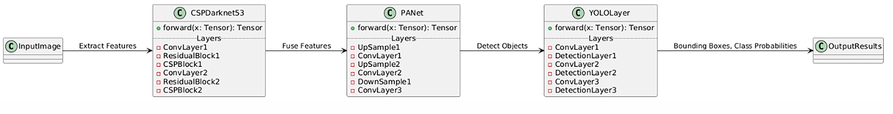
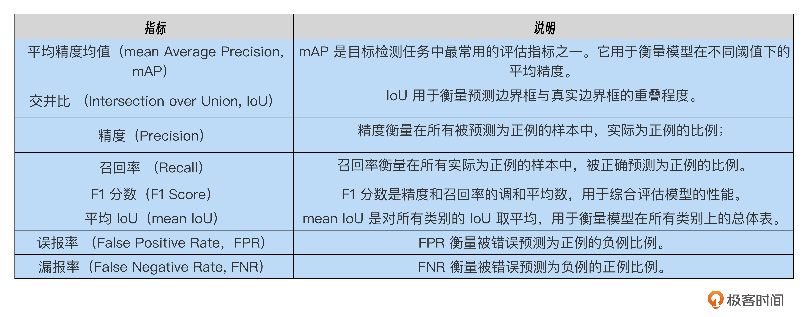
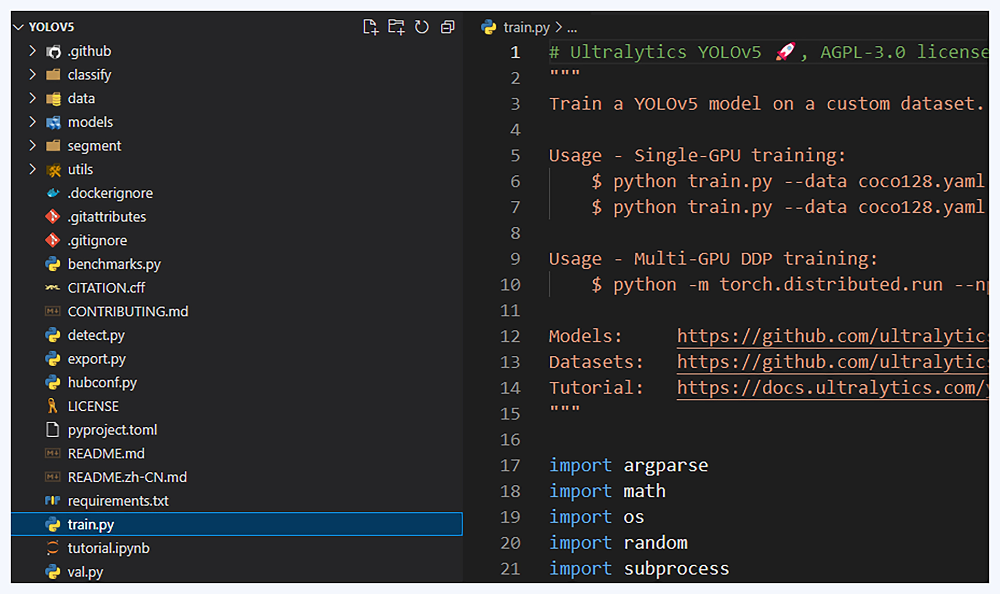
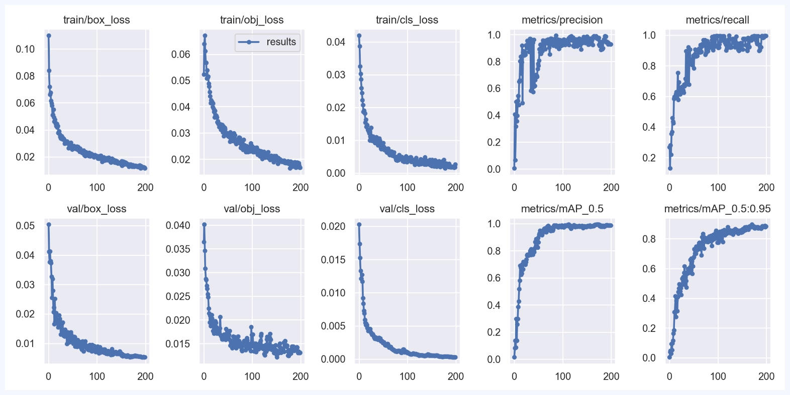
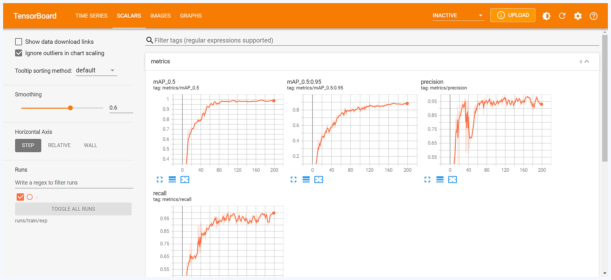

# 11 | 模型训练：如何教会模型学习

你好，我是柳博文，欢迎和我一起学习前端工程师的 AI 实战课。

前面两节课中，我们先后准备好了基础的图像数据，并且按照 PASCAL VOC 的标准制作出了一份用于目标检测模型训练的数据集。那么现在万事具备，接下来我们就可以进行模型训练了。

## 模型选择

在这个实践课程中，我们需要使用 AI 来完成页面的布局，简单来说，就是需要使用目标检测来识别出页面的组件类型和定位组件的位置，再通过工程化的方法来完成页面布局代码的自动生成。所以，在 AI 识别部分这是一个典型的目标检测任务。

那么，通过前面第 5 节课的学习，我们知道目标检测现在的模型方法分为两类，一类是 one-stage，另外一类是 two-stage。

两种方法的不同之处主要在于前者模型对目标的类别判断和位置识别在同一次计算中完成，而后者则是分为两步进行。one-stage 方法速度快但是精度相对较低，代表模型为 YOLO 系列；two-stage 精度高但是速度慢，代表模型是 R-CNN 系列。

结合我们要做的 H5 页面布局助手，我们需要完成的是页面的布局识别，对精度的要求不是很高，所以选择 YOLOv5 作为基础模型来训练。

YOLOv5（You Only Look Once version 5）是一个广泛使用的实时目标检测系统。它能快速、高效地检测图像中的多个物体，具有速度快，精度高的优点，同时也易于使用。对于前端工程师来说，理解并使用 YOLOv5 可以显著增强应用的视觉识别能力。

YOLOv5 的核心思想是将目标检测任务转化为一个回归问题，通过一个单一的神经网络直接从输入图像中预测出边界框和类别。具体来说，YOLOv5 将输入图像划分为 SxS 的网格，每个网格预测 B 个边界框和每个边界框的置信度，同时预测 C 个类别的概率分布。

下面是 YOLOv5 的层级结构图。



本质上来，说 YOLOv5 也是一个典型的 CNN 结构，由基础网络模型加上其他计算层组合而成。可以看到图中包含了 YOLOv5 的层结构，至于更多细节的原理和设计，你如果有兴趣可以在课后查阅更多资料。

## 模型评估标准

在模型训练中如何评判是否达到了训练标准呢？在正式开始模型训练前，我们一起来看一下目标检测中有哪些模型评判标准。

在目标检测的数据集评估标准中主要包括以下几个指标。



第一项指标平均精度均值（mean Average Precision），简称 mAP，这是目标检测任务中最常见的评估标准之一。mAP 用于衡量模型在不同阈值下的平均精度以及模型在检测多个类别时的整体性能。另外，在 mAP 的计算过程中又结合了精度 (Precision) 和召回率 (Recall) 这两个标准。

mAP 也是我们即将使用的 YOLOv5 模型训练和评估过程中的重要指标，那么我们结合例子来看看 mAP 是如何计算的。

假设我们有一个目标检测模型，用于检测图片中的猫和狗。我们有以下几张图片及其对应的检测结果。

- 图片 1：模型检测到一只猫，实际也有一只猫。

- 图片 2：模型检测到一只狗，实际也有一只狗。

- 图片 3：模型检测到一只猫，实际没有猫（误报）。

- 图片 4：模型检测到一只狗，实际没有狗（误报）。

- 图片 5：模型没有检测到任何东西，但实际有一只猫（漏报）。

首先需要计算每个类别（猫和狗两个类别）的精确率和召回率。

对于猫这个类别：

精确率 (Precision) 等于检测到的猫中实际为猫的比例 = 1/2 = 0.5

召回率 (Recall) 等于实际为猫中被正确检测到的比例 = 1/2 = 0.5

同样对于狗这个类别：

精确率 (Precision) 等于检测到的狗中实际为狗的比例 = 1/2 = 0.5

召回率 (Recall) 等于实际为狗中被正确检测到的比例 = 1/1 = 1.0

接下来，我们计算可以计算每个类别的平均精确率 (AP) 了。猫类别的 AP 等于在不同的召回率下精确率的平均值。假设我们有多个阈值下的精确率和召回率，计算其平均值。对于狗类别的 AP，我们也同样计算其平均值。

最后我们来计算 mAP，mAP 是所有类别的 AP 的平均值，mAP 的计算公式如下，其中 N 是

## AP

- 是类别 i 的平均精度。

总类别数，

- ​i

- N

## 1

## ∑

## mAP =

- ​APi​​

## N

- i=1

那么，假设猫类别的 AP 是 0.5，狗类别的 AP 是 0.75，那么 mAP 的结果就是 0.625，计算过程是：mAP = (0.5 + 0.75)/2 = 0.625。

通过这样一个 mAP 的示例计算过程，可以看出 mAP 值越高，表示模型在检测不同类别的目标时，能够更准确地识别和定位目标。相反 mAP 值越低，就表示模型在检测不同类别的目标时，存在较多的误报（False Positives）或漏报（False Negatives）。在我们训练模型时，也可以通过观察 mAP 值来判断是否达到训练要求。

## 模型训练

接下来我们就可以开始训练模型了。首先需要下载 YOLOv5 的源代码，这是一个开源代码，需要从 GitHub 上拉取。

```
git clone https://github.com/ultralytics/yolov5.git
```

在下载代码的同时，我们还需要下载一些预训练模型。这些预训练模型是通过一些公共数据集训练好的模型，在预训练模型上进行训练可以显著提高模型性能，减少训练时间。在同等硬件资源下使用预训练模型进行二次训练会有更快的模型收敛速度。

YOLOv5 的源代码结构如下：



我们来一起看一下需要我们关注和修改的几个文件。首先是根目录下的 train.py，这是模型训练的入。在 train.py 这个文件大概第 560 行左右的位置，会有一些使用 argparse 进行超参数设置的代码，需要我们根据先验知识进行设置。这里的先验知识通常来源于一些经典论文或者网络搜索，并在训练的过程中不断调整。

我们来一起看看一些必要的超参数。

```
   parser.add_argument('--weights', type=str, default=ROOT / 'yolov5s.pt', help=
   parser.add_argument('--cfg', type=str, default='models/yolov5s.yaml', help='m
   parser.add_argument('--data', type=str, default=ROOT / 'data/myvoc.yaml', hel
   parser.add_argument('--hyp', type=str, default=ROOT / 'data/hyps/hyp.scratch-
   parser.add_argument('--epochs', type=int, default=200, help='total training e
   parser.add_argument('--batch-size', type=int, default=8, help='total batch si
```

- –widgets 参数，用于设置预训练模型的路径，加载预训练模型的权重。

- -cfg 参数是模型配置文件的路径。该文件定义了模型的架构和参数。

- –data 参数, 它定义了模型读取数据的路径，以及一些数据相关的配置信息。

- –hyp 参数是超参数配置文件的路径。该文件定义了训练过程中使用的超参数，如学习率、动量等。

- –epochs 参数代表总训练轮数，定义了模型训练的总迭代次数。

- –batch-size 是总批量大小，定义了每次训练迭代中使用的样本数量。

接下来我们把制作好的数据集放在根目录下，并激活在环境配置课程中搭建好的 Conda 环境，再执行 tarin.py 便可以开始训练了。

在训练的过程中，命令行程序会不断有 log 打出，输出当前批次的训练进度（如下图为第三批次的一条训练进度日志）。同时，在目录的 runs/train 文件夹下会显示完成定长批次训练后的结果，直到完成我们设定的 epochs 次数结束训练。


训练结束后，打开位于 runs/train 文件夹下的最后一次训练结果，就能看到里面有一张训练结果图，我们来一起分析下这个训练结果图：



mAP 值代表了模型在不同阈值下的平均精度。通过这张图我们可以看到当训练次数达到 200左右的时候，mAP 值能够达到 90% 以上并且趋于稳定，也就是是说在这个时候，模型已经通过训练达到了一个不错的预测精准度。那么这个训练次数下的权重文件便可用于预测了。

这里我们通过直接观察 mAP 值来判断了模型的训练效果。其实，对于 YOLOv5 的训练效果分析不仅通过 mAP，还可以通过分析训练和验证损失、精度和召回率等指标来实现。我们可以通过这样一个命令打开一个本地服务，来查看和分析更多的训练结果指标。

```
tensorboard --logdir runs/train/exp10
```

然后，通过浏览器访问 http://locahost:6006，即可浏览到如下界面，这样就可以借助图里的指标进行分析了。



## 总结

我们来一起做个总结吧。

我们选择了 YOLOv5 作为本次目标检测任务的基础模型，主要因为它在性能和检测精度方面表现出色。

在学习目标检测领域的模型评估标准时，我们重点理解了 mAP（mean Average Precision）。通过猫狗检测的实例，我们详细学习了 mAP 的计算过程。

接着，我们深入分析了 YOLOv5 的源代码，并详细解读了其中的关键部分。在这个过程中，我们特别关注了超参数的设置，这些超参数就像函数的参数一样，能够直接影响模型的性能。

完成模型训练后，我们对生成的结果图进行了分析，重点关注了 mAP 的变化趋势以及超参数之间的关系。

## 思考题

在模型训练结果的分析中，我们用 mAP 进行了分析，那么，还有哪些指标可以用来分析，以及观测方法是什么？

欢迎你在留言区和我交流互动，如果这节课对你有启发，也推荐分享给身边更多朋友。
