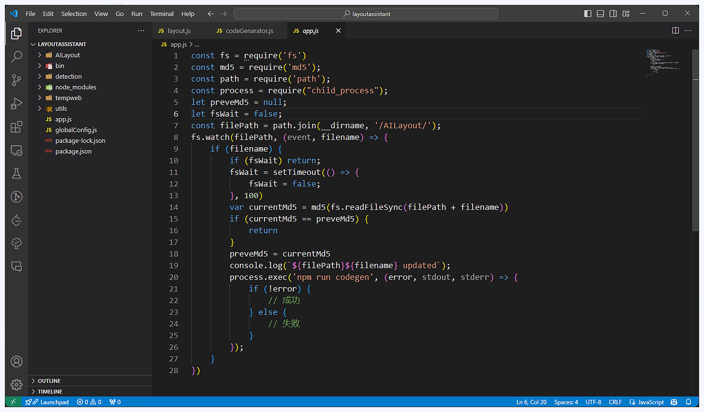
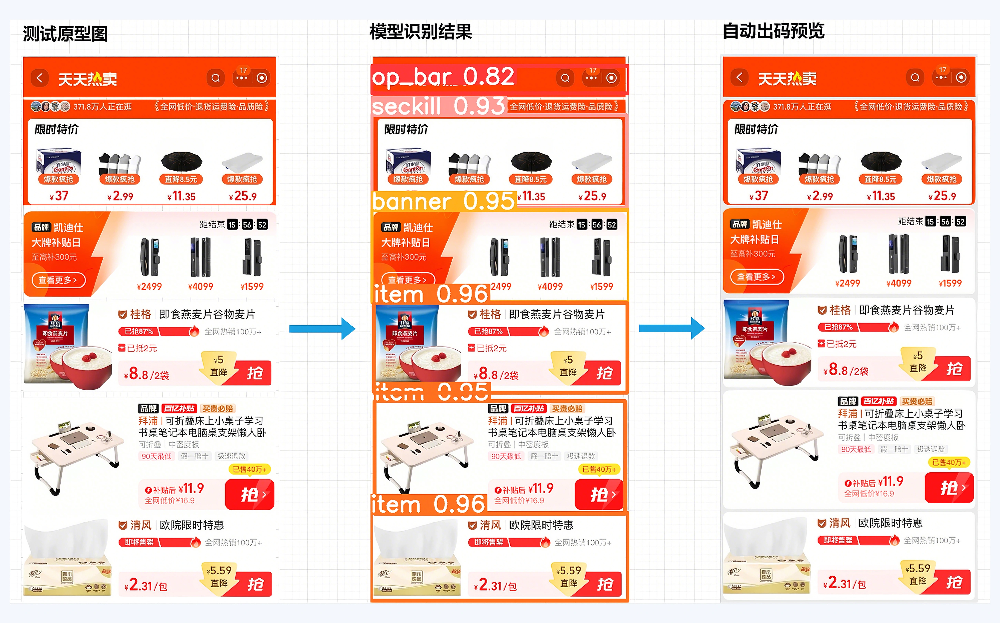

# 13 | 自动出码：如何根据预测结果生成代码

你好，我是柳博文，欢迎和我一起学习前端工程师的 AI 实战课。

上节课，我们使用训练好的模型进行了模型预测，模型能够准确地识别出图像中的组件类型和组件信息，并且给出了可视化的检测结果和文本形式的结果文档。

那么，今天我们就将进行本次实践的工程化部分，使用 React+NodeJS 完成一个 POC 层级的最小闭环工程链路，实现从页面图片到自动生成页面源代码，然后在浏览器中预览的过程。在这个过程中只需要执行一条模型检测命令。

这里，为了模拟产品出图的逻辑，我准备了一张原型图，用于完成这节课中的工程链路。


在这张模拟产品原型稿中，我按照模型训练时的组件分类类型，从上到下分别排列了操作栏（op_bar）、秒杀模块（seckill）、商品模块（item）、横幅模块（banner）、不同类型的商品模块（item）、商品模块（item）。我们需要将这张图像作为待识别数据放入 data/images 目录下，等待执行检测命令。

## 组件准备

首先，我们需要新建一个 React Web 项目，使用 vite 生成一个初始化空项目即可。在数据集准备阶段，我们设定了需要识别的组件类型为 4 类，分别是顶部操作栏（op_bar）、秒杀模块（seckill）、商品模块（item）以及横幅（banner）。

接下来，我们需要为这四类模块分别实现一个组件。

在第一章中的第二节课里，我们学习了组件库的实现方案和细节，还深入探讨了组件划分的粒度以及组件的可解释性。这里虽说只是准备好需要的几个组件，但也是实现一个自己物料库的起点。你可以根据前面课程的学习内容不断完善这个物料库。

这里说点题外话，为了让你把注意放在链路实现的主线里，课程里我们实现的只是最小demo。如果真的要用到实际生产环境中，物料库应该会是一个庞大的覆盖业务场景，75% 以上的组件都会放在这个库里。

## 工程链路结构

具体来说，这个工程实现链路可以分成三个部分——AI 识别、NodeJS 文件监听及代码生成，以及 React 页面预览。

我们再明确一下这三部分的作用。

AI 模型负责识别页面，并将识别后的页面中组件类型和相关属性进行文件写操作，将其写入到一个中间文件中。

NodeJS 文件用于监听服务。监听到中间文件内容发生变化后，读取其中的内容，并结合代码模板进行代码生成，然后将生成的代码写入到对应的 React 项目文件中。

在 React 项目中的开发环境中，能够监听文件变化并自动更新页面，这样就可以在浏览器中实时预览到 AI 模型识别出来的结果了。

接下来，我们来看一下整个工程的目录结构，你可以参考后面的截图。



对照截图可以看到，这里我们新建了一个 NodeJS 项目作为整个工程的根目录。在这个目录中，主要存放了文件内容更新监听、实例代码生成以及全局配置等文件。

AILayout 则是作为一个中间过渡目录，存放着 JSON 格式的描述文件，它是模型识别了页面组件内容后的输出结果，在内容变更时会被 NodeJS 文件服务监听到。

detection 存放着 AI 模型相关的代码，执行检测的图像需要放在这个目录的子目录——data/images 目录下。

tempweb 是一个 React Web 项目，NodeJS 在完成代码生成后，会直接保存到这个目录下的文件中。

## 关键代码

在这个过程中，有一些关键的代码需要我们注意。

首先是 YOLOv5 的模型识别结果保存的修改，基于开源的 YOLOv5 源代码进行训练后，用于检测的结果会保存在 runs/detect 文件夹中。我们需要将检测结果以需要的格式保存在AILayout 中间过渡目录中。

这样一来，在 AI 模型完成识别后，就会把识别结果写入到 AILayout 中间文件目录中保存。这个修改需要在 detection 文件目录下的 detect.py 文件中进行。在这个文件中的 165 行处，我们需要将识别结果转换为一个 JSON 格式数据，并写入中间文件中。

具体代码如下所示，可以看到在这段代码中用到了 Python 的文件读写操作。

```javascript
# Write results
for *xyxy, conf, cls in reversed(det):
   if save_txt:  # Write to file
       xywh = (xyxy2xywh(torch.tensor(xyxy).view(1, 4))).view(-1).tolist()  # no
       # print(xywh)
       line = (cls, *xywh, conf) if save_conf else (cls, *xywh)  # label format
       with open(f'{txt_path}.txt', 'a') as f:
           f.write(('%g ' * len(line)).rstrip() % line + '\n')
   if save_img or save_crop or view_img:  # Add bbox to image
       c = int(cls)  # integer class
       label = None if hide_labels else (names[c] if hide_conf else f'{names[c]}
       annotator.box_label(xyxy, label, color=colors(c, True))
   if save_crop:
       save_one_box(xyxy, imc, file=save_dir / 'crops' / names[c] / f'{p.stem}.j
with open(f'{txt_path}.txt', encoding='utf-8') as gen:
   datastr = []
   for ann in gen.readlines():
       ann = ann.strip('\n')       #去除文本中的换行符
       res = ann.split(' ')
       temp = {'type':res[0], 'left':res[1], 'top':res[2], 'width':res[3], 'heig
       datastr.append(temp)
   schemaRes = 'const pageLayout='+str(datastr)+'; module.exports = {'+' pageLay
with open(f'../AILayout/layout.js', 'w') as sc:
   sc.write(schemaRes)
   sc.close()
```

然后是源代码的生成，这部分使用 NodeJS 实现，具体作用就是引入读取中间文件中的页面组件描述信息，并且解析和绑定组件以及模版。

生成源代码的逻辑你可以在 utils/codeGenarator.js 文件中看到。

```bash
const registeriedComponents = [];
const typeToComponents = {
   "0": "op_bar",
   "1": "seckill",
   "2": "banner",
   "3": "item"
}
const createImportTemplate = (component) => {
   return `import ${component} from './components/${component}'
   `;
}
const createBodyTemplate = (componenet, style) => {
   return `<${componenet} position={${style}}/>
   `;
}
const createHeaderTemplate = (importTemplate) => {
   return `import './App.css';
   ${importTemplate}
   function App() {
     return (
       <div className="App">
   `
}
const createFooterTemplate = () => {
   return `
       </div>
       );
       }
   export default App;
   `
}
const codeGen = (layout) => {
   let importHTML = '';
   let bodyHTML = '';
   for (let i = 0; i < layout.length; i++) {
       let cur = layout[i];
       if (!registeriedComponents.includes(cur.type)) {
           importHTML += createImportTemplate(typeToComponents[cur.type]);
           registeriedComponents.push(cur.type);
       }
       const tempStyle = { left: parseInt(cur.left)-parseInt(cur.width)/2, top:
       bodyHTML += createBodyTemplate(typeToComponents[cur.type], JSON.stringify
   }
   return `${createHeaderTemplate(importHTML)}
   ${bodyHTML}
   ${createFooterTemplate()}
   `
}
module.exports = {
   codeGen
}
```

在这个文件中定义了可以生成的组件类型，这需要和模型识别的结果一一对应。同时，我们还定义了页面的不同位置的模版，这些模板用于拼接出来整个页面的源代码。最后，调用codeGen 方法来生成源代码即可。

有了代码生成的核心逻辑，接下来我们就可以使用 NodeJS 的文件监听和文件写操作来自动生成代码了。在根目录下的 app.js 文件中，存放了监听文件内容变化的代码，在中间文件内容发生变化时，就能够自动执行代码生成的命令。

```javascript
const filePath = path.join(__dirname, '/AILayout/');
fs.watch(filePath, (event, filename) => {
   if (filename) {
       if (fsWait) return;
       fsWait = setTimeout(() => {
           fsWait = false;
       }, 100)
       var currentMd5 = md5(fs.readFileSync(filePath + filename))
       if (currentMd5 == preveMd5) {
           return
       }
       preveMd5 = currentMd5
       console.log(`${filePath}${filename} updated`);
       process.exec('npm run codegen', (error, stdout, stderr) => {
           if (!error) {
               // 成功
           } else {
               // 失败
           }
       });
   }
})
```

在这段代码中，监听了 AILayout 目录下文件内容的变化，也就是 AI 模型完成识别后写入识别结果的文件目录。这样就把 AI 识别和代码生成结合了起来。

最后，我们再实现一个写文件功能，将代码写入到 tempweb 目录中。这样一个完整的自动出码的链路就完成了。

```javascript
const fs = require("fs");
const path = require("path");
const filePath = path.join(__dirname,'../tempweb/src/')
const createFile = (html) => {
   fs.writeFileSync(`${filePath}app.js`,html);
}
module.exports = {
   createFile
}
```

通过这样的文件写操作，可以看到源代码会被写入到 tempweb/src 目录下的 app.js 中。

## 代码生成和预览

万事俱备，我们来直接执行一下吧。

在执行 AI 模型识别命令之前，需要先启动 NodeJS 文件服务和 React Web。

我们先在根目录下执行 node app。

```
node app
```

然后进入到 tempweb 目录下，执行 npm start 启动 React Web 到本地 3000 端口，并在浏览器中实时预览到页面变化。

```bash
cd tempweb & npm start
```

接下来，在 detection 目录下调用 python detect.py，在检测命令执行以后，我们就能在浏览器中看到实时更新的页面了。

我们来看一下 AI 模型的可视化识别结果（中），可以看到每种类型的组件都以较高的准确率完成了识别。同时，在浏览器中也能够实时看到自动生成代码后的页面效果（右）。



在生成结果中，AI 识别出了页面中组件的类型和布局顺序位置，工程链路生成了这样一张页面。

你应该也发现了，这里生成页面和用于识别测试的原型图几乎一样。这是因为我在实现组件时直接使用了不同卡片类型的截图，以标签进行了简单实现。而在真实场景中，你需要根据设计稿以源码的形式产出组件，也就是开头所提及的物料库。

另外，从这个识别结果中也可以看出，倒数第一个和倒数第二个商品卡片的样式是不一样的，这也是需要考虑的。在模型训练时应该增加一个商品类型信息作为区分，在组件实现的时候也同样需要区分实现。本质上来说，你需要 AI 在布局层面做到什么样的粒度细节，那么，你在训练模型和设计工程链路时也需要做到同样的粒度要求。

## 总结

那么，让我们来一起做个总结吧。

在这节课中，我们完成了自动出码的完整工程链路，还准备用于测试的产品模拟原型图，并且完成了对应类型的示例组件开发用于后续调用。

自动出码的工程链路包括三个部分——AI 模型识别、NodeJS 文件监听和代码生成，React 页面预览。

AI 模型完成识别后需要将结果以 JSON 格式保存在一个中间文件中，NodeJS 监测到这个中间文件内容变化后，就会读取文件内容并分析。然后使用模板生成代码，并保存在 React 项目中。React 项目在监听到文件内容更新后，在开发环境下会再次执行编译打包运行。这样就可以在浏览器中实时看到由 AI 检测并自动生成的页面了。

同时，我们详细讲解了关键代码细节的修改。这里需要使用 Python 完成 AI 模型识别结果的写操作。在代码生成时，需要使用 NodeJS 监听这个文件写操作后的变化，根据识别结果生成源代码。

## 思考题

这节课里通过使用代码模板拼接的方式简单粗暴地生成了代码，那么结合现代前端打包工具的方法怎么实现呢？

欢迎你在留言区和我交流互动，如果这节课对你有启发，也推荐分享给身边更多朋友。
