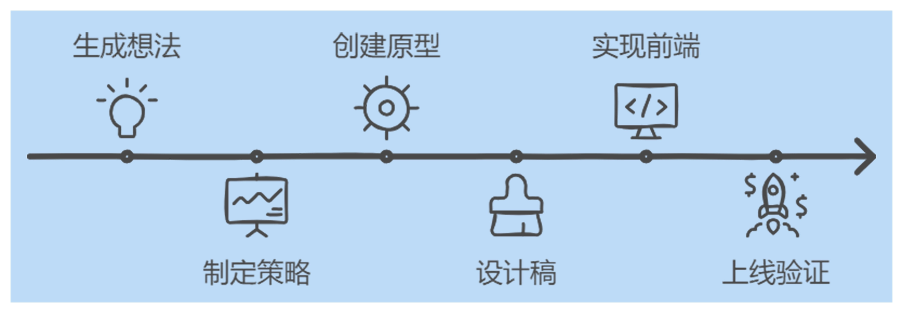
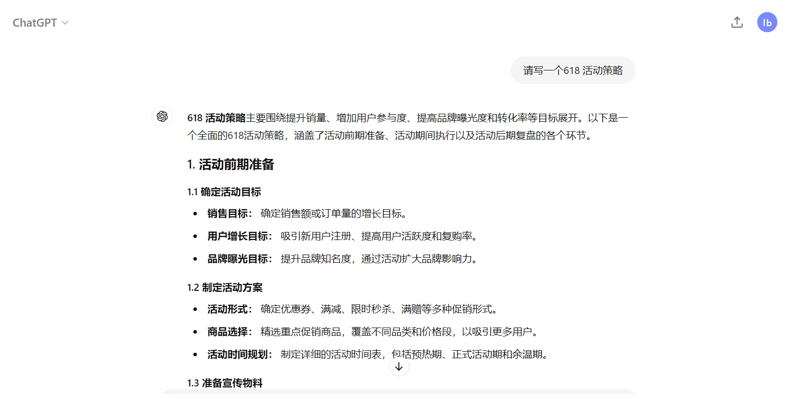
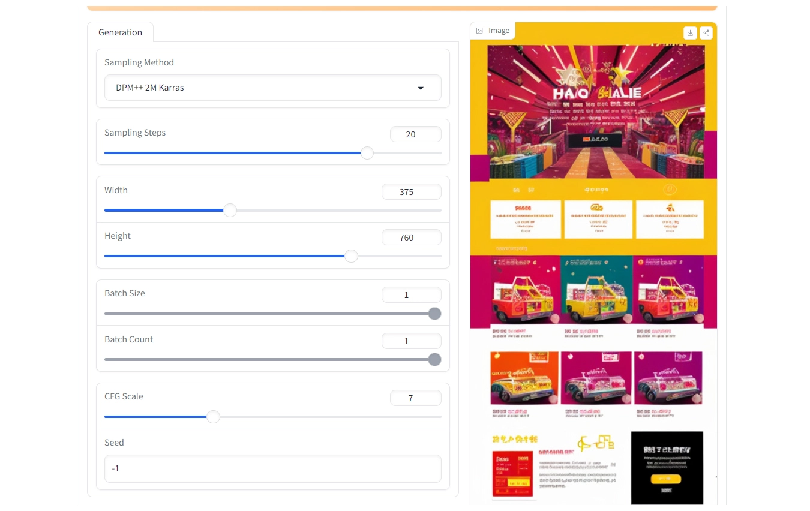

# 14 | 延伸思考：AI技术如何贯穿产研全流程？

你好，我是柳博文，欢迎和我一起学习前端工程师的 AI 实战课。

通过这个章节的实践课程，我们学习了如何让 AI 识别页面组件的类型和定位，并使用NodeJS 自动生成页面代码。

在这个过程中，我们重点探索了 AI 模型的训练与预测，也简单串联了前端工程链路。相信对于熟悉前端的你来说，工程链路的设计不会有任何挑战，你甚至可以轻松构建自己的流程。

不过，这只是一个简单的 AI 辅助布局开发的实践，仅仅是属于前端承接需求中的一个很小的环节，那 AI 在整个需求实现过程中还能起到哪些新的辅助作用，乃至自动实现哪些任务呢？

这里，我们就以一个完整的前端需求实现为线索，来展开今天的讨论。

## AI 布局助手在前端需求的实现路径中的位置

首先我们来梳理一下需求的实现路径。

这一章里我们实现了 AI 布局助手，目的是辅助前端工程师实现页面布局部分。那么，前端需求的实现路径中的具体作用位置在哪里呢？我们不妨以完成的前端需求产研流程来举例说明。

对于一个完整的前端需求产研流程来说，往往要经过后面这些背景，且对于不同公司会有不同，但都大同小异，这里的产研流程以一个纯前端的需求实现为背景。



首先，理想情况下，需求往往来源于业务同学的一个策略，甚至是想法。接着，产品同学则会根据业务同学的想法给出原型图。然后，设计同学会根据原型稿给出一个精美的设计稿。接下来，就轮到我们前端工程师上场了，根据设计稿一比一还原到网页上，最后，将需求上线。

那么，前端工程师拿到设计稿后，又要如何完成这个需求呢？

一般来说，拿到设计稿后，按照现代前端框架开发的方式，我们会对页面进行不同部分的拆分，目的是理清需要哪些组件和对应需要实现的功能。这个划分逻辑你可以参考第一章第二节课组件划分粒度的设计。

完成组件拆分后就要具体去实现组件了。在这个过程中，往往需要先完成组件的 HTML+CSS部分，也就是组件的布局。然后，将功能逻辑加入到组件中来完成组件的开发。这个过程中就可以使用我们完成的 AI 布局助手来辅助开发实现了。

这样一梳理，我们不难发现 AI 布局助手所做的事情，仅仅是在前端实现需求流程中很小的一部分。那我们自然会产生这样一个疑问——AI 能否在产研全流程里发挥更大的作用呢？

## AI 能否作用于产研全流程

对于这个问题，答案当然是肯定的。哪怕放在 2022 年 ChatGPT 出来之前，都能肯定的回答，更何况现在有了如此厉害的 AI 大模型。

对业务同学来说，可以使用现在的文本大模型来进行生成式对话，比如，让 ChatGPT 为电商618 活动提供一段产品策略。



有了产品需求，便可根据需求画出产品原型稿以及设计稿，这一部分同样可以使用 AI 来完成。这个问题放在多年前看似是一个不可能完成的任务，但对于当下的 Stable Diffusion 来说是相对简单的，我们根据对应提示词即可完成。

我们结合例子来看更加直观。这里有一段描述 618 活动的提示词，这段提示词包含了淘宝风格和 618 活动相关的元素，可以帮助我们生成一个具有吸引力的 H5 页面设计。

```
A vibrant and colorful Taobao-style H5 page design for a 618 shopping event, feat
```

我们使用在线的 Stable Diffusion 服务，输入这段提示词，就生成了后面的 H5 页面设计图像。



那么，有了产品的设计稿，这个时候前端工程师开始介入产研流程中来实现这个需求。按照上面探讨的流程，在进行 HTML+CSS 实现时，AI 布局助手便可以用来辅助完成这个部分。

AI 如何实现页面逻辑的生成

但如何进行组件的逻辑绑定？这个问题其实是这部分的需要解决的核心问题。这个问题之前想用 AI 来解决是比较棘手的，但 AI 大模型的出现让情况有所变化，我们完全可以引入大模型的能力来尝试解决这一问题。

使用 AI 生成代码，这种方式是通过自然语言描述业务逻辑和页面功能，利用 AI 代码生成模型（例如 OpenAI 的 Codex、GitHub Copilot 等）来自动生成 JavaScript 或 TypeScript 代码。我相信这种方式你一定或多或少的已经尝试过了，我们需要先提供待生成代码的全局或部分上下文代码，然后不断地对 AI 代码模型进行提示，让它帮我们生成代码。

为了帮你加深理解，我们来看一个具体例子。我们可以提供一些业务需求描述给代码生成模型，比如“当用户点击按钮时，打开一个弹窗”，然后模型会生成相应的 JavaScript 代码。后面这个例子就是用 GitHub Copilot 生成的代码。

```bash
import React, { useState } from 'react';
import { Dialog, DialogTitle, DialogContent, DialogActions, Button } from '@mater
const App: React.FC = () => {
 const [open, setOpen] = useState(false);
 const handleClickOpen = () => {
   setOpen(true);
 };
 const handleClose = () => {
   setOpen(false);
 };
 return (
   <div>
     <Button variant="outlined" color="primary" onClick={handleClickOpen}>
       Open Dialog
     </Button>
     <Dialog open={open} onClose={handleClose}>
       <DialogTitle>Dialog Title</DialogTitle>
       <DialogContent>
         <p>Dialog Content</p>
       </DialogContent>
       <DialogActions>
         <Button onClick={handleClose} color="primary">
           Close
         </Button>
       </DialogActions>
     </Dialog>
   </div>
 );
};
export default App;
```

在这个过程中，实际上还需要 AI 实现数据的绑定。这一步同样可以让 AI 辅助，让它通过分析页面来设计和数据结构，并自动生成数据绑定的代码。通常来说会用到 React、Vue 或Angular 等前端框架和库，如果有需要，你甚至可以借助 LangChain 设计一个自动化流程，让AI 模型的数据绑定过程自动化。

此外，页面中还有许多页面事件处理代码可以自动生成。基于用户界面的设计，AI 可以生成点击事件、输入事件、悬停事件等的处理代码，这些代码与具体的业务逻辑绑定，这应该是AI 视觉模型能够完成的部分。

事件代码生成与绑定的过程，主要涉及 UI 组件的事件处理模式的分析与推荐。通过 AI 视觉模型识别页面中的不同组件类型（如按钮、输入框、图片等），我们可以推断出这些组件通常会触发哪些常见的事件。

接着，AI 模型就能结合已知的设计模式和上下文信息，预测出合适的事件处理代码。例如，按钮对应点击事件，输入框对应输入事件，而图片或导航元素可能需要悬停事件。最终，AI就会推荐相应的代码块，并与具体业务逻辑进行绑定。本质上也就是代码块的推荐。

最后还有一点不太容易想到，AI 不仅能够生成并绑定代码，还可以根据业务逻辑推荐优化代码。比如说，可以让 AI 分析现有的代码和页面逻辑，为我们推荐优化建议或自动改进业务逻辑。通过机器学习模型识别反模式、性能瓶颈或潜在的错误等。

## 美学评判

“美学评判”这个词，我相信你一定是第一次听说，其作用就是使用 AI 模型来对 AI 模型生成的设计稿进行一个设计层面的美学评判，从而过滤掉不符合要求的生成结果。

在上述流程中，我们可以使用 Stable Diffusion 来根据提示词生成设计稿，那么，理论上来说可以无限生成设计稿，面对如此巨量的设计稿，人眼去识别过滤是不现实的，所以，我们同样可以训练出一个 AI 模型来完成这样的工作，这个方向的专业研究称为“图像质量评估”，在这个基础上训练出一个用于在设计美学层面评判的 AI 模型是完全可行的

基于 AI 的设计稿自动生成的逻辑，我们就拥有了可能的界面设计稿，在对于设计稿的评判上又可以使用另外一个 AI 模型来评判出符合设计要求的结果。这个评判模型学习模拟设计师的过往经验来进行评判，其实更为重要的一个评判标准是用户。

更为专业和直白的说法是用户在不同的界面设计上的数据反馈，以电商产品来说，用户的点击，停留时长、转化率等数据才能直观地评判出什么是好的界面设计。这其实是一个可行的UI 调控方案，也就是对合适的用户推荐合适的 UI 设计，并直接在端侧进行 UI 的重排来试试调整 UI 结构的策略。

在接下来的实践章节中，我们还会展开聊聊基于 AI 推荐的端侧实时调整 UI 的方案，敬请期待。

## 总结

这节课是第三章的最后一节课，也是一个承上启下的思考与引入。

在前端需求的实现中，产研流程通常从业务需求开始，由产品经理提出原型设计，然后设计师制作精美的设计稿，最后由前端工程师将设计稿转化为网页。这一过程体现了多角色间的分工合作。

在前端工程师拿到设计稿后，首先对页面进行组件化拆分，按照现代前端框架开发的方式，实现组件的 HTML+CSS 布局，进而添加功能逻辑。AI 布局助手可以在这一环节中帮助前端工程师高效完成部分任务。

此外，AI 技术还可以贯穿整个产研流程。文本大模型如 ChatGPT 可帮助业务人员生成策略和需求文案；图像生成模型如 Stable Diffusion 可以根据提示词生成产品原型和设计稿。

这种全流程的 AI 辅助已超越了单纯的代码生成，AI 甚至可以根据业务需求生成相应的JavaScript 代码，并优化代码逻辑，自动进行数据绑定和事件处理。这样的自动化提高了前端开发的效率，也为整个流程带来了创新的思路。

尽管 AI 赋能产研流程带来了高效和创新，但也引发了数据安全和生成内容评判的挑战。企业和个人可以使用开源的 AI 模型（如 ChatGLM、Stable Diffusion）在本地环境中处理数据，保障安全。

为确保生成内容的质量，AI 还可以通过“美学评判”模型自动评估设计稿，优化用户体验。这些方法和工具不仅使前端开发流程更智能化，还推动了基于数据反馈和 AI 评估的界面设计优化，未来可能进一步实现端侧实时 UI 调整策略。

## 思考题

这节课我们分析了 AI 在研发流程中的辅助作用，那么在用户侧，AI 又能在产研流程中有哪些帮助呢？

欢迎你在留言区和我交流互动，如果这节课对你有启发，也推荐分享给身边更多朋友。
