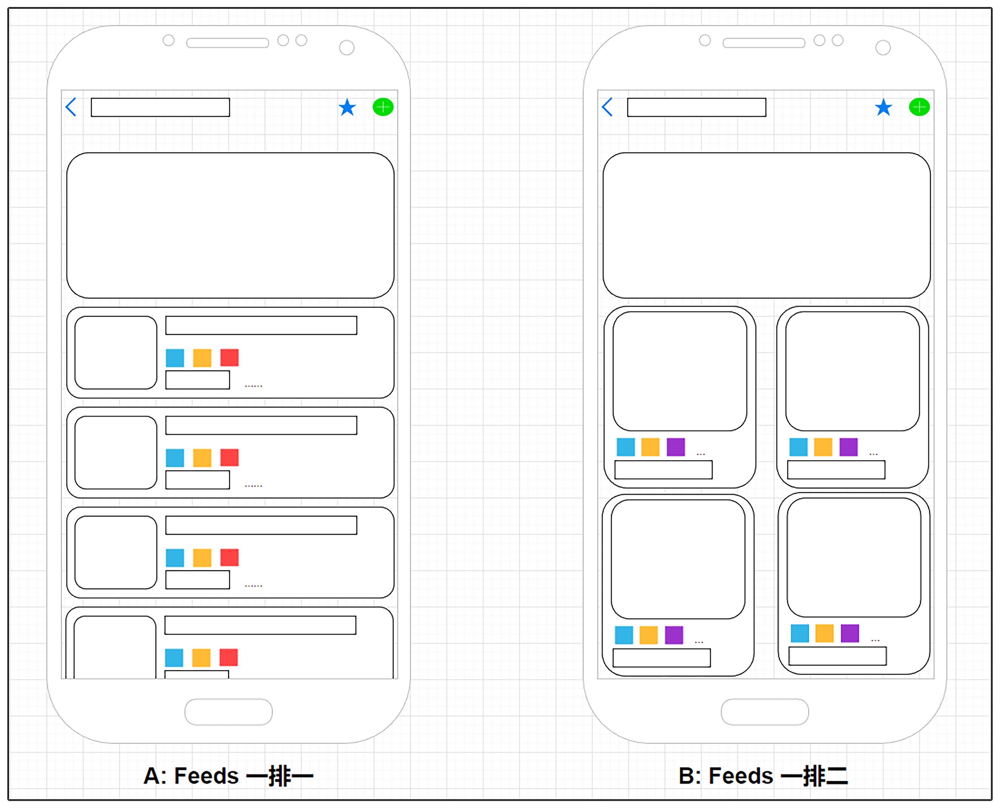
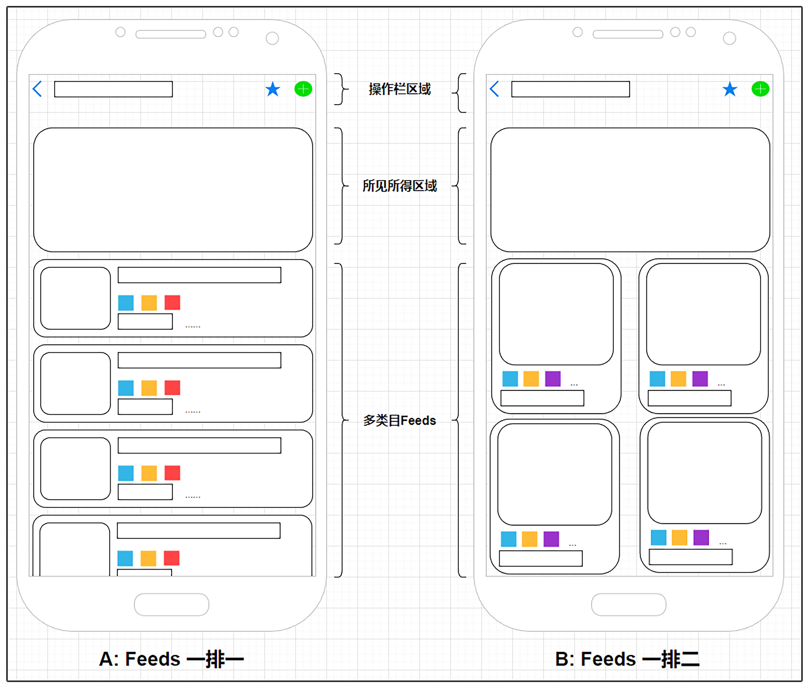
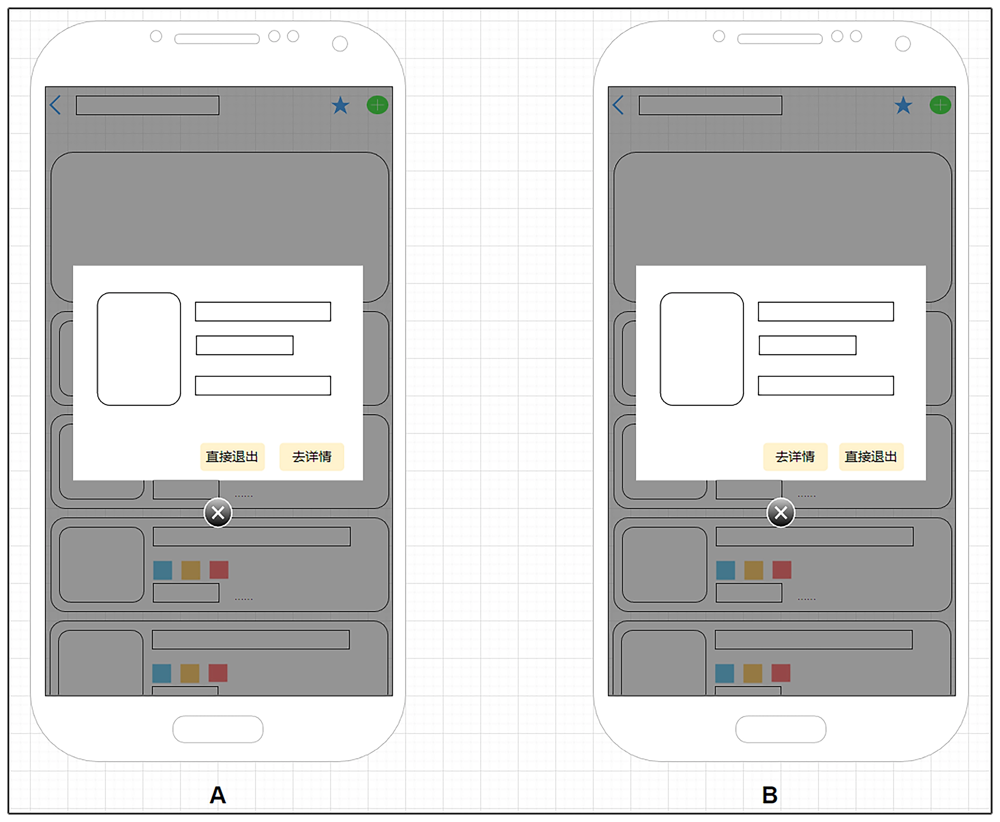

# 15 | 何为端侧重排：UI的千人千面

你好，我是柳博文，欢迎我和一起学习前端工程师的 AI 实战课。

通过前面的学习，相信你已经对 AI 在前端日常开发的应用有了一定了解。接下来，我们将会关注 AI 在前端产品上的创新实践。

我们会以电商 C 端产品作为切入案例，不过即便你没有电商背景，也不影响课程的理解。因为我们后面要讨论的数据埋点、数据统计分析等内容，成熟的产品里都会涉及。

这节课，我们就来了解 UI 如何理解用户，实现“UI 千人千面”的问题。简单来说，就是如何基于 AI 来打造更符合用户偏好的前端页面，帮助我们的产品带来更多流量（甚至更多收入）。而“端侧重排”则是实现 UI 千人千面的具体方案，也就是根据 AI 的推荐在用户端进行页面的重新布局和渲染。

## 数据的“千人千面”

在开始之前，我们首先需要了解一下“千人千面”的底层逻辑，这与我们即将学习的 UI 千人千面有着本质的区别，但又有一定的联系。

“千人千面”是一种个性化推荐技术，目的是为每个用户展示最符合其兴趣和需求的商品。这种技术背后的底层逻辑主要是基于大数据分析和机器学习算法。

实现“千人千面”的基本步骤和逻辑是这样的。

首先，系统会收集用户的各种行为数据，包括但不限于浏览历史、搜索记录、购买历史、点击行为、用户在平台上的停留时间、用户对商品的评价和反馈。

然后是用户画像构建与商品属性分析。用户画像是实现个性化推荐的基础。系统会根据收集到的数据，构建每个用户的画像，这包括用户的兴趣偏好、购买习惯、活跃时间段等多维度信息。而商品属性分析与用户画像构建类似，系统也会对商品进行多维度的属性分析，包括商品的类别、价格、销量、评价等信息。

接着是匹配算法。系统会使用各种匹配算法，如协同过滤、内容推荐、深度学习模型等，来分析用户画像和商品属性之间的匹配度。这些算法可以帮助系统理解哪些商品更可能吸引特定用户的注意。

随后做实时调整。个性化推荐是一个动态过程，系统会根据用户的最新行为实时调整推荐结果。例如，如果用户搜索了某个特定的商品，系统可能会立即调整并推荐相关商品。

最后还有 A/B 测试和优化的工作。为了不断提高推荐的准确性和用户满意度，系统会定期进行 A/B 测试，比较不同推荐算法或策略的效果，并据此进行优化。

通过以上处理逻辑，“千人千面”就能够通过复杂的数据分析和机器学习或者 AI 算法，实现对每个用户个性化推荐的技术。这不仅提高了用户体验，也增加了平台的销售额和用户粘性。

不难发现，收集数据是实现千人千面的第一环，那么这些数据从哪里来呢？这就是我们接下来要讲的数据埋点。

## 埋点的“通常”与“特殊”

我想作为前端工程师的你，对于“埋点”应该再熟悉不过了。

通常埋点会为两个方面服务，一是业务要求，比如页面的曝光、点击；二是对于前端专业领域的数据收集、JS 问题收集，页面性能数据收集等等。

不过你是否想过，抛开这些我们日常做的埋点工作，前端工程师还可以从哪些问题入手，帮助产品带来更多用户增长呢？你可以暂停一下稍作思考，再继续往下看。

这里我列出了一些值得我们深刻思考的问题，供你参考。

- 是否关注到用户在产品上的注意力如何分配？

- 是否关注到用户在产品上的操作路径？

- 是否关注到一个价格字符颜色，对用户做出下单决定的影响程度？

可以不要小看这些问题，因为很多时候，很微小的一个前端改变就可能带来产品数据增长。在《增长黑客》这本书里面，就列举了许多某家公司或者某家创业公司的产品案例，因为改变了一些看似可有可无的设定而带来大量的用户增长的例子，有兴趣的话你可以课后去看看。

实际上，通过设计埋点和数据分析，我们就能找到与上面问题或思考相似的数据支持，这可能会让你想到数据层面对产品做的数据分析，但这门课程关注的是一个完全脱离后端和算法层面的纯前端数据分析。

那具体怎么做呢？我们首先要让 UI 理解用户。

## UI 如何理解用户

前面我们理解了常规的数据“千人千面”，那么 UI 千人千面是做什么的呢？

我们一起先来看两张页面结构图，这是我用画图软件仿造的，看起来是不是有点像现在电商平台的 H5 页面？

没错，这是一个比较经典的导购页面设计。最顶端是操作栏，往下是一些跳转模块，具备所见所得功能（所见所得为电商领域常用专业名词，指代二级页面的前几个商品信息会在当前页面的模块中展示，点击即可跳转二级页面）。整个页面其余的部分就是一个典型的多类目 feeds流了。其主要作用就是以流的形式来组织商品，方便用户访问。

我们将左侧页面视为 A 页面，右侧页面视为 B 页面，那么这两个页面有什么区别呢？

不难看出，A 页面 feeds 流的商品排列是一排一，B 页面的 feeds 流的排列是一排二。我们可以简单地把这个作为 AB 实验，进行数据收集。通过数据分析会发现一些有趣的数据结论，例如这样的结论。

- 男性用户更喜一排一

- 女性用户更喜欢一排二

- 年少用户更喜欢一排一

- 年长用户更喜欢一排二

这些数据结论，就来自于数据埋点的收集，比如商品的点击、曝光等。通过这些数据维度，我们就可以进一步计算出另外一些更加具有可比意义的数据，例如点击率、曝光时长等。这些数据能反映出用户的喜好，结合用户的画像，我们就能将 UI 层面的变化和用户的喜好很好地结合起来。

上面关于 Feeds 流商品排放的布局是关于 UI 视觉层面，那么相应地我们也应该有 UX 交互层面，对吧？

那么我们再来看两张图，同样分为 AB 两图。

我们同样举个例子，帮助你理解。电商类 H5 营销导购页面最喜欢做的一个操作就是回退拦截，也就是在你点击左上角返回按钮试图退出当前页面的时候，会有一个弹窗。这个弹窗的信息往往会带有一个商品广告或者挽留信息，并给出两个按钮。一个按钮是点击跳转商品详情，另一个是直接退出。

按照以往经验来看，这个回退拦截的效果是利大于弊的。但其实对于不喜欢这类操作的用户，反而会降低用户体验，损失这部分用户的页面粘性，带来负面效果。

所以，同样，正如你看到的这两张图，其实细微区别就是两个按钮位置不同。我们按照常识，也就是右手拿手机的状态来判断，可以先假设或许 B 图的设计会更加适合。

但任何都是需要数据说话的，这个时候又体现出了埋点的重要性。通过埋点数据的收集和对数据的分析，以点击、点击率等维度来看，或许我们又能得到以下数据表象：

- 男性用户更加喜欢 B 按钮结构

- 女性用户更加喜欢 A 按钮结构

- 年少用户更加喜欢 B 按钮结构

- 年长用户更加喜欢 A 按钮结构

其实从常识来判断，也能够想到这些结论。例如男性可能没有女性具有更多的耐心，想直接退出，右手操作的情况下，就喜欢能够快速点到直接退出按钮。

通过刚才两个关于视觉结构和操作体验的实例，我们已经找到了一些规律。没错，在做好数据埋点、AB 实验、数据收集分析等类似数据“千人千面”的流程后，我们也可以根据用户不同维度的画像，得到不同的数据结果。

得到这些数据结果只是第一步，我们还可以根据数据的结果，动态调整页面的结构，让不同的人浏览到更符合他们喜好的前端页面。这其实就是让 UI 理解用户、迎合用户，让用户用得舒畅，最终带来商业数据的增长。

讲到这里，我们稍微做个梳理。UI“千人千面”和数据“千人千面”的目标都是让数据说话，帮助产品提供更符合用户喜好的产品。而 UI“千人千面”的本质，就是基于埋点数据训练更加“善解人意”的 AI 模型，再通过模型来实现 UI 动态调控推荐，最终实现人群精细化运营，让不同用户看到不同的产品 UI。

关于动态调整的具体方案，后续章节里我们还会展开讨论，这里你先有个印象就好。

## 人群画像及实验策略

要实现 UI 千人千面，第一步就需要收集不同用户在不同策略下的产品数据。这就需要我们精心设计实验实验策略，然后对不同人群进行不同的分桶逻辑验证。

怎么理解分桶逻辑呢？一般来说，一款产品的流量会在一定策略下进行调控，今天你命中实验A 桶，明天可能命中了实验 B 桶。这也就是为什么同样的产品会看到不一样数据。因为分桶逻辑的工程链路不是课程的重点，想了解更多的话，可以自行查阅资料。

那么既然是要做分桶实验，人群画像和实验策略是必不可少的。

首先关于人群画像，我想每个公司都会有自己的一套人群画像，本质来说就是以多个维度进行人群的划分。要建立人群画像，维度定义十分重要，因为这是数据源。

这里我列举了一些数据维度，供你参考。

- 用户属性数据：收集用户的基本信息，如年龄、性别、地理位置、教育水平、职业、家庭状况等。

- 用户行为数据：通过用户在使用产品或服务过程中的行为（如浏览、搜索、点击、购买等）来收集数据。

- 市场研究数据：包括行业报告、竞争对手分析、市场趋势等。

- 用户反馈数据：通过调查、访谈、在线评论等方式收集用户的直接反馈。

然后是实验策略，本质上来说我们是想找到特定人群在 UI 上的某一些特性和共性，那么制定实验策略也十分重要。

以电商营销导购页面为例，通常包括以下实验策略。

- feeds 商品流的排列方式

- 商品图使用白底图还是主图

- 商品信息的对齐方式

- 商品价格的文字颜色

- 活动 banner 的插入位置

需要说明的是，尽管这节课我们的例子是电商领域的营销导购场景，但上述实验策略还可以套用到更多场景，只要你能够进行前端的数据埋点以及埋点数据的收集即可。至于工程链路，就需要你根据自己的产品自行设计落地了。

## 总结

今天我们一起学习探索了 UI 千人千面，让我们一起来总结一下吧。

首先，我们学习了数据的千人千面的整体逻辑和流程，掌握这些是我们后续顺利实现 UI 千人千面的前提。数据的千人千面包含了用户行为数据收集、用户画像构建、商品属性分析、匹配算法、适时调整，还有 A/B 测试和优化等步骤。UI 千人千面同样需要这些步骤，但具体的实现逻辑有所不同。

今天，我们以 H5 营销导购页面为例，抽象并分析了其中可能的端侧重排逻辑。我们发现，不同人群会对不同的 UI 结构、UE 设计产生不同的体验。由此我们想到通过埋点数据训练 AI 模型，然后通过该模型实现 UI 动态调控推荐，这就是所谓的 UI“千人千面”。

要实现 UI 千人千面，我们同样需要构造属于自己业务场景的用户画像。这个用户画像一般来说都已经由各自公司的算法部门完成了，可以直接参考使用。当然，作为前端 owner 的你，想要埋点收集属于自己的数据想必是易如反掌。我们可以从一些基本的数据维度（用户属性、用户操作、市场数据、用户反馈等）入手，建立人群画像，然后围绕视觉结构和用户体验等方向制定实验策略。

## 思考题

数据的千人千面与 UI 的千人千面有哪些相似之处？又有哪些不同？

欢迎你在留言区和我交流互动，如果这节课对你有启发，也推荐分享给身边更多朋友。
