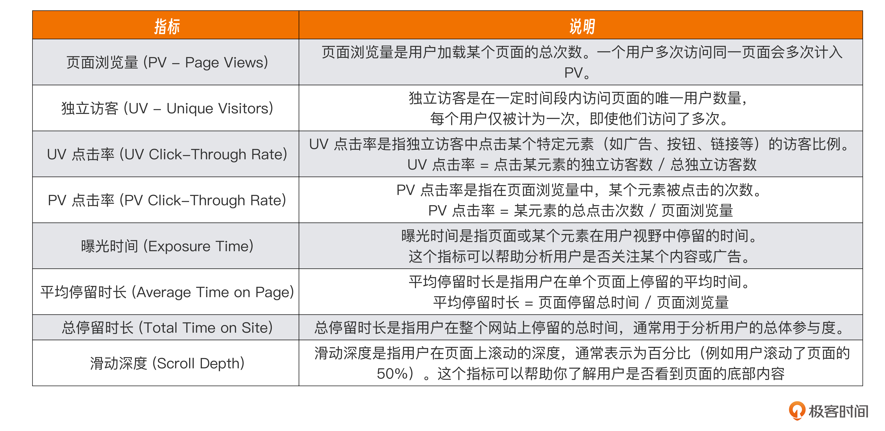
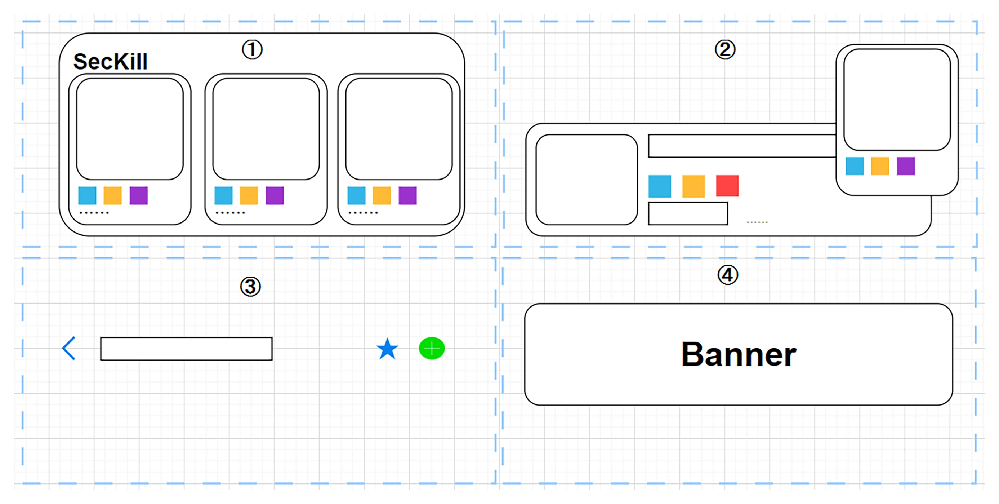
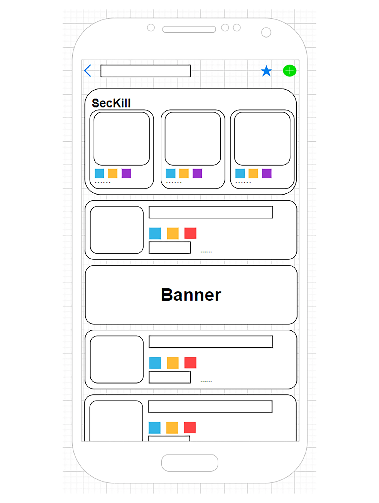
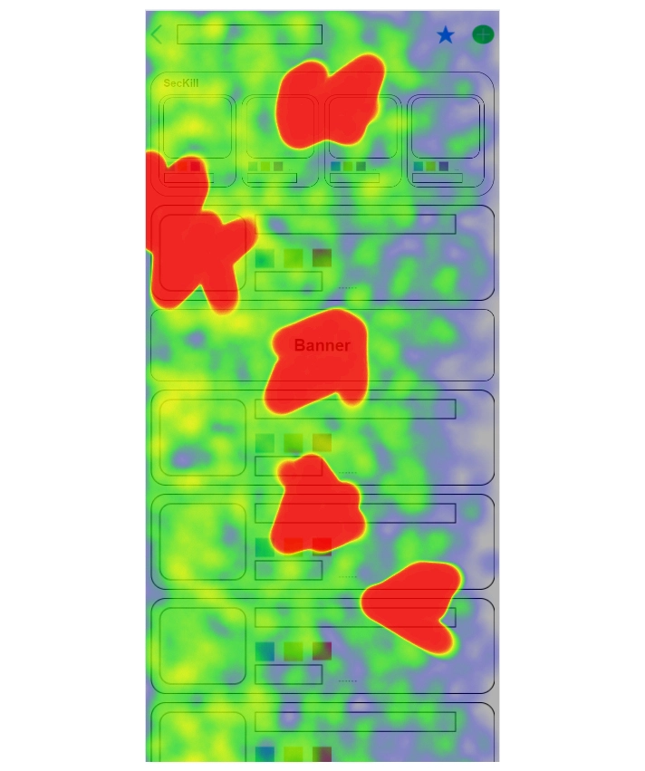

# 16 | 数据模拟：产品级页面数据模拟及热力图生成

你好，我是柳博文，欢迎和我一起学习前端工程师的 AI 实战课。

在上节课中，我们初步了解了 UI 的千人千面。因为不同属性的人群会有不同的 UI 结构设计的倾向，我们就可以类比数据的千人千面，借助 AI 的推荐，在端侧重排出符合当前用户喜好的UI 结构与设计，这就是 UI 的千人千面。

想要更好地分析 UI 千人千面，数据可视化是常用的辅助手段之一。具体到用户在页面中的行为数据的可视化，热力图是一个不错的选择。

这节课，我们就以电商 H5 营销页面为例，通过模拟用户行为的方式生成用户数据，并通过热力图的方式来将用户数据可视化，之后用数据可视化的方式进行人群精细化分析，以及算法模型的训练。

## 关键数据指标

在模拟用户行为生成用户数据之前，有一些专业的数据指标及相关意义需要我们提前知晓。通常这也是业务埋点时需要收集的各项数据。你可以参考后面的表格来了解。



在上面的表格中，我们需要重点关注 PV、UV、PV 点击率、UV 点击率以及停留时长这五个指标，稍后我们就会通过模拟用户行为来生成这几个指标的数据。

## 模拟用户行为生成用户数据

在电商领域的营销导购业务中，通常会用 H5 页面将商品以及其他营销活动以 Feeds 形式展示出来。用户通过浏览这个 H5 页面来找到想要购买的目标商品，然后下单完成订单交易。

在这样一个预定的用户行为路径下，势必会在 H5 页面对应位置以及对应 Feeds 卡片上留下用户的行为数据。本质上来说，这些数据是一组用户自身数据和用户行为数据结合映射。这个映射中显示了不同画像的人群在这样一个页面中的行为数据，以及这样的行为数据最后带来的商业行为结果。

其中，用户画像就是用户自己的属性标签，比如年龄、性别等基本信息。除此之外，如果取得用户同意以后，还会有职业、购买力（收入水平）、社交关系、价格敏感度、搜索记录、购买历史、收藏加入购物车行为等等维度的数据。

同时，用户的行为数据就是用户在 H5 页面 Feeds 流中留下的行为数据。在 Feeds 流中所有信息都会以卡片的形式承载。那么，用户在什么时间、在某个卡片处停留了多久、在什么卡片处发生了点击行为等，都可以对应成为不同维度的数据。这些数据包括卡片的曝光时间、停留时长、用户的点击位置和点击次数等。

因为不同属性的用户会在页面中形成不同的行为数据，最后达到不同的业务效果。那么用户在页面中的行为数据就可以表达为这样一个因果结构：


基于这样的分析，我们就可以使用程序来生成模拟数据了。这里我们选择用户年龄和性别两个画像维度来模拟用户画像，以 UV 点击、UV 点击率、曝光次数来模拟用户行为数据，并结合Feeds 流卡片 UI 进行分析。

其中性别的分类是男、女两类，年龄则分为 18-25、25-35、35-45、45-55 这样四个年龄段。

性别的分类很容易理解，而对于年龄的分类是有一定考量的。

- 18-25 这个年龄段往往代表大学生或者刚入职场的年轻人，年龄小、对价格敏感、独立性逐渐增强、购买力有限，追求时尚潮流，偏爱个性化产品。

- 25-35 这个年龄段往往代表了已婚有家庭的工薪群体，有家庭及个人需求，有独立购买力。

- 35-45 这个年龄段往往代表了已婚有家庭且有稳定收入的群体，有较强的家庭需求，有较强的购买力，注重实用性和性价比。

- 45-55 这个年龄段往往代表了较高的经济稳定性，较高可支配收入，且家庭成员子女也已独立，注重健康，重视产品质量和品牌价值。

由此其实可以看出，人群画像中的年龄这一指标，是一个足够用来描述用户的指标，能够反映出其他画像指标。

同样，对于一个电商营销导购页面中，根据业务属性在 Feeds 流中的卡片可以分为以下几类。

首先是商品卡片，这是整个 Feeds 流中最多的一类卡片。这类卡片用于承载商品信息，信息结构往往是商品图加上商品信息，以及一些商品特殊属性。所谓特殊属性，就是一些可能够让用户产生兴趣的信息，比如“次日达”。

UI 结构则分为两种，以商品图和信息部分上下组合（如下图②左图），左右组合（如下图②右图）为主。

其次是功能卡片（如下图①），这一类卡片往往就是带有活动属性的卡片，比如秒杀模块。功能卡片会具有一个跳转功能，在模块上也会承接到所见所得的商品。

然后是活动卡片（如下图④），这类卡片一般是直接出一个具有具体含义的图，比如“37 女神节女装合集”等，然后以 banner 的样式插入到商品卡片中。活动卡片同样具有跳转功能，点击后将会跳转到对应的活动页面中。

最后是一些具有特定功能的模块，如关注收藏栏等，如下图③。



以这四类卡片来组成一个常规营销页面 Feeds 流，结构一般如下图：



理解了这些必要的数据维度后，接下来我们就来使用一段程序来帮我们随机生成这样的数据。

注意，这里我们尽量按照真实数据（来源于真实电商业务数据结果）来用程序随机生成数据，生成数据结果可能有好有坏。不过我们的重点是基于 UI 的可视化数据分析以及 AI 算法模型的端侧重排，所以不必太过关注模拟的随机数据结果。

后面这段代码就是生成模拟数据的程序，使用 JavaScript 实现。

```javascript
// 生成随机用户ID
function generateUserIds(numUsers) {
   const userIds = [];
   for (let i = 0; i < numUsers; i++) {
       userIds.push(`user_${i + 1}`);
   }
   return userIds;
}
// 生成随机性别
function generateRandomGender() {
   const genders = ['male', 'female'];
   return genders[Math.floor(Math.random() * genders.length)];
}
// 生成随机年龄
function generateRandomAge() {
   return Math.floor(Math.random() * (55 - 18 + 1)) + 18;
}
// 生成随机点击时间
function generateRandomTime() {
   const date = new Date();
   date.setHours(Math.floor(Math.random() * 24));
   date.setMinutes(Math.floor(Math.random() * 60));
   date.setSeconds(Math.floor(Math.random() * 60));
   return date.toISOString();
}
// 生成随机点云
function generateRandomPointCloud(numPoints, maxX, maxY) {
   const points = [];
   for (let i = 0; i < numPoints; i++) {
       const x = Math.random() * maxX;
       const y = Math.random() * maxY;
       points.push({ x, y });
   }
   return points;
}
// 在指定坐标附近生成热点区域
function generateHotspotsNearCoordinate(centerX, centerY, numHotspots, maxOffset
   const hotspots = [];
   for (let i = 0; i < numHotspots; i++) {
       const pointCloud = generateRandomPointCloud(10, maxOffset * 2, maxOffset
           x: centerX + point.x - maxOffset,
           y: centerY + point.y - maxOffset
       }));
       hotspots.push(pointCloud);
   }
   return hotspots;
}
// 修改后的生成热点区域函数，热点区域在y = 0到800px范围内生成
function generateHotspots(numHotspots, pageWidth) {
   const hotspots = [];
   for (let i = 0; i < numHotspots; i++) {
       const maxY = 800; // 设置热点区域的最大Y坐标为800px
       const centerX = Math.floor(Math.random() * pageWidth);
       const centerY = Math.floor(Math.random() * maxY); // 限制中心Y坐标到前800px内
       const pointCloud = generateRandomPointCloud(10, 100, 100).map(point => ({
           x: centerX + point.x - 50,
           y: centerY + point.y - 50
       }));
       hotspots.push(pointCloud);
   }
   return hotspots;
}
// 检查点是否在多边形内
function isPointInPolygon(point, polygon) {
   let x = point.x, y = point.y;
   let inside = false;
   for (let i = 0, j = polygon.length - 1; i < polygon.length; j = i++) {
       const xi = polygon[i].x, yi = polygon[i].y;
       const xj = polygon[j].x, yj = polygon[j].y;
       const intersect = ((yi > y) !== (yj > y)) &&
           (x < (xj - xi) * (y - yi) / (yj - yi) + xi);
       if (intersect) inside = !inside;
   }
   return inside;
}
// 生成随机点击位置，模拟热点和冷点区域，并在x轴上点击数据逐渐减少
function generateRandomClickPosition(hotspots, pageWidth) {
   let x, y;
   const decreaseRate = 0.5; // 调整这里的值来控制减少的速率，越小减少越慢
   if (Math.random() < 0.7) { // 70%的概率生成在热点区域
       const hotspot = hotspots[Math.floor(Math.random() * hotspots.length)];
       do {
           x = Math.floor(Math.random() * pageWidth);
           y = Math.floor(Math.random() * 5000);
       } while (!isPointInPolygon({ x, y }, hotspot) || Math.random() > ((pageWi
   } else { // 30%的概率生成在其他区域
       do {
           x = Math.floor(Math.random() * pageWidth);
           y = Math.floor(Math.random() * 5000);
       } while (Math.random() > (5000 - y) / 5000 || Math.random() > ((pageWidth
   }
   return { x, y };
}
// 生成点击数据
function generateClickData(userIds, clicksPerUser, hotspots, pageWidth) {
   const clickData = [];
   userIds.forEach(userId => {
       const gender = generateRandomGender();
       const age = generateRandomAge();
       for (let i = 0; i < clicksPerUser; i++) {
           clickData.push({
               userId: userId,
               gender: gender,
               age: age,
               clickTime: generateRandomTime(),
               clickPosition: generateRandomClickPosition(hotspots, pageWidth)
           });
       }
   });
   return clickData;
}
const numUsers = 10000;
const clicksPerUser = 5; // 每个用户的点击次数
const numHotspots = 6; // 热点区域数量
const pageWidth = 390;
const userIds = generateUserIds(numUsers);
const hotspots = generateHotspots(numHotspots, pageWidth);
generateClickData(userIds, clicksPerUser, hotspots, pageWidth)
```

在这段代码中，生成了不同性别以及不同年龄段下的用户在一个 H5 页面中的点击行为数据。之后还通过热区的概念来模拟生成用户集中点击区域的数据，这模拟了用户的兴趣和注意力。

刚才的代码是模拟用户点击定位，并以点击的位置来生成数据。另外，我们也可以使用其他方式来模拟生成数据，比如借助被点击的卡片类型、被点击卡片的位置索引等等，并且可以通过计算生成 UV 点击率这样信息含量更高的数据结果。

这里我再说一些题外话，因为在真实业务环境中这些数据往往需要连表查询才能得到的，所以呢，对于前端工程师来说，SQL 也是建议深入学习的。

## 生成热力图

有了模拟数据，我们就可以生成热力图了。这里使用 heatmap.js 这个热力图工具库，使用它绘制热力图很容易，只需引入 heatmap 的脚本即可实现自定义的热力图。代码如下：

```xml
<!DOCTYPE html>
<html lang="en">
<head>
   <meta charset="UTF-8">
   <meta name="viewport" content="width=device-width, initial-scale=1.0">
   <title>Data Visualization with Real H5 Page</title>
   <style>
       * {
           padding: 0;
           margin: 0;
       }
       body {
           margin: 0;
           overflow: auto;
           position: relative;
       }
       #heatmapContainer {
           position: absolute;
           top: 0;
           left: 0;
           width: 390px;
           height: 5000px;
           pointer-events: none;
           z-index: 10;
           background: rgba(0, 0, 0, 0.3);
       }
       #h5Page {
           position: absolute;
           top: 0;
           left: 0;
           width: 390px;
           height: 5000px;
           z-index: 1;
       }
   </style>
   <!-- 引入 heatmap.js -->
   <script src="https://cdn.jsdelivr.net/npm/heatmap.js@2.0.5/build/heatmap.min.
</head>
<body>
   <div id="h5Page">
       <!-- 真实的H5页面内容在这里 -->
       <p>Your real H5 page content goes here...</p>
   </div>
   <div id="heatmapContainer"></div>
   <script>
       // 初始化 heatmap 实例
       const heatmapInstance = h337.create({
           container: document.getElementById('heatmapContainer'),
           radius: 20,
           maxOpacity: 0.8,
           minOpacity: 0,
           blur: 0.75,
       });
       // 格式化数据为 heatmap.js 需要的格式
       const heatmapData = {
           max: 10,
           data: generateClickData(userIds, clicksPerUser, hotspots, pageWidth).
               const { x, y } = click.clickPosition;
               return { x, y, value: 1 };
           })
       };
       // 设置热力图数据
       heatmapInstance.setData(heatmapData);
       // 同步滚动逻辑
       const syncScroll = () => {
           const scrollTop = window.scrollY;
           heatmapContainer.style.transform = `translateY(${-scrollTop}px)`;
       };
       window.addEventListener('scroll', syncScroll);
   </script>
</body>
</html>
```

在这段代码中，使用 heatmap 的 API 新建了一个实例，再通过前面所讲的生成模拟数据的方法 generateClickData 来生成模拟数据，并将这些数据格式化，输出为 heatmap 需要的数据格式，最后显示在网页上。

同时，HTML 结构使用了 position 的布局，在热力图层下还有一层 H5 页面的内容，这样能够将数据和页面具体位置对应起来，便于观察分析。在网页中执行这个代码之后的效果如下：



## 总结

让我们来总结一下今天的内容吧！

这节课我们使用程序生成了用户点击行为的模拟数据，并根据这些数据生成了热力图。这个过程里有几个细节点需要我们格外关注。

首先是关键数据指标，要模拟用户在页面中的行为数据，一些领域的关键指标及含义需要知晓。在 Web 应用中，重要的业务指标包括 UV、PV、UV 点击率、PV 点击率以及曝光时长等。

在电商领域的营销导购业务中，我们可以通过 H5 页面的 Feeds 流来展示商品和活动，以获取用户的行为数据并对其进行分析。利用 heatmap.js 生成了用户点击的模拟数据，并与页面内容叠加，结合同步滚动逻辑，实现了用户点击行为的动态热力图展示。

通过对用户画像（如性别和年龄段）和用户行为数据（如 UV 点击率、曝光次数等）的模拟，我们就能结合 JavaScript 程序生成点击数据、热点区域和点击位置。这个模拟的意义在于帮助我们更好地理解不同人群的偏好和行为模式，从而更深入地分析用户在页面中的行为特征。这将为后续优化营销策略、构建推荐系统提供有力支持。

## 思考题

这节课里我们将用户年龄作为关键指标，分析了不同年龄段用户的特质。那么以职业（学生，公司职员，自由职业）来划分用户的话，你觉得会找到哪些特征呢？

欢迎你在留言区和我交流讨论，如果这节课对你有启发，也推荐你把它分享给更多朋友。
