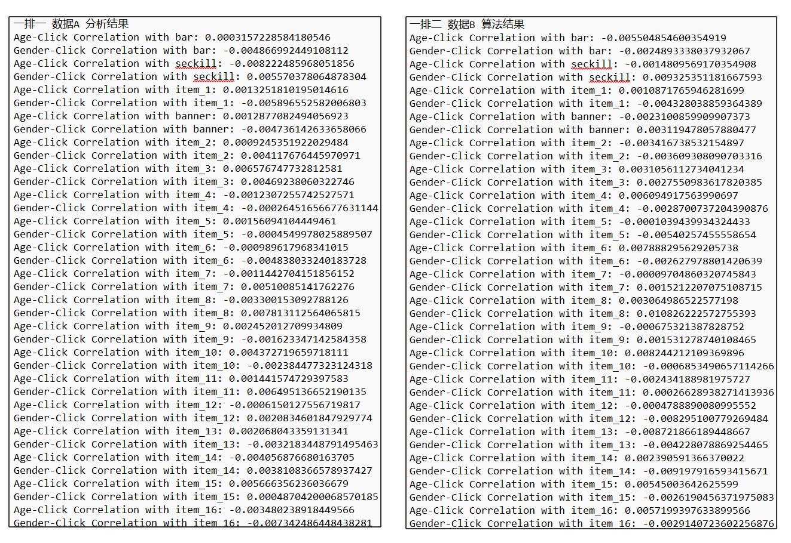
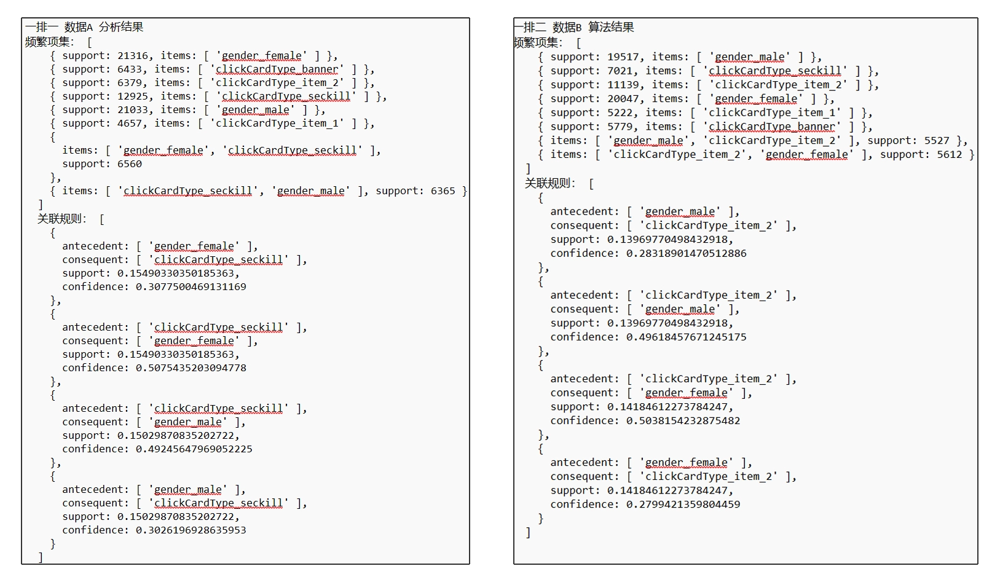

# 18 | 商业意义（上）：如何利用端侧重排提升转化率

你好，我是柳博文，欢迎和我一起学习前端工程师的 AI 实战课。

前面我们分析了用户点击行为数据，并按性别和年龄细分，探讨了不同群体的 UI 偏好。不过除了通过热力图的方式，还有更多挖掘和分析数据的方式。

接下来的两节课，我们来看看如何通过不同的算法模型，找到不同人群下的数据共性，再将算法跑在端侧来为不同人群推荐不同的 UI 结果，为产品转化做出更多贡献。

今天我们先来学习如何进行数据预处理，然后再看看怎么应用传统算法来处理这些数据。

## 通过算法找到数据共性

在上节课中，我们用热力图可视化的方式分析了用户的点击数据。不过对于这些数据，我们还有更科学的处理方式，那就是利用一些常规的算法模型来处理分析，从而找到这堆数据中的共性。

在这组数据中，每条记录都包含了用户的 ID、性别、年龄等用户属性，同时还记录了用户在H5 页面上的点击行为时间和位置。在上节课讨论长尾效应时，我们了解到，用户的点击位置实际上对应了页面中 Feeds 卡片的类型，而这些卡片类型具有特定的商业属性。

为了便于后续算法分析，我们将用户的点击位置与 Feeds 对应的卡片类型进行匹配绑定。具体来说，我们可以使用点击事件的 y 坐标来确定用户点击了哪个位置上的卡片类型。

以下是 Feeds 的结构映射，展示了各个 y 坐标区间与相应卡片类型之间的对应关系。这种映射方式将帮助我们更好地理解用户行为模式及其与页面元素之间的关系，从而优化用户体验、提升商业效果。

```javascript
const regions = {
 bar: [0, 100],
 seckill: [150, 350],
 item_1: [370, 470],
 banner: [490, 590],
 item_2: [610, 710],
 item_3: [830, 930],
 item_4: [950, 1050],
 item_5: [1070, 1170],
 item_6: [1190, 1290],
 item_7: [1310, 1410],
 item_8: [1430, 1530],
 item_9: [1550, 1650],
 item_10: [1670, 1770],
 item_11: [1790, 1890],
 item_12: [1910, 2010],
 item_13: [2030, 2130],
 item_14: [2150, 2250],
 item_15: [2270, 2370],
 item_16: [2390, 2490],
 item_17: [2510, 2610],
 item_18: [2630, 2730],
 item_19: [2750, 2850],
 item_20: [2870, 2970],
 item_21: [2990, 3090],
 item_22: [3110, 3210],
 item_23: [3230, 3330],
 item_24: [3350, 3450],
 item_25: [3470, 3570],
 item_26: [3590, 3690],
 item_27: [3710, 3810],
 item_28: [3830, 3930],
 item_29: [3950, 4050],
 item_30: [4070, 4170],
 item_31: [4190, 4290],
 item_32: [4310, 4410],
 item_33: [4430, 4530],
 item_34: [4550, 4650],
 item_35: [4670, 4770],
 item_36: [4790, 4890]
};
```

然后编写映射函数完成卡片类型的绑定，处理函数如下。在这个函数中，通过判断点击的 y 坐标值，就能确定点击的卡片类型。

```javascript
// 处理点击数据并为每个点击分配区域类型
function assignClickCardType(clickData, regions) {
 clickData.forEach((click) => {
   const clickY = click.clickPosition.y;
   let foundRegion = null;
   for (const [regionName, [start, end]] of Object.entries(regions)) {
     if (clickY >= start && clickY <= end) {
       foundRegion = regionName;
       break;
     }
   }
   click.clickCardType = foundRegion;
 });
 return clickData;
}
// 处理完成的数据结构
// {
//   "userId": "user_1",
//   "gender": "male",
//   "age": 48,
//   "clickTime": "2024-08-31T20:11:45.637Z",
//   "clickPosition": {
//     "x": 319,
//     "y": 367
//   },
//   "clickCardType": null
// }
```

在下面算法的应用过程中，我们处理了生成的一排一 UI 结构和一排二 UI 结构的数据，为每条数据加上 clickCradType 字段，这么做是为了后续的对比试验做准备。为了方便，后面将一排一 UI 结构的数据描述为 A 数据，将一排二 UI 结构的数据描述为 B 数据。

好了，接下来我们就来进行算法的处理和分析吧。后面我们将分别从传统算法、机器学习算法、深度学习算法三个方面，选择了一些常用且适合我们需要的算法来演示与讲解。

这节课我们的重点是传统算法，后面两个方面的算法处理我们下节课再探讨。

## 传统算法代表

传统算法中，我们将会用到皮尔逊相关系数算法和 Apriori 算法。

### 皮尔逊相关系数

皮尔逊相关系数是一种统计方法，用于衡量两个变量之间的线性相关性。是衡量两个变量之间线性关系强度和方向的统计量。其值范围从 -1 到 +1。

- +1 表示完全正相关，表示当一个变量增加时，另一个变量也相应增加。

- 0 表示无相关，表示两个变量之间没有线性关系。

- -1 表示完全负相关，表示当一个变量增加时，另一个变量相应减少。

通过计算用户的年龄、性别与点击行为（如点击的卡片类型或位置）之间的相关性，我们可以观察到哪些用户属性对点击行为有显著影响。

在这个过程中，我们需要先完成数据的预处理，将数据中的性别、年龄和点击行为映射为数值特征，然后计算每个属性和点击行为之间的皮尔逊相关系数。

使用 NodeJS 来实现皮尔逊相关系数的代码如下：

```javascript
const fs = require('fs');
const math = require('mathjs');
// 读取数据
const data = JSON.parse(fs.readFileSync('../data/onetwowithcardtype.json', 'utf-8
// 定义所有的 clickCardType 区域
const regions = {
 bar: [0, 100],
 seckill: [150, 350],
 item_1: [370, 470],
 banner: [490, 590],
 item_2: [610, 710],
 item_3: [830, 930],
 item_4: [950, 1050],
 item_5: [1070, 1170],
 item_6: [1190, 1290],
 item_7: [1310, 1410],
 item_8: [1430, 1530],
 item_9: [1550, 1650],
 item_10: [1670, 1770],
 item_11: [1790, 1890],
 item_12: [1910, 2010],
 item_13: [2030, 2130],
 item_14: [2150, 2250],
 item_15: [2270, 2370],
 item_16: [2390, 2490],
 item_17: [2510, 2610],
 item_18: [2630, 2730],
 item_19: [2750, 2850],
 item_20: [2870, 2970],
 item_21: [2990, 3090],
 item_22: [3110, 3210],
 item_23: [3230, 3330],
 item_24: [3350, 3450],
 item_25: [3470, 3570],
 item_26: [3590, 3690],
 item_27: [3710, 3810],
 item_28: [3830, 3930],
 item_29: [3950, 4050],
 item_30: [4070, 4170],
 item_31: [4190, 4290],
 item_32: [4310, 4410],
 item_33: [4430, 4530],
 item_34: [4550, 4650],
 item_35: [4670, 4770],
 item_36: [4790, 4890]
};
// 将性别和年龄转换为数值
const numericData = data.map(({ gender, age, clickCardType }) => ({
 gender: gender === 'male' ? 0 : 1,
 age,
 ...Object.keys(regions).reduce((acc, key) => {
   acc[key] = clickCardType === key ? 1 : 0;
   return acc;
 }, {})
}));
// 计算皮尔逊相关系数
const pearsonCorrelation = (x, y) => {
 const meanX = math.mean(x);
 const meanY = math.mean(y);
 const numerator = math.sum(x.map((xi, i) => (xi - meanX) * (y[i] - meanY)));
 const denominator = Math.sqrt(
   math.sum(x.map(xi => (xi - meanX) ** 2)) * math.sum(y.map(yi => (yi - meanY)
 );
 return numerator / denominator;
};
// 计算年龄和性别与每个 clickCardType 的相关性
const clickCardTypes = Object.keys(regions);
const correlations = clickCardTypes.reduce((acc, type) => {
 acc[type] = {
   ageCorrelation: pearsonCorrelation(
     numericData.map(d => d.age),
     numericData.map(d => d[type])
   ),
   genderCorrelation: pearsonCorrelation(
     numericData.map(d => d.gender),
     numericData.map(d => d[type])
   )
 };
 return acc;
}, {});
// 打印相关性结果
clickCardTypes.forEach(type => {
 console.log(`Age-Click Correlation with ${type}:`, correlations[type].ageCorrel
 console.log(`Gender-Click Correlation with ${type}:`, correlations[type].gender
});
```

根据相关系数结果，我们可以了解年龄和性别对点击行为的影响，从而优化 UI 设计，比如针对不同年龄段的用户定制不同的 UI 布局。

将算法分别作用于 A、B 两组数据，就能得到对应的算法结果。因为结果比较长，后面我提供部分截图，你自己运行代码以后就可以看到全部结果了。



这个结论的推导过程需要了解皮尔逊相关系数，我这里也顺便补充一下。你也可以不必深究细节，只需要知道根据刚才的算法处理结果，可以发现年龄和性别对点击行为的影响比较小。

- 拓展知识点：皮尔逊相关系数，代表两个变量之间线性关系强度和方向的统计量。正数表示正相关，0 表示无相关，-1 表示负相关，范围是 -1 到 1。

- 上图结果中可以看出，无论正负相关的数值基本都已经来到了小数点后的千分位或者更小的数值了，这就说明年龄和性别对点击行为的影响很小了。

理想状态是找到比较大的差异，这样后续的优化效果会更高。不过这里尽管影响比较小，根据微小的差异，还是可以提出一些优化点的，比如从这几个方面来优化：

1. 可以考虑用户的年龄或性别，通过动态行为数据调整 UI 展示顺序；

2. 在特定卡片上优化色彩和设计以吸引目标用户；

3. 对性别有偏好的卡片进行布局调整；

4. 持续进行 A/B 测试并收集用户反馈，以基于数据进行优化。

需要注意的是，我们要确保优化过程中保持 UI 的多样性和包容性，避免偏见。

### Apriori 算法

其次是传统算法中的 Apriori 算法，这是一种广泛应用的算法，用来挖掘数据集中经常出现的数据项组合以及这些数据项组合之间关系规则。这个算法特别适合于事务型数据，例如购物篮分析。在电商页面点击数据的场景中，它可以帮助我们发现哪些用户属性（如性别和年龄）与某些点击行为（如点击某类型卡片）之间的关联。

在 Apriori 算法的算法原理中，有四个比较重要的概念需要我们掌握，它们是频繁项集、关联规则、支持度和置信度。

- 频繁项集是数据集中出现频率超过设定阈值的项组合。项是基本元素，比如对于商品来说，项集就是它们的集合。高支持度项集称为频繁项集。

- 关联规则用于揭示项集间的强关系，如点击了“item_1”的用户很可能也会点击 “item_2“。

- 支持度用来衡量项集或规则在数据中的普遍程度，即项集或规则出现的事务比例，高支持度表明常见。

- 置信度衡量关联规则的可靠性，即当前提发生时，结论发生的概率。高置信度表明规则可靠。

了解了基础概念以后，我们再来看看 Apriori 算法的大致操作步骤。

1. 生成候选项集：从数据中生成频繁 1- 项集（每个单独的项），然后使用自底向上的方式生成更大项的候选项集。

2. 剪枝：根据最小支持度阈值筛选候选项集，保留支持度大于等于阈值的项集。

3. 生成频繁项集：从数据中筛选出经常一起出现的项组合。

4. 生成关联规则：根据频繁项集生成可能的关联规则，并使用最小置信度阈值筛选有效的关联规则。

同样我们可以使用 NodeJS实现 Apriori 算法，代码如下：

```javascript
const fs = require('fs');
const { Apriori } = require('node-apriori');
// 读取 JSON 文件中的数据
const data = JSON.parse(fs.readFileSync('../data/onetwowithcardtype.json', 'utf-8
// 转换数据格式：将每个用户的点击行为转化为一个事务
const transactions = data.map((entry) => {
   return [
       `userId_${entry.userId}`,
       `gender_${entry.gender}`,
       `age_${entry.age}`,
       `clickCardType_${entry.clickCardType}`
   ];
});
// 设置支持度阈值和置信度阈值
const support = 0.1;
// 创建 Apriori 实例
const apriori = new Apriori(support);
// 运行 Apriori 算法
apriori.exec(transactions)
   .then(result => {
       console.log(`频繁项集：`, result.itemsets);
       // 计算关联规则
       const itemsets = result.itemsets;
       const rules = generateAssociationRules(itemsets, transactions, support);
       console.log(`关联规则：`, rules);
   })
   .catch(error => console.error('Apriori 执行出错:', error));
// 生成关联规则的函数
function generateAssociationRules(itemsets, transactions, minSupport) {
   const rules = [];
   itemsets.forEach(itemset => {
       if (itemset.items.length < 2) return;
       const subsets = getSubsets(itemset.items);
       subsets.forEach(subset => {
           const itemsetSubset = itemset.items.filter(item => !subset.includes(i
           if (itemsetSubset.length === 0) return;
           const subsetSupport = getSupport(subset, transactions);
           const itemsetSupport = itemset.support;
           const confidence = itemsetSupport / subsetSupport;
           if (confidence >= minSupport) {
               rules.push({
                   antecedent: subset,
                   consequent: itemsetSubset,
                   support: itemsetSupport / transactions.length,
                   confidence: confidence
               });
           }
       });
   });
   return rules;
}
function getSubsets(items) {
   const subsets = [];
   const length = items.length;
   for (let i = 1; i < (1 << length); i++) {
       const subset = [];
       for (let j = 0; j < length; j++) {
           if (i & (1 << j)) {
               subset.push(items[j]);
           }
       }
       subsets.push(subset);
   }
   return subsets;
}
function getSupport(itemset, transactions) {
   let count = 0;
   transactions.forEach(transaction => {
       if (itemset.every(item => transaction.includes(item))) {
           count++;
       }
   });
   return count;
}
```

分别作用于 A 数据和 B 数据，算法输出如下：



分析了对比结果之后，不难得出这样一些优化策略。

- 尽管性别对卡片类型点击影响较小，但可以在初始展示时保持界面一致，之后根据用户行为进行微调，测试个性化效果。

- 提升 item_2 的可见性，将最受欢迎的 item_2 放在显眼位置，并在不同设备上保持突出展示，增加类似内容以提升用户参与度。

- 突出秒杀活动，尤其针对女性用户，通过弹窗、倒计时等方式强调秒杀活动，对男性用户测试其他促销策略。

- 新老用户策略：新用户展示多样化内容，老用户提供定制化推荐，提升用户粘性和转化率。

通过使用 Apriori 算法，我们可以从用户点击数据中挖掘出有价值的模式和关联，为优化电商H5 页面设计和用户体验提供依据。这种方法特别适用于发现不同用户群体的偏好和行为模式，有助于进行精细化的用户运营和个性化推荐。

## 总结

我们来做个总结吧！

在这节课中，为了更好地适配算法，我们对数据进行了预处理，在原有数据基础上将用户的点击位置与 Feeds 对应的卡片类型做了匹配绑定。这样就能将用户的点击位置和 Feeds 流中具体的卡片对应起来了。

然后，我们选择了皮尔逊系数和 Apriori 两种传统算法来对数据进行处理分析。皮尔逊系数是一种统计方法，用于衡量两个变量之间的线性相关性，我们可以用它来了解年龄和性别对点击行为的影响，从而优化 UI 设计，比如针对不同年龄段的用户定制不同的 UI 布局。

Apriori 算法，这是一种广泛应用的算法，用来挖掘数据集中经常出现的数据项组合以及这些数据项组合之间关系规则，我们可以用它来发现用户属性（如性别和年龄）与点击行为（如点击某类型卡片）之间的关联。它同样可以用来优化 UI 设计。

## 思考题

这节课中，我们选择了 皮尔逊和 Apriori 两种传统算法来进行实验，那么，除此之外还有哪些适合课程实验数据结构和内容的传统算法呢？

欢迎你在留言区分享你的思考或疑问，如果这节课对你有启发，别忘了分享给身边更多朋友。
