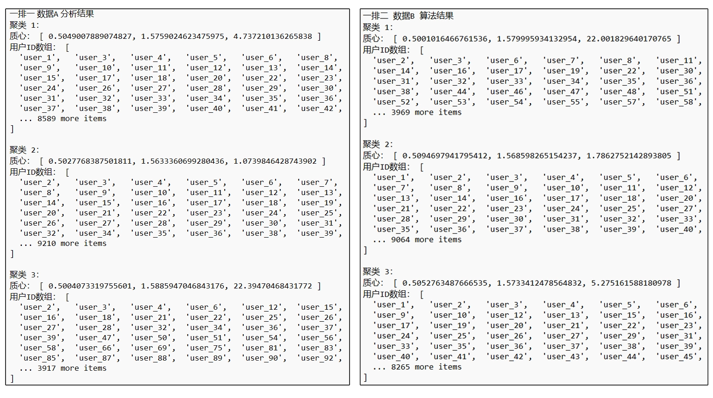

# 19 | 商业意义（下）：如何利用端侧重排提升转化率

你好，我是柳博文。

这节课我们继续学习如何利用端侧重排提升转化率。上节课我们已经学习了传统算法里的代表——皮尔逊相关系数和 Apriori 算法。

今天，我们还会学习一些机器学习和深度学习里的典型算法。最后我还会为你演示如何在端侧把算法跑起来，最终实现转化率的提升。

好，话不多说，我们直接开始吧。

## 机器学习算法代表

在机器学习这个方向上，我们选择了 kmeans 和决策树算法。

### kmeans 算法

首先是 kmeans 算法，其原理是将用户分成不同的簇，每个簇表示一组具有相似点击行为的用户，之后就可以根据这些簇推荐定制化 UI 界面。

为了实现这个算法，针对需要处理的数据结构，我们可以使用用户属性和点击位置及卡片类型作为特征。然后应用 K-Means 聚类，将用户分为若干簇，根据聚类结果，向每个簇的用户展示不同的 UI 结构。

我们仍然使用 NodeJS 来实现，代码如下：

```javascript
const fs = require('fs');
const kmeans = require('node-kmeans');
// 读取 JSON 文件中的数据
const data = JSON.parse(fs.readFileSync('../data/oneonewithcardtype.json', 'utf-8
// 定义卡片类型区域
const regions = {
 bar: [0, 100],
 seckill: [150, 350],
 item_1: [370, 470],
 banner: [490, 590],
 item_2: [610, 710],
 item_3: [830, 930],
 item_4: [950, 1050],
 item_5: [1070, 1170],
 item_6: [1190, 1290],
 item_7: [1310, 1410],
 item_8: [1430, 1530],
 item_9: [1550, 1650],
 item_10: [1670, 1770],
 item_11: [1790, 1890],
 item_12: [1910, 2010],
 item_13: [2030, 2130],
 item_14: [2150, 2250],
 item_15: [2270, 2370],
 item_16: [2390, 2490],
 item_17: [2510, 2610],
 item_18: [2630, 2730],
 item_19: [2750, 2850],
 item_20: [2870, 2970],
 item_21: [2990, 3090],
 item_22: [3110, 3210],
 item_23: [3230, 3330],
 item_24: [3350, 3450],
 item_25: [3470, 3570],
 item_26: [3590, 3690],
 item_27: [3710, 3810],
 item_28: [3830, 3930],
 item_29: [3950, 4050],
 item_30: [4070, 4170],
 item_31: [4190, 4290],
 item_32: [4310, 4410],
 item_33: [4430, 4530],
 item_34: [4550, 4650],
 item_35: [4670, 4770],
 item_36: [4790, 4890],
 item_37: [5010, 5110],
 item_38: [5230, 5330],
};
// 将卡片类型映射到数值
const cardTypeToNumber = (cardType) => {
 return Object.keys(regions).indexOf(cardType);
};
// 将性别和年龄映射到数值
const genderToNumber = (gender) => (gender === 'male' ? 0 : 1);
const ageToNumber = (age) => {
 if (age >= 18 && age <= 25) return 0;
 if (age >= 26 && age <= 35) return 1;
 if (age >= 36 && age <= 45) return 2;
 if (age >= 46 && age <= 55) return 3;
 return 4; // 超过范围的年龄
};
// 转换数据格式以便进行聚类
const vectors = data.map((entry) => [
 genderToNumber(entry.gender),
 ageToNumber(entry.age),
 cardTypeToNumber(entry.clickCardType),
]);
// 设置聚类的数量
const numClusters = 3; // 可以调整聚类数量
// 执行 K-means 聚类
kmeans.clusterize(vectors, { k: numClusters }, (err, res) => {
 if (err) {
   console.error('K-means 聚类出错:', err);
 } else {
   console.log('K-means 聚类结果:');
   res.forEach((cluster, index) => {
     const userIds = cluster.clusterInd.map(pointIndex => data[pointIndex].userI
     const uniqueUserIds = [...new Set(userIds)]; // 去重用户ID数组
     console.log(`\n聚类 ${index + 1}：`);
     console.log(`质心：`, cluster.centroid);
     console.log(`用户ID数组：`, uniqueUserIds);
   });
 }
});
```

分别作用于数据 A 和数据 B，算法输出是后面这样。



那么，我们可以对以上结果做一个分析：

首先是质心（质心是每个数据簇的中心点，它代表了该簇中所有数据点的“平均位置”）的三个维度，代表了用户点击行为特征。虽然第一个和第二个维度的差异较小，但在第三个维度上，用户群体的行为特征显著不同，反映了用户在特定条件下的点击行为变化。

然后是用户分布对比，聚类 3 的用户覆盖最广泛，其次是聚类 2，聚类 1 的用户相对较少。其中，聚类 2 的质心值较高，可能表明该聚类用户的行为模式与其他群体不同。

根据以上结果分析，用户行为模式显示了 UI 交互中的显著差异。聚类 2 的用户表现出较强的目的性，他们进入页面后会迅速寻找所需商品。因此，这类用户适合提供个性化推荐，帮助他们快速找到心仪商品并下单。

而聚类 1 和 3 的用户目的性较弱，可能只是随意浏览，但也希望购买一些商品。对于这类用户，操作流程过于复杂就会导致用户流失。所以对于聚类 1、3 的用户，需要我们化简他们的操作流程，并根据群体特征动态调整 UI 布局。

### 决策树算法

接下来是决策树算法，决策树可以帮助我们识别用户属性（如性别、年龄）如何影响点击行为，从而为每种用户属性组合推荐最佳 UI。

在实现决策树算法的过程中，我们将用户的属性和点击行为作为输入特征训练决策树模型，最后使用这个模型来用户的点击行为，使用决策树模型结果为不同用户定制推荐的 UI 卡片。

我们继续使用 NodeJS 来实现这样的决策树算法，代码如下：

```javascript
const DecisionTree = require('decision-tree');
const fs = require('fs');
// 读取 JSON 文件中的数据
const rawData = fs.readFileSync('../data/oneonewithcardtype.json', 'utf-8');
const data = JSON.parse(rawData);
// 准备训练数据
const trainingData = data.map(({ gender, age, clickCardType }) => ({
 gender: gender === 'male' ? 0 : 1,  // 将性别转换为数值
 age,
 clickCardType
}));
// 过滤无效的标签并确保标签是有效的类
const validTrainingData = trainingData.filter(item =>
 item.clickCardType !== undefined &&
 item.clickCardType !== null &&
 item.clickCardType !== '' // 检查空字符串
);
if (validTrainingData.length === 0) {
 throw new Error('No valid training data available.');
}
// 特征和标签
const features = ['gender', 'age'];
const labels = validTrainingData.map(item => item.clickCardType);
// 创建并训练决策树
const decisionTree = new DecisionTree(validTrainingData, 'clickCardType', feature
// 预测
const predictedLabel = decisionTree.predict({ gender: 0, age: 25 }); // 预测25岁男性
console.log('Predicted label:', predictedLabel);
```

使用决策树算法对数据 A 和数据 B 都进行一次处理，同样对 25 岁男性进行预测。数据 A 的预测结果是 item_1，数据 B 的结果是 item_23。也就是说这样的性别和年龄的组合下，用户在一排一的 UI 结构下偏好第一个商品，而在一排二这样的 UI 结构下，用户偏爱第 23 个商品。

这样一来，我们就可以根据进来的用户进行预测，将用户偏好的卡片放在显而易见的地方，也可以将用户偏好的卡片放在非第一屏的地方来激活长尾效应。

## 深度学习算法代表

最后是深度学习算法代表，这也是我们这节实践课重点要关注和学习的算法模型类型，这里我们选择 LSTM（RNN）神经网络和卷积神经网络模型（CNN）算法。

这里大概梳理一下 RNN 和 CNN 的区别。

RNN 用于处理序列数据（如时间序列和文本），通过循环连接记忆之前的输入，适用于有时间依赖的数据。但它容易遇到梯度消失或爆炸的问题。

而 CNN 擅长处理图像数据，通过卷积操作提取局部特征，对数据的空间结构敏感，适合图像分类、目标检测等任务。CNN 使用卷积核提取局部特征，计算复杂度主要与空间维度有关，易于并行计算。

选择 RNN 还是 CNN 取决于数据类型，也就是说处理时间序列数据适合用 RNN，处理图像数据适合 CNN。

对于 RNN 来说，LSTM，这是一种特殊的 RNN 模型，擅长处理时间序列数据。哪怕你的数据并非典型的时间序列，但 LSTM 仍然能捕捉到用户行为的序列模式，尤其是在用户交互行为具有一定的时序或顺序依赖时效果会更好。

这里使用 NodeJS 结合 synaptic 来实现，代码如下:

```javascript
const fs = require('fs');
const synaptic = require('synaptic');
// 读取 JSON 文件中的数据
const rawData = fs.readFileSync('../data/onetwowithcardtype.json', 'utf-8');
const data = JSON.parse(rawData);
// 将数据转换为适合网络的输入格式
const processedData = data.map(item => ({
   gender: item.gender === 'male' ? 0 : 1,
   age: item.age,
   clickTime: new Date(item.clickTime).getTime(),
   clickPositionX: item.clickPosition.x,
   clickPositionY: item.clickPosition.y,
   clickCardType: item.clickCardType
}));
// 提取输入特征
const inputFeatures = processedData.map(item => [
   item.gender,
   item.age,
   item.clickTime,
   item.clickPositionX,
   item.clickPositionY
]);
// 提取标签 (clickCardType) 并将其转化为数值（假设有三个类型）
const cardTypes = Array.from(new Set(processedData.map(item => item.clickCardType
const labelMap = cardTypes.reduce((map, type, index) => (map[type] = index, map),
const labels = processedData.map(item => labelMap[item.clickCardType]);
// 为神经网络准备训练数据
const trainingData = inputFeatures.map((input, index) => ({
   input: input,
   output: Array(cardTypes.length).fill(0).map((v, i) => i === labels[index] ? 1
}));
// 创建并训练神经网络
const { Layer, Network } = synaptic;
const inputLayer = new Layer(5);
const hiddenLayer = new Layer(10);
const outputLayer = new Layer(cardTypes.length);
inputLayer.project(hiddenLayer);
hiddenLayer.project(outputLayer);
const net = new Network({
   input: inputLayer,
   hidden: [hiddenLayer],
   output: outputLayer
})
const trainer = new synaptic.Trainer(net);
trainer.train(trainingData, {
   rate: 0.1,
   iterations: 100,
   error: 0.01,
   shuffle: true,
   log: 10
});
// 保存模型
const modelJSON = net.toJSON();
fs.writeFileSync('./model.json', JSON.stringify(modelJSON));
console.log('Model trained and saved successfully.');
// 使用模型进行预测
const newUserData = [
   0, // gender: male
   25, // age
   new Date().getTime(), // current time
   150, // clickPositionX
   300  // clickPositionY
];
// 预测结果
const output = net.activate(newUserData);
const predictedIndex = output.indexOf(Math.max(...output));
const predictedLabel = cardTypes[predictedIndex];
console.log('Predicted ClickCardType:', predictedLabel);  // Predicted ClickCardT
```

在这个过程中，通过多次迭代训练，最终将训练完成的模型文件保存在文件中，这样我们就可以使用权重文件在进行预测了。最直观的使用方法就是预测用户喜欢点击的卡片的类型，然后将对应卡片放在整个页面醒目的地方，一次提升点击以及后续的数据转化。

那么，同样对于卷积神经网络，CNN 通常用于图像数据，但在特征数量较多的情况下，也能用来提取特征并做分类。特别是当你对点击数据进行高维度编码时，CNN 可以帮助识别局部特征模式。所以我们不妨用它来做一次测试，或许会有惊喜。

使用 NodeJS 加上 synaptic 实现一个 CNN 并完成训练和预测的代码如下：

```javascript
const synaptic = require('synaptic');
const fs = require('fs');
// 读取 JSON 文件中的数据
const rawData = fs.readFileSync('../data/oneonewithcardtype.json', 'utf-8');
const data = JSON.parse(rawData);
// 卡片类型映射
const cardTypes = [
 'bar', 'seckill', 'item_1', 'banner', 'item_2', 'item_3', 'item_4', 'item_5',
 'item_6', 'item_7', 'item_8', 'item_9', 'item_10', 'item_11', 'item_12', 'item_
 'item_14', 'item_15', 'item_16', 'item_17', 'item_18', 'item_19', 'item_20', 'i
 'item_22', 'item_23', 'item_24', 'item_25', 'item_26', 'item_27', 'item_28', 'i
 'item_30', 'item_31', 'item_32', 'item_33', 'item_34', 'item_35', 'item_36', 'i
 'item_38'
];
// 数据预处理
const preprocessData = (data) => {
 return data.map(item => ({
   inputs: [item.age, item.gender === 'male' ? 0 : 1], // 示例中使用简单特征
   output: cardTypes.map(type => type === item.clickCardType ? 1 : 0) // 独热编码
 }));
};
const processedData = preprocessData(data);
// 定义一个简单的神经网络模型
const { Layer, Network } = synaptic;
// 创建网络层
const inputLayer = new Layer(2); // 输入层：特征数
const hiddenLayer = new Layer(5); // 隐藏层的神经元数量
const outputLayer = new Layer(cardTypes.length); // 输出层：预测类别数量
// 连接网络层
inputLayer.project(hiddenLayer);
hiddenLayer.project(outputLayer);
// 创建网络
const network = new Network({
 input: inputLayer,
 hidden: [hiddenLayer],
 output: outputLayer
});
// 训练网络
const trainer = new synaptic.Trainer(network);
trainer.train(processedData, {
 rate: 0.01,
 iterations: 2000,
 error: 0.005
});
// 预测
const predict = (inputData) => {
 const output = network.activate(inputData);
 return cardTypes[output.indexOf(Math.max(...output))]; // 返回预测类别
};
// 示例预测
const prediction = predict([48, 0]); // 48岁男性的输入特征
console.log('Prediction:', prediction);
```

卷积神经网络模型的训练完成后，就能够使用模型来进行预测了，这里我们可以采取和 RNN一样的思路逻辑来完成 UI 结构的优化。

## 让算法跑在端侧

有了训练好算法模型，以及根据算法预测制定的策略之后，想要完成端侧重排就很容易了。基于现代前端框架的客户端渲染（CSR）方式，可以选择在客户端处使用 JavaScript 动态调整UI 结构，这也是为什么我们需要使用 JavaScript 版本的库来进行训练，这样可以直接快速地集成到页面代码中。

## 总结

让我们来做一个总结吧！这节课，我们继续尝试用将不同类型的算法作用在处理好的数据上，并对其算法处理结果进行分析。

其中，机器学习方向上，选择了 kmeans 和决策树算法。在深度学习的方向上，我们分别尝试了 RNN 和 CNN 这两类具有代表性的算法模型。

K-means 算法可以将用户根据其点击行为的相似性划分为不同的簇，每个簇代表了一类具有相似行为模式的用户。通过这些簇，我们可以为每个用户群体推荐个性化的 UI 界面。另一方面，决策树算法可以帮助我们分析用户的属性（如性别、年龄等）对点击行为的影响，从而为不同的用户属性组合提供最优的 UI 推荐。

接下来是 RNN 和 CNN 模型。我们之前提到的计算机视觉（CV）应用中使用了 CNN，而RNN 则是我们首次接触的模型。RNN 特别适合处理序列数据（例如时间序列和文本），它通过循环连接保留之前输入的信息，因此能有效处理时间依赖性的数据。无论是 RNN 还是CNN，都是通过多轮迭代训练来优化模型，训练完成后再用模型进行预测。

最后，根据模型预测结果，我们可以通过 CSR 的方式，在客户端使用 JavaScript 来动态调控UI 结构，以此来实现端侧重排。

## 思考题

为什么不能将 UI 的重排放在服务器端？

欢迎你在留言区和我交流讨论，如果这节课对你有启发，也推荐你把它分享给更多朋友。
