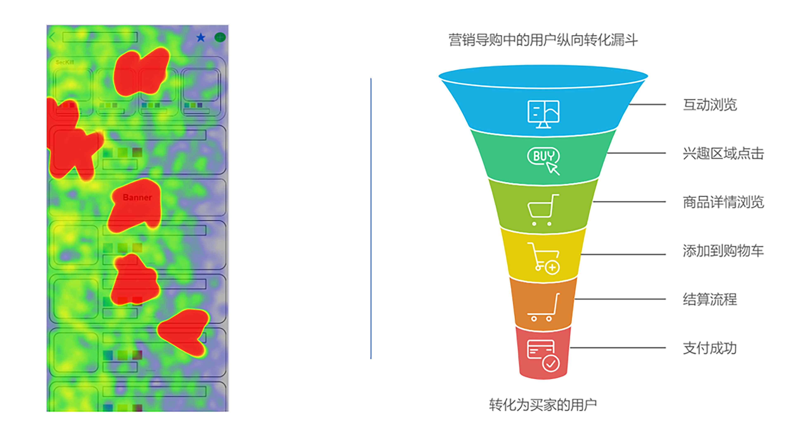

# 20 | 精细化运营：数据的“横向”与“纵向”以及人群运营模对比

你好，我是柳博文，欢迎和我一起学习前端工程师的 AI 实战课。

前面我们完成了 UI 千人千面的讨论和学习，并尝试结合 AI 算法模型处理和分析用户在页面中的日常行为数据，借此完成 UI 侧的推荐，实现端侧 UI 重排。

在这个过程中，我们不是简单地对数据进行分析，而是将数据按照人群属性进行细分，并借助算法的力量来寻找不同人群下的数据共性，以求通过数据共性来为合适的用户推荐合适的 UI设计和结构。

这本质上是在做一个在 UI 侧的人群精细化运营数据分析实验。在目前流量见顶的情况下，靠吃“大锅饭”已经很难实现增长了。因此有必要将人群拆开细分，分析用户的行为模式以及习惯，将用户留在自己的应用中，帮助业务持续增长与转化。

那么，接下来我们就先来理解一下页面的“横向”与“纵向”概念，并学习常用的人群运营模型。理解这些有利于我们更好地选择模型和实现 UI 侧的用户运营。

## “横向”与“纵向”的思考

前面的课程里，我们将用户的点击行为数据使用热力图进行了可视化，并且根据数据中的性别和年龄两个维度分别拆分出了不同的用户数据热力图。同时，我们将热力图进行逆时针旋转90 度后，将整个页面拉长来看，由此提出了“长尾效应”。

对“长尾效应”的分析其实就是“横向”的分析，这个横向分析主要作用于用户在当前 H5 页面中的行为数据，以此来分析页面的 UI 设计和结构是否能够满足不同人群的需求。

那么，什么又是“纵向”呢？

同样在前面的课程里，我们提到了“漏斗”这个词语。如果是电商领域的同学，应该对这个词非常熟悉了。但这也不是电商领域的专有名词。这个词代表着业务流量的转化，无论最后是达成交易、还是完成广告视频的浏览，都存在一个漏斗模型，本质上来说就是让用户往下继续流转。

漏斗模型（Funnel Model）是一种用于理解用户行为和转化过程的分析模型。在互联网领域，用户从进入平台到最终购买、转化的路径通常可以分为多个阶段，而每个阶段的用户数量都会逐渐减少，呈现出像漏斗一样的形状。

漏斗模型的核心是转化率，即从一个阶段转化到下一个阶段的用户比例。通过分析各个阶段的流失情况，企业可以找到用户流失的环节，并加以优化。

用户从某一个切入点进入到了你的页面，他就一定会在你的页面上产生行为数据。这个行为数据不仅仅是说我们刚才说到的页面中的行为数据，而是一个“纵向”的操作数据，通常包括这样一些关键过程。

1. 进入渠道：用户通过某个渠道进入到了页面中

2. 页面操作：在页面中产生了一些操作（滑动、点击、停留）。

3. 页面跳转：然后用户通过点击哪一个点跳转到了另外一个子页面，又或许在子页面中点击了回退按钮回到了当前页面。

4. 详情页下单：通过另外一个点击跳转到了详情下单页面并完成了下单。

这样一个完整的用户操作路径就是“纵向”。也可以简单地理解为 UX 设计层面的路径设定，即我希望用户在页面中完成某个目标，为用户设定的操作路径，这样一个纵向的分析设计。

现在的推荐系统都是基于人货匹配的，而人与 UI/UX 层面匹配则是一个充满潜力的探索方向。如果你留心观察的话，就会发现不少流行的应用已经开始这方面的尝试了，比如抖音 App可选 UI 结构的内容 Feeds 流，抖音商城较短的支付路径等等。

通过这样一个切入点引入，结合前面讲过的人群模型，我们可以将用户行为数据按照人群模型进行清洗与处理，我想会有一些意想不到的收获。

结合上一节课的热力图，我们以用户从进入页面到完成支付为例来更为形象地展示“纵向”。

那么，为了更好地在“横向”与“纵向”上实现 UI 侧的人群精细化运行，一些经典的人群模型是可以借鉴参考的，我们这就来看一下有哪一些可以借鉴参考的人群模型。

## 人群运营模型

在人群运营领域，有多种人群模型可以帮助企业精细化管理和运营不同类型的用户。每个模型都有不同的原理和适用场景。

### RFM 模型（Recency，Frequency，Monetary）

首先是 RFM 模型（Recency, Frequency, Monetary），RFM 模型通过分析用户的购买行为，将用户分为不同的类别。

这个模型包含三个维度。

- Recency 指用户最近一次购买的时间，越近的用户越活跃。

- Frequency 表示用户的购买频次，越频繁用户忠诚度越高。

- Monetary 是消费金额，金额越高代表用户价值越大。

根据这三个维度打分（例如 1-5 分），就可以把用户分为不同群体，如高价值客户、潜在流失用户等。

RFM 模型简单易操作，通过现有的购买数据就能完成精准的用户分类，并为高价值用户提供更好的优惠，同时挽留潜在流失用户。适合需要基于用户历史购买行为进行分类和营销策略制定的场景。

### CLV 模型（Customer Lifetime Value）

然后是 CLV 模型（Customer Lifetime Value），CLV 模型用于预测用户在其整个生命周期内可能为企业带来的收入。该模型通过分析用户的购买频率、平均消费金额和生命周期长短，评估用户的长期价值。

我们可以根据历史数据预测每个用户未来的购买行为，计算其 CLV 值，进而制定针对高价值用户的专属服务，如定制优惠、个性化推荐。

CLV 可以帮助企业识别出最有价值的客户，制定长期战略，合理分配资源以最大化收益，尤其对会员制或高复购行业效果显著。适合需要评估用户长期价值并制定个性化服务或定制优惠的场景。

### AARRR 模型（Acquisition, Activation, Retention, Revenue, Referral）

接下来是 AARRR 模型（Acquisition, Activation, Retention, Revenue, Referral），AARRR 模型将用户分为五个阶段——获取、激活、留存、收入和推荐，帮助企业分析用户从注册到留存和推荐的全过程。

该模型在每个阶段根据用户数据进行分析和优化。例如，提升获取阶段的转化率，通过个性化服务提高留存率，并鼓励用户推荐产品。

这个模型能够全面覆盖用户生命周期的各个环节，帮助企业发现和解决运营中的问题，从而提升用户活跃度和收入。适合需要分析和优化用户从注册到推荐整个生命周期的场景。这个也是目前使用频率比较高的人群运营模型。

### ABC 模型（Always Best Customers）

下一个是 ABC 模型（Always Best Customers），ABC 模型将客户按照贡献度分为三类：A 类客户贡献最大，占 20% 客户却贡献了 80% 销售额；B 类客户贡献次高；C 类客户数量最多但贡献较少。

根据该模型，就能帮我们根据客户的消费金额和频次等数据做分类，对 A 类客户提供 VIP 服务，B 类客户进行促销活动提升活跃度，C 类客户则通过广泛的推广策略引导消费。ABC 模型能够帮助企业将资源集中在高价值客户上，提升 ROI，同时能有效提升高价值用户的忠诚度。适合需要集中资源提升高价值客户的场景，如 VIP 服务和促销活动。

### 标签化人群运营（Tagging）

最后是标签化人群运营（Tagging），标签化人群运营是通过为用户打上不同的行为和属性标签，如“价格敏感用户”或“新品爱好者”，从而精准定位用户需求，实现个性化运营。

根据用户的行为数据打好标签之后，我们就能利用这些标签对用户进行细分，实施定向的推送策略，如为价格敏感用户推送优惠券，为忠诚用户推送新品通知。标签化运营能够极大提高个性化运营的精准度，改善用户体验，帮助企业灵活应对多样化的业务场景需求。 适合需要精细化用户管理和个性化推送的场景，比如根据用户行为和属性进行定向营销。

## 应用建议

刚才我们一共学习了五个不同的人群运营模型，根据具体的业务需求和数据场景，你可以选择一个或多个模型来 综合分析和应用。下面是一些常用建议：

- 如果主要目标是基于用户历史购买行为进行精准分类和针对性营销，RFM 模型是合适的选择。

- 如果需要评估用户的长期价值并制定长期战略，CLV 模型会更加合适。

- 如果想全面覆盖用户生命周期的各个阶段，并优化各个阶段的用户体验，AARRR 模型是较好的选择。

- 如果目标是集中资源在高价值客户上，提高 ROI，ABC 模型将会更有用。

- 如果需要进行精细化管理，并且想通过个性化推送提高用户体验，标签化人群运营（Tagging）是最适合的模型。

## 总结

我们来一起做一个总结吧！

首先我们需要掌握“横向”和“纵向”的概念。横向是用户在页面中的行为，纵向则是用户通过既定或者自定义路径完成产品漏斗转化的行为。漏斗模型（Funnel Model）是一种用于理解用户行为和转化过程的分析模型。

之后我们学习和对比了五个比较经典的人群运营模型，分别是 RFM、CLV、AARRR、 ABC和标签化这五种模型，并且总结了各个模型的适用场景。其中，RFM 和 AARRR 相对是更为合适的分析模型。

## 课后思考

在“纵向”这个方向上，前端可以做哪些优化工作来提升漏斗转化数据呢？

欢迎你在留言区和我交流互动，如果这节课对你有启发，也推荐分享给身边更多朋友。
