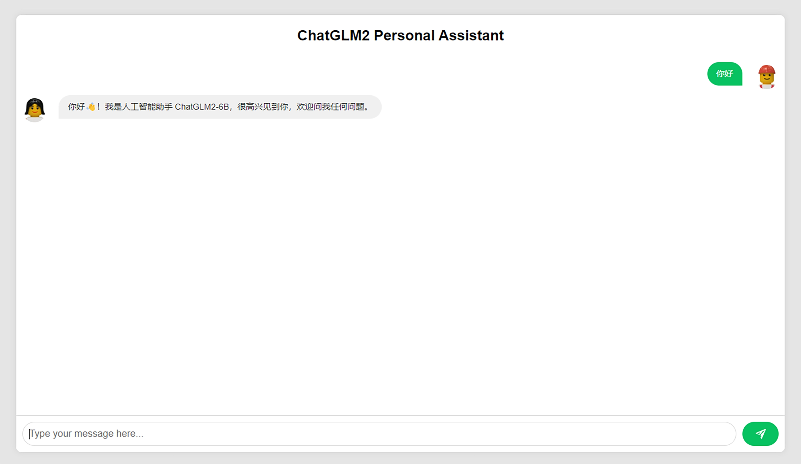

# 21 | 文本大模型：chatGLM2-6B的本地部署与前端集成

你好，我是柳博文，欢迎和我一起学习前端工程师的 AI 实战课。

通过前面的学习，相信你已经逐渐熟悉了 AI+ 前端的开发新范式，对于如何把 AI 引入到前端工作中有更深的认识。

自从 2022 年 10 月 ChatGPT 问世，已经过去了 600 多天。在此期间，大模型不断发展，从文本大模型到文生图，图生图大模型，再到现在的文生视频大模型。这些大模型在持续优化进步，让我们切身实际地感受到了 AI 的力量，未来已来。

接下来的课程，我们就通过动手实验，把这些模型部署到本地，体验一下这些模型的效果。

为了方便国内环境的部署与使用，文本大模型我们选择清华开源的 ChatGLM-6B，文生图片大模型选择开源的 StableDiffusion，视频生成大模型则选择腾讯开源的大模型。

那么，这节课我们先来本地部署 ChatGLM-6B 模型，并实现一个网页来与模型进行问答交互。

## 初识 ChatGLM-6B 模型

ChatGLM-6B 是基于 GLM（General Language Model） 架构的一个针对中英文双语优化的对话生成模型。它与 GPT 模型类似，但针对中文进行了特别的优化，因此在处理中文任务时表现更加友好。

该模型有 60 亿参数，虽然规模比不上 GPT-3 的 1750 亿参数，但它在对话生成任务中具有优秀的平衡性，既能保证较高的生成效果，又不需要过于庞大的计算资源，非常适合在本地部署和运行。

ChatGLM-6B 的核心特点

首先，ChatGLM-6B 经过大规模中英文语料库的训练，因此在双语对话场景下表现得非常流畅。无论是中文用户还是英文用户，都可以通过与模型对话获得自然、连贯的答案。

其次，ChatGLM-6B 在普通设备上（例如 CPU 或较小的 GPU）也能高效运行。对于许多开发者来说，这意味着他们可以在本地部署 ChatGLM-6B，而不必依赖云计算资源，降低了成本，也保证了个人数据的安全。

## 如何在本地部署 ChatGLM-6B 项目

你可能认为部署大语言模型需要强大的计算资源或云端支持，然而 ChatGLM-6B 的一大优势就是可以在本地运行，即使使用消费级硬件也可以高效推理。

接下来我们就进入动手环节，学习如何将 ChatGLM-6B 模型部署到本地环境，并进行推理操作。

### 环境准备

在本地运行 ChatGLM-6B 之前，我们需要先准备好相应的运行环境。为了保证推理性能，建议使用具备一定计算能力的设备，以下是基本的硬件和软件需求：

- 操作系统：Linux、Windows 或 MacOS。

- Python 版本：Python 3.8 或以上。

- 硬件要求：如果有 GPU，推理速度会大大提升，特别是使用 CUDA 支持的显卡（如Nvidia）。

- 软件依赖：Anaconda（方便管理依赖包）、PyTorch（用于模型推理）。

### 安装 ChatGLM-6B

这里我们仍然使用 conda 来进行 ChatGLM-6B 的环境创建和部署。使用以下命令创建一个虚拟环境并激活它。

```
conda create -n chatglm python=3.8
conda activate chatglm
```

进入虚拟环境后，使用 pip 命令安装 PyTorch 和 Hugging Face 的 transformers 库， 同时根据 requirements.txt 中的内容安装依赖库。

```
pip install torch transformers huggingface_hub
pip install -r requirement.txt
```

之后我们通过 Hugging Face Hub 下载 ChatGLM-6B 模型。这一步骤只需要运行一次，模型下载后就可以在本地使用，考虑到网络和下载问题，我已经将模型下载完成并放在了代码库中，可以直接下载运行即可。

```
python -c "from transformers import AutoTokenizer, AutoModel; tokenizer = AutoTok
```

启动模型并进行本地推理在模型安装完成后，接下来我们可以编写一个简单的 Python 脚本来启动 ChatGLM-6B 模型，并与其进行对话。以下是一个示例代码：

```python
from transformers import AutoTokenizer, AutoModel
import torch
# 加载模型和 tokenizer
tokenizer = AutoTokenizer.from_pretrained("THUDM/chatglm-6b")
model = AutoModel.from_pretrained("THUDM/chatglm-6b").half().cuda()
# 定义推理函数
def ask_chatglm(question):
   inputs = tokenizer(question, return_tensors="pt").to("cuda")
   outputs = model.generate(inputs["input_ids"], max_new_tokens=50)
   return tokenizer.decode(outputs[0], skip_special_tokens=True)
# 测试模型
print(ask_chatglm("你好，今天的天气如何？"))
```

这段代码会调用 ChatGLM-6B 模型，并生成回答。如果你的设备支持 GPU，可以使用half().cuda() 来加速推理过程。如果没有 GPU 的话，可以将 .half().cuda() 替换为 .float() ，这样就会使用 CPU 进行推理。

### 优化和调试

在本地运行模型时，我们有时可能会遇到显存不足或者计算资源限制等问题。对于 GPU 用户，可以通过使用 half() 方法来减少模型占用的显存，同时也可以通过调整 max_new_tokens来控制生成文本的长度，从而减少推理时间。

对于 CPU 用户，虽然速度较慢，但依然可以通过多线程或批量处理请求来提高效率。你还可以在实际应用中，结合 Web API 接口，将 ChatGLM-6B 模型封装为服务，以便前端调用。

### 在前端集成 ChatGLM-6B 模型

前端工程师在 AI 项目中的角色越来越重要，尤其是在实现与用户交互的场景中。要在前端集成 AI 模型，最常见的方式是通过 API 与后端模型进行通信。我们这就来看看如何通过 API 在前端与 ChatGLM-6B 进行交互。

### 后端 API 的设计

通常，ChatGLM-6B 会部署在后端服务器上，通过 HTTP 请求与前端进行通信。在开源的ChatGLM-6B 的源码中已经集成了进行接口请求的服务，代码如下：

```python
from fastapi import FastAPI, Request
from fastapi.middleware.cors import CORSMiddleware
from transformers import AutoTokenizer, AutoModel
import uvicorn, json, datetime
import torch
DEVICE = "cuda"
DEVICE_ID = "0"
CUDA_DEVICE = f"{DEVICE}:{DEVICE_ID}" if DEVICE_ID else DEVICE
def torch_gc():
   if torch.cuda.is_available():
       with torch.cuda.device(CUDA_DEVICE):
           torch.cuda.empty_cache()
           torch.cuda.ipc_collect()
app = FastAPI()
# 配置 CORS 中间件
app.add_middleware(
   CORSMiddleware,
   allow_origins=["*"],  # 允许所有源进行访问，生产环境中应指定允许的域
   allow_credentials=True,
   allow_methods=["*"],  # 允许所有 HTTP 方法
   allow_headers=["*"],  # 允许所有请求头
)
@app.post("/")
async def create_item(request: Request):
   global model, tokenizer
   json_post_raw = await request.json()
   json_post = json.dumps(json_post_raw)
   json_post_list = json.loads(json_post)
   prompt = json_post_list.get('prompt')
   history = json_post_list.get('history')
   max_length = json_post_list.get('max_length')
   top_p = json_post_list.get('top_p')
   temperature = json_post_list.get('temperature')
   response, history = model.chat(tokenizer,
                                  prompt,
                                  history=history,
                                  max_length=max_length if max_length else 2048,
                                  top_p=top_p if top_p else 0.7,
                                  temperature=temperature if temperature else 0.
   now = datetime.datetime.now()
   time = now.strftime("%Y-%m-%d %H:%M:%S")
   answer = {
       "response": response,
       "history": history,
       "status": 200,
       "time": time
   }
   log = "[" + time + "] " + '", prompt:"' + prompt + '", response:"' + repr(res
   print(log)
   torch_gc()
   return answer
if __name__ == '__main__':
   tokenizer = AutoTokenizer.from_pretrained("models", trust_remote_code=True)
   model = AutoModel.from_pretrained("models", trust_remote_code=True).cuda()
   model.eval()
   uvicorn.run(app, host='0.0.0.0', port=8000, workers=1)
```

这段代码实现了一个基于 FastAPI 的 API 服务，使用预训练的 Transformer 模型处理自然语言生成任务。它允许客户端发送包含 prompt 和其他参数的 POST 请求，生成相应的文本响应，并返回给客户端。

代码还配置了 CORS 中间件以允许跨域请求，并在 GPU 上运行 PyTorch 模型以加速计算，同时将服务运行在了本机的 8000 端口上。

### 前端调用 API

在前端部分，我们可以编写一个前端页面来完成与 API 的交互，这里实现了一个网页端的聊天窗口来实现与模型的对话，部分核心代码如下所示。完整代码放在了代码库中，如有需要请下载。

```xml
<!DOCTYPE html>
<html lang="en">
<head>
   <meta charset="UTF-8">
   <meta name="viewport" content="width=device-width, initial-scale=1.0">
   <title>ChatGLM2 Personal Assistant</title>
   <style>
       body {
           font-family: Arial, sans-serif;
           background-color: #e5e5e5;
           margin: 0;
           padding: 20px;
           display: flex;
           justify-content: center;
           align-items: center;
           height: 100vh;
           overflow: hidden;
       }
       #chat-container {
           width: 70%;
           height: 80%;
           display: flex;
           flex-direction: column;
           background-color: #ffffff;
           border-radius: 8px;
           box-shadow: 0px 0px 10px rgba(0, 0, 0, 0.1);
           overflow: hidden;
           position: relative;
       }
   </style>
</head>
<body>
   <div id="chat-container">
       <h2 style="text-align: center;">ChatGLM2 Personal Assistant</h2>
       <div id="messages"></div>
       <div id="input-container">
           <input type="text" id="prompt" placeholder="Type your message here...
           <button id="send">
               <!-- Airplane icon -->
               <svg xmlns="http://www.w3.org/2000/svg" viewBox="0 0 24 24" fill=
                   <path
                       d="M21.992 2.22a.75.75 0 0 0-.755-.122L2.993 9.978a.75.75
               </svg>
           </button>
       </div>
   </div>
   <script>
       // List of random avatar images
       const avatarUrls = [
           'https://randomuser.me/api/portraits/lego/1.jpg',
           'https://randomuser.me/api/portraits/lego/2.jpg'
       ];
       // Randomly assign avatars to the user and bot
       const userAvatar = avatarUrls[Math.floor(Math.random() * avatarUrls.lengt
       const botAvatar = avatarUrls[Math.floor(Math.random() * avatarUrls.length
       function formatMessage(text) {
           return text.replace(/\n/g, '<br>'); // Replace newline characters wit
       }
       function addMessage(text, className, isUser) {
           const messageContainer = document.getElementById('messages');
           const message = document.createElement('div');
           message.className = `message ${className}`;
           const avatar = document.createElement('div');
           avatar.className = 'avatar';
           avatar.style.backgroundImage = `url(${isUser ? userAvatar : botAvatar
           message.appendChild(avatar);
           const bubble = document.createElement('div');
           bubble.className = `bubble ${className}`;
           bubble.innerHTML = formatMessage(text); // Use innerHTML to render HT
           message.appendChild(bubble);
           if (isUser) {
               message.insertBefore(bubble, avatar);
           }
           messageContainer.appendChild(message);
           messageContainer.scrollTop = messageContainer.scrollHeight;
       }
       async function sendMessage() {
           const promptElement = document.getElementById('prompt');
           const prompt = promptElement.value;
           if (!prompt) return;
           addMessage(prompt, 'user', true);
           promptElement.value = '';
           const responseMessage = document.createElement('div');
           responseMessage.className = 'message bot';
           const avatar = document.createElement('div');
           avatar.className = 'avatar';
           avatar.style.backgroundImage = `url(${botAvatar})`;
           responseMessage.appendChild(avatar);
           const bubble = document.createElement('div');
           bubble.className = 'bubble bot';
           bubble.innerHTML = '<span class="loading"><span></span><span></span><
           responseMessage.appendChild(bubble);
           document.getElementById('messages').appendChild(responseMessage);
           try {
               const response = await fetch('http://localhost:8000/', {
                   method: 'POST',
                   headers: {
                       'Content-Type': 'application/json',
                   },
                   body: JSON.stringify({
                       prompt: prompt,
                       history: [],
                       max_length: 2048,
                       top_p: 0.7,
                       temperature: 0.95,
                   }),
               });
               const data = await response.json();
               bubble.innerHTML = formatMessage(data.response); // Use innerHTML
           } catch (error) {
               bubble.innerHTML = `Error: ${error.message}`; // Use innerHTML fo
           }
           const messageContainer = document.getElementById('messages');
           messageContainer.scrollTop = messageContainer.scrollHeight;
       }
       document.getElementById('send').addEventListener('click', sendMessage);
       // Support Enter key to send message
       document.getElementById('prompt').addEventListener('keydown', (event) =>
           if (event.key === 'Enter') {
               sendMessage();
           }
       });
   </script>
</body>
</html>
```

通过这种方式，前端应用可以轻松与 ChatGLM-6B 模型集成，实现自然语言的交互。集成以后的页面大概是这个样子，可以尝试向模型提问，例如：让它生成一段用于 StableDiffusion生成电商活动 H5 页面设计图的提示词。



## 总结

那么，接下来我们来一起做个总结吧。

在这节课中，我们一起了解了 chatGLM-6B 文本大模型，chatGLM-6B 大模型凭借平衡的参数量，很方便我们个人在本地部署和使用，同时它的推理能力和效果也不错。

随后，我们在本地使用 conda 完成了运行 chatGLM-6B 的环境搭建。在这一步中，除了需要下载 chatGLM-6B 的源代码，还需要下载 ChatGLM-6B 模型。

然后我们学习了如何在前端集成这个模型，ChatGLM-6B 的源码中已经集成了接口请求的服务。通过分析相关代码，我们知道了 API 提供了一个基于 FastAPI 的 API 服务，它允许客户端发送包含 prompt 和其他参数的 POST 请求。最后，我们还实现了一个前端聊天页面和大模型做语言交互，它调用了 chatGLM-6B 的接口。

推荐你课后按照今天的讲解，自己动手练习一下，这样你就能轻松拥有一个自己专属的本地文本大模型助手了。

## 课后思考

这节课我们学习部署使用了 chatGLM-6B 模型，我相信你对个人本地化部署大模型有了一些新的思路，那么，除了 chatGLM-6B，还有哪些文本大模型可以在 PC 上进行本地部署和使用呢？

欢迎你在留言区和我交流互动，如果这节课对你有启发，也推荐分享给身边更多朋友。
