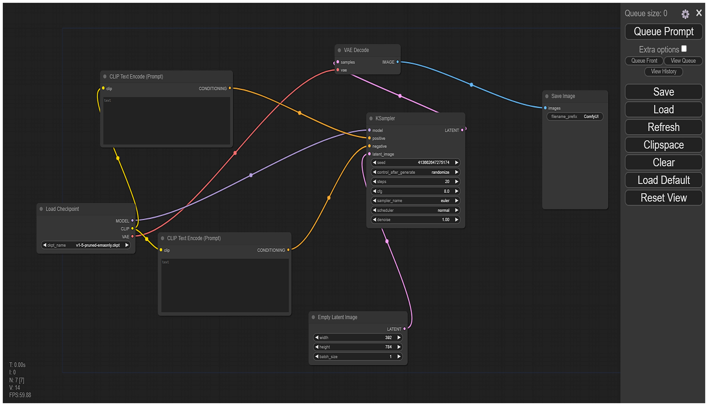
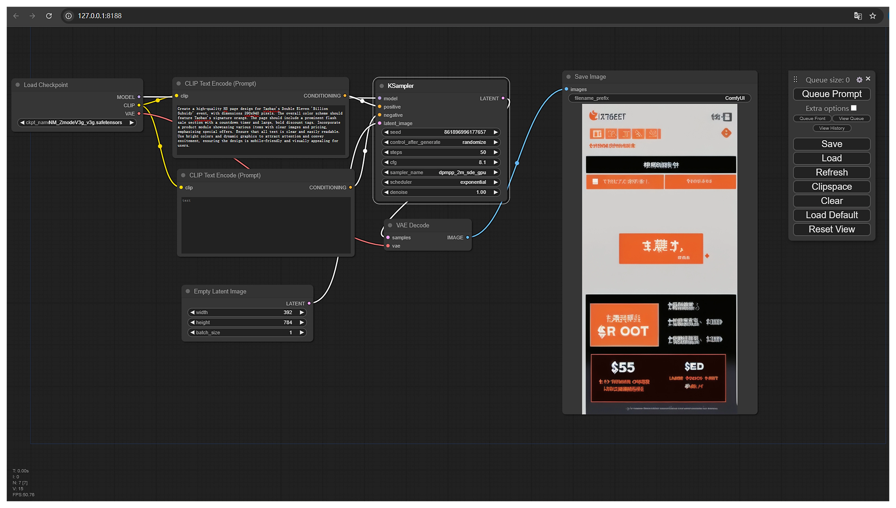

# 22 | 图像生成大模型：使用StableDiffusion生成电商活动原型设计稿

你好，我是柳博文，欢迎和我一起学习前端工程师的 AI 实战课。

上节课，我们在本地部署了 chatGLM2-6B，实现了可以进行文本对话的本地大模型服务。

在内容生成领域，除了文本生成，图像和视频的生成也越来越流行，这同样可以使用大模型来完成。这节课我们就一起来学习一下图像生成大模型，我们同样会配置一个本地可运行的图像生成模型，并用它来生成一个电商活动的原型设计图。

## 图像生成大模型

在过去几年里，人工智能（AI）领域取得了长足进步，其中一个关键的突破就是图像生成大模型。图像生成大模型，顾名思义，是指那些可以通过简单的输入（通常是文本描述或噪声数据）生成逼真、复杂图像的深度学习模型。这类模型的广泛应用正在改变着设计、艺术、广告等众多行业。

### 生成图像模型的原理

图像生成大模型的核心是“学习”海量数据，以此理解如何根据输入生成视觉内容。具体来说，这些模型通过“生成对抗网络”（GANs）或“扩散模型”（如 Stable Diffusion）等方式，在不断的训练过程中提高图像生成的准确性和逼真度。

GAN 是由两个神经网络构成的系统，一个生成器负责生成图像，而另一个判别器负责判断生成的图像是否真实。两者相互博弈，最终生成器就能生成高质量、近乎真实的图像。

### 扩散模型与传统生成方法的区别

而扩散模型是一种较为新兴的图像生成方法，采用了与 GAN 和变分自编码器（VAE）不同的方式。这种方法通过从噪声中逐渐生成图像，其原理类似于在模糊状态下逐步还原图像的细节。在图像生成框架里，最著名的要属 Stable Diffusion，它就使用了扩散模型。

### 图像生成模型在前端领域的应用

对于前端工程师，图像生成大模型可以极大提高工作效率。尤其是在 Web 设计、产品展示、图形元素生成等领域，Stable Diffusion 等模型可以快速生成所需的设计草稿，免去了传统设计工具中的繁琐步骤。

以下是图像生成大模型在前端领域中的一些应用场景：

- 快速生成网页素材：通过文本描述生成页面背景、按钮、图标等，前端工程师无需等待设计师提供素材，可以通过 AI 实现一定程度的自主设计。

- 自动化设计流程：前端开发者可以将 AI 生成的图像融入自动化流程中，通过特定算法批量生成多个不同风格的页面原型稿，迅速搭建网站雏形。

- 增强视觉设计能力：图像生成技术能够根据指定需求快速生成高质量图像，帮助前端工程师丰富页面视觉设计内容。

总的来说，Stable Diffusion 和其他生成大模型的引入，将帮助前端开发与设计的工作更加紧密地融合，为前端工程师提供更多设计辅助工具。

## Stable Diffusion 配置

接下来我们就来完成本地配置工作，实际体验一下效果。

### 环境配置与安装

要使用 Stable Diffusion 在本地生成图像，首先需要配置正确的环境。这包括安装必要的依赖项、获取模型权重，并确保机器具备足够的算力。

想要实现本地 StableDiffusion 的配置和使用主要有两种方式，一种是源码层面的配置，需要一步一步地完成。另一种是一个开源的集成环境 ComfyUI，只需要下载安装这个软件即可完成。

这里我们选择第二种更加简单的方式。如果你对源码配置的方式感兴趣，可以在网上查阅相关资料。

ComfyUI 是一个用于 Stable Diffusion 模型的可视化用户界面，旨在简化图像生成流程。它通过模块化的节点系统让用户自由组合不同的步骤，如文本输入、模型选择和图像处理，轻松创建高质量图像。这个界面支持多种模型格式（如 .ckpt 和 .safetensors），用户可以自定义复杂的生成流程。

ComfyUI 提供细粒度的生成控制，包括调整步数、采样器、图像尺寸和种子，甚至可以修复或扩展已有图像。它支持跨平台运行，并利用 GPU 提高效率。作为开源项目，ComfyUI 拥有活跃的社区，用户能扩展功能、共享工作流程，非常适合艺术创作、内容制作、UI 设计及模型研究。

我们可以直接下载 ComfyUI 的 release 包，鉴于网络不稳定等问题，我已将安装包放在了课程源码目录中，你可以直接下载使用。

在安装包中包含了 CPU 运行版本和 GPU 运行版本，这是两个在根目录下的.bat 文件，我们双击即可运行。需要注意的是初次运行可能需要下载安装一些依赖库，同时 ComfyUI 需要使用 Python 3.10 或更高版本，请注意观察。

完成前面的步骤之后，我们就能在浏览器中打开 ComfyUI 的页面来创作了。具体界面如下：

在 ComfyUI 中，使用节点的方式就能自由组合，通过拖放不同的模块即可创建复杂的图像生成流程。

正如界面中的节点所示，我们可以在不同的节点中进行模型选择、参数调整、提示词填写以及生成图片预览等操作。

我们可以在提示词的节点处写入正向和负向的提示词，并且选择要使用的模型，然后点击右上角 Queue Prompt 就能生成图像了。

ComfyUI 是一个集成度较高且功能完善的 UI，支持许多高级功能，例如支持自定义节点，用户可以通过编写 Python 脚本来扩展功能。还可以结合不同的生成模型，或者进行图像的后处理和样式转换。不过，更多高级的用法我们就不展开探讨了，有兴趣的话你可以课后深入了解。

### 设计稿生成

接下来，我们就利用 ComfyUI 来生成一个电商 618 活动页面的原型设计稿。618 是一个大型促销节日，各大电商平台会集中展示促销信息、特价商品和限时优惠等内容。因此，在设计电商页面时，我们需要考虑以下几个要素：

- 视觉冲击力：电商页面需要吸引用户眼球，通常使用鲜艳的颜色、促销标签和吸引人的图片。

- 布局合理：页面布局需要简洁清晰，便于用户快速浏览商品信息，找到心仪的产品。

- 主题风格一致：页面的主题应与 618 促销节日的气氛相匹配，如使用庆祝性、节日元素等。

## 文本提示设计与优化

在使用 ComfyUI 生成页面设计稿时，文本提示（prompt）的撰写至关重要。好的 prompt 能够有效控制生成结果的风格和细节。

我们可以使用文本大模型来帮助我们编写提示词。在提示词中，有一些关键字眼需要注意，结合我们的场景需求，提示词里需要包含电商、H5、高质量、618 活动等关键词。这是一段用于生成的提示词示例：

- “Create a high-quality H5 page design for Taobao’s Double Eleven ‘Billion Subsidy’ event,with dimensions 390x940 pixels. The overall color scheme should feature Taobao’ssignature orange. The page should include a prominent flash sale section with acountdown timer and large, bold discount tags. Incorporate a product module showcasingvarious items with clear images and pricing, emphasizing special offers. Ensure that alltext is clear and easily readable. Use bright colors and dynamic graphics to attractattention and convey excitement, ensuring the design is mobile-friendly and visuallyappealing for users.”

在 ComfyUI 中基于这段提示词使用默认模型进行生成时候的截图：

上图展示了使用 ComfyUI 生成电商 618 活动页面的原型设计的过程，虽然生成的图像没有达到真实使用场景的标准，不过我们仍然能看到 ComfyUI 这样工具颇有潜力。如果想追求商用级的效果，则需要调用专业模型（经过专业数据训练过的）。

## 整合生成结果

将生成的图像下载后，可以使用设计工具如 Figma、Sketch 或 Photoshop 对其进行进一步地调整和整合。前端工程师可以根据这些设计稿生成 HTML、CSS 和 JavaScript 代码，实现高保真页面的最终实现。

持续优化与迭代

生成的图像可能并不是一次性就能达到完美，我们可以通过反复修改 prompt，或调整模型参数来得到更接近预期的设计。随着生成模型技术的进步，生成图像的准确性和风格匹配度也在不断提高。

## 总结

今天我们一起体验了 Stable Diffusion 图像生成模型如何应用，并以 618 电商活动页面为例，展示了如何通过文本提示生成设计元素。通过这种方法，前端开发人员可以快速生成视觉素材，减少对设计师的依赖，并显著提高工作效率。

随着图像生成技术的不断进步，前端工程师的工作也将变得更加多样化和创意化。掌握 StableDiffusion 等生成模型，不仅能够让前端开发者在设计方面有更多的发挥空间，还能为实现个性化页面提供新的技术手段。

未来，随着生成大模型与 Web 技术的深度融合，前端领域的设计开发流程将更加自动化和智能化，让开发者能够以更低的成本生成更高质量的视觉内容。

## 思考题

通过 Stable Diffusion 就能直接生成设计原型稿，理论上讲就可以无限制地生成 UI 界面了，这与我们第四章实现的 UI 千人千面有什么联系呢？

欢迎你在留言区和我交流互动，如果这节课对你有启发，也推荐分享给身边更多朋友。
