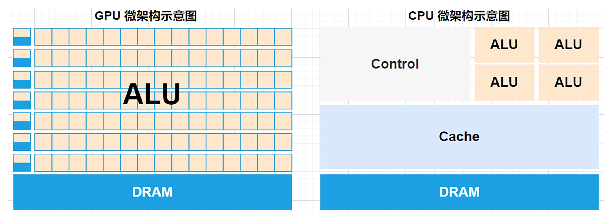
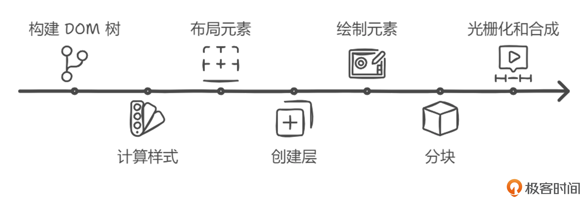
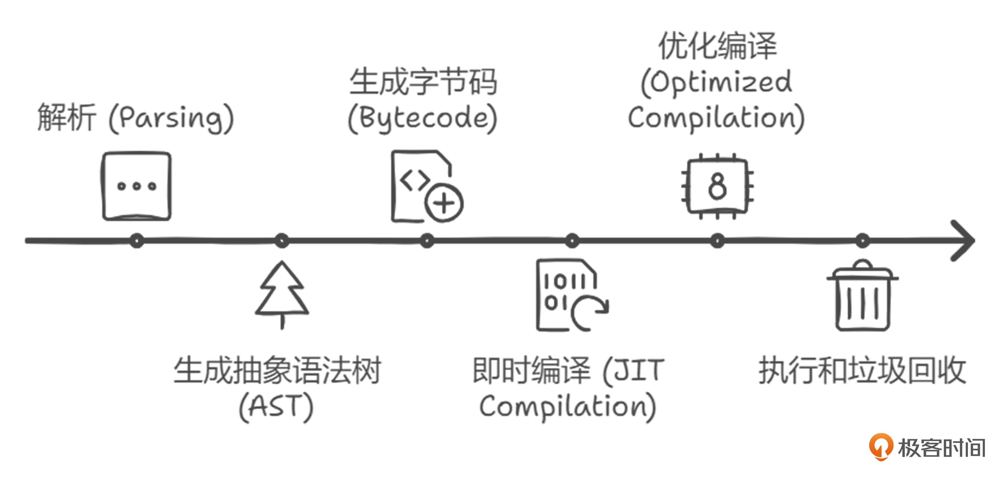

# 24 | 端侧模型下的JavaScript的性能局限如何解决？

你好，我是柳博文，欢迎和我一起学习前端工程师的 AI 实战课。

前面的课程里，我们在端侧使用 JavaScript 尝试过不少模型预测任务，即便这些任务计算量都比较小，我们仍然能切身体会到 JavaScript 执行矩阵运算等任务时的局限。

讲到 JavaScript 的性能，肯定离不开 V8 引擎。对于 JavaScript 这门极度依赖宿主环境的脚本语言，我相信包括我在内的所有前端工程师追求的极致目标，就是高性能地执行JavaScript。

那么，今天，我们就来讨论一下端侧模型下的 JavaScript 的性能局限到底在哪里，以及有哪些方法可以改善其端侧模型下的性能。

## 端侧模型下 JavaScript 的局限

想要提升性能，我想我们需要首先弄清楚两个问题，一是了解矩阵运算对硬件的要求，二是V8 执行 JavaScript 的方式。

首先是矩阵运算对硬件的要求，关于矩阵运算的原理以及在 AI 模型训练过程中的作用，在第二章中的原理部分（第四节课、第八节课）已经描述清楚，有需要请进行回顾。

这里我们重点聊一下为什么我们需要使用 GPU 为第一选择来训练模型，而 CPU 只是备选。这就需要我们对比一下 GPU 和 CPU 的架构设计和运行方式。

### CPU 和 GPU 对比

CPU（中央处理器）的设计是为了处理复杂的、串行的任务，它通常拥有较少的核心（通常 2到 16 个核心）。每个核心非常强大，能够快速处理单一的指令流。因此 CPU 非常适合处理多样化、复杂的任务，比如操作系统的控制和运行应用程序。

而 GPU（图形处理器）最初是为图像渲染而设计，它的架构适合处理大规模的并行计算。GPU 拥有成百上千个核心，这些核心可以同时执行大量简单的计算任务，因此在进行大量的数学运算（如矩阵运算）时表现出色。AI 训练中的神经网络主要涉及矩阵乘法和加法，这正是 GPU 的强项。下图分别为 GPU（左）和 CPU（右）的微架构示意图，可以直观地看出两者架构设计的不同。



通过以上对比可以看出，CPU 虽然能够处理这些任务，但因为它的核心数量较少（通常 2-16个核心），因此处理这些任务时速度较慢。GPU 则能够通过并行计算，大规模地同时处理成千上万个计算单元的任务，因此在处理矩阵和向量运算时效率更高。

总之，GPU（图形处理器）比 CPU（中央处理器）更适合 AI 模型的训练，主要是因为它们的架构和运行方式在处理大规模并行计算任务时表现得更好。AI 训练涉及大量的矩阵运算、向量操作，而这些任务都需要极大的计算能力。

讲到这里，我们找到了提升性能的第一个可能性，设法找到端侧调用 GPU 的方法，来进行模型推理相关的运算。

### JavaScript 在浏览器以及 V8 中的执行

为了更好地从原理层面寻找提升 JavaScript 执行的性能的方法，我们来看看浏览器和 V8 在执行 JavaScript 的时候都使用 CPU 和 GPU 做了哪些工作。

浏览器的 V8 在执行 JavaScript 时，使用了 CPU 来进行计算，只有在最后完成位图的生成时才调用了 GPU 进行图像生成。也就是在这个阶段，浏览器内部才调用了硬件上的 GPU 来实现加速。

下面是浏览器完成一次完整页面渲染的流程：



在这个过程中，主线程会使用 CPU 单线程的方式来执行 JavaScript，完成页面的拼装和渲染，并通过其他功能的线程的协同合作最终将页面绘制出来。这些都需要花费大量的能耗和时间。

其次是 V8 执行 JavaScript 的方式。我们知道 JavaScript 的每次执行都是通过在主线程上执行并维护多个异步任务队列来实现的。页面的首屏渲染以及页面更新都需要进行 JavaScript的计算，尤其是现代前端的框架和库都是基于 CSR 的渲染方式。压力几乎都给到了JavaScript，也同样给到了前端工程师。

由此我们就找到了第二个潜在优化点——看看能否改变这种单线程执行方式，把一部分计算密集型任务分出去。

接下来我们再看看 V8 在每次执行 JavaScript 所需要的步骤：



如果我们能够简化这个流程，让 V8 直接拿到字节码，同样可以提升 JS 性能。这就是 JS 性能提升的第三个思路，至于具体方案我们稍后揭晓。

## 加速端侧推理性能

现在我们对优化方向更清晰了，分别是后面这三个方向：

- 在应用层引入更擅长处理模型推理任务的 GPU 帮忙。

- 浏览器的 V8 里执行 JavaScript 都要通过主线程，设法分担主线程压力。

- 设法化简 V8 执行 JavaScript 的步骤，比如直接让 V8 拿到字节码。

其实概括来说就是在高效推理和高性能页面之间找到一个平衡。相应的优化方法有不少，下面我们将会看到业界热议的几种方案。

### Web Worker

第一种方案就是引入 Web Worker，通过上面的分析我们知道，由于浏览器渲染页面时候执行JavaScript 时是跑在主线程上，如果主线程由于执行其他任务（例如：模型推理这样耗时耗力的任务）被占用过久，就会极大影响页面的渲染和用户体验。

那么，我们就可以将执行模型推理的任务放在其他的线程中执行，当得到结果时候与主线程通信交换数据即可。

以 Chrome 为代表的浏览器的架构设计中设定了一个 tab 页面中能够存在的线程，并且线程都有特定的作用，也不允许开发者修改这些线程的作用。所以在现有架构设计的基础上，没有多余的线程让我们使用。

不过，现在 W3C 有了新的一个标准 Web Worker，情况就不同了。

Web Worker 是 HTML5 引入的一项技术，用于在浏览器中创建后台线程，允许 JavaScript 代码在主线程之外运行。通常，JavaScript 是单线程执行的，Web Worker 提供了一种并行处理的方法，避免长时间任务（如模型推理、复杂计算）阻塞用户界面。

Web Worker 的来源是为了提升 Web 应用的性能，特别是在需要执行密集计算时，能够保持UI 的流畅性，同时不打断用户体验。Web Worker 允许在后台线程运行 JavaScript 代码，主线程和 Worker 线程之间通过消息传递进行通信。

接下来，我们就来看看如何使用 webworker 来进行推理加速。我们来设定这样一个实例：在浏览器中运行模型推理（如 TensorFlow.js、ONNX.js）利用 Web Worker 进行加速。然后观察这样做是否可以避免模型推理占用主线程时间，阻塞用户交互，同时提升模型推理的性能和效率。

思路已经有了，下面我们进入动手环节。

### 在主线程中创建 Worker

首先，我们使用 new Worker() 创建 Worker，将模型推理任务分配到 Worker 线程中。

```xml
<!DOCTYPE html>
<html lang="en">
<head>
   <meta charset="UTF-8">
   <meta name="viewport" content="width=device-width, initial-scale=1.0">
   <title>MobileNet Inference</title>
   <!-- 引入 TensorFlow.js 库 -->
   <script src="./tf.js"></script>
</head>
<body>
   <script>
       window.onload = function () {
           // 确保 TensorFlow.js 库已经加载
           if (typeof tf === 'undefined') {
               console.error('TensorFlow.js library not loaded');
               return;
           }
           // 创建 Worker
           const modelWorker = new Worker('./modelWorker.js');
           // 生成随机输入数据
           const inputTensor = tf.randomNormal([1, 224, 224, 3]);
           const inputData = inputTensor.dataSync(); // 转换为扁平数组
           // 向 Worker 发送输入数据
           modelWorker.postMessage({ input: inputData });
           // 接收模型推理结果
           modelWorker.onmessage = function (event) {
               console.log('Model inference result:', event.data);
           };
       };
   </script>
</body>
</html>
```

### 在 Worker 中加载和推理模型

Worker 线程会接收到主线程发送的输入数据，然后执行模型推理。这里我们可以使用TensorFlow.js 或其他浏览器支持的推理引擎。

```javascript
// modelWorker.js
importScripts('./tf.js'); // 引入 TensorFlow.js 库
let model;
// 监听主线程消息（接收输入数据）
self.onmessage = async function (event) {
 const inputData = event.data.input;
 if (!model) {
   try {
     // 加载模型
     model = await tf.loadLayersModel('https://storage.googleapis.com/tfjs-model
     console.log('Model loaded successfully');
   } catch (error) {
     console.error('Error loading model:', error);
     return;
   }
 }
 // 将输入数据重构为正确形状的 Tensor
 const inputTensor = tf.tensor(inputData, [1, 224, 224, 3]); // 指定形状
 const prediction = model.predict(inputTensor);
 // 将结果转为数组并返回主线程
 const result = await prediction.array();
 self.postMessage(result);
};
```

### 在主线程接收推理结果

之后，主线程中 modelWorker.onmessage 事件处理函数会接收到 Worker 线程的消息，即模型推理的结果。

```javascript
modelWorker.onmessage = function(event) {
 const inferenceResult = event.data;
 console.log('Received inference result:', inferenceResult);
 // 可以在主线程中更新 UI 或进一步处理结果
};
```

可以看到，这样就能将大量复杂的计算移到不阻塞主线程的 Web Worker 中执行。这种加速推理的方式是基于网页渲染流程和 JavaScript 执行的机制分析出来的。

Web Worker 适合在前端中分担 CPU 密集型任务，能显著提升主线程的响应性能。但需要我们权衡通信开销和线程管理的复杂性，对于较短的任务，直接在主线程中处理可能更加高效。

### WASM

第二种可以加速推理的方式是 WASM 这个标准。

WebAssembly（WASM）由万维网联盟（W3C）于 2017 年推出。其主要目标是提供一种在网页上运行高性能应用程序的方式。

因为 WASM 是一种二进制指令格式，可以将高级语言（如 C、C++ 和 Rust）编译成浏览器可以直接执行字节码，准确地说是 V8 可以直接执行的字节码。所以它自然可以作为我们简化V8 执行 JavaScript 的解决方案。

而且 WASM 还支持将其他高级语言编写的代码编译成为 V8 能够执行的字节码，这样就能够省去一半的执行流程，进而减少执行时间。

那么，如果我们要使用 WASM 加速端侧模型的推理时，或许可以采用后面的步骤来完成，以C++ 为例。

1. 编写 C++ 代码：首先，你需要编写 C++ 代码进行模型推理。

2. 编译为 WASM：使用 Emscripten 工具链将 C++ 代码编译成 WASM 字节码。

3. 加载 WASM 模块：在浏览器中使用 JavaScript 加载和运行 WASM 模块。

为了直观地展示出 WASM 和纯 JavaScript 执行效率的区别，这里有一个实现斐波那契数列的性能对比实例。我们一起试试看。

首先使用 C++ 代码编写一个斐波那契函数如下：

```
#include <emscripten.h>
extern "C" {
   EMSCRIPTEN_KEEPALIVE
   int fibonacci(int n) {
       if (n <= 1) return n;
       return fibonacci(n - 1) + fibonacci(n - 2);
   }
}
```

然后使用 Emscripten 将上面的 C++ 代码编译成 WASM 字节码，注意 WASM 的环境需要安装配置。因为这个环节并不复杂，你可以在网上参考相关资料来完成配置。

```
emcc fibonacci.cpp -O3 -s WASM=1 -s EXPORTED_FUNCTIONS="['_fibonacci']" -s EXTRA_
```

接下来，我们需要编写一个 html 文件，为了对比 WASM 与原生 JavaScript 的执行效率，在这个文件中也要实现一个 JavaScript 版本的斐波那契函数。然后我们在这个网页里面执行 JS和 WASM 的函数，来对比两者的执行效率。

```xml
<!DOCTYPE html>
<html lang="zh">
<head>
   <meta charset="UTF-8">
   <meta name="viewport" content="width=device-width, initial-scale=1.0">
   <title>斐波那契性能测试</title>
   <script src="fibonacci.js"></script> <!-- 确保包含正确编译的 JS 文件 -->
</head>
<body>
   <h1>斐波那契性能测试：WebAssembly 与 JavaScript</h1>
   <button onclick="runFibonacci()">运行斐波那契</button>
   <div id="wasm-output"></div>
   <div id="js-output"></div>
   <script>
       let wasmFibonacci;
       // 加载 WebAssembly 模块
       async function loadWasm() {
           const module = await new Promise((resolve, reject) => {
               Module.onRuntimeInitialized = () => resolve(Module);
           });
           // 包装 WebAssembly 模块中的 'fibonacci' 函数
           wasmFibonacci = module.cwrap('fibonacci', 'number', ['number']);
       }
       // JavaScript 版本的斐波那契函数
       function fibonacciJS(n) {
           if (n <= 1) return n;
           return fibonacciJS(n - 1) + fibonacciJS(n - 2);
       }
       // 运行 WebAssembly 和 JavaScript 版本并测量执行时间
       async function runFibonacci() {
           const n = 40;  // 用于比较性能的大斐波那契数
           // 确保 WebAssembly 模块已加载
           if (!wasmFibonacci) {
               alert('WebAssembly 模块尚未加载');
               return;
           }
           // 运行 WebAssembly 斐波那契
           const wasmStart = performance.now();
           const wasmResult = wasmFibonacci(n);
           const wasmEnd = performance.now();
           document.getElementById('wasm-output').innerText =
               `WebAssembly 结果：${wasmResult}，时间：${wasmEnd - wasmStart} 毫秒`
           // 运行 JavaScript 斐波那契
           const jsStart = performance.now();
           const jsResult = fibonacciJS(n);
           const jsEnd = performance.now();
           document.getElementById('js-output').innerText =
               `JavaScript 结果：${jsResult}，时间：${jsEnd - jsStart} 毫秒`;
       }
       // 页面加载时加载 WebAssembly 模块
       loadWasm();
   </script>
</body>
</html>
```

通过对比我们会发现，在浏览器中直接运行纯 JavaScript 代码性能比较低，尤其是递归深度较大的情况下，这是因为 JavaScript 是解释型语言，而通过 WASM 执行编译后的 C++ 代码，WASM 提供了接近原生的执行速度，因此对于计算密集型任务，性能会显著优于 原来的JavaScript 代码。

### GPU.js

通过分析代码执行原理，我们找到了 Web Worker 和 WASM 这两种可行的解决方式。

其实更为上层的应用层面，也有许多我们可以参考使用的优化方式和库。

通过前面的分析我们知道，页面完成渲染后，GPU 线程会根据绘图指令生成分块分层位图，最后交给浏览器线程完成页面的渲染和显示上图。也就是说，在浏览器环境下调用 GPU 是可行的，其中具有代表性的是 GPU.js 这个库。

GPU.js 是一个基于 WebGL 的 JavaScript 库。它经常被用在矩阵运算、机器学习推理、图像处理等任务。

GPU.js 可以将 JavaScript 代码编译为 WebGL 着色器，并在 GPU 上运行。它允许开发者编写普通的 JavaScript 函数并在 GPU 上执行，而无需深入理解 WebGL 的细节。因此，GPU.js是在端侧（客户端）进行高效计算加速的便捷方式。

在模型推理中，尤其是深度学习模型推理，矩阵运算（如矩阵乘法、加法、点积等）是关键。使用 GPU.js 可以加速这些操作就可以帮助我们提升端侧模型推理速度。

同样，我们再结合一个例子来加深理解 。我们简单实现一个简单的多层感知机 (MLP) 模型，并使用 GPU.js 来加速矩阵运算部分。以下是推理过程中矩阵乘法和激活函数的加速示例：

```javascript
const forwardPass = gpu.createKernel(function(weights, input, bias) {
   let sum = bias[this.thread.y];
   for (let i = 0; i < this.constants.inputSize; i++) {
       sum += input[i] * weights[this.thread.y][i];
   }
   return 1 / (1 + Math.exp(-sum)); // 激活函数 Sigmoid
}).setOutput([128]) // 输出维度，假设我们有 128 个神经元
 .setConstants({ inputSize: 784 }); // 假设输入向量维度为 784（如 MNIST 数据）
const weights = Array(128).fill().map(() => Array(784).fill(Math.random()));
const input = Array(784).fill(Math.random());
const bias = Array(128).fill(0.1);
// 执行前向传播
const output = forwardPass(weights, input, bias);
console.log(output);
```

在这个例子中，我们使用 GPU.js 来加速多层神经网络的前向传播。通过这种方式，矩阵乘法和激活函数计算可以快速在 GPU 上并行执行，显著提高模型推理速度。

同样，为了让你直观感受到 GPU 和 CPU 执行矩阵乘法的效率区别，我们分别用两个版本的矩阵乘法函数来进行对比，代码如下。

```xml
// CPU 执行矩阵乘法
function cpuMultiply(a, b) {
   const size = 512;
   const result = Array(size).fill().map(() => Array(size).fill(0));
   for (let i = 0; i < size; i++) {
       for (let j = 0; j < size; j++) {
           let sum = 0;
           for (let k = 0; k < size; k++) {
               sum += a[i][k] * b[k][j];
           }
           result[i][j] = sum;
       }
   }
   return result;
}
// GPU 执行矩阵乘法
function gpuMultiply(matrixA, matrixB) {
   const gpu = new GPU.GPU();
   const multiplyKernel = gpu.createKernel(function (a, b) {
       let sum = 0;
       for (let k = 0; k < this.constants.size; k++) {
           sum += a[this.thread.y][k] * b[k][this.thread.x];
       }
       return sum;
   })
       .setOutput([512, 512]) // 输出维度
       .setConstants({ size: 512 }); // 矩阵的大小
   return multiplyKernel(matrixA, matrixB);
}
async function runMatrixMultiplication() {
   const size = 512;
   const matrixA = Array(size).fill().map(() => Array(size).fill(Math.random()))
   const matrixB = Array(size).fill().map(() => Array(size).fill(Math.random()))
   // 测试 CPU 执行时间
   const cpuStart = performance.now();
   cpuMultiply(matrixA, matrixB);
   const cpuTime = performance.now() - cpuStart;
   // 测试 GPU 执行时间
   const gpuStart = performance.now();
   gpuMultiply(matrixA, matrixB);
   const gpuTime = performance.now() - gpuStart;
   // 显示总执行时间
   document.getElementById('output').innerHTML = `
               <h2>总执行时间</h2>
               <p>CPU 矩阵乘法时间: ${cpuTime.toFixed(2)} ms</p>
               <p>GPU 矩阵乘法时间: ${gpuTime.toFixed(2)} ms</p>
           `;
}
```

通过这种方式比较 CPU 和 GPU 在矩阵运算中的执行时间，我们可以明显感受到 GPU 加速在端侧推理中的优势。

## 总结

我们来做一个总结吧。

今天这节课，我们讨论了如何突破端侧模型推理中 JavaScript 的性能局限。依照现在的现状和发展趋势，将模型跑在端侧进行推理是一个必然的趋势。然后基于现在的浏览架构设计和JavaScript 和 V8 的运行机制，在模型推理的任务处理存在明显不足，这主要体现在高性能的模型推理和优秀的页面体验的矛盾上。

于是我们分析了页面的渲染流程和 V8 执行 JavaScript 的机制，分别从渲染流程入手引出了Web Worker 标准，来将模型的推理实现并行和脱离主线程。这样做既加速了模型的推理，又不妨碍主线程上的页面的渲染。

其次，我们从 JavaScript 的执行机制入手引出了 WASM 标准。这个标准通过离线编译时将其他高级语言编译成 V8 能够直接执行的字节码，这样就节约了 V8 编译 JavaScript 的时间，既能提升模型推理的速度，又减少了占用主线程执行 JavaScript 的时间。这个标准同样可以在加速模型推理的前提下，而不会过度影响页面的渲染流程和用户体验。

最后，我们还在应用层的库上找到了以 GPU.js 为代表的加速端侧模型推理的方式，GPU.js 通过调用 WebGL 着色器的方式来实现调用 GPU，实现模型推理的加速，这也是一个不错的解决方案。

## 课后思考

使用 WASM 进行加速推理的过程中，主要是优化了什么部分？

欢迎你在留言区记录你的思考或疑问。如果这节课对你有启发，别忘了分享给身边更多朋友。
