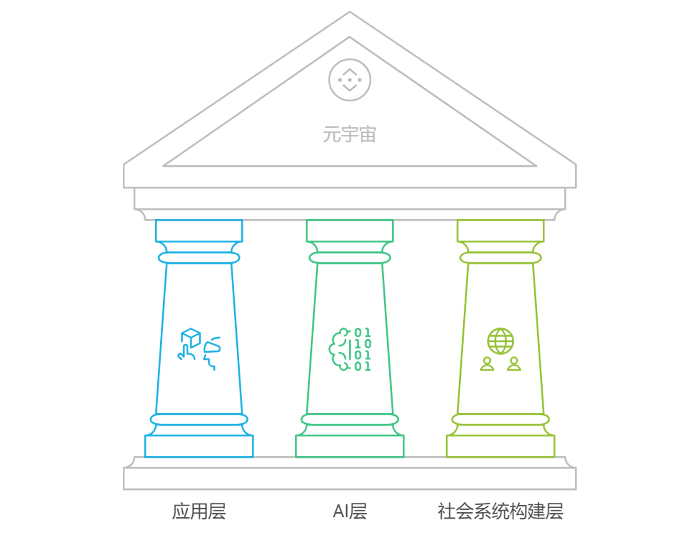

# 25 | 为什么Sora的出现标志着我们离Meta元宇宙更近了一步？

你好，我是柳博文，欢迎和我一起学习前端工程师的 AI 实战课。

这节课是我们的第二节加餐课，我们今天就来聊一下元宇宙的相关话题。

通过前面的学习，我相信你对 AI 的发展已经有了一个整体认识。从最早的传统算法，到机器学习，再到深度学习再到现在的大模型方向上，AI 在不断进步。在 AI 的这个发展过程中，不仅仅是这个概念的前进，这其中算法原型、硬件计算量级等都在不断演进。

而相比文本大模型和图像大模型，视频大模型的难度和成本和前面两个并不在一个量级。那么大模型（尤其视频大模型）又和今天要聊的元宇宙有什么关系呢？

说起大模型不得不提到一个优秀代表——Sora。Sora 是一款文生视频的大模型，今年年初的时候一经曝光就受到了广泛关注。尽管我们还不能够切身体验到它的优秀，但它与 ChatGPT同宗同源，体验过 ChatGPT 惊艳的对答和搜索能力，Sora 的水平也并不逊色。

Sora 在文生文、文生图的基础上完成了文生视频的理解和生成。这标志着 AI 已经进一步进化，对视频帧的理解有了不错的进步，这对于元宇宙中使用 AI 构建自主意识的虚拟社会具有重要意义。

今天我就为你梳理一下 AI 前沿技术与元宇宙的关系，看完后面的内容，你就明白为什么我会说 Sora 的出现标志着我们离元宇宙更近一步了。

## 元宇宙

首先我们需要了解什么是元宇宙。

这里截取一段百科上的解释：“元宇宙（Metaverse），是人类运用数字技术构建的，由现实世界映射或超越现实世界，可与现实世界交互的虚拟世界，具备新型社会体系的数字生活空间”。

看了这个定义是不是还是有些迷茫？

在我看来，元宇宙就像是一个巨大的虚拟世界。你可以用电脑、手机或者特殊的眼镜进去。在里面，你可以像在现实世界一样，和朋友们一起逛街、玩游戏、工作，甚至还能拥有自己的房子和土地。简单来说，它就是一个可以互动、玩耍、社交的网络空间。而 AI 技术的作用就是让这个虚拟世界变得更智能。

美好而宏大的愿景需要基础的技术实现，回到技术本身，元宇宙需要怎么实现呢？具体可以将其大致分为三层——应用层、AI 层和社会系统构建层。

### 应用层

这一层是用户与元宇宙交互的最直接部分。包括以硬件设备、交互方式和反馈机制这几个要素。

首先来看硬件设备，也就是像 VR（虚拟现实）、AR（增强现实）、MR（混合现实）等设备。依赖智能终端、脑机接口等设备，帮助用户进入虚拟世界。这些设备可以捕捉用户的手势、姿态、语音甚至情绪，使虚拟世界的反馈更加及时、准确。

应用层的核心是人机交互方式，既包括视觉、听觉的沉浸式体验，也涵盖了用户输入的动作、指令。通过这些交互，元宇宙中的 3D 模型能够实时对用户的操作做出响应。例如，在虚拟会议中，用户可以通过手势改变 3D 环境的布局，或通过语音和虚拟助手进行互动。

接下来是反馈机制。当用户在元宇宙中操作某个 3D 物体或执行某项任务时，系统需要根据预设规则或环境情况，立即做出反馈。这种实时反馈是应用层实现沉浸感和用户体验的关键。未来，随着硬件技术进步（如全息投影、触觉反馈设备等），用户的体感会更好，和虚拟世界（元宇宙）的交互深度也会更深入。

### AI 层

AI 层是元宇宙中赋予“虚拟生命”的一部分，旨在让虚拟对象能够自主学习和行动，模拟现实中个体的自我意识。它主要涵盖以下三个方面。

第一个方面是学习能力。AI 层使得元宇宙中的虚拟角色能够通过历史数据进行学习。这种数据可以来自用户的行为习惯、对话模式、偏好等，AI 会根据这些数据调整虚拟角色的行为，使其更接近用户的现实反应或未来需求。

第二个方面是自主性。3D 模型不再仅仅依赖用户的输入。通过 AI 学习，虚拟角色能够在用户不在场的情况下做出自主决策。比如在虚拟游戏中，一个 3D 角色可以在待机状态下选择自我发展、战斗升级或进行模拟社交，而不是单纯地等待用户命令。

第三方面是自我意识。虽然当下的 AI 仍处于模仿人类行为的阶段，但 AI 层的目标是让元宇宙中的虚拟角色发展出某种形式的自我意识或模拟的“自我感知”，即便只是遵循算法规则，这些角色的行为也将变得更加复杂、多样。

### 社会系统构建层

这一层是元宇宙作为一个虚拟社会的基础结构。它不仅仅是虚拟世界的表面，而是一个与现实社会紧密相连的、具有独立运行规则的社会系统。

先来看经济系统，元宇宙中的经济活动会与现实世界挂钩，用户可以通过虚拟货币进行商品交易、购买虚拟资产、创建虚拟企业等。数字资产（如 NFT）在元宇宙中起到关键作用，使得虚拟和现实的经济系统进一步融合。

社会系统的根基是生产和交易。元宇宙中的物品可以是用户创造的 3D 艺术品、虚拟地产、虚拟物品等，交易行为同样模拟现实社会的买卖关系。智能合约和区块链技术可以确保这些虚拟资产的安全交易与所有权的转移。

然后还有元宇宙的社会发展，宇宙中的社会不仅会模仿现实中的社会架构，还会有其独特的制度、规则和发展模式。人们可以在其中通过虚拟身份参与政治、经济、文化等方面的互动，甚至形成超越现实社会的新型关系和组织结构。

## AI 大模型是元宇宙的基石

AI 之所以被视为元宇宙的基石，主要源于其在驱动虚拟世界的智能化、个性化和自主性方面所扮演的核心角色。

### 智能交互的核心

元宇宙的目标是构建一个沉浸式的虚拟世界，而这一体验的核心在于与虚拟世界中对象的智能互动。AI 赋予了这些对象以学习能力和自主行动能力，使用户能够与虚拟角色、环境进行复杂、个性化的交互。

没有 AI 的支撑，元宇宙中的交互将变得机械化、单一，无法满足人们对智能虚拟世界的期待。那么，想要实现这种个性化的智能交互，具体会用到哪些 AI 技术呢？

- 自然语言处理 (NLP)：AI 通过 NLP 技术，让用户能够与虚拟世界中的角色自然对话，从而提高沉浸感。元宇宙中的虚拟助理、角色和对象都可以理解并回应用户的语言输入，形成更为自然的交流。

- 行为预测：AI 不仅仅在用户输入时才做出响应，它还可以通过行为预测模型，在用户未主动进行交互时，根据历史行为和偏好做出相应的动作。这种“智能”使得虚拟世界中的交互更加有趣和有机。

### 元宇宙的自我发展与演进

AI 可以让元宇宙的虚拟世界自行学习和进化，而不仅仅是由开发者事先设定的规则驱动。通过 AI 的机器学习和深度学习能力，虚拟世界中的对象可以根据数据和用户反馈进行自我优化和调整。

AI 可以持续学习用户的行为习惯、喜好，并调整虚拟环境和虚拟角色的表现。这种持续的自我学习能力使得元宇宙能够在时间推移中愈发贴近用户的需求，甚至提前预见用户的意图。

另外，AI 可以使得元宇宙中的虚拟世界以一种动态和自适应的方式演化。游戏角色、城市建设、社交关系等都可以通过 AI 进行自我迭代，保持世界的活力和可持续性。

### 自主行为与虚拟生物的创造

AI 为元宇宙中的虚拟角色注入了活力，让这些角色不再只是人类操作的工具，而是具备一定自主性和“智能生命”特征的对象。

它们不仅可以处理日常任务，还可以根据用户需求做出复杂行为，比如可以模拟复杂的情感反应、做出自主决策，甚至发展出个性化行为。那么虚拟世界的 AI 是怎么样进行自我学习和决策的呢？

简单来说就是根据 AI 算法模仿现实生活中的人物行为模式，甚至能在无用户参与时继续成长和进化。最终效果就是让元宇宙由被动交互变成主动演化。

### 复杂系统的管理与运行

之前我们了解到元宇宙是一个复杂的虚拟社会，包含了经济系统、生产系统、社交系统等多层次的交互。AI 作为智能化系统，可以有效地管理这些复杂的关系和运行模式。

比方说，AI 可以通过大数据分析和预测模型，管理虚拟世界中的经济活动，如虚拟货币的供需平衡、物价波动等。这不仅增强了虚拟社会的真实感，还可以防止系统内部的通货膨胀或资源过度分配。

AI 在社交系统中的应用可以帮助用户更好地适应虚拟社会的规则，并通过数据分析优化人们在虚拟空间中的交互体验，推动元宇宙中的社会更加高效、有序地运转。

### 元宇宙中的个性化体验

AI 的另一个重要作用是在元宇宙中创造个性化体验。AI 能够分析用户的行为、偏好，并根据这些数据定制虚拟世界的互动内容，使每个用户的元宇宙体验都是独一无二的。

AI 可以为用户提供个性化的内容推荐，无论是虚拟物品、虚拟活动，还是社交互动，都可以根据用户的个人习惯和兴趣进行定制。

此外，AI 根据用户的反馈和数据输入，实时调整虚拟环境，使其符合用户的喜好，从而增强用户的沉浸感和满足感。

## 前端工程师的机会

经过前面的分析，不难发现，无论是元宇宙亦或者是现在的应用，大家都越来越关注触达用户的端侧。这里说的“端侧”不是狭义地指代前端，而是广义指所有与用于产生行为交互的终端，并会以多种显示形式来展现。

由此我们就发现了前端同学的第一个机会——虚拟世界的用户界面和交互设计师。具体来说，或许我们可以进行 3D 界面、虚拟现实 (VR) 和增强现实 (AR) 交互等方面的知识技术储备以应对未来的新交互形式。

其次，进入大模型时代之后，即使目前来说模型提供的服务仍然运行在云端，但是端侧模型仍然是一大趋势。越来越多的硬件设备都会配备擅长模型推理的专有芯片。端侧的性能会不断地提升，同时模型会越来越小，端侧的推理是必然趋势。那么，要想在端侧很好地运行模型推理，必定离不开前端的专业知识的结合，这也是我们作为前端工程师的机会。

同时，也是这整堂课的一个创作初衷。希望前端工程师未来都能成为 AI 前端工程师。能够通过 AI 的加持，为产品负责，为用户体验负责，不断提升用户体验。

## 总结

这节课是整个课程的最后一节课，也是一次更加开放自由的探讨。

首先我们以分层的形式拆解了元宇宙的概念，了解了组成它的三个层次——应用层、AI 层、社会系统构建层，并且知道了 AI 层是元宇宙的基石。

依照元宇宙的分层分析，我们也看到了前端工程师的未来机会。首先是应用层触达用户的这一端，这是前端工程师天生擅长的，只是和用户的交互媒体和方式会发生变化，比如增加了 3D的交互等等。

另外就是端侧模型推理的趋势，这是肉眼可见的一个趋势，也是设计这门课的一个初衷，希望让更多前端工程师能够了解 AI、掌握 AI，使用 AI 为我们的用户带来更好的产品体验，也为自己谋求更光明的职业前景。

## 课后思考

除了课程里提到的机会，你觉得未来前端工程师还有哪些潜在机会呢？

欢迎你在留言区和我交流互动，也推荐你把这节课的内容分享给身边更多朋友。
