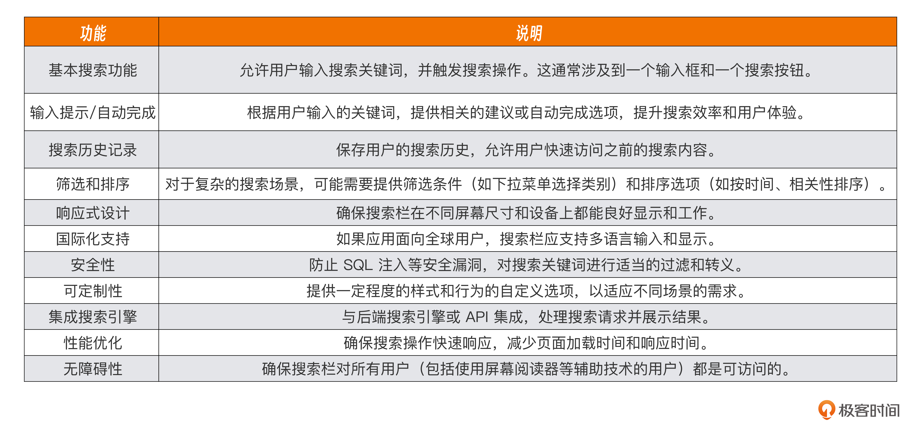
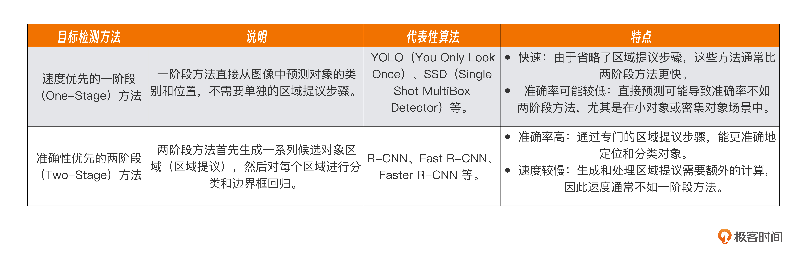
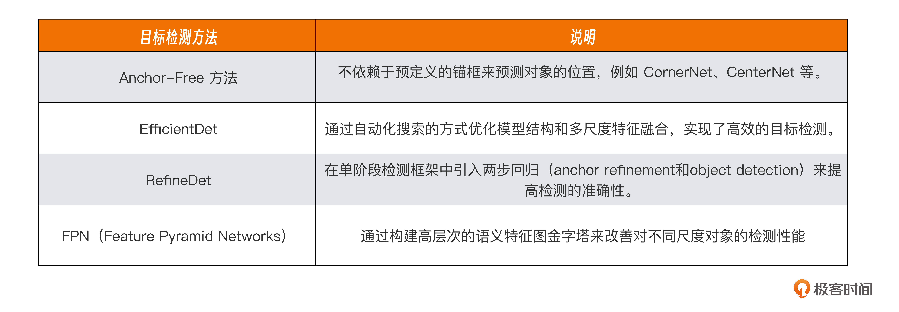
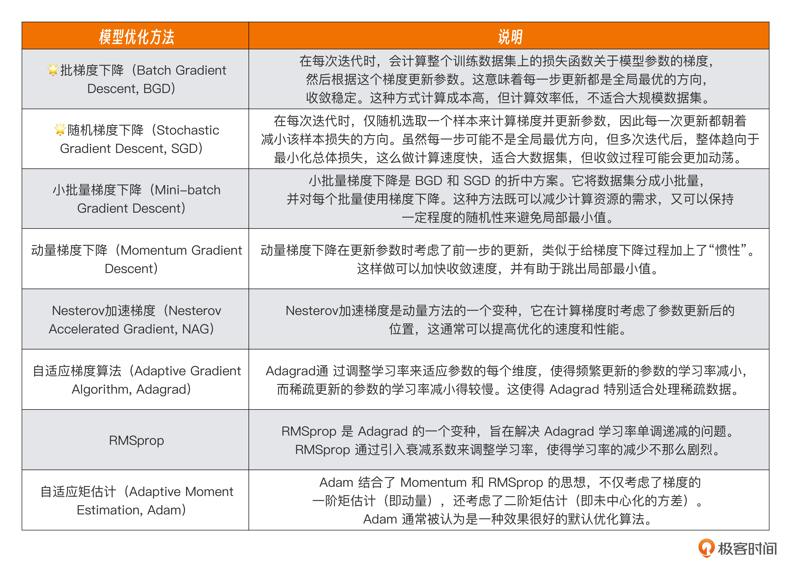
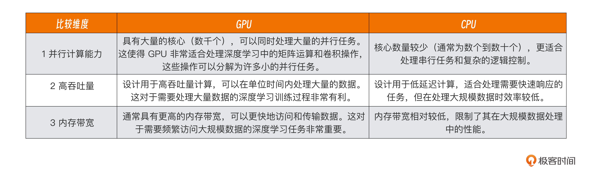
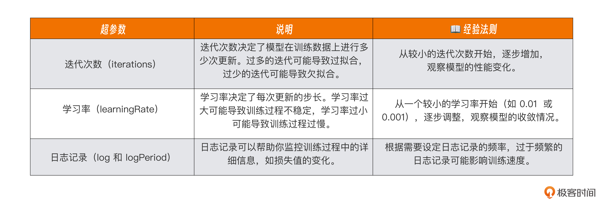
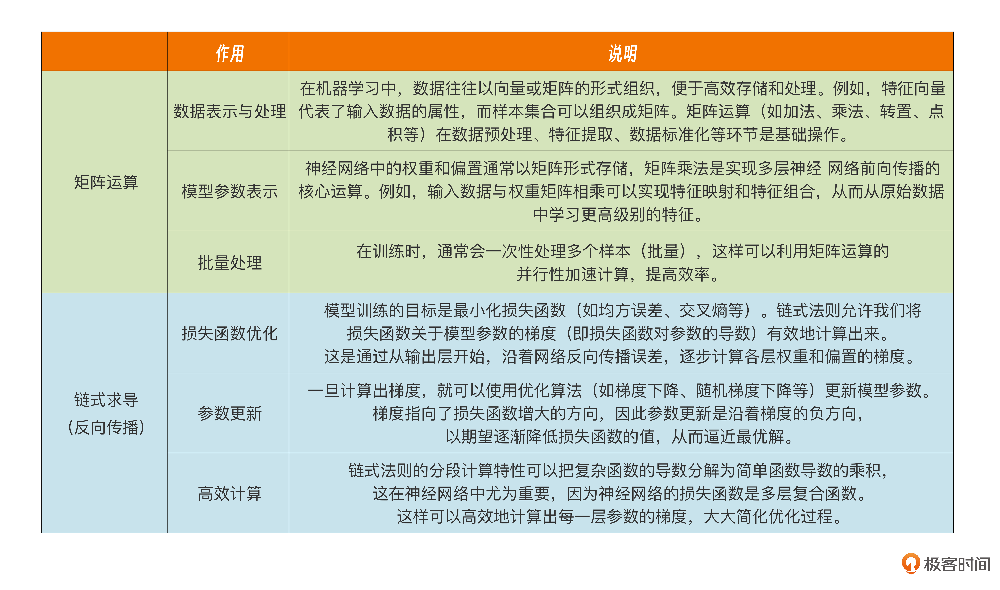
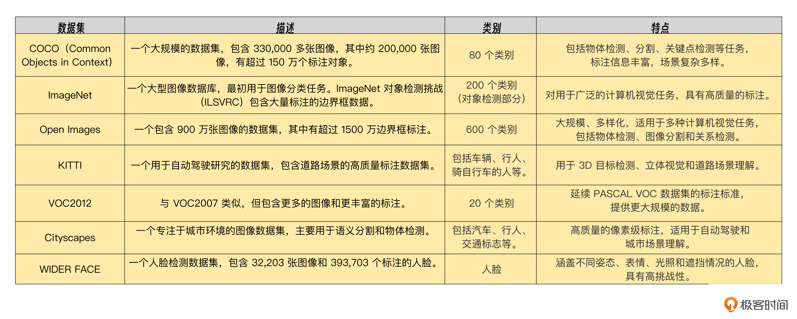
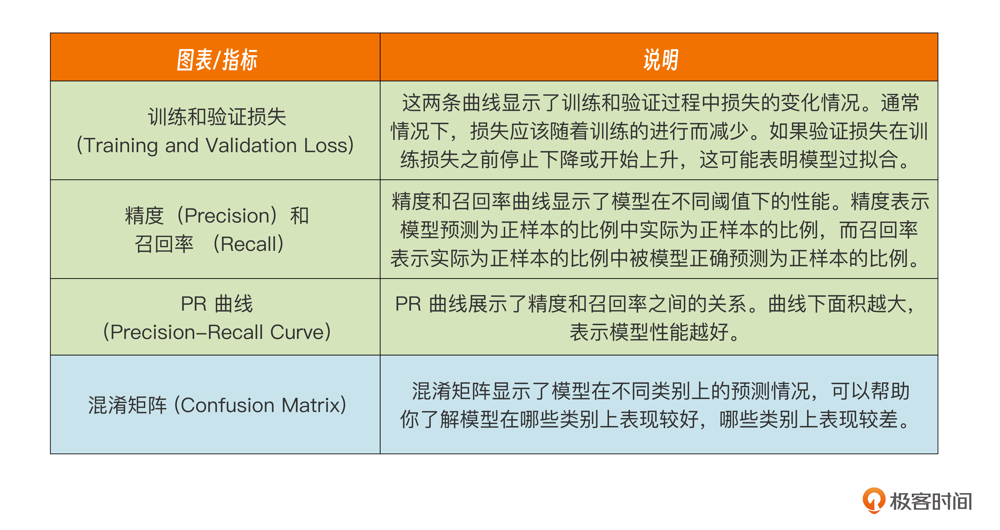

# 答案锦集（一） | 思考题答案汇总

你好，我是柳博文。

课程更新告一段落，感谢你的一路相伴。这次加餐我为你准备了课程的思考题参考答案。

建议你一定要先自己独立思考、动手编码以后，再对照参考答案，这样学习效果会更好。

因为课程里很多题目都涉及代码，只听音频的话不太容易跟上，所以我建议你直接看文稿。我把每节课的题目和答案放在了一起，每节课的超链接也放在了文稿里，方便你跳转复习。

## 第一章

第一节课

Q：MD5 算法在今天这节课里的作用是什么，你还知道它的哪些应用呢？

A：MD5 算法在这节课里主要用于对比文件内容的变化，通过 MD5 进行 hash 计算后的定长字符串的对比会更加高效。

其他作用：

- 完整性校验：通过比较文件或数据的哈希值，可以验证其内容是否未被篡改。如果两个文件的哈希值相同，那么这两个文件在内容上是相同的。

- 数据去重：在存储大量数据时，可以使用哈希值来快速判断数据是否已经存在，避免重复存储。

- 密码存储：虽然 MD5 等哈希算法不应用于现代密码存储（因为它们容易受到暴力破解和彩虹表攻击），但在过去，哈希算法被用来存储密码的哈希值，以保护原始密码不被泄露。

- 数字签名：在数字签名中，哈希算法用于生成数据的摘要，然后对该摘要进行加密，生成签名。签名可以证明数据的完整性和来源的可靠性。

第二节课

Q：如果我们要设计实现一个顶部搜索栏，你认为这是什么粒度的组件，应该具有哪些功能集成。

A：设计一个顶部搜索栏，这通常属于技术组件或业务组件的范畴，具体取决于其集成的功能和复用的广泛性。在大多数情况下，由于搜索栏往往结合了基础组件（如输入框、按钮）以及特定的搜索逻辑，因此它更倾向于技术组件。但如果该搜索栏还包含了与特定业务紧密相关的功能（如自动完成、公司内部数据预加载等），则它也可以被视为业务组件。

一个顶部搜索栏应该具备以下功能集成：

在设计实现顶部搜索栏时，需要根据项目的具体需求和团队的情况来选择合适的技术栈和框架，并遵循上述功能集成原则来构建高效、易用、安全的搜索组件。

## 第二章

第三节课

Q：目标检测中 one-stage 和 two-stage 的区别是什么，你还知道其他的目标检测方法么？

A：目标检测中的一阶段（One-Stage）和两阶段（Two-Stage）方法的主要区别在于它们处理目标检测任务的方式，即如何平衡检测速度与准确性。

其他目标检测方法见下表。

第四节课

Q：为了优化 AI 模型，让模型具有更高的准确率，模型使用了什么优化方法，除了课程中讲到的方案，你还知道什么其他的优化方法么？

A：在 AI 模型训练过程中，除了课程中提及的批量梯度下降（Batch Gradient Descent, BGD）和随机梯度下降（Stochastic Gradient Descent, SGD）之外，还有其他几种梯度下降的方法。

你可以参考我整理的表格。

第五节课

Q：为什么预训练模型直接用来检测自定义图像的效果可能不理想？

A：简单来说，自定义图像的特征并未被当前模型收集和拟合，也就是没有这类数据作为数据集来进行模型训练。

后面是更加专业的解释：

- 数据分布不匹配：如果训练模型的数据集与你的自定义图像在分布上有显著差异，模型可能无法很好地泛化到新数据上。这种差异可能是由于图像的质量、尺寸、拍摄角度、光照条件等因素造成的。

- 类别不匹配：如果你的自定义图像包含训练模型未曾见过的类别，模型将无法正确识别这些新类别。模型的识别能力限于其训练数据中的类别。

- 过拟合：如果模型在训练数据上过拟合，它可能在训练集上表现得很好，但在新的、未见过的数据上表现不佳。过拟合意味着模型学习到了训练数据中的噪声和特定细节，而没有捕捉到足够的泛化特征。

- 图像预处理不一致：在将图像输入模型之前，通常需要进行一系列预处理步骤，如缩放、裁剪、归一化等。如果这些预处理步骤与训练时使用的不一致，模型的性能可能会受到影响。

- 模型复杂度：如果模型过于简单，可能无法捕捉到足够复杂的特征来准确识别图像中的对象。相反，如果模型过于复杂，它可能会过拟合训练数据，导致在新数据上的泛化能力下降。

第六节课

Q：为什么进行模型训练使用 GPU 计算效率会比 CPU 高？

A：原因主要有以下三方面。

第七节课

Q：如何设定模型的训练超参数，为什么说是根据过往经验来设定的？

A：在机器学习中，模型的训练超参数（如迭代次数、学习率等）通常是根据经验和实验结果来设定的。这是因为不同的数据集和模型架构对超参数的敏感度不同，最佳的超参数组合往往需要通过实验来确定。这也就是为神马我们总是调侃自己是调参工程师的由来。

设定训练超参数的步骤主要包括后面几项。

为什么说是根据过往经验来设定的？

- 经验法则：很多超参数的初始值是基于过往经验和文献中的推荐值。例如，学习率通常从0.01 或 0.001 开始。

- 实验结果：通过实验不断调整超参数，观察模型在验证集上的性能，找到最佳的超参数组合。

- 领域知识：不同领域的数据集和任务可能对超参数有不同的要求，领域专家的知识可以提供有价值的指导。

总之，设定训练超参数是一个需要经验和实验的过程。通过不断调整和观察模型的性能，可以找到适合特定任务的最佳超参数组合。

第八节课

Q：请问矩阵运算以及链式求导在模型训练过程中具体作用是什么？

A：

## 第三章

第九节课

Q：对图像数据进行数据增广后，图像的像素会怎么变化，同时对于 AI 做识别任务又有什么影响？

A：图像数据增强会改变图像的像素值。具体的变化取决于所使用的数据增强技术

- 旋转：旋转图像会改变像素的位置，可能会引入一些插值造成的像素值变化。

- 缩放：缩放图像会改变像素的分布，小的缩放可能会导致像素值的插值变化，大的缩放可能会改变物体的形状。

- 平移：平移图像会改变像素的位置，但不会改变像素值。

- 翻转：翻转图像会改变像素的位置，但不会改变像素值。

- 颜色变换：如亮度、对比度、饱和度的调整会改变像素值，但不会改变像素的位置。

对于 AI 识别任务有以下影响。

- 提高模型的泛化能力：通过在训练数据中引入变化，模型可以学习到更多的变化模式，从而在处理新的、未见过的数据时表现得更好。

- 提高模型的鲁棒性：模型可以更好地处理图像的小的变化，如旋转、缩放、平移等，从而在处理实际图像时表现得更好。

- 扩大训练数据：数据增强可以有效地扩大训练数据，从而减少过拟合的风险。

第十节课

Q：除了 PASCAL VOC 数据集外，还有哪些流行的目标检测数据集？

A：除了 PASCAL VOC 数据集外，还有许多流行的目标检测数据集。这些数据集涵盖了不同的应用场景和标注类型，常用于训练和评估目标检测模型。以下是一些主要的目标检测数据集。

这些数据集提供了丰富的图像和标注资源，帮助研究人员开发和评估各种目标检测算法，推动计算机视觉领域的进步。

第十一节课

Q：在模型训练结果的分析中，我们用 mAP 进行了分析，那么，还有哪些指标可以用来分析，以及观测方法是什么？

A：在使用 YOLOv5 训练目标检测任务后，训练结果图通常包括以下几种图表和指标，它们可以帮助你分析模型的性能。

第十二节课

Q：在真实业务场景里，页面往往不止 4 个类别这么简单，层级结构更是复杂，那么要如何使用 AI 模型来完成页面布局呢？

A：课程的目的是为了通过最小完整的 demo 来演示 AI 是如何完成布局信息的识别。

真实场景中，页面的复杂程度取决于你对页面组件的划分粒度，同时受限于你的组件库的实现程度，这也是为什么我们前面课程里要学习组件库和组件粒度划分知识。

这些都是需要在一个清晰的问题定义下配套实现的，AI 的识别是发散的，但结果往往是需要约束的。

一个可行的做法是，根据具体的业务场景尽可能地抽象出需要的组件，划分粒度可以参考前面章节的讲解，并实现对应的组件库。在进行数据标签标记时，按照划分粒度进行标记，使用这样的数据和标记来训练模型。

你可能会问，业务可能会玩得比较花，设计给出的稿子也可能天花乱坠。没有任何问题，在使用 AI 提效这个问题上，本来就是一个需要多方共建的问题，无论是产品还是设计，他们都会有自己的一个约束集合，多方共建需要找到这些集合的交集，达成共识。

第十三节课

Q：这节课里通过使用代码模板拼接的方式简单粗暴地生成了代码，那么结合现代前端打包工具的方法怎么实现呢？

A：这里给你提供两种方案，

使用 Webpack 的插件或加载器（Loaders）

Webpack 提供了丰富的插件和加载器生态系统，可以在构建过程中动态生成源代码。

- 使用 raw-loader 或 string-loader：这些加载器可以让你直接加载 JavaScript 字符串作为模块内容。例如，你可以使用模板字符串生成的源代码，并通过这些加载器在运行时动态注入。

- 使用自定义插件：你可以编写一个 Webpack 插件来在构建过程中生成文件。这个插件可以根据需要读取模板并生成相应的 JavaScript 或 JSX 文件。

使用 Vite 的插件

Vite 也支持类似的自定义插件机制，可以在构建时或者运行时动态生成源代码。Vite 插件机制允许你在不同的构建阶段插入自定义逻辑。你可以利用这一点来在构建之前读取模板文件，生成需要的 React 组件文件，然后让 Vite 继续打包这些文件。

### 第十四节课

Q：这节课我们分析了 AI 在研发流程中的辅助作用，那么在用户侧，AI 又能在产研流程中有哪些帮助呢？

A：接下来我给出一些参考，答案并不固定，而且并不局限于我列的内容，也期待你的分享。

想法提出（运营）：AI 可以分析用户行为数据、市场趋势，生成需求建议或优化现有产品策略，帮助运营人员更好地理解用户需求。

策略制定（产品）：AI 可以基于历史数据和用户反馈，分析出潜在的高效方案，提供产品策略的优化建议，如推荐功能优先级、预测用户点击行为等。

原型稿产出（产品）：AI 可以自动生成简单的产品原型，基于输入的需求或关键功能，快速生成 UI 布局草稿，为产品人员提供参考，加速原型设计。

设计稿产出（UED）：AI 视觉模型可以辅助设计师生成高保真的设计稿，例如通过自动推荐布局、调色方案，甚至生成交互动画，减少重复性工作。AI 还可以根据风格和设计趋势自动生成多种设计风格，供我们选择。

上线验证：AI 可以在测试阶段自动生成测试用例，并通过自动化测试工具对页面的功能、响应式设计、性能进行验证，甚至通过 AI 模型预测上线后用户的使用行为和体验，提前发现潜在问题。

好了，前三章的思考题答案就更新到这里，如果你还有什么疑问欢迎继续在留言区跟我交流。
