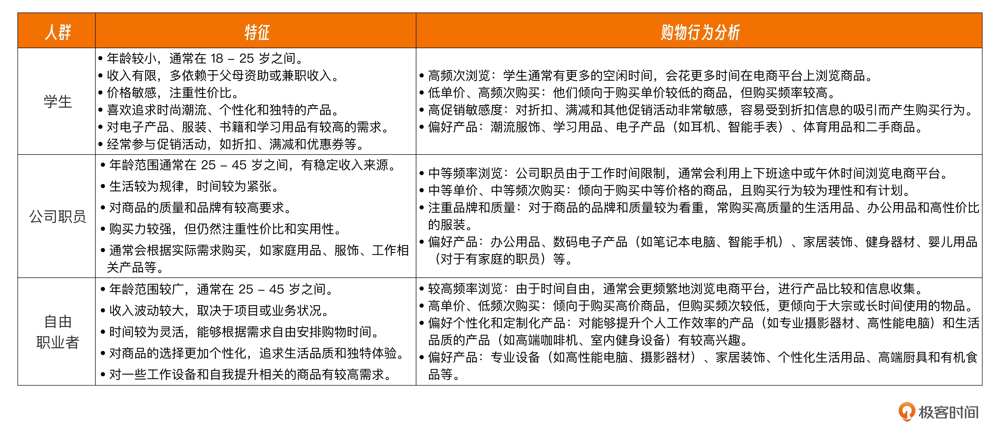
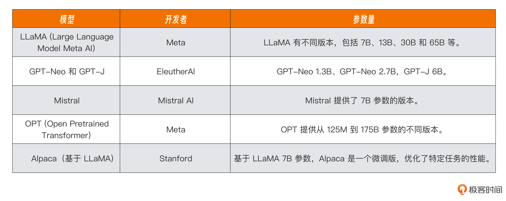

# 答案锦集（二） | 思考题答案汇总

你好，我是柳博文。

课程正文已经完结，不知道你的学习动态如何？这次加餐我们继续更新后三章思考题的答案。

还是建议你学习课程之后，先尝试自己完成课后题目，然后再对照参考答案，这样能更好地帮助你查漏补缺。

因为后面的内容，如果只听音频的话不太容易跟上，所以我建议你直接看文稿。我把每节课的题目和答案放在了一起，我把每节课的超链接也放在了文稿里，方便你跳转复习。

## 第四章

第十五节课Q：数据的千人千面与 UI 的千人千面有哪些相似之处？又有哪些不同？

A：相似：两者均需要构建人群画像，均需要进行数据的埋点、收集和分析，根据需要算法的帮助推荐，目的都是让产品更加符合用户的使用习惯。

不同：数据的千人千面是从后端数据维度考虑的。它是基于后端数据和背后推荐算法（机器学习，深度学习）等推荐来完成的，所有的操作都在服务端实现了。

而 UI 的千人千面是从 UI 维度出发，让 UI 也能够理解用户，通过构建人群画像、埋点做数据收集和分析，再通过端侧的 AI 模型进行预测，实时重排，让不同用户都使用到自己喜欢的页面。

第十六节课

Q：这节课里我们将用户年龄作为关键指标，分析了不同年龄段用户的特质。那么以职业（学生，公司职员，自由职业）来划分用户的话，你觉得会找到哪些特征呢？

A：不同职业的用户在电商平台上的行为模式和购物偏好各不相同。通过职业划分，可以更有针对性地优化推荐策略和营销活动。

第十七节课Q：这节课里，我们通过热力图分析了用户在电商 H5 页面上的点击行为，并根据性别和年龄段对点击数据进行了细分分析。同时，我们观察到页面点击行为具有长尾效应，数据呈递减趋势。

作为一名前端工程师，根据这些数据分析结果，你有哪些优化页面交互设计和用户体验的思路呢？

A：根据用户点击行为数据，可以采取以下技术方案来优化页面的交互设计和用户体验。

1. 动态内容加载和展示优化：根据热力图的点击数据，使用懒加载技术来优化页面加载速度。对于点击率高的区域，确保其内容和资源优先加载，使用户能够快速看到他们感兴趣的内容。对于点击率较低的长尾区域，使用懒加载或按需加载来减少初始页面加载时间。

2. 个性化 UI/UX 调整：基于性别和年龄段的数据分析结果，可以使用前端框架（如 React 或Vue）动态调整页面布局和内容。例如，根据用户的性别和年龄段加载不同的 CSS 样式或布局模板，以提升用户体验。

3. 交互热点的高亮显示和反馈：使用数据分析结果，将用户高点击区域的交互元素（如按钮、链接）进行视觉上高亮显示或增加交互反馈（如按钮悬停动画、点击反馈），吸引用户进一步互动。

4. 优化长尾内容区域的可用性：针对长尾效应中点击率较低的内容区域，可以增加引导性的工具提示或推荐内容，以引导用户探索更多内容。

通过这些前端技术方案的实现，可以有效优化页面的加载速度、交互设计和用户体验，进而提升整体页面的点击率和用户参与度。

第十八节课

Q：这节课中，我们选择了皮尔逊和 Apriori 两种传统算法来进行实验，那么，除此之外还有哪些适合课程实验数据结构和内容的传统算法呢？

A：余弦相似度（Cosine Similarity）

作用：用于计算两个向量之间的相似度，通常用于文本挖掘中，判断两个文档的相似程度。也广泛应用于推荐系统和聚类分析中。

杰卡德相似度（Jaccard Similarity）

作用：用于衡量两个集合的相似性，计算的是两个集合的交集与并集的比值。常用于聚类、分类、推荐系统中。

EM 算法（期望最大化算法）

作用：用于在含有隐变量的模型中求解最大似然估计，常用于聚类、混合模型等。

随机森林（Random Forest）

作用：通过构建多棵决策树并通过投票或平均来进行分分类或回归。对抗过拟合能力强。

第十九节课

Q：为什么不能将 UI 的重排放在服务器端？

A：这是一个很值得思考的问题，现代前端框架的产物都是以 bundle.js 的形式进行下发，然后，在客户端处使用 JavaScript 的方式进行页面的渲染。但 CSR 的方式多了在客户端执行JavaScript 的时间，往往性能不那么尽如人意，在要求秒开的业务上无法满足要求。

那么，我们就可以使用 SSR 的方式在服务端完成页面的拼接，这样就省去在客户端执行JavaScript 的时间，性能上会有明显的提升。但是这又让基于数据做个性化推荐为难了，因为个性化推荐往往需要满足“千人千面”，这才仅仅是数据层面的千人千面，这会造成服务器巨大的开支。

如果将课程所讨论的 UI 层面的千人千面也放在服务端拼接完成再下发，那更会是巨大的资源开支。

所以，将 UI 的重排放在端侧，这也是一个相对合理，符合技术潮流的操作。再结合一些性能优化的手段，便可做到均衡地调控。但将模型放在客户端上运行，这对 JavaScript 又是一个巨大的考验，这个部分我们在加餐部分还会展开，你可以看看我们的第二十四节课。

第二十节课

Q：在“纵向”这个方向上，前端可以做哪些优化工作来提升漏斗转化数据呢？

A：这个问题我们可以使用一个实例来回答，你是否关注过，各大电商场景的完成支付的步骤变得越来越短呢？

例如你在某宝看到一个商品 选定 SKU 之后，点击购买就能够直接拉起一个快速支付的底部抽屉组件来完成支付。而不是以前经由各种来回的路由跳转，才能到支付页面完成下单。这其实就是在优化“纵向”上的用户体验，缩短用户的操作路径，更快捷地下单支付。

同理，任何契合用户心态的纵向优化逻辑，都能够为用户带来不错的产品体验的提升，这也就是如何进行纵向优化的方向。在这个过程中，我们就可以使用课程讲过的思路，进行人群运营模型进行人群分析与匹配，分析用户操作路径进行纵向的用户路径推荐。

## 第五章

第二十一节课

Q：这节课我们学习部署使用了 chatGLM-6B 模型，我相信你对个人本地化部署大模型有了一些新的思路，那么，除了 chatGLM-6B，还有哪些文本大模型可以在 PC 上进行本地部署和使用呢？

A：我列出一些比较有代表性的模型供你参考。

第二十二节课

Q：通过 Stable Diffusion 就能直接生成设计原型稿，理论上讲就可以无限制地生成 UI 界面了，这与我们第四章实现的 UI 千人千面有什么联系呢？

A：千人千面本质上是要为用户推荐更加青睐的 UI 设计，以此提升用户体验来提升商业数据的转化。

在这个过程中，我们需要不断地实现 AB 实验来产生数据，并且寻找 UI 设计和用户数据之间的联系。理论上来说，UI 设计越多越好。但是 UI 的设计总是需要设计师产出的，面对人力有限的情况，就能使用 Stable Diffusion 来协助设计师生产更多的 UI 设计，沉淀更多用于 AI 训练的 UI 设计物料。

第二十三节课

Q：对于前端开发者来说，未来应该如何更好地融入视频生成的大模型生态中？你可以尝试从前端工程师角色变化、如何结合前端技术优化 AI 生成效果等方面聊聊你的想法。

A：想要融入视频生成的大模型生态，前端工程师可以考虑以下切入点。

- AI 生成技术的局限性：当前的视频生成大模型仍有一定的局限性，比如生成速度、细节控制等问题。那么如何结合前端技术来优化用户体验，提升生成效果呢？

- 前端工程师的角色变化：随着 AI 生成技术的普及，前端开发者不仅仅是界面搭建者，还逐渐参与到内容生成和创作中。这种角色的变化对前端开发者提出了新的挑战，你认为有哪些AI 生成的知识和技能值得学习呢？

- 生成内容的个性化与多样化：如何结合大模型的生成能力，为用户提供个性化的内容定制服务？如何在不影响用户体验的情况下，动态生成符合用户需求的视频内容？

- 生成模型与用户数据的结合：未来可以尝试将用户的行为数据与视频生成模型相结合，根据用户的历史操作和偏好，生成更符合用户需求的视频内容。这需要前端工程师深入了解 AI模型和用户数据之间的联系，并在技术实现上做好桥接。

## 第六章

第二十四节课

Q：使用 WASM 进行加速推理的过程中，主要是优化了什么部分？

A：使用 WASM 的方式，能够将其他高级语言通过编译器直接编译为 V8 可运行的字节码，这样直接在前端运行，就省去了 V8 编译解析 JavaScript 源码的时间，以此达到加速推理的目的。

第二十五节课

Q：除了课程里提到的机会，你觉得未来前端工程师还有哪些潜在机会呢？

A：这同样是一个开放性问题，我这里列出一些自己想到的方向供你参考。

3D 界面与交互设计

元宇宙中的很多场景将是三维虚拟世界，前端工程师需要掌握 3D 图形处理技术，例如WebGL、Three.js 和 Babylon.js。与传统的 2D 页面不同，3D 用户界面的设计和实现将成为未来的核心需求，包括虚拟世界中的交互方式、物理模拟、角色动画等。

虚拟现实 (VR) 和增强现实 (AR) 开发随着 VR 和 AR 设备的普及，前端工程师可以参与到这些设备的应用开发中。例如，使用WebXR API，可以为元宇宙创建虚拟和增强现实体验。这将包括为不同平台和设备（如Oculus、HoloLens）设计的沉浸式用户体验。

实时渲染与性能优化

由于元宇宙中的场景往往复杂且动态，前端工程师将面临性能优化的挑战。需要处理大量实时渲染、动态加载内容和多用户同步的需求，这意味着需要深入理解图形渲染和网络性能的优化技巧，利用如 WebGPU 等更高效的渲染技术。

分布式系统与区块链

元宇宙会涉及大量的分布式架构，前端工程师需要学习如何与区块链等去中心化技术集成。例如，创建去中心化的应用（DApp），用于管理虚拟资产和身份验证。智能合约的交互和前端与区块链的集成也会成为一个新的领域。

虚拟人物与内容生成

AI 在元宇宙中将会扮演重要角色，前端工程师可以结合 AI 技术，帮助开发虚拟人物、自动生成内容（如 AI 生成场景、对话、动画）。例如，利用 MuseV 等生成虚拟人视频、StableDiffusion 等生成图像，前端可以负责这些内容的渲染和交互。

跨平台体验与适配

元宇宙不仅限于桌面或移动设备，还包括多种不同的设备和平台。前端工程师需要掌握跨平台开发技术，确保在各种设备（如桌面、手机、VR 设备等）上提供一致的用户体验。掌握适应性设计、多设备渲染优化和跨平台技术（如 WebAssembly、PWA）将是必备技能。

社交与协作功能

元宇宙的社交和协作是核心功能之一，前端工程师可以参与开发实时通信、虚拟空间中的多人交互功能，例如多人虚拟会议、虚拟展览、实时协作设计等。这些功能的实现通常涉及WebRTC、Socket.io 等技术。

智能合约和数字资产

元宇宙中会有大量的数字资产交易和管理，前端工程师可以参与开发与 NFT（非同质化代币）、虚拟货币相关的用户界面，确保用户能够轻松地创建、展示、交易虚拟物品。

在未来，前端工程师不仅需要传统的 HTML、CSS、JavaScript 技能，还需要深入理解 3D 渲染、VR/AR 开发、实时通信和区块链技术，才能抓住元宇宙带来的广阔机会。

以上就是后两章思考题答案的全部内容。

最后，希望你能抽几分钟填一下结课问卷，我会参考同学们的意见持续优化课程。

