# 第三十六封信-那什么颜色才是对的？

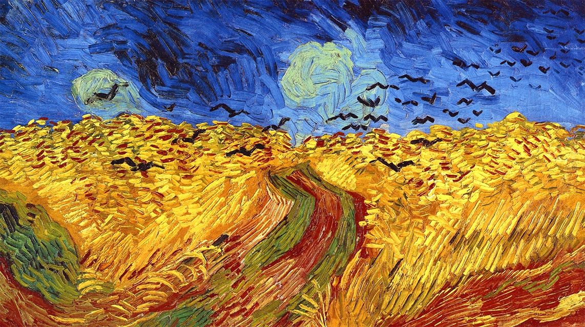

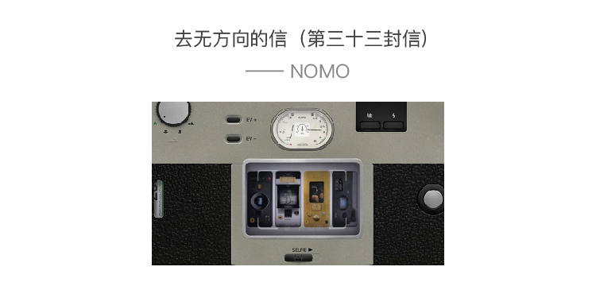

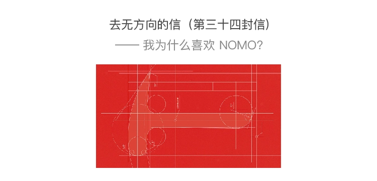

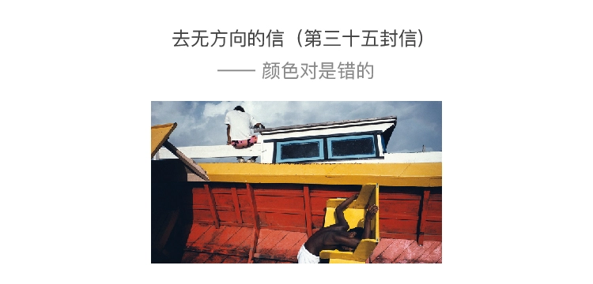

生生：

你好哇。

前几次我一直在说这个对那个错，可能都把你搞糊涂了，为什么这个就是对？为什么那个就是错？这个颜色怎么就好看了？那个颜色怎么就愚蠢且丑陋了？这次要聊的就是这个事。

我在上一封信的结尾贴了一组图：

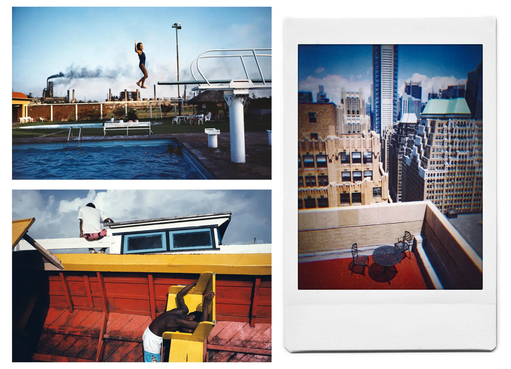

左边这两张是 Alex Webb 的照片儿，右边这张是我用 NOMO 拍完以后又修了一下颜色的照片儿，咱们一点一点来说。

首先，这三张照片儿肯定都不是当时的真实环境颜色，但之所以我们没有觉得这三张照片儿的颜色显得那么假，一是因为这三张照片儿里的颜色确实正，非常纯，二是因为上次咱们说过的“白平衡”……看画面里的白色，都基本没有偏色，我说过，只要白是白，那么即便其他颜色轻一点、重一点、亮一点、暗一点、暖一点、冷一点，甚至偏紫偏绿，都没那么难以接受。

再来，看 Alex Webb 的第一张照片儿，天空的蓝色，游池里的蓝色，混合在一起整体的那个蓝色调，再看我那张照片儿里的蓝色，然后看 Alex Webb 的第二张照片儿，红色的木船，再看我那张照片儿里的红色……虽然不可能是一模一样，但大差不差。

Alex Webb 肯定算得上是公认的色彩大师之一了，他的好看是公认的，是被很多很多人喜欢的，所以，如果我的颜色跟他的颜色大差不差，基本等于我的颜色也就能算得上是好看的了，所以，我所谓的“好看”，一部分是从 Alex Webb 这儿来的。

再来看一张照片儿：

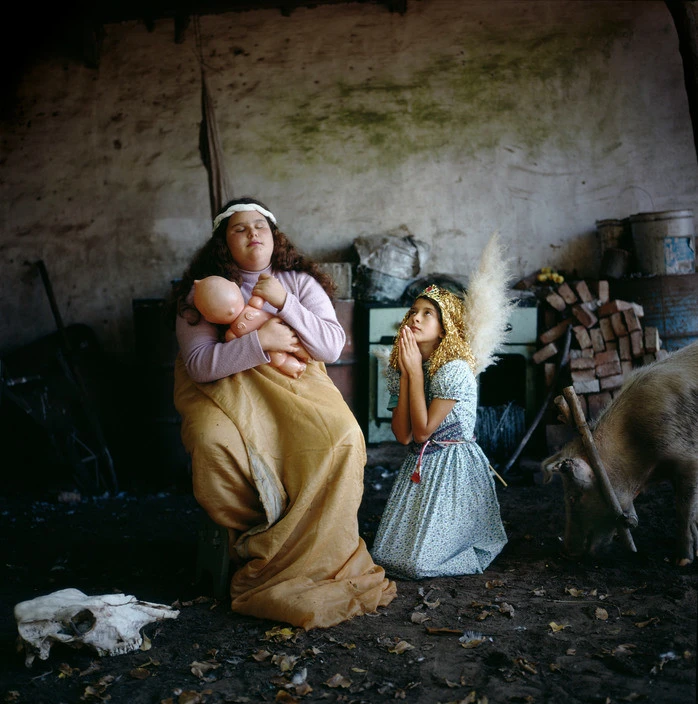

- Alessandra Sanguinetti

这张照片儿是 Alessandra Sanguinetti 拍的，颜色非常好，饱满通透，而且整张照片儿的光感非常强，虽然跟 Alex Webb 不太一样，但我们认为这也是一张很好看的照片儿，而且，这种照片儿，我猜测，基本代表了绝大多数摄影爱好者拍照片儿的初心……这种照片儿的好看显然也是公认的，是被特别多特别多人喜欢的，我也不例外，所以我所谓的“好看”，一部分又是从这种照片儿这儿来的。

我那张照片儿里好看的蓝色和红色来源于 Alex Webb，不是自创的，而 AlessandraSanguinetti 这张照片儿的好看也不是自创的，这种照片儿的好看来源于以前的古典油画。

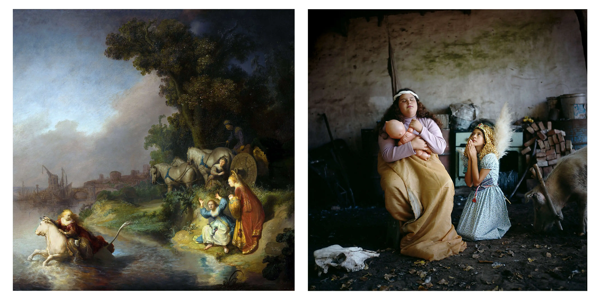

- Rembrandt vs. Alessandra Sanguinetti

然后咱们说回到 Alex Webb，不要放过他，他的颜色不是那种特别经典的古典，肯定不是伦勃朗，所以难道他的颜色就是自创的了？当然也不是……他对于我来说是前人，我被我的前人影响，越来越觉得他们好看，而他们也都有前人，他们也知道他们的前人们好看。

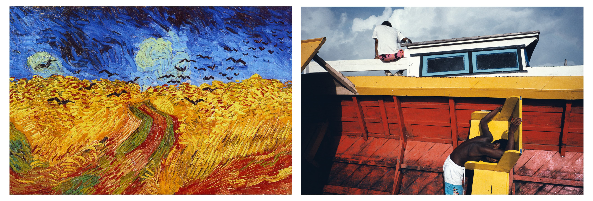

- Vincent van Gogh vs. Alex Webb

为什么要是这个红？为什么要是这个黄？为什么要是这个蓝？专门研究颜色的人也许能说出一二三，在大脑科学和心理科学的领域也许真的有解释，但对于个人来说，我觉得真的就是没有道理，摄影界里的色彩大师肯定不是天天在家研究有关颜色的理论知识，他们顶多是对颜色更敏感，再加上一代影响一代，都被洗脑了，不是差不多那样的红黄蓝，看着就别扭。

下面这三张照片儿是除 Alex Webb 之外另外三位公认的色彩大师，看看那个红色，看看那个黄色，看看那个蓝色，可以拿这三张照片儿跟 Alex Webb 的照片儿对比，也可以他们仨互相对比，然后你就明白我说的是什么意思了。

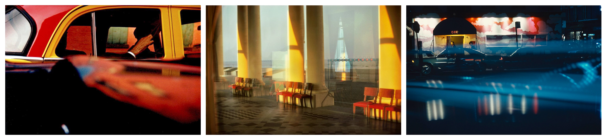

- Saul Leiter | Harry Gruyaert | Ernst Haas

经常会有人拿来自己的照片儿问我那照片儿拍得怎么样，我说这儿不太讲究，那儿可以改进一下儿，然后说到颜色，我说颜色不好看，他就不高兴，带着“你说不好看就不好看啊”的语气问：那颜色怎么才算好看？

这事儿不是我说了算的，我是听 Alex 和 Alessandra 他们的，但他们说了也不算，因为他们是听梵高和伦勃朗的，那梵高和伦勃朗说了算不算？基本上算，因为在梵高之前基本没有像他和高更那样涂颜色的，在伦勃朗之前基本没有那样用光用影的。

开创纪元是很难的一件事儿，大家都是先踩着前人的脚印往前走，毕加索也是先画的《科学与博爱》，之后才有的《格尔尼卡》，更何况咱俩不是毕加索，咱俩只是两个资质平平的庸才。

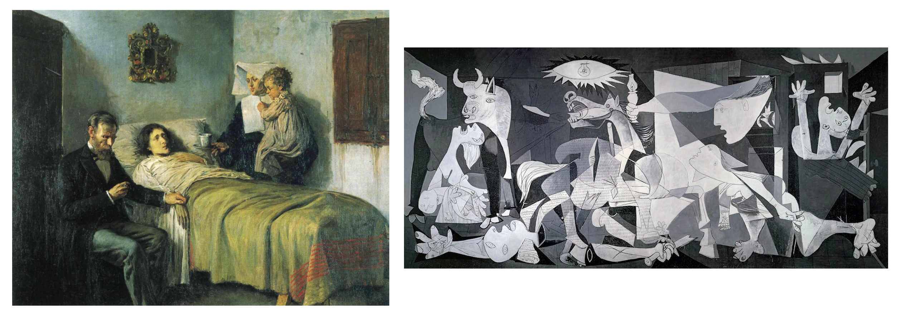

- Pablo Picasso

之前我提到过 Trent Parke 这个人，我说我恨我自己认识他认识得太晚了，如果说之前我照片儿的颜色受 Alex Webb 那一系列人的影响比较大，但现在，显然是又进入到了 Trent Parke 时代，于是就有了下面这样的照片儿。

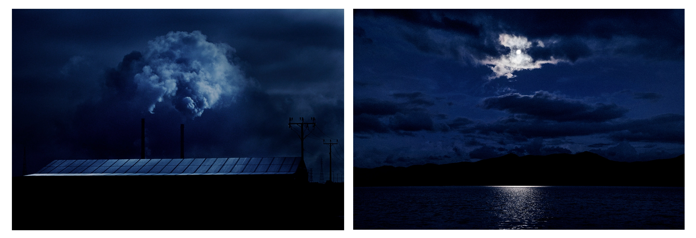

- Trent Parke | Mai

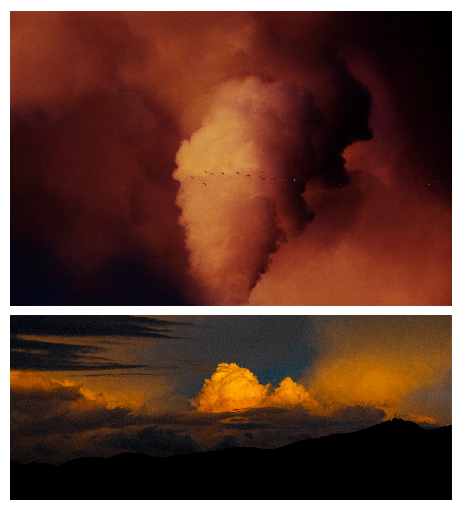

- Trent Parke | Mai

经常能听到那些教摄影的人说摄影要从模仿开始，我也免不了俗套，我也得说拍照片儿要从模仿开始，因为这事儿真的还挺重要的。你可以主动地去模仿，也可以被动地被影响，因为我就是偷懒被动被影响的那种，我没有专门去模仿过谁，练是练过，但就一阵，没有狠下心真的去下这个苦功夫，所以每次我老师或五哥说到模仿这事儿的时候，我都特别羞愧。

但即便如此，我肯定也并不能跳过这个必经的阶段，因为多少也还是喜欢和喜欢过一些非常对我路数的摄影师，多少也还是特别认真地看过一些他们的作品，多少也还是通过有关无关的书、画、电影、音乐等等这些东西汲取到过一些说不清道不明的感受。

所以，有一天当我回看我拍的照片儿的时候，我突然发现，这些照片儿并不完全是我的照片儿，好像每一个让我有冲动按下快门的画面，都是在我脑子里已经流转了很久的记忆，我只是看见某个画面，然后可能由此想到了某个相似的画面，最后掏出相机拍下来了，而已。

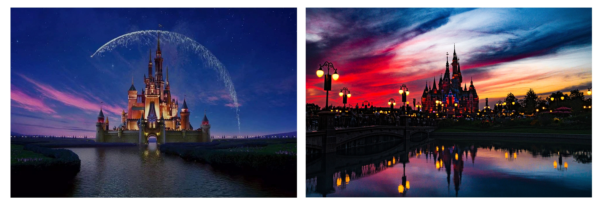

- Disney Opening LOGO | Mai

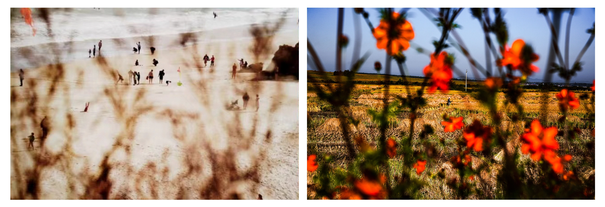

- Martin Parr | Mai

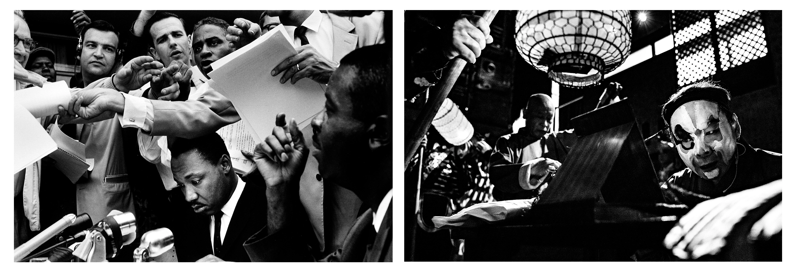

- Bruce Davidson | Mai

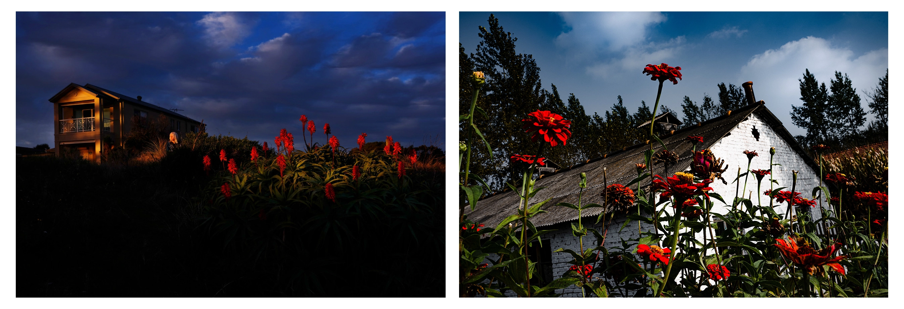

- Trent Parke | Mai

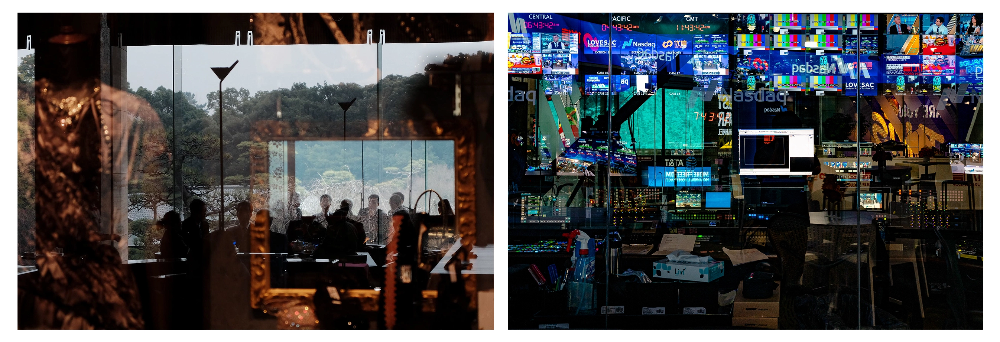

- Gueorgui Pinkhassov | Mai

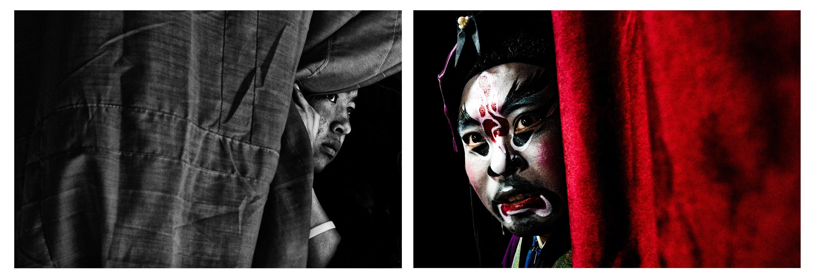

- Mai Mentor（闫璐） | Mai

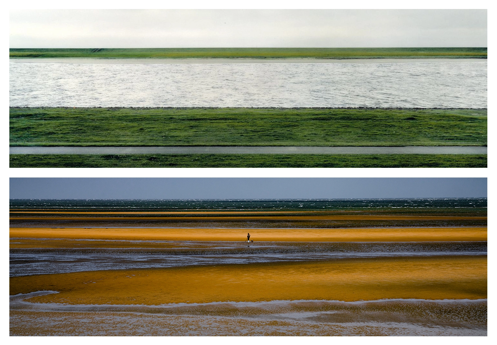

- Andreas Gursky | Mai

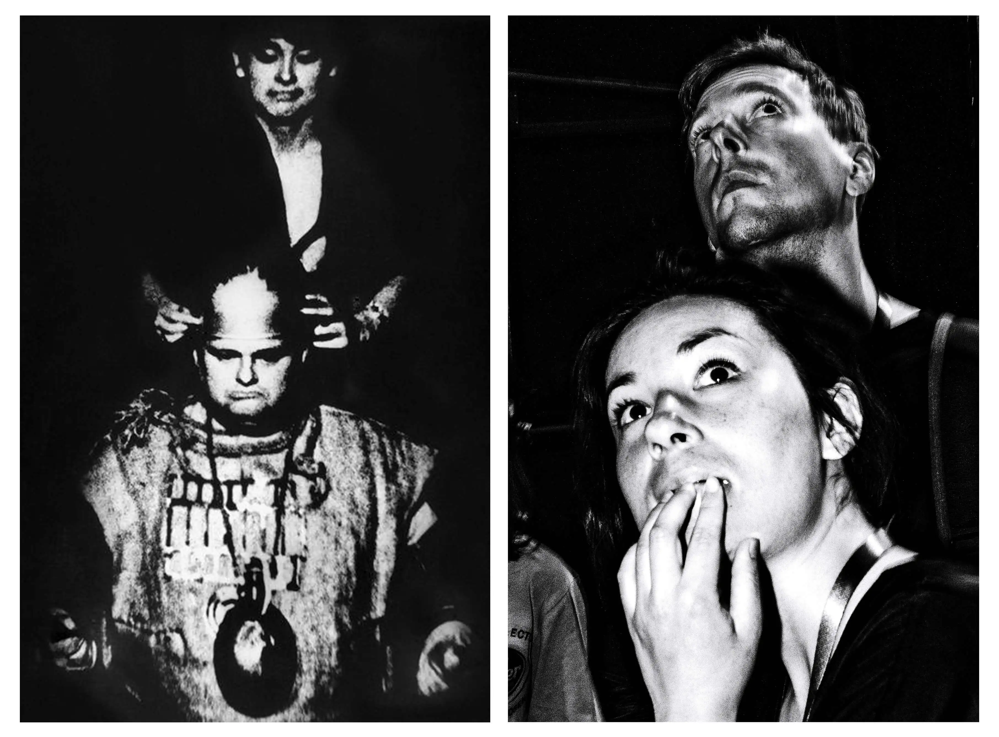

- Josef Koudelka | Mai

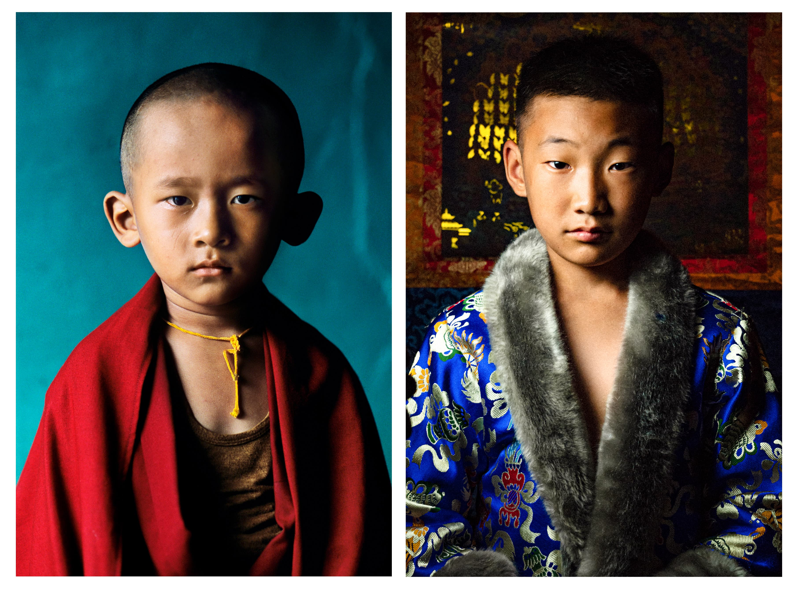

- Steve McCurry | Mai

左边这些照片儿的拍摄者一个个的都名声赫赫，右边这些照片儿都卑微如我，但是，我的这些照片儿和他们的名字摆在一起，也没那么丢人……我不是一个有天赋的人，所以需要多刻苦一点点，平常会稍微多拍一点稍微多看一点，一点而已，但好像仅仅如此，就已经不会一直原地踏步了。

多看，固然是学拍照片儿很重要的一环，但你如果再能知道看一张照片儿应该怎么看，应该看什么，效果肯定会更好。

等下一封信写完咱们就聊这事儿。
