# 第五十三封信-那我们应该从哪儿开始？（三角）

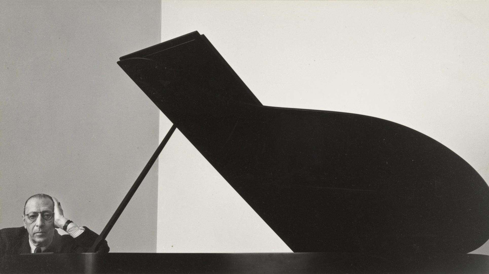

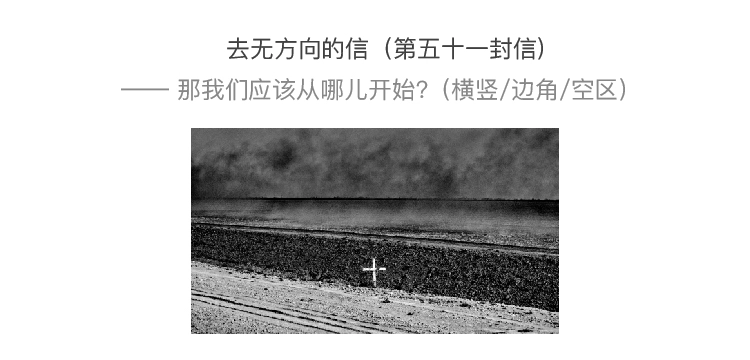

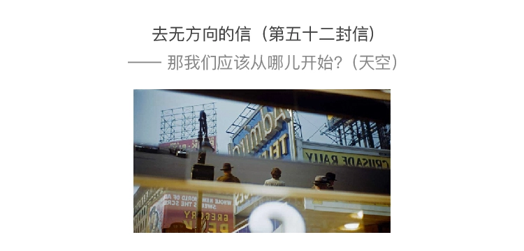

你好哇，

生仔。

上次我们通过讲“天空”，把空区这件事基本摊平了，但我在那些好照片儿里发现的小伎俩，可不止“挡天”这一招儿……所以，这次要再说一个，字很少，图很多，一定好好儿看图。

少废话，先看东西：

这些照片儿都是之前贴过的，我们好像已经非常仔细地看过他们了，也从很多方面分析过他们了，但其实还没完，在这些照片儿里还有一些东西可以看。

九张照片儿来自九位摄影师，地点各异，时代各异，但在拍摄手法上显然都用了景深陷阱，这一点已经不用再多说了，一定会是这样，正经拍这种照片儿的话，非景深陷阱不能为……不过，除了拍摄手法一样之外，不知道你能不能看出来，这九张照片儿还有一个共同点，那就是：都有三角。

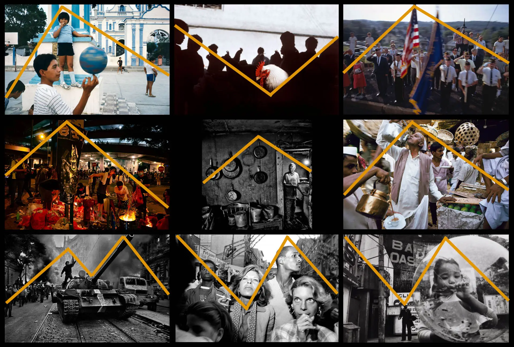

- （防杠注：我这几条线能把事儿讲清楚，但放在一起看确实太丑了，你凑合看吧……）

在很多很多照片儿里我们都能看到这种三角，你可以说这是画面的节奏，可以说这是主次视觉重心的排布，可以说这是在把画面填满的同时让画面有秩序的方式……当然，也可以说这叫构图。

三角大概是拍群像拍多视觉元素的时候最好使的一种构图方式了，因为很容易观察到，而且足够简单就可以让画面在稳定的同时多少产生一些节奏感……另外，更重要的一点是，三角等于是让画面支棱起来了，而支棱起来是要干嘛？是要戳破空区，尤其是画面上部的空区。

画面上部的空区，是不是听起来有点儿熟悉？所以，我们很自然地可以看到很多用三角挡天的照片儿，比如这样：

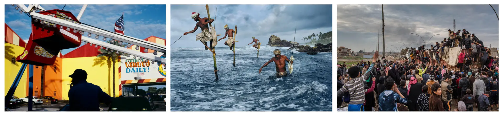

- Constantine Manos/Steve McCurry/Ivor Prickett

多解释一句，这个三角并不是规则，也不是绝对万能的手法，更多的是一种意识。

顺着这个话茬，咱们来说说竖着的照片儿。

手机普及之后，很多人都喜欢拍竖着的照片儿，现在弄得连视频都是竖着的了，因为方便，因为在手机上容易看，但，竖着的照片儿是不是竖着拍就行了？不是，我们来看照片儿：

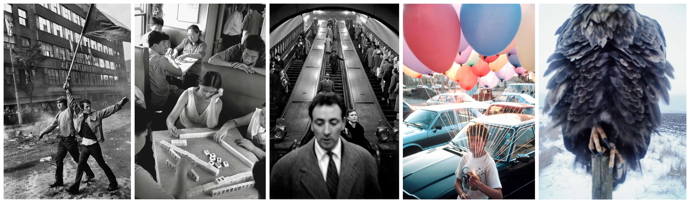

这几张也都是咱们之前贴过的照片儿，再重新看他们一遍。

我们能看到每张照片儿里都有非常明确的主体，护旗兄弟、麻将女、大脸男、气球小子和大爪子……但我们要注意画面上半部分，都是满的，而且是有意义的，甚至，我们可以说，这几张照片儿的上半部分成就了画面的主体。

没有那面旗子，那两个人就毫无意义，而且，画面上半部分就会变成无意义的空区……同样的道理，另一桌麻将和观战的路人、电梯和电梯上的行人、花里胡哨的气球、毛渣渣的羽毛和画框外的鸟头，他们不光是平衡了构图，还丰富了画面信息。

然后，再来看一眼我们平常拍的竖着的照片儿：

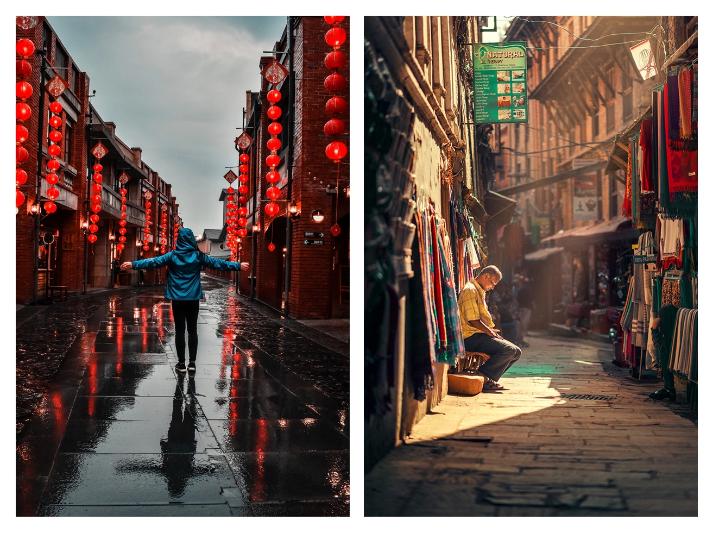

大概就这样儿，要么空区接空区，要么以为有东西，其实乱七八糟的啥也不是，竖着拍照片儿最怕这样……我们为什么要横着拍照片儿？因为上下没啥东西看，但左右有。我们为什么要竖着拍照片儿？因为左右没啥东西看，但上下有。这么想，你大概就好懂了。

说来说去，其实还是在聊怎么处理空区。

最后，我们再看一些照片儿，很多很多照片儿：

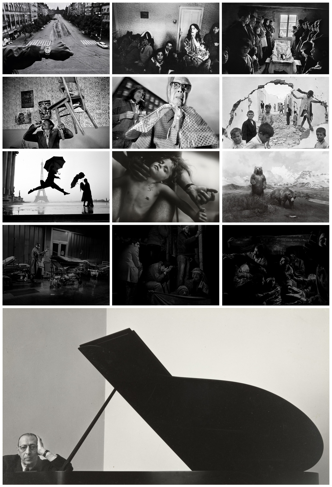

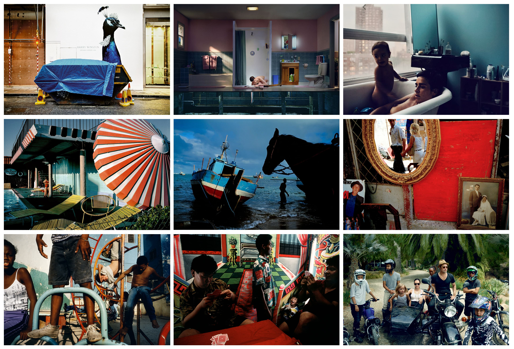

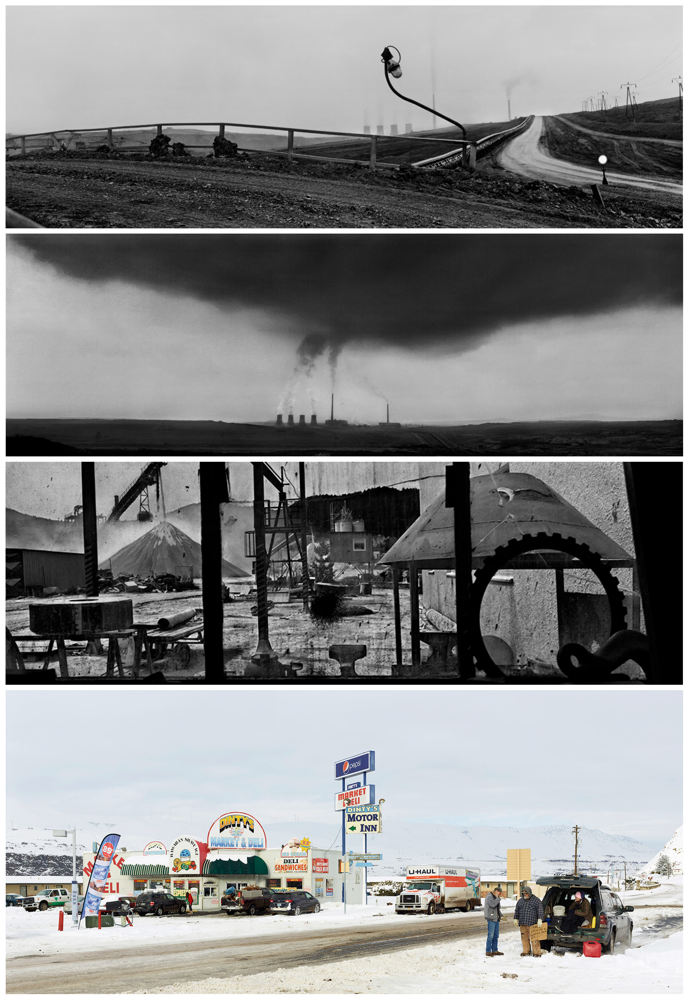

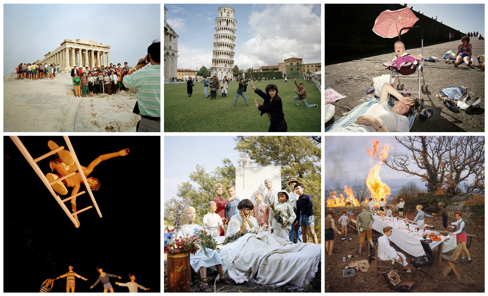

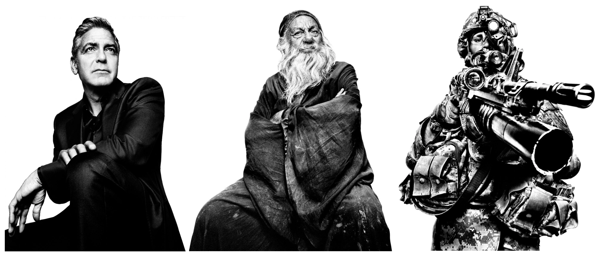

三角无处不在，支棱起来的照片儿数不胜数……咱们之后有时间再继续聊。
