# 第五十四封信-那我们应该从哪儿开始？（五彩斑斓的黑）

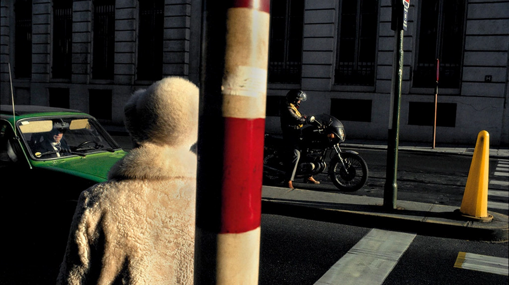


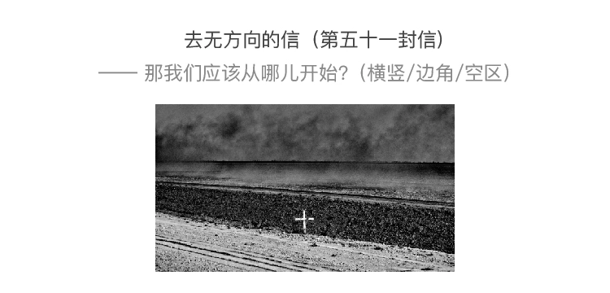

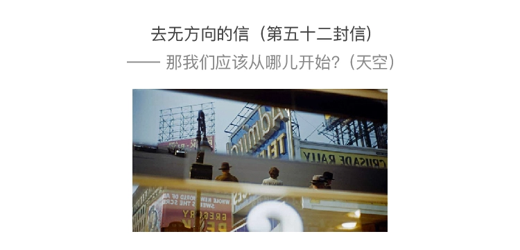

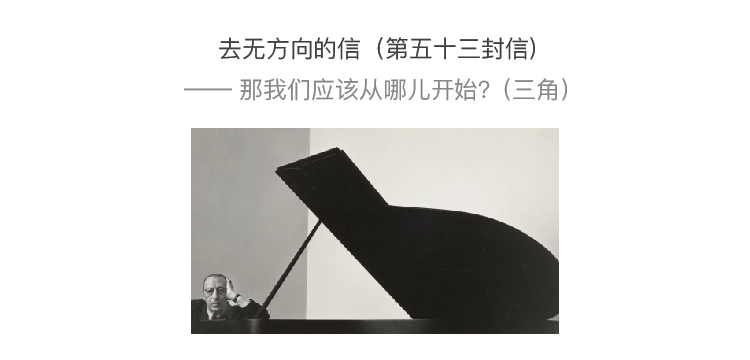

你好哇，

生仔。

构图这个东西是没法儿教的，绝不是什么三分法构图、对角线构图、中心对称构图啥的，但前几封信其实我一直在聊构图。我认为，只要能让画面平衡，或者你知道方法有意让画面不平衡，都是好的构图。这其中只有一些隐隐的迹象，一些大家通识的感觉，但完全没有定式，就像我在上一封信里说的，构图不是某种方法，而是某种意识。

其实，构图这个东西，如果聊下去，还有很多东西可以说，但我不打算再继续了，因为我相信读信读到现在的你已经知道怎么读图了，所以，后面的路，你自己走吧。

构图翻篇了，最后两封《那我们应该从哪儿开始》，要说颜色的事儿。

我们之前聊过什么是体面的颜色，什么是扎眼的颜色，我说关于颜色的一切，我们都是一代接一代被洗脑洗下来的，Rembrandt 和 Vincent van Gogh 影响了 Alessandra Sanguinetti 和Alex Webb，然后他们两位摄影师又影响了后世的摄影师们，或甚至画家。

之前聊这些东西的时候有点虚，讲了讲概念和逻辑，看了看对比组图，但现在，我要更落地地讲一讲这些颜色是怎么搞出来的。

先看图：

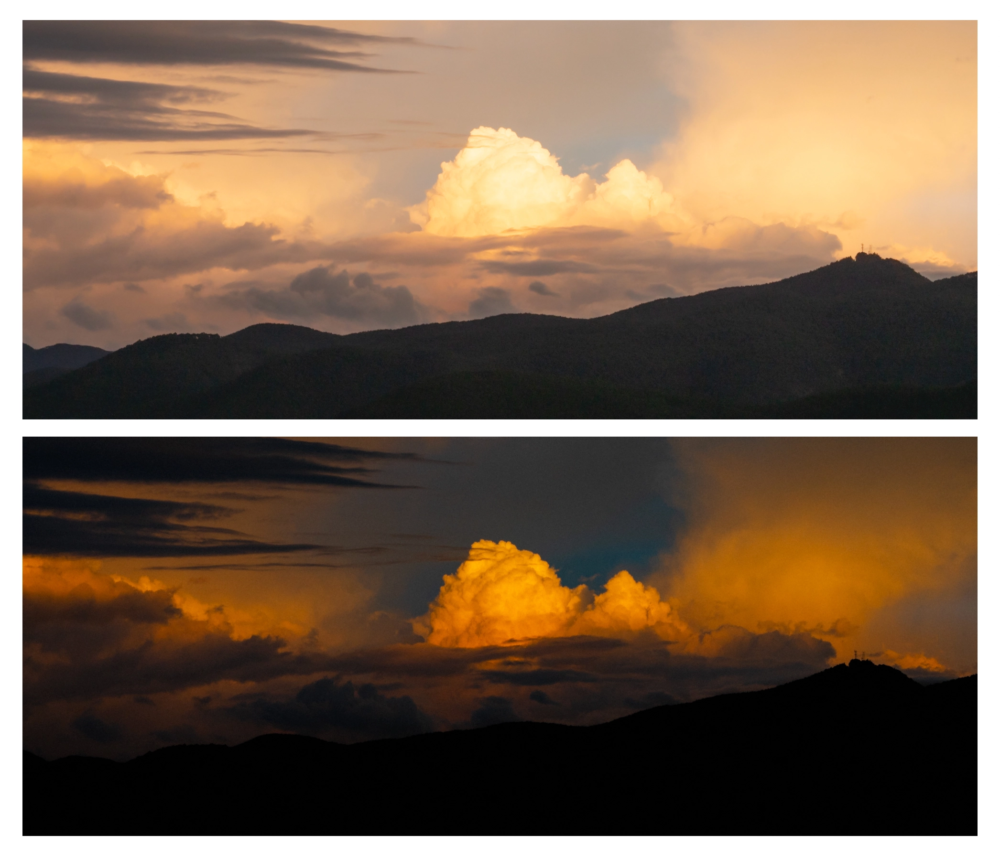

这是之前讲 RAW 图的时候的一张例图，我说 RAW 图可以把稍微过曝的高光区域拉回来，说得好像上面那张图是原图一样，但其实不是这样，当时只是举个例子说明情况，实际下面这张图才是贴近原图的样子……如果我在有强光的环境里拍颜色，第一件事，就是要把曝光降下来。

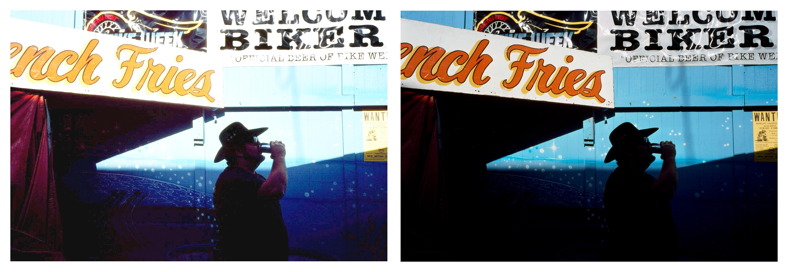

- Constantine Manos

Harry Gruyaert，公认的色彩大师之一，说过这么一句话：

```
“There is no story. It's just a question of shapes and light.”（照片儿里没有故事，只有关于形
```

状和光线的问题。）

这句话基本上是拍色彩的人的共识。就像 Henri Cartier-Bresson 只关心结构一样，你看看那些色彩大师，他们只关心颜色，但同样的，他们也不在意自己镜头里的人。

比如上面这张例图，图里的人对摄影师来说重要不重要？“看不清他”对摄影师很重要，因为摄影师只需要这个人的影子，不需要这个人的任何细节，因为这个人的细节与照片儿无关。所以，这个人无关紧要到不需要是某个特定的人，换一个人也行。摄影师在意的是颜色，在意的是在这么好的颜色氛围里，少了人影，画面不够丰富。而，说回到颜色本身，这种颜色，是靠把曝光降下来拍出来的，在强光强影的环境里，“亮”是不可能拍出颜色的。

再来看一张照片儿：

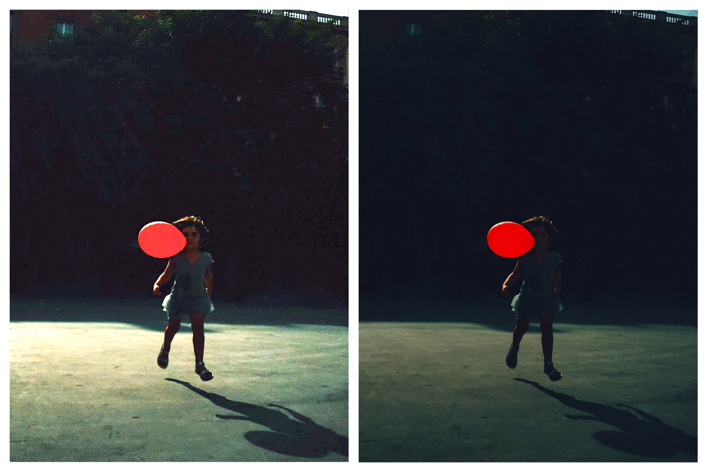

- Christopher Anderson

这是 Christopher Anderson 拍自己的小女儿，右边是原图，左边是我把曝光拉上去了，你能看清 Pia 的脸了，还能隐隐看清后面的绿树和红色的四层小楼，但摄影师没打算让你看清他家姑娘的脸，他只想让你看那颗红色的气球。

那我们就先不看别的，只看气球。左边的气球亮，右边的气球暗，但亮起来的气球远没有暗下去的气球好看，也居然没有暗下去的气球显眼。顺便还可以看一眼地面，那种悠悠的绿色调，在提亮以后，彻底完蛋了。

继续看这张照片儿。看影子和右上角露出来的那一小小块天空我们可以知道，这其实是一个光线条件非常好的环境，但摄影师选择拍得这么暗，为什么？首先，可以解放光圈，其次，可以解放快门，这两点都是拍孩子的时候最需要的东西，最后，可以凸显出来在这个场景里最重要的东西，那就是那颗逆光的气球。摄影师彼时彼刻只想创造一个画面，Pia 在这张照片儿里并不重要，换成别人也行。

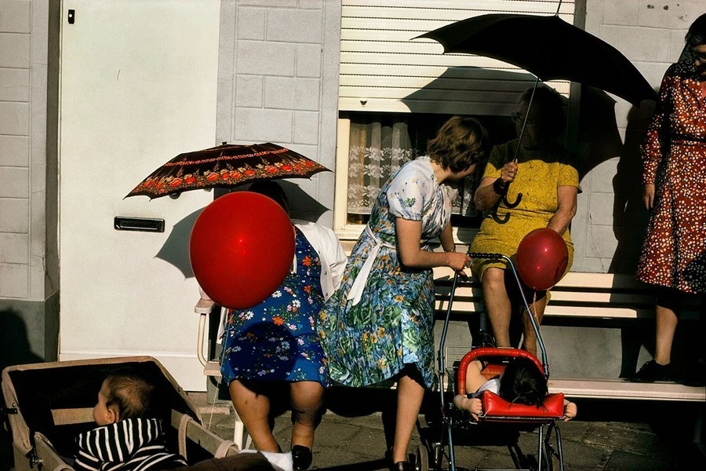

- Harry Gruyaert

Harry Gruyaert 在 Brabant 溜达，他突然举起了相机，请问，是这些人吸引了他么？我猜完全不是，而是红色的气球，摄影师被红色的气球激活了，他脑中会闪过一个念头：“红色！好看！这事儿有戏！”所以才会举起相机碰碰运气，这一切都只因为那颗红气球，而不是其他。

我们来看看 Harry Gruyaert 这个人有多容易被红色激活：

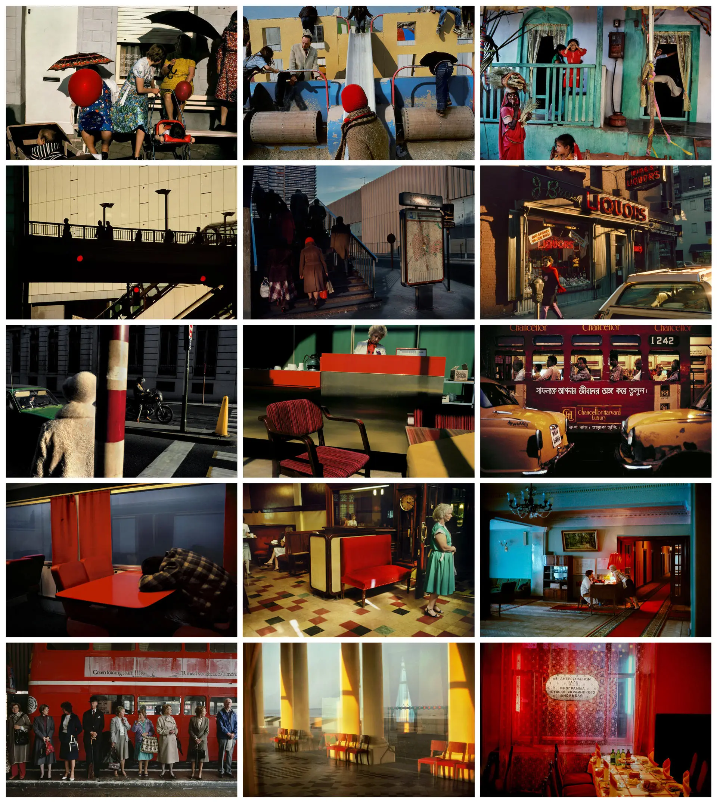

- Harry Gruyaert

这就是拍色彩的人。

拍色彩从来都不是“不是黑白照片儿”，不是有颜色就叫色彩作品……那些正经拍色彩的人，只有颜色可以激活他们，他们眼睛里除了颜色再没有其他东西了。

说回到“暗”的这个话题。

颜色有三个要素，分别是色相、饱和度和明度。色相就是颜色各式各样的样子，就是这个颜色长什么样儿，是红的还是绿的，是黄的还是蓝的；饱和度就是颜色的浓度，也可以说是纯度，饱和度越高，颜色就越鲜艳，饱和度越低，颜色就越趋近于灰色；至于明度，就是颜色的亮度，我可以比较武断地说这么一句话：高明度的颜色不是体面的颜色。

你可以看一眼蜷川实花的照片儿：

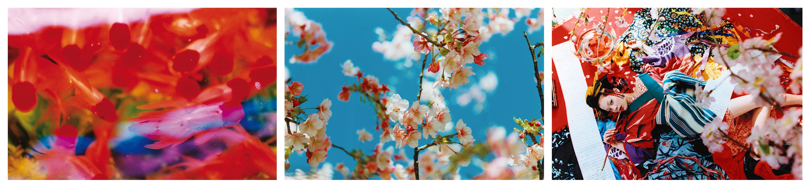

高饱和低明度，这么高的饱和度，为什么依然好看且不油腻，就是因为颜色的明度低……而很多扎眼的照片儿，我们会误认为那只是饱和度太高了，其实更多的是明度的问题。

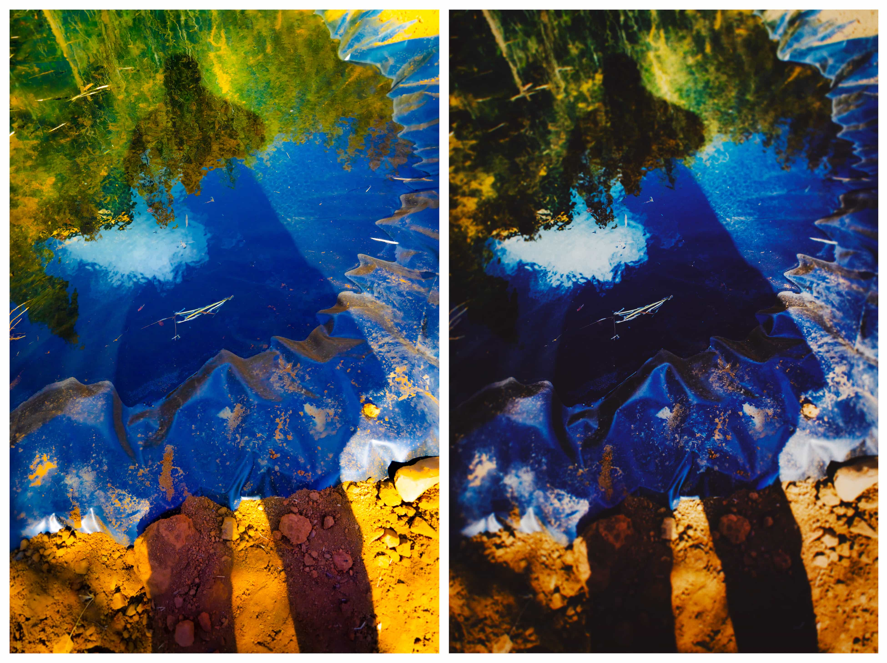

这个话题不再继续往下讲了，你可以自己去感受。

说回来，我刚才提到，如果想在强光强影的环境里表现颜色，需要把曝光降下来，需要让画面里的高光区域曝光正常，麻麻烦烦的，但其实，强光强影的环境本来就不是最适合表现颜色的环境……或者可以这么说，如果想在强光强影的环境里表现颜色，非常依赖环境本身，环境本身必须特别花里胡哨，所以 Alex Webb 才往古巴跑，所以 Harry Gruyaert 才往摩洛哥和印度跑。

那什么光线条件最适合拍色彩呢？多云阴天傍晚下雨下雪。

一想到这些场景，你可能会觉得很平淡，不抢眼，但相机最喜欢这样的环境。之前咱们说过，人眼的宽容度是很高的，对于人眼来说，光线再强，影子再黑，我们也能看清各种颜色，不太会因为白花花的强光和黑漆漆的阴影就分辨不了颜色，但相机不行。所以，拍色彩，对相机最友好的环境是没有强光强影的平光环境。

在这种环境里，颜色最能表现出来它们本身的样子，或者说，稍微有一点颜色，就能拍出来。淡淡的肉粉色、淡淡的米黄色，淡淡的天青色等等，在强光下，不会有什么太大的分别，尤其是在黑压压的阴影的衬托下，他们都会趋近于白色，而如果你感知不太到这些淡淡，你就体会不到色彩他细腻的一面。你看那些在强光强影里拍色彩的人，他们的照片儿里从来不会有淡淡，因为淡淡在那种照片儿里是很难被感知到的。

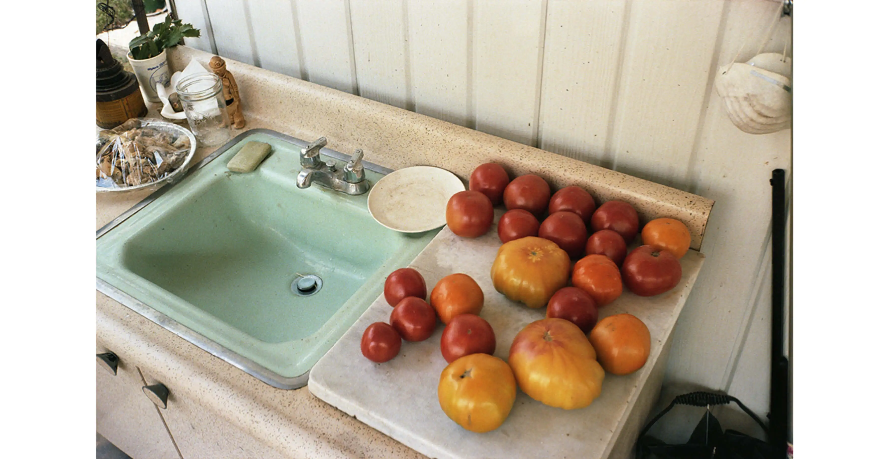

- William Eggleston

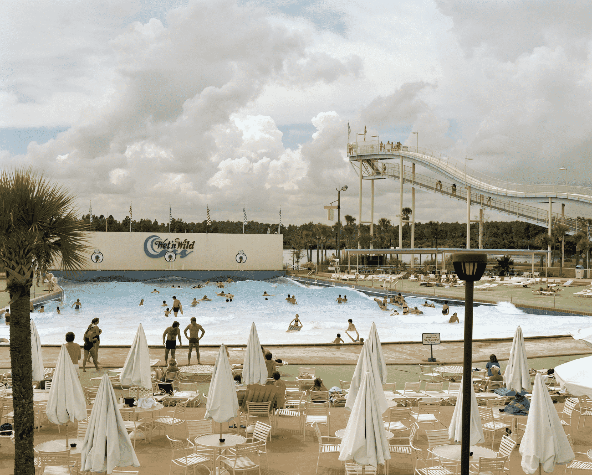

- Joel Sternfeld

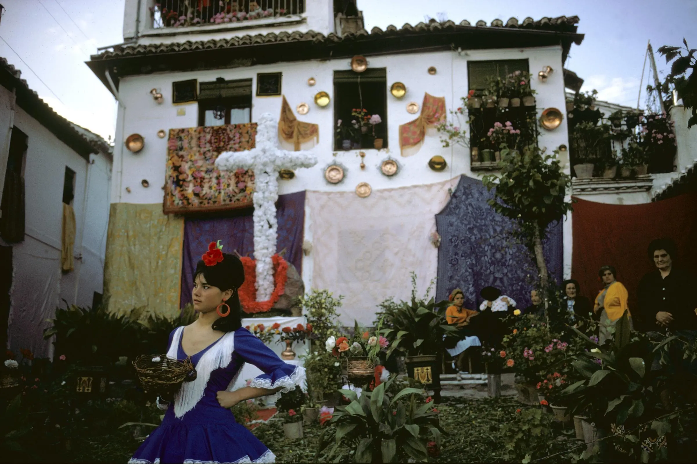

- Stephen Shore

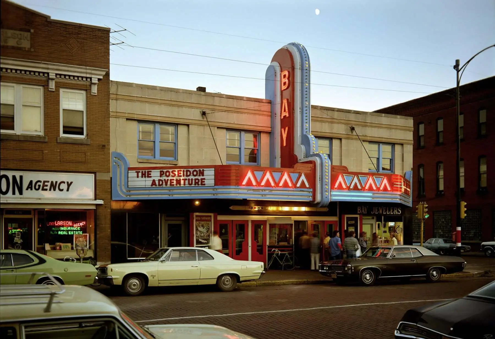

- Saul Leiter

看这些照片儿，淡淡的，但是多姿多彩……咱们下次继续聊。
