# 第十九封信-“要么横着涂，要么竖着涂”（上）

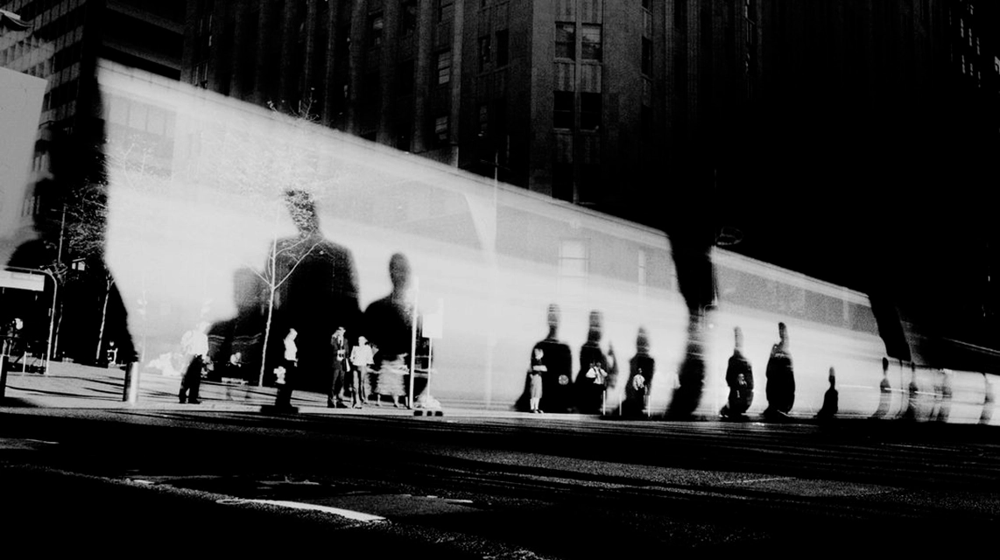

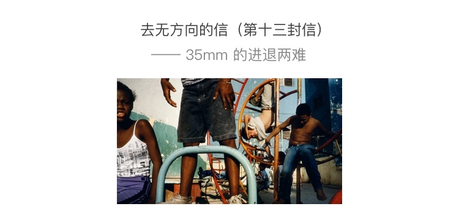

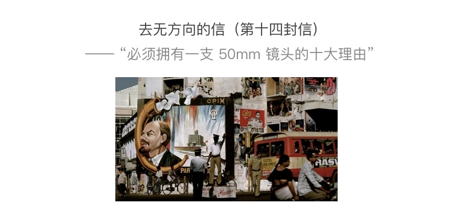

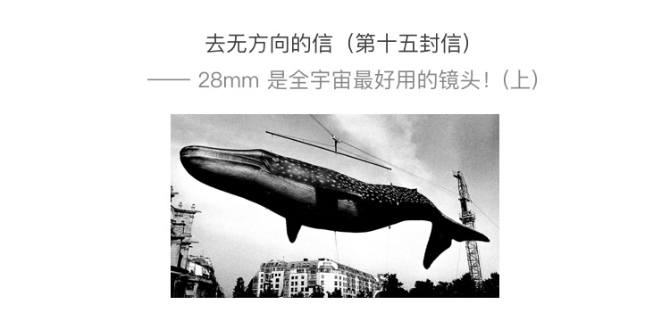

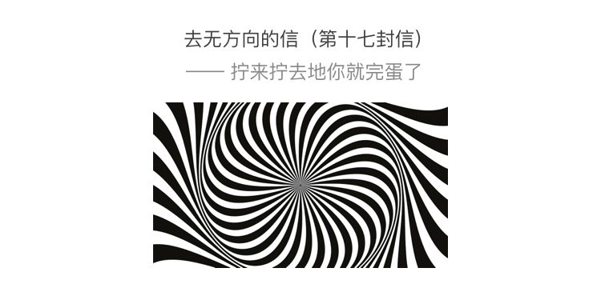

生生：

你好哇。

之前咱们聊了聊定焦镜头，聊了聊变焦镜头，中间还提到了“距离”和“框”这两个概念……所以，这次一开始，先来回顾一下我之前到底都讲了些啥。

我们聊“定焦镜头”的时候说过：定焦镜头没法儿拧来拧去让画面放大缩小，但他们可以靠咱们前后走动当变焦镜头来用，各个焦段有各个焦段的视觉特点，各个距离有各个距离的视觉特点……但是，前后走动并不代表着你想近就近，想远就远，因为你得“要么横着涂，要么竖着涂”，不然容易涂花。

我们聊“变焦镜头”的时候说过：变焦镜头可以拧来拧去让画面放大缩小，但如果想用好他们，我们偏偏不能拧来拧去（长焦除外），我们反而需要把他们当定焦镜头来用，不然你就永远都搞不清他们的“框”。

我们聊“距离”的时候说过这么几点：

1. 绝大多数情况下，“距离”是决定一张照片儿好坏最关键的密匙；

2. 如果你用定焦镜头，你离一个东西的距离决定着这个东西在你画面里的大小占比；

3. 如果你用定焦镜头，如果一个东西在你画面里的大小占比没有改变，说明你离它的距离也没有改变；

4. 看同一个职业摄影师拍的不同照片儿，可能正是因为画面里各种视觉元素的大小占比一样，所以才尤其显得构图方式统一，有强烈的个人风格；

我们聊“框”的时候说过这么几点：

1. “框”就是照片儿的四条边；

2. 你需要对“框”里的一切负责，你需要把所有你不想负责的东西都隔在“框”之外；

3. 你得非常熟悉你常用的几个焦段的“框”，你得知道你一举起相机，能拍到多大范围；

咱们这次就是要把所有这些东西都串起来。好，捋一捋逻辑：

第一步：变焦镜头其实是几个定焦镜头的集合，所以甚至可以这么说，这个世界上就没有变焦镜头；

第二步：定焦镜头的所谓“变焦属性”给了你可以走近拍或走远拍的自由，但这并不意味着你拍这张照片儿的时候想往前，就往前了，你拍那张照片儿的时候想往后，就往后了。而是说，你要找到合适自己的距离，然后，不管拍什么，都基本保持这个距离不再怎么变，或者说，在这个距离以外的东西，都跟你没有关系；

第三步：如果能保证镜头焦段和距离基本不变，那么“框”的取景范围就基本不变，画面中的视觉元素（人、车、花草、路牌、房子、小畜生们……）的大小占比也基本不会变；

第四步：所以，如果我们知道一张照片儿是用什么焦段的镜头拍的，我们就可以通过画面中视觉元素的大小占比反推出“距离”；

第五步：一旦推出距离，再配合最之前说的“阳光十六法则”，我们就可以推出更多有关和无关技术的信息，这个咱们之后再说。

来看照片儿。

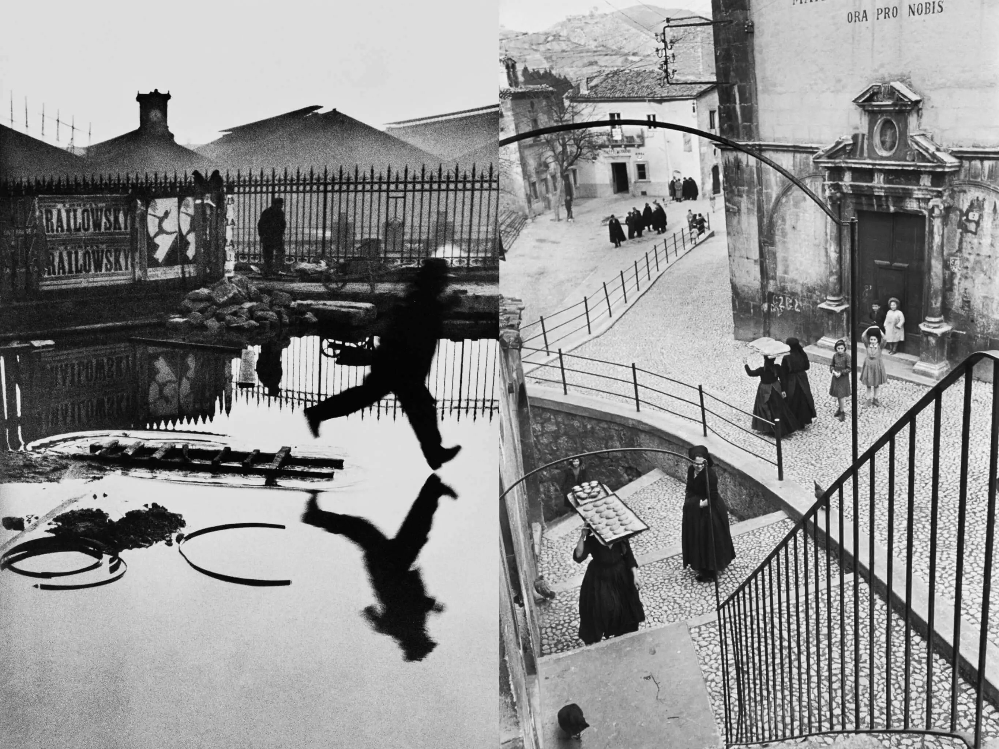

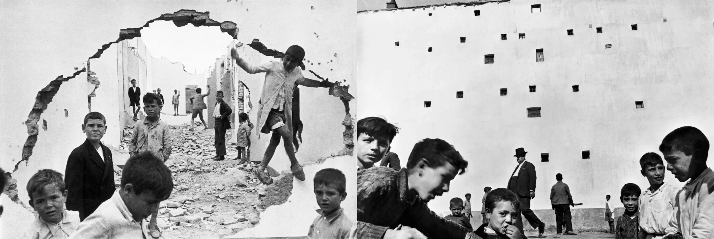

- Henri Cartier-Bresson

Henri Cartier-Bresson 用过 35mm 和 50mm 镜头，但他拍的照片儿，大都很像 35mm 的视角，说明他就喜欢这个视角。

他虽然喜欢 35mm 的视角，但他不喜欢 35mm 的距离，所以最开始他用 35mm，后来改用了50mm。如果想让 50mm 镜头拍出 35mm 镜头的视角，他就要往后退，一旦退远了，这个“法国胆小鬼”的心里就舒坦了。

所以你先看看他这些照片儿里的人，看看这些人在画面里的大小占比。然后咱们马上再来看看Bruce Gilden。

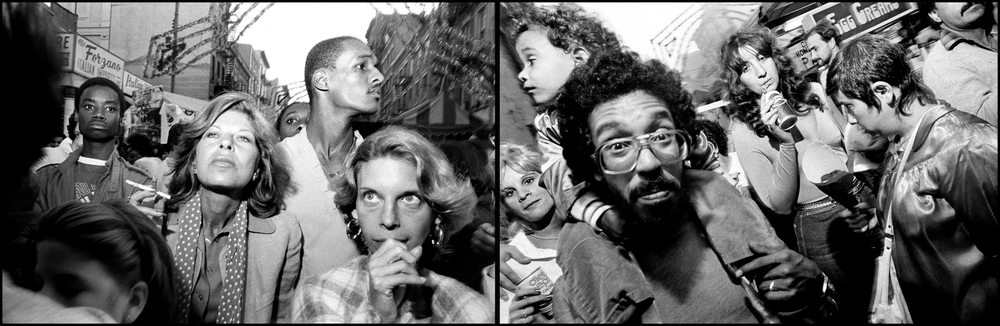

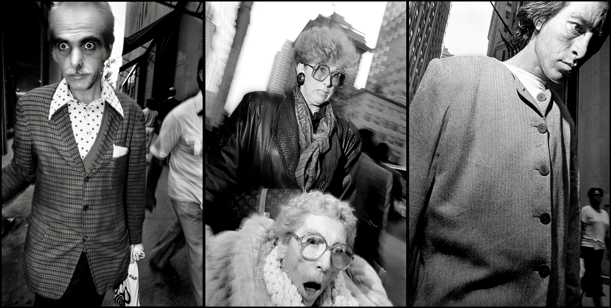

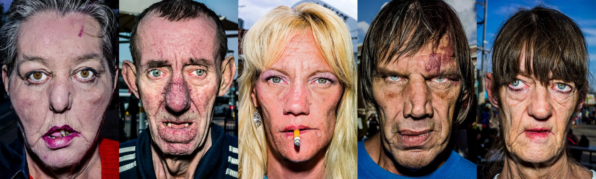

- Bruce Gilden

Bruce Gilden 用 28mm 镜头近摄直闪，我说过，28mm 超级自由，夸张点说能相当于一支 21-85mm 的变焦镜头，想近就近，想远就远。但 BG 这个“纽约街头最没有道德的人”就是不能离远了拍，他就是要在大概 1m-1.5m 的这个距离拍，甚至近到半米。

50mm 本来应该把人拍得很大，但 Henri Cartier-Bresson 偏偏要拍小人儿，28mm 本来应该人小景大，但 Bruce Gilden 偏偏要拍大脸。他们对于镜头的理解，显然跟民间谣传的那种思路不一样。

再来看 Trent Parke，也是 28mm 镜头，镜头跟 Bruce Gilden 一样，但这个“澳大利亚最分裂的人”跟“纽约街头最没有道德的人”的距离选择显然不一样，他更贴近我们比较普遍的对于28mm 的认知。但是 TP 的影调让我们很难相信这是风景如画的澳大利亚。

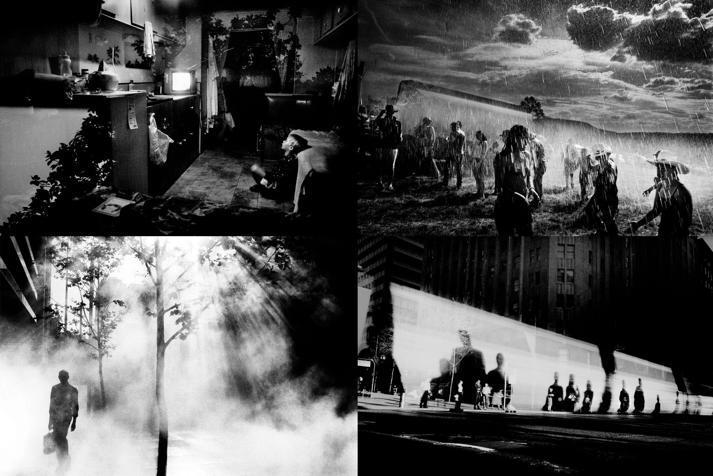

最后，我们看回 Alex Webb。

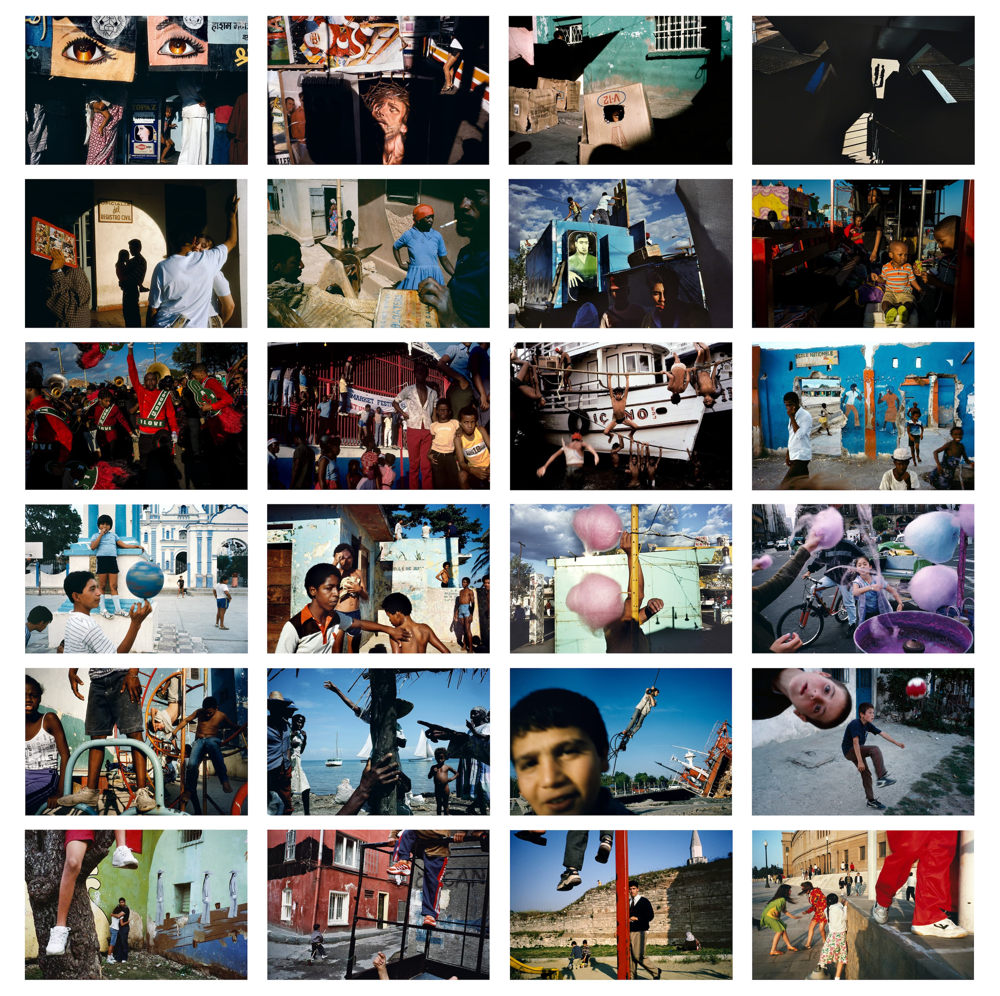

- Alex Webb

Alex Webb 就是把 35mm 用得特别像 35mm，我当时提到他的时候讲过，对于 Alex Webb 来说，他心里觉得最舒服的距离大概是 1.5m-3m。

你看，一切的一切都是关于距离的，当焦段和距离都固定的时候，其实“距离”就是“框”，而“框”就是你的这张照片儿，所以“距离”就是你的这张照片儿。

最后，我们再多看一眼 Alex Webb，我贴了他好多好多照片儿，而且是按照特别的顺序编排的，我可不是吃饱了撑的，所以你可一定得放大了一张一张地看看。看这些照片儿的时候，我不禁会思考一个问题，我也特别想让你跟我一起想一想这个问题：Alex Webb 这个人，到底是拍了很多很多照片儿？还是他其实就只拍了那么几张照片儿而已？

咱们之后有时间再继续聊。
