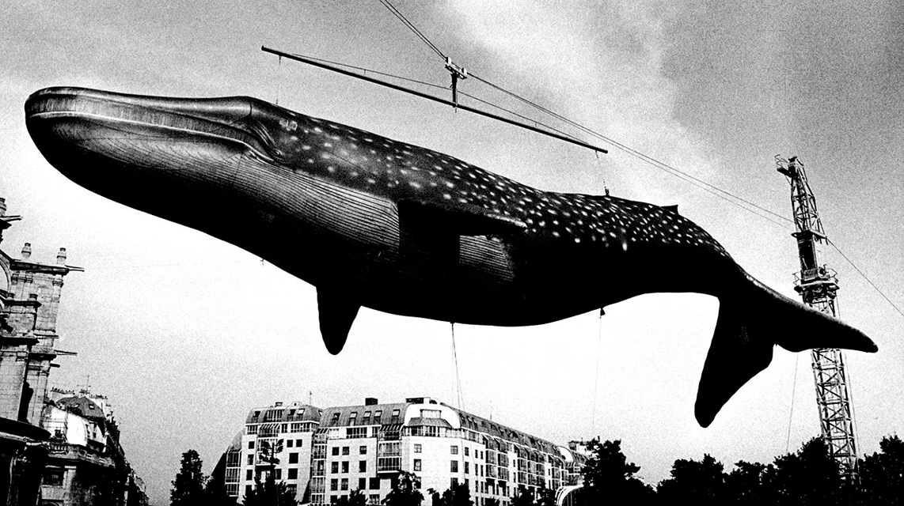
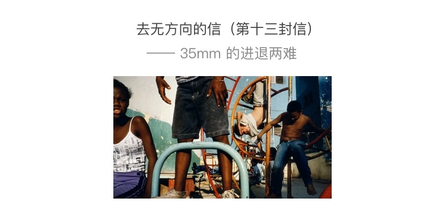
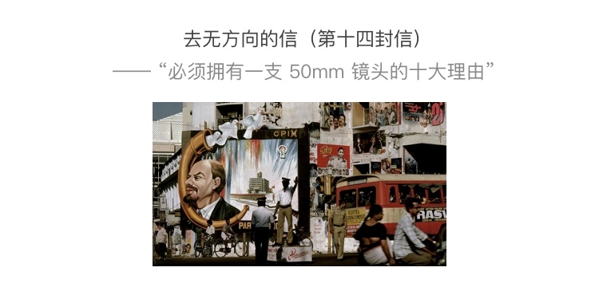
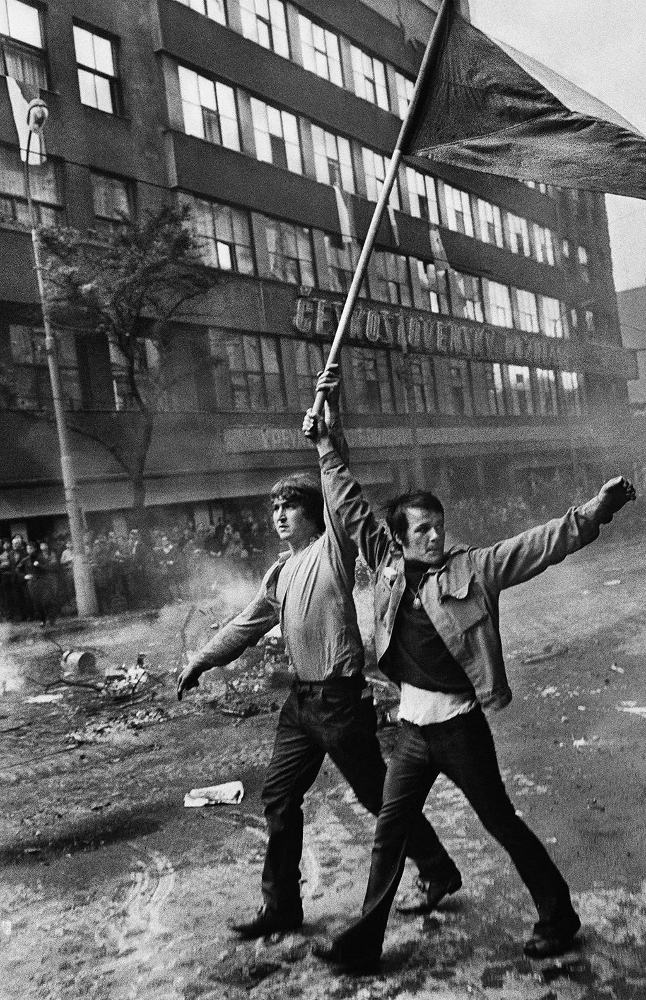
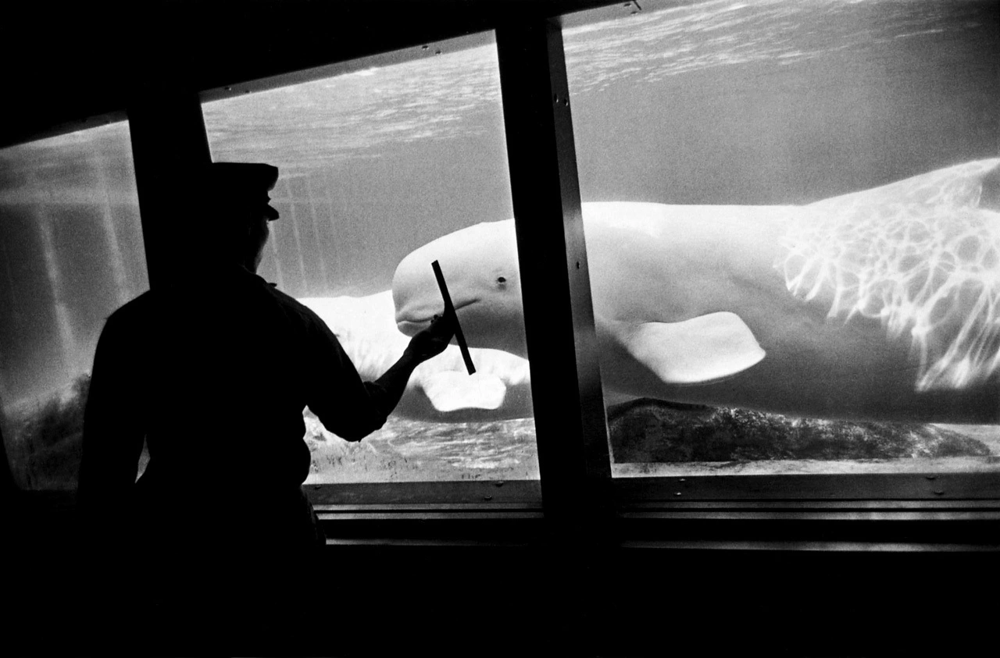
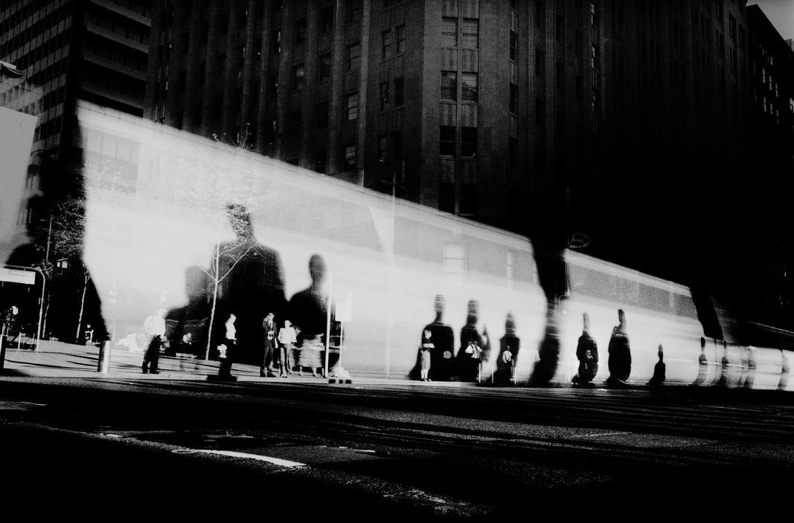
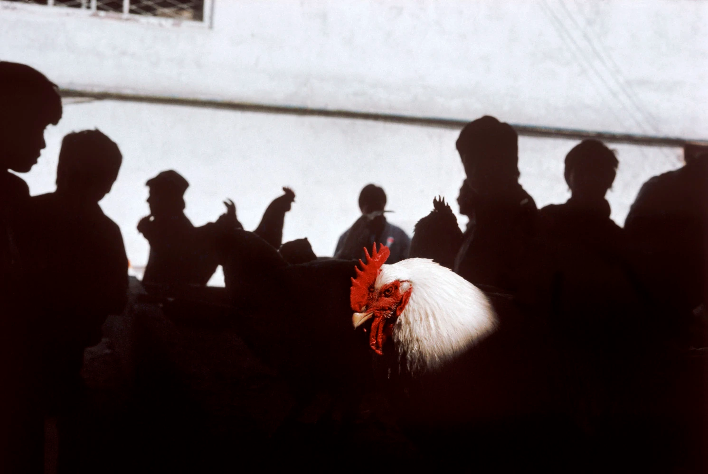
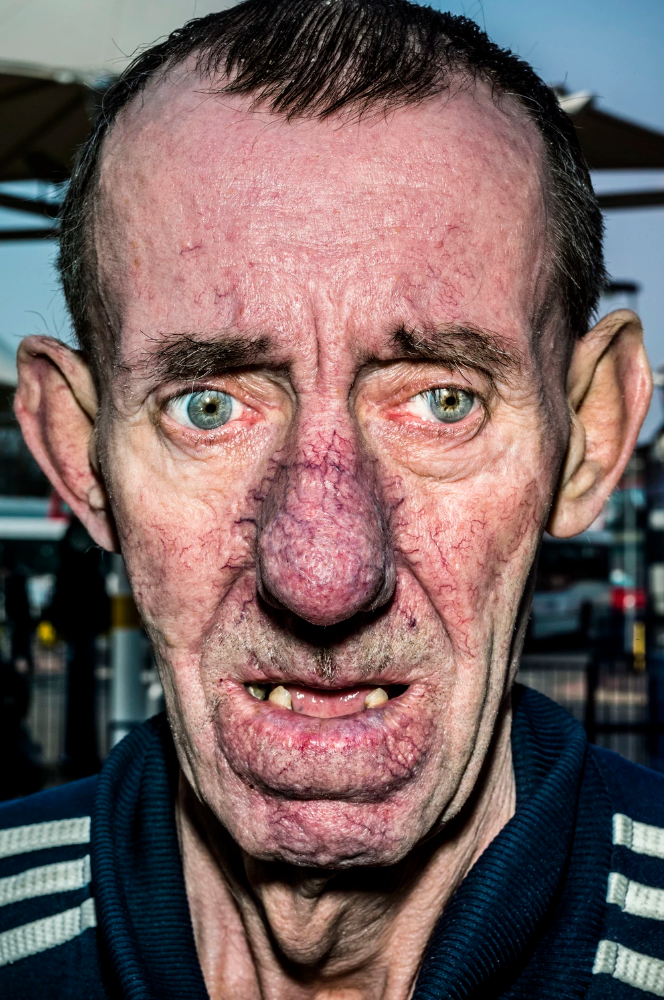
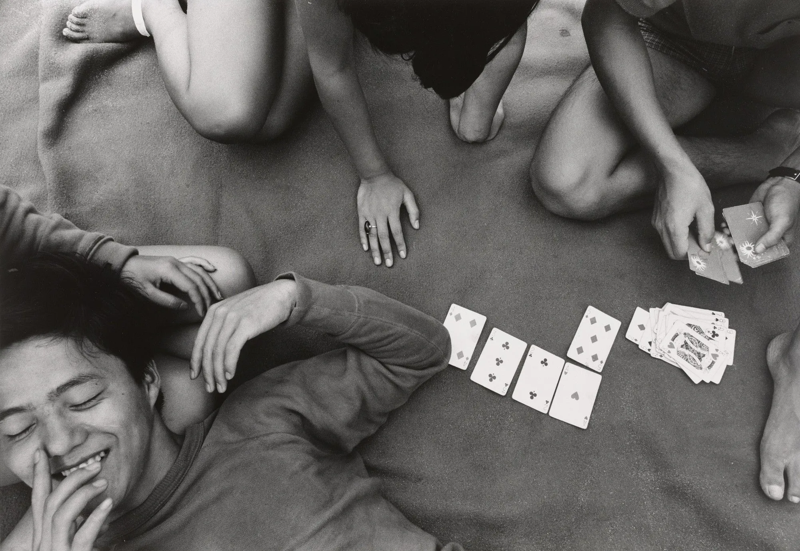
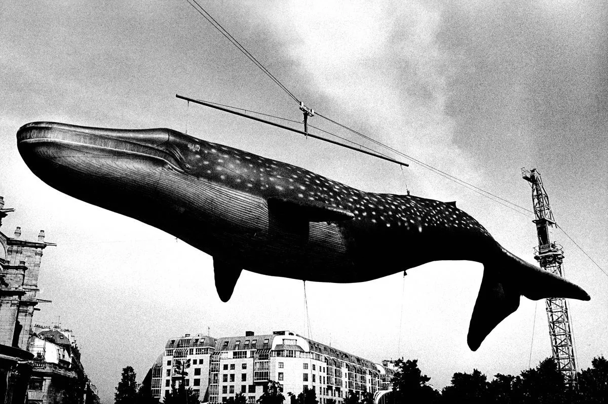

# 第十五封信-28mm是全宇宙最好用的镜头！







生生：

你好哇。

终于，到 28mm 了，哈！

不说废话，就像上次说 50mm 的时候一样，咱们先来看看这些惯用 28mm 镜头的人说的话：

```
" I don't pretend to be an intellectual or a philosopher. I just look." —— Josef Koudelka
```

- “我不想假装自己是什么知识分子，或者哲学家什么的。我就是，看，而已。” —— 约瑟夫·寇德卡（防杠注：我知道寇老师用的是 25mm 镜头。）

```
" I don't have anything to say in any picture. My only interest in photography is to see
```

- what something looks like as a photograph." —— Garry Winogrand“我完全没打算用我的照片儿去表达点儿什么，我对摄影这个东西唯一的兴趣，就在于我想看看我拍的那些东西变成照片儿以后长什么样儿。” —— 盖瑞·温诺格兰德

```
" I'm always'wired', always awake, things are always rattling through my mind. I
suppose I've started to calm down a little bit, but in that first ten-year period that I was on
```

- the streets of Sydney I was just manic. Insane. " —— Trent Parke“我这个人一直挺怪的，什么时候都特警醒，脑子里整天嗖嗖过事儿……我觉得最近我开始有点儿平静下来了，但最早那十年在悉尼街头拍照片儿的时候，我基本就是个精神病儿，躁，疯得很。” —— 特伦特·帕克

```
" Don't be afraid to take bad pictures, because good pictures are the mistakes of bad
```

- pictures." —— Gueorgui Pinkhassov“不要怕拍到那些坏照片儿，因为好照片儿就是那些拍坏了的坏照片儿。” —— 格奥尔基·平克哈索夫

- "I have no ethics. " —— Bruce Gilden“我没有道德。” —— 布鲁斯·吉尔顿（防杠注：后来在一个访谈里，他说这句话显然是一种挖苦的说法。但我觉得我基本能明白他的意思，他这句话既不是当时字面上的那个意思，也不是他在访谈里澄清后的那个意思）

看，比用 50mm 的人病得还严重。

28mm 是我最心爱的焦段了，上面提到的这五个人在我的心爱排行榜单上也是很靠前的几位，光是看到他们几个人的名字我就激动得想当街起舞！28mm 太精彩了（包括寇老师用的25mm），用 28mm 的人也太精彩了（包括用 25mm 的寇老师），继续，不说废话，咱们马上看照片儿。



- Josef Koudelka



- Garry Winogrand



- Trent Parke



- Gueorgui Pinkhassov



- Bruce Gilden

我之所以喜欢 28mm 镜头，是因为他最自由。

你应该还记得我反复提到的“距离”，我们来想一下儿：我用 50mm 镜头，横构图，如果我要拍一个人的胸像，我大概距离这个人 1.5m 远；如果我想拍他的半身像，我大概要再往后退1m；如果我想拍他的全身像，我大概要再往后退 2m；如果我想拍一张人小景大的照片儿，让人物融入环境，同时更多地传递一些环境信息，我大概需要退到十米开外了。

如果我用 35mm 镜头，情况稍好一些，但这个现象依然存在。

至于 28mm 镜头，在半身像的距离，往前走一小步就是大头像，往后退两小步就是全身像，再退两步就是大环境的环境人像。

50mm 镜头控场能力强，但很多时候，我的 28mm 多往前走两步就能干掉 50mm。35mm 镜头前后游走相当于 24-55mm 的变焦镜头，但我的 28mm 前后游走，说夸张点儿，相当于 21-85mm 的变焦镜头，所以我的 28mm 只要前后微微游走就能干掉 35mm。

看上面的照片儿你应该也能看出来，比如第一张寇老师 (Josef Koudelka) 的照片儿，如果当时是布老师 (Henri Cartier-Bresson) 在布拉格的街道上拍，他把拍人的距离都安排好了，最合适的构图比例，安排得明明白白的，但突然有俩人儿高举着大旗走过来了，布老师得气死，他用50mm 镜头，退无可退……这时候，寇老师往后微撤一步，把相机一竖过来，拍上了。

对于 28mm 镜头来说，基本没有什么画面不能在 3m 内解决，基本没有什么画面不能在五步内解决。

另外，28mm 镜头能创造出可被控制的视觉冲击力。

24mm 以下的镜头，虽然比 28mm 更自由，但它们有点儿自由大发了，很难控制背景，而“控制背景”对一张照片儿来说非常重要；50mm 以上的镜头非常容易让画面化繁为简，但它们很难创造出视觉冲击力，也很难让阅图的人体会到那种临场感。

而很多我们日常拍摄的照片儿，恰恰非常需要那种临场感。

我们再来看两张照片儿：



- 东松照明



- 森山大道

不知道你记不记得那些用焦段稍微长一点儿的镜头拍的毕业照，看上去工整规矩，不知道你对那些用长焦狙到的小鸟儿有没有印象，看上去近在咫尺……但工整规矩的毕业照，除了你主观赋予它的感动，它本身并没有任何情绪，而看上去近在咫尺的小鸟儿，你心里很清楚，它们其实远在天边，没有触手可及的感觉。

临场感，就是我看到两条大腿的一瞬间，看到在半空中遨游的大鲸鱼的一瞬间，我感觉我就在现场。

最后，我要给你抛出一个问题：我说 28mm 非常自由，你看看 Bruce Gilden 拍的那张大脸，超级近，视觉冲击力超级强，你再看看 Trent Parke 拍的街道，在大环境的压迫感下鬼影幢幢，感觉 28mm 确实进可进退可退。

但等我们真用上 28mm 镜头的时候，我们真的可以进可进退可退么？

我上幼儿园的时候有过这么一件事儿：

有一次老师教我们给图片上色，老师说“要么横着涂，要么竖着涂”，她的意思是如果决定横着涂就一直横着涂，如果决定竖着涂就一直竖着涂，不然会涂花……但我当时完全理解错了，所以我涂的时候，虽然坚决执行了老师的命令，要么横着涂，要么竖着涂，反正确实没有斜着涂，但结果就是被老师说“这什么脑子？”

在这件事儿里，我现在看，我认为她表述不清，而我也确实是脑壳有包，所以，为了我能不再犯我幼儿园老师的错误，也为了你能不再犯我当年犯的傻，这个问题，我会马上找机会说清楚。

这一次我们的标题是 —— 28mm 是全宇宙最好用的镜头！，我觉得很有必要预告下一次的标题：28mm 是全宇宙最好用的镜头？

千万别着急觉得我偏激，咱们还有很多东西都没有讲到呢。

下次聊。
