# 第十六封信-28mm是全宇宙最好用的镜头？


- ↓


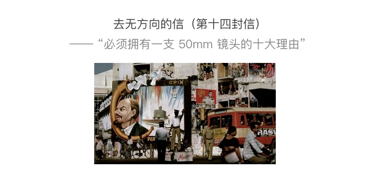

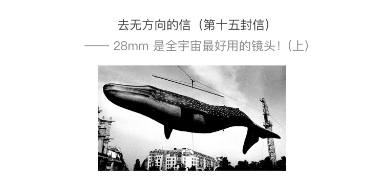

生生：

哈，你好哇。

开个玩笑，然后紧接着咱们就开始说正经的。

我之前说 35mm 镜头是没有什么特点的镜头，进可为 50mm，退可为 28mm，所以他是最好用的，也是最难用好的镜头；

我之前说 50mm 镜头是控场之王，用 50mm 的人都是有强迫症的控制狂，而且他们只关心场控，不关心人类；

我之前说 28mm 镜头是全宇宙最好用的镜头，因为他非常自由，于他而言，日常中基本没有什么场景是不能在五步内解决的。

但真是这样么？35mm 真的没有特点么？用 50mm 的人真都“有病”么？28mm 真是全宇宙最好用的镜头么？

这所有的一切，都只是我非常个人化的看法。

跟“阳光十六法则”这种恒常不变的宇宙法则不一样，如果过两年我再重新写这些东西，天知道我会不会把 18-200mm 或 24-240mm 这种一镜走天下的“狗头”认做是全宇宙最好用的镜头呢。

而且，我为了向你证明我是对的，不惜厚着脸皮请各位大师帮我站台，处心积虑地以他们的原话为基础，然后在断章取义后拿给你看。

比如，Marc Riboud，一个用 50mm 镜头的人，我说他们用 50mm 镜头的都是控制狂，但他比较核心也比较爱说的一个理念其实是：Surprise。

```
" I'm often asked: Did you get what you wanted? But how should I know what I wanted?
```

- A photo is an encounter, a surprise. The eye is made to see and not to think…A goodphotograph is a surprise. How could we plan and foresee a surprise? We just have to beready." —— Marc Riboud“我经常被人问到：你有没有拍到你想要的画面？但问题是，我怎么可能知道我想要什么？一张照片儿就是一场邂逅，是一个偶发的意外。我们的眼睛是用来看东西的，不是用来想事儿的……一张好的照片儿绝对是一个惊喜，我们怎么可能计划惊喜呢？又怎么可能预知惊喜呢？我们能做的只有时刻准备着。” —— 马克·吕布

老人家看上去显然不是什么控制狂，所以后来他换成 35mm 镜头了……哦？好像又一次，从另一个角度，证明了我的观点是对的，哈！

35mm 的自然视觉感基本没有其他焦段的镜头能比，用 50mm 镜头的人没有病，28mm 镜头也当然不是全宇宙最好用的镜头，因为如果这么搞：

Saul Leiter 就没镜头用了；就没有 Christopher Anderson 的 COP 系列和 Martin Parr 的Beach Therapy 系列了；Ernst Haas 就没法儿在 21mm、28mm、50mm、90mm、135mm和 180mm 之间换着玩儿了，Ed van der Elsken 也没法儿在 135 相机和中画幅相机之间换着玩儿了，就更不要说大画幅这种我们基本接触不到的设备了；我们也看不到马头星云和创世之柱了；这个世界上就不会有 National Geographic 这样精彩且油腻的杂志了；也不会有Nikon’s Small World 这么精彩的摄影比赛了。

说回到我们身边，Apple 就没必要往 iPhone 身上安三颗摄像头了。

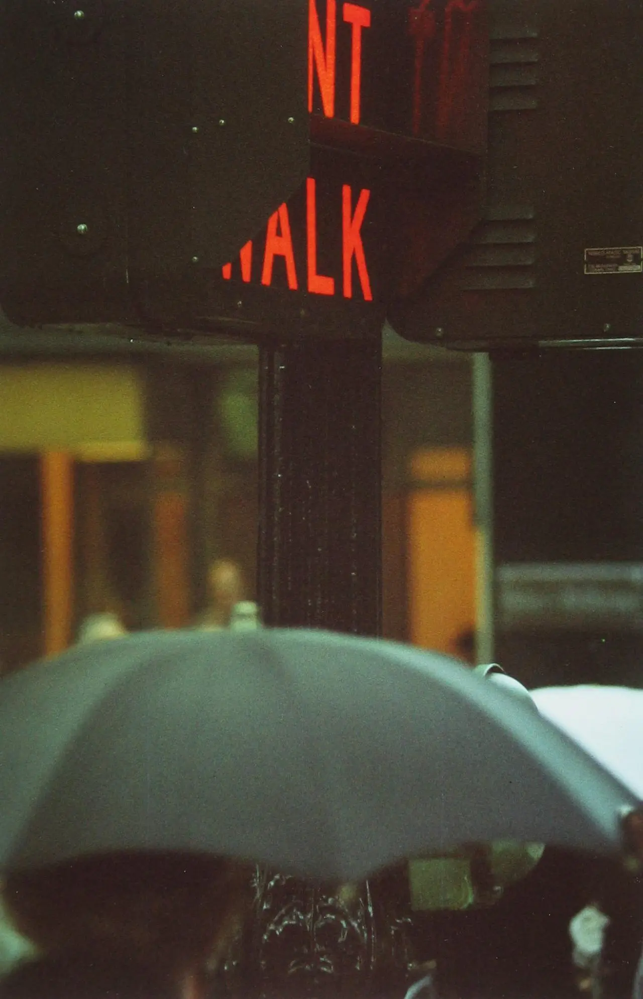

- Saul Leiter


- Christopher Anderson

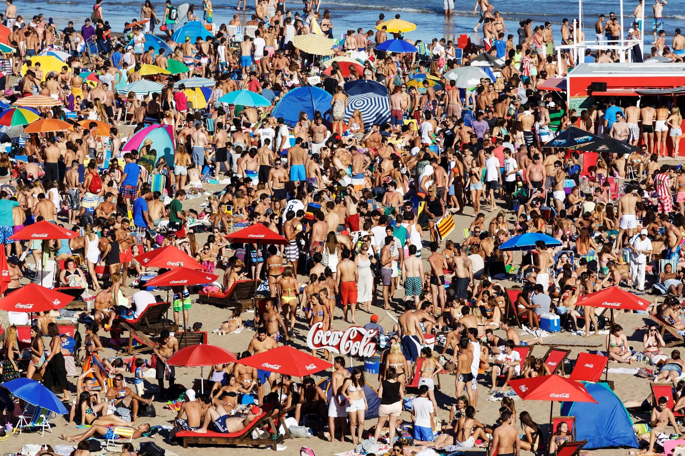

- Martin Parr

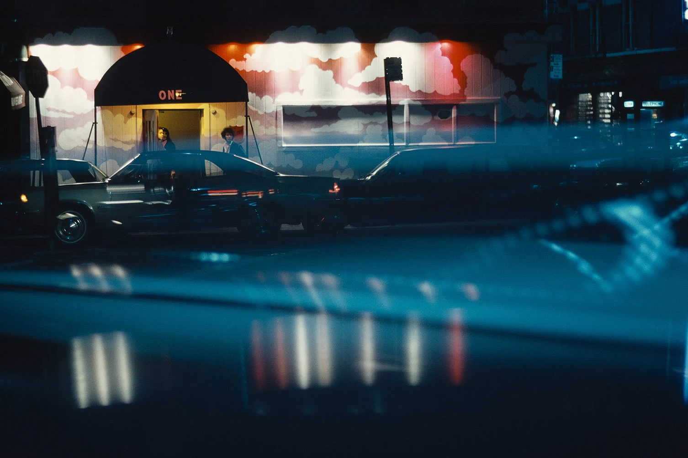

- Ernst Haas

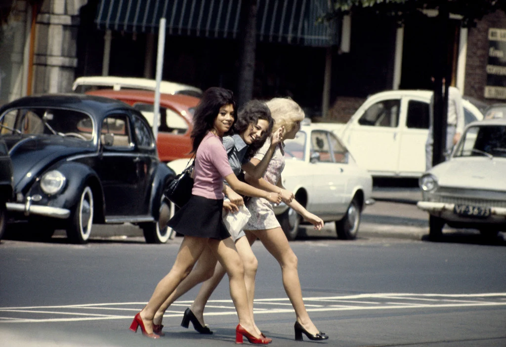

- Ed van der Elsken

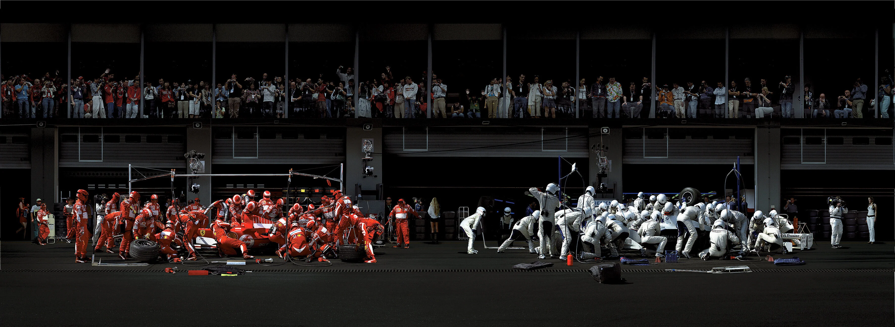

- Andreas Gursky

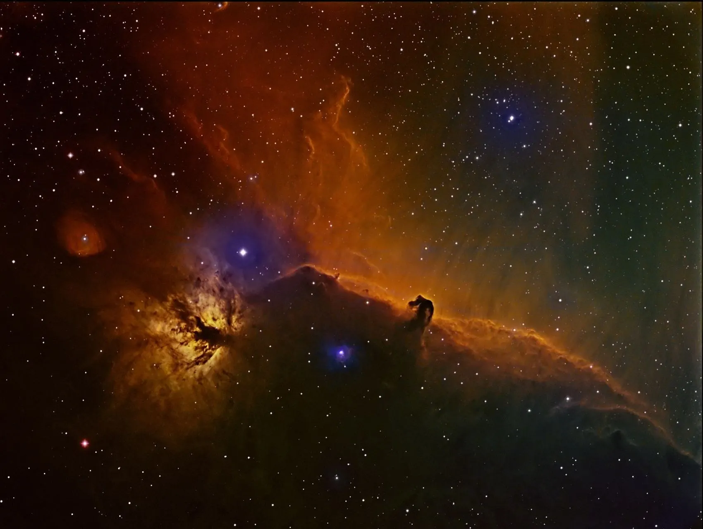

- Horsehead Nebula（马头星云）

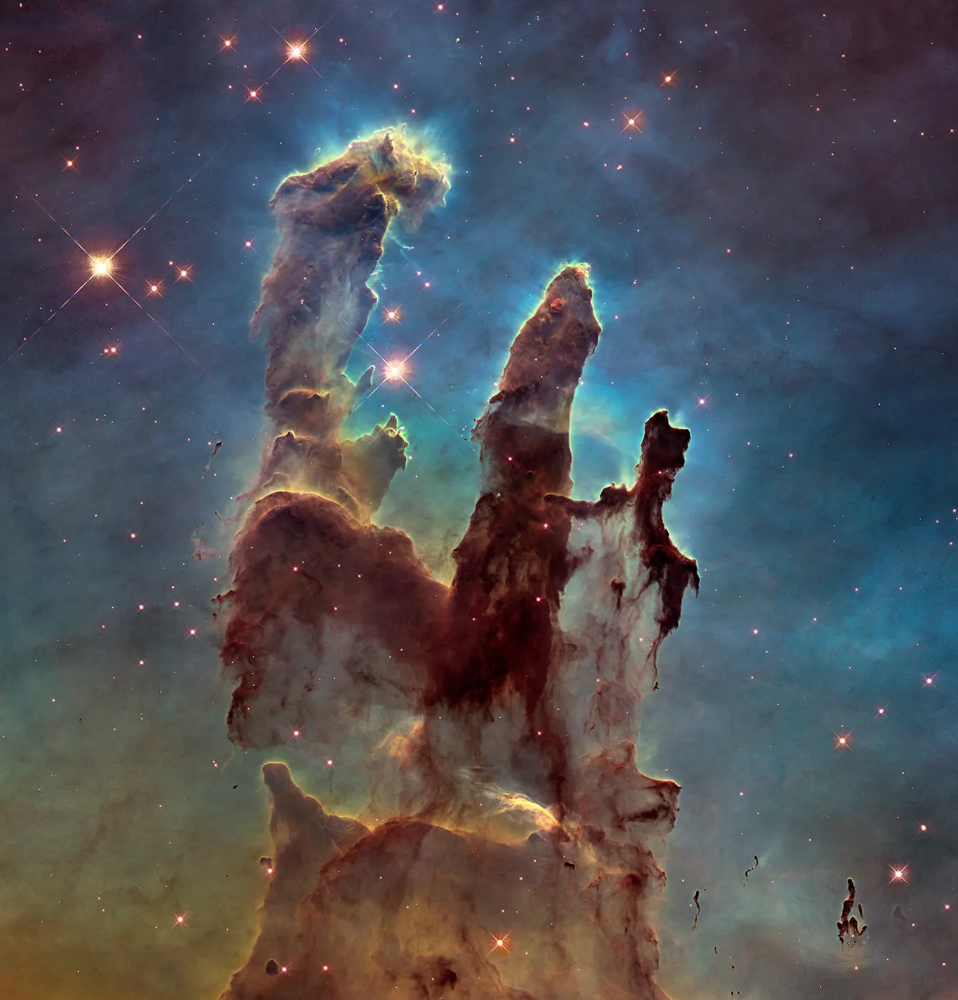

- Pillars of Creation（创世之柱）倾情注：最高的那根儿柱子，有 4 光年高，三十万公里每秒的光要疯跑四年，才能从柱子底部爬上柱子顶部，而一道光横穿整个太阳系大概只需要 8 个小时……哎，我快哭了。

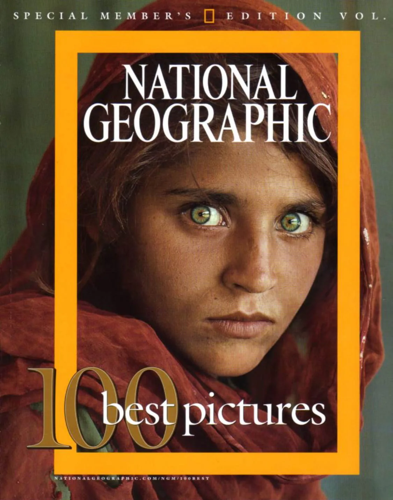

- National GeographicSteve McCurry

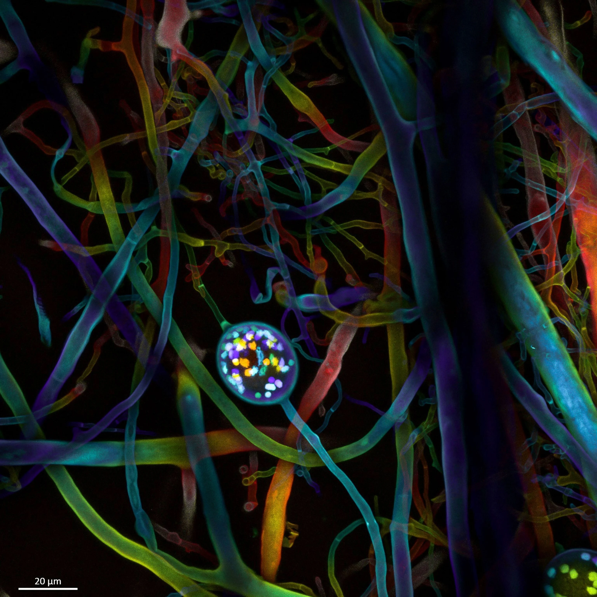

- Vasileios Kokkoris, Franck Stefani, and Nicolas Corradi

你看看这些精彩的照片儿，都不是用 28mm 镜头拍的，我之所以说 28mm 镜头是全宇宙最好用的镜头，只是单纯的因为他最能满足我目前的拍摄需求，以及 28mm 镜头的视觉效果最符合我目前的审美趣味。

Josef Koudelka 是第一个让我疯狂迷恋上的摄影师，我当时看了他的 Invasion 68: Prague 和Gypsies 之后就彻底醉了，我那时候一直以为他用的是 28mm 镜头，所以，就这么简单，这就是一切的开始……当然，后来我知道其实他用的是 25mm 镜头。

但寇老师在拍完 Gypsies 之后就基本不再用 25mm 镜头了，改换成了 35mm 和 50mm，因为他到更开阔的地方拍东西去了，场景不再有局限，而且改换焦段就等于改换了自己照片儿的视觉观感，也改换了他看世界的视角，这样可以避免自己无限重复自己……再之后，他又开始一心一意地拍全景照片儿去了。

即便寇老师用 25mm 镜头拍出了那么多经典的照片儿，但我相信，他也肯定不会觉得 25mm镜头是全宇宙最好用的镜头。

因为相机就是相机，而已，镜头就是镜头，而已，至于他们之中谁是最好用的，都由“此时此刻”的“我”来决定，彼时彼刻的都不行。

所以，你此时此刻的选择是什么？

期待你的回信，更多的咱们之后有时间再聊。
