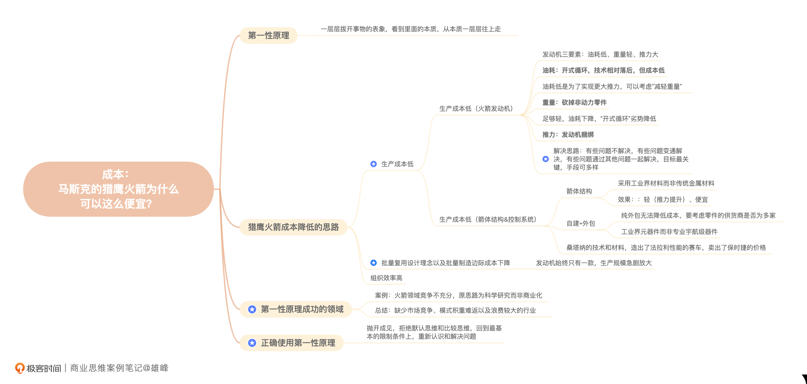
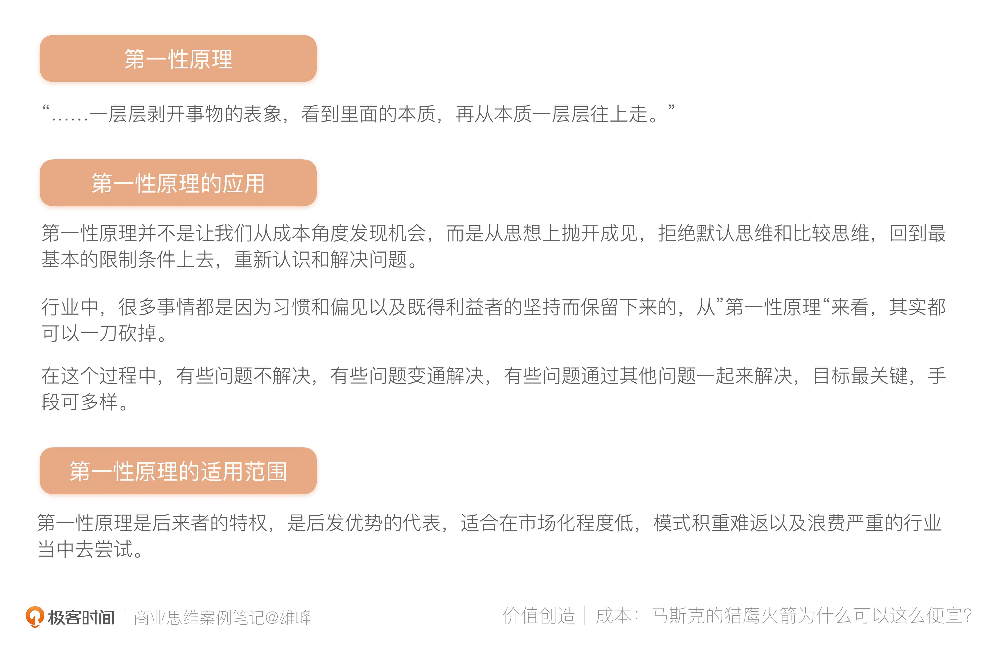
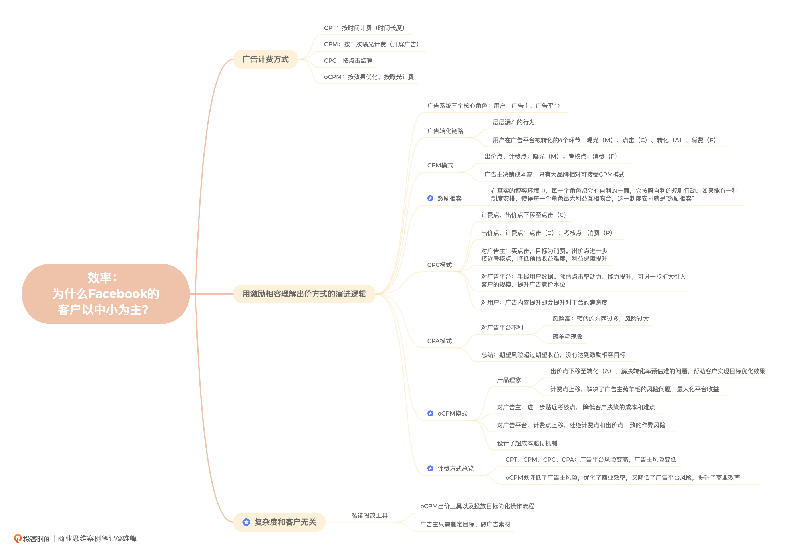
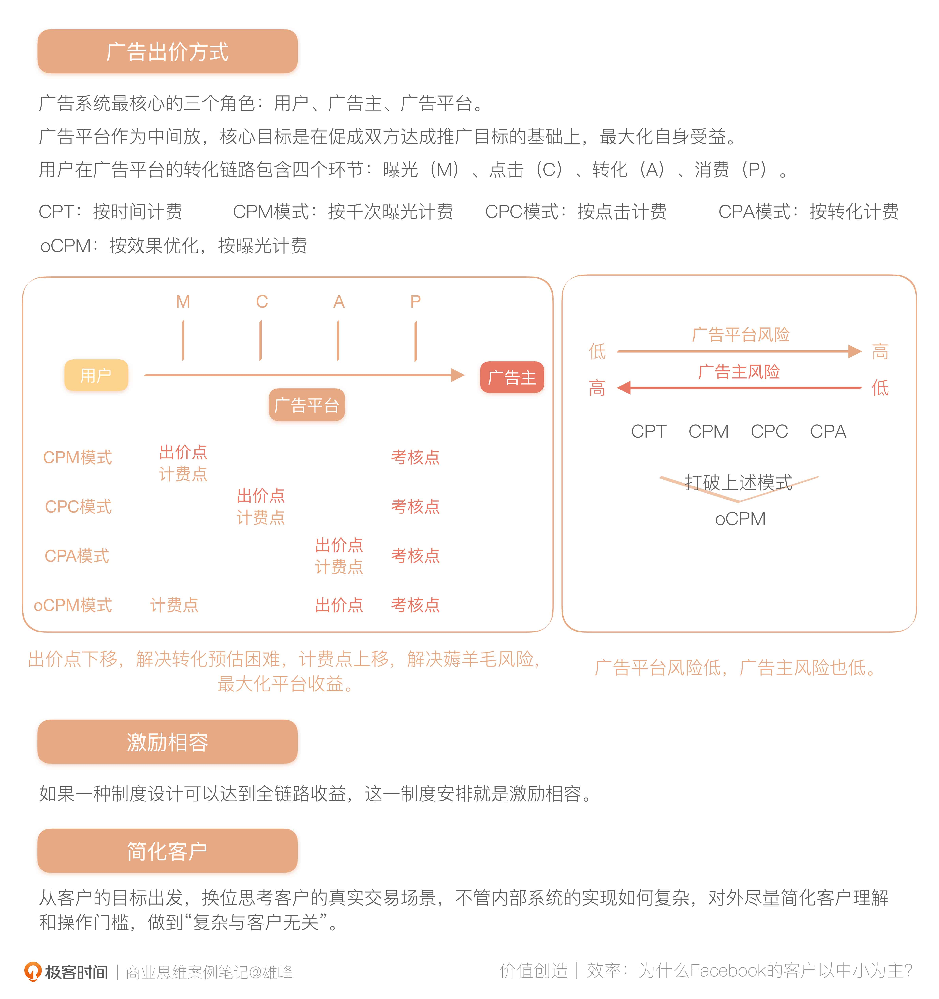
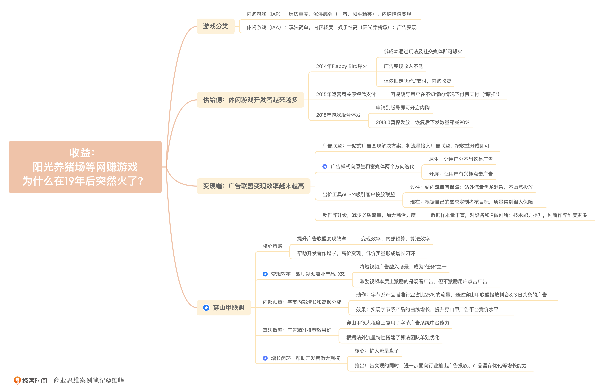
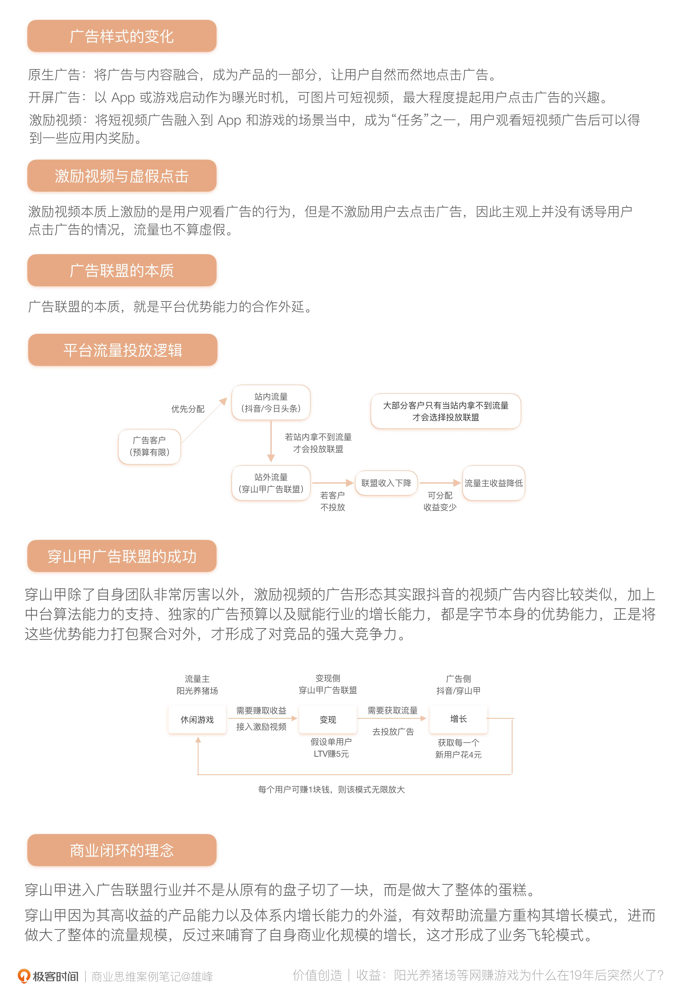
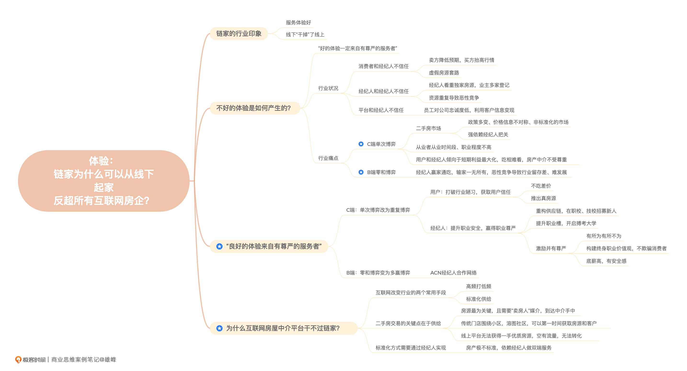
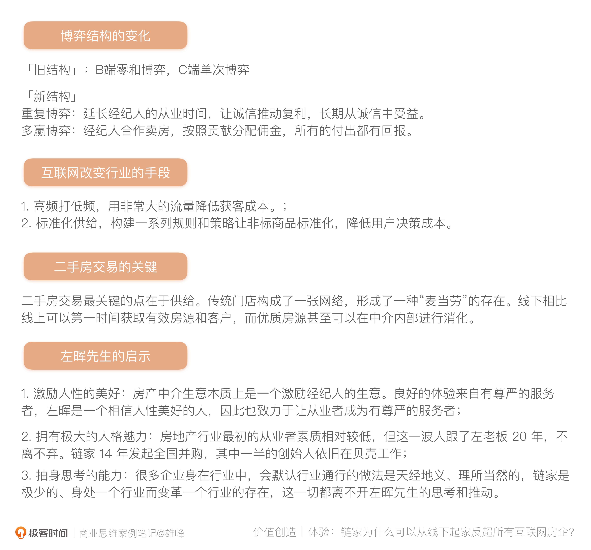

# 复习加餐 | 4组图看懂价值创造！

你好，我是编辑晓蕾，国庆假期快乐，我又来了！

《商业思维案例笔记》已经更新过半了。比起你有没有按时追更，我们更关心你有没有吸收好每一节课的内容。今天我就来和你一起，复习第一板块“价值创造”的内容。

什么是价值创造呢？它可以从四个维度去考虑：成本、效率、利润、体验。

一个社会问题就是一个商业机会，但并不是所有的问题解决都可以创造商业价值，还需要看问题是痛点还是痒点，痛点代表了刚需，解决掉则可产生很大的商业价值，这个过程就是价值创造。

那我们如何判断一个产品或服务是否很好地解决了用户或社会的痛点，创造了商业价值呢？行业的判断标准有四个：是否极大地降低了成本，是否极大地提升了效率，是否极大地创造了利润，是否极大地提升了体验。

好了，接下来，你可以用我们在练习课中提到过的费曼学习法的思路，从课程的标题切入，尝试通过思维导图串起来这节课的内容。也欢迎你把每节课相应的知识卡片保存下来，时常复习。

## 降低成本

- 如果把所有问题都推到系统的问题上，那么不是蠢就是坏。真正为业务负责的思路应该是进行错位切换。

问题分析：马斯克的猎鹰火箭为什么可以这么便宜？

思维导图：

重点卡片：

## 提升效率

- oCPM 之所以伟大，则在于其创造性的引入了“按效果优化、按展示 / 点击收入”的产品理念，既优化了客户广告效果，提升了商业效率，又保障了广告平台的收入，达到了广告主风险低以及广告平台风险低的双赢情况。

问题分析：为什么 Facebook 的客户以中小为主？

思维导图：

重点卡片：

## 创造收益

- 穿山甲自身能力的外溢，有效帮助流量方重构其增长模式，进而做大了整体的流量规模，反过来哺育了自身商业化规模的增长，形成了业务飞轮模式。

问题分析：阳光养猪场等网赚游戏为什么在 19 年后突然火了？

思维导图：

重点卡片：

## 提升体验

- “他正在这里干着活，外面来了一个大妈，端着一盘饺子，对他说“怎么还没下班”，把饺子给他吃。我觉得这是真正激励他的事情。”——《详谈左晖》

问题分析：链家为什么可以从线下起家反超所有互联网房企？

思维导图：

重点卡片：

推荐阅读：《详谈左晖》

最后，如果关于专栏，你有什么建议或更好的想法，也欢迎你分享在留言区，我一定会关注。如果你觉得这门课对你有所帮助的话，欢迎你把课程分享给同事或朋友，我们共同学习进步！
