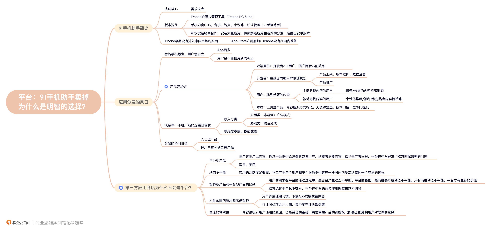
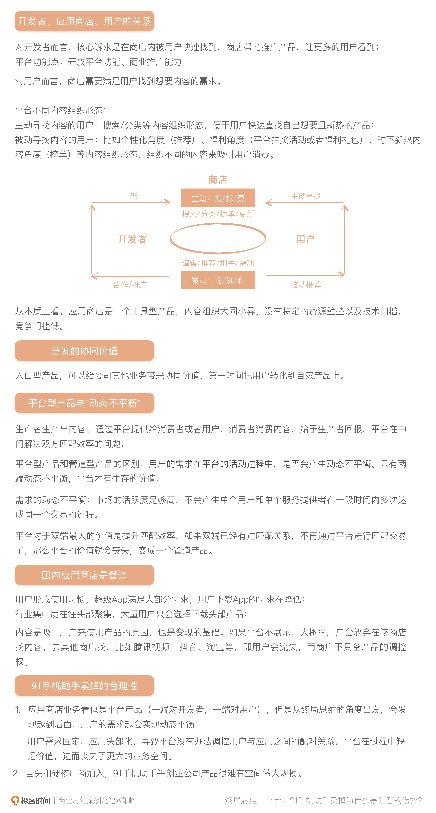
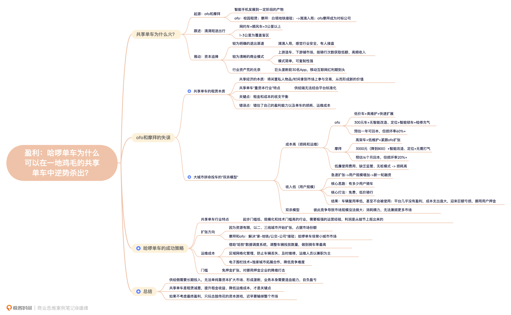
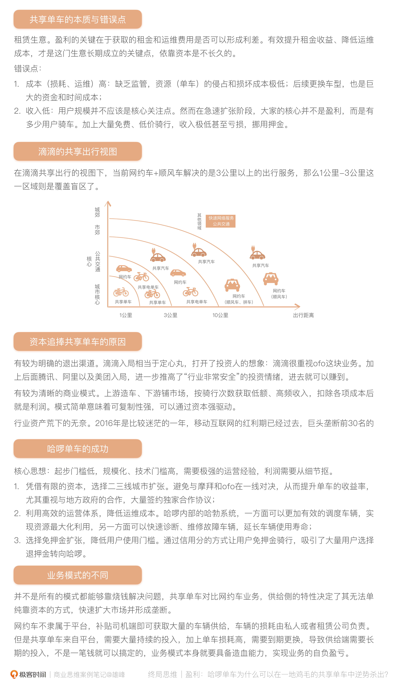
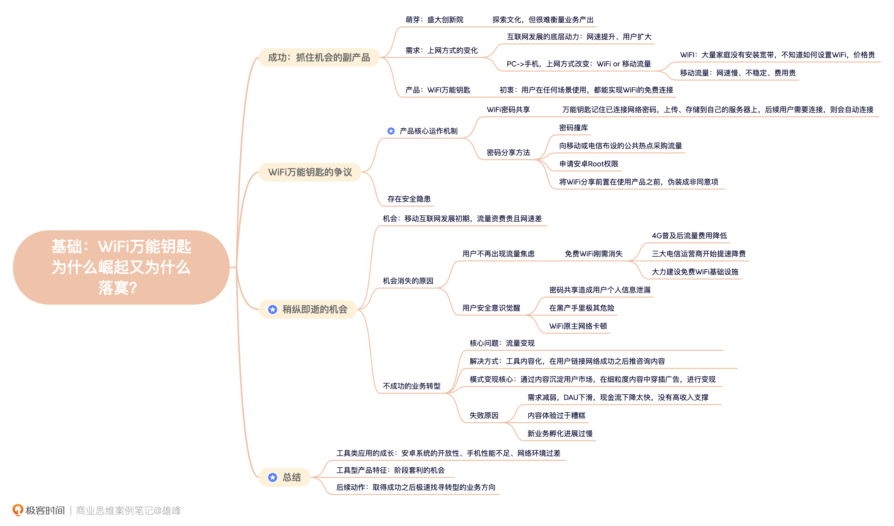
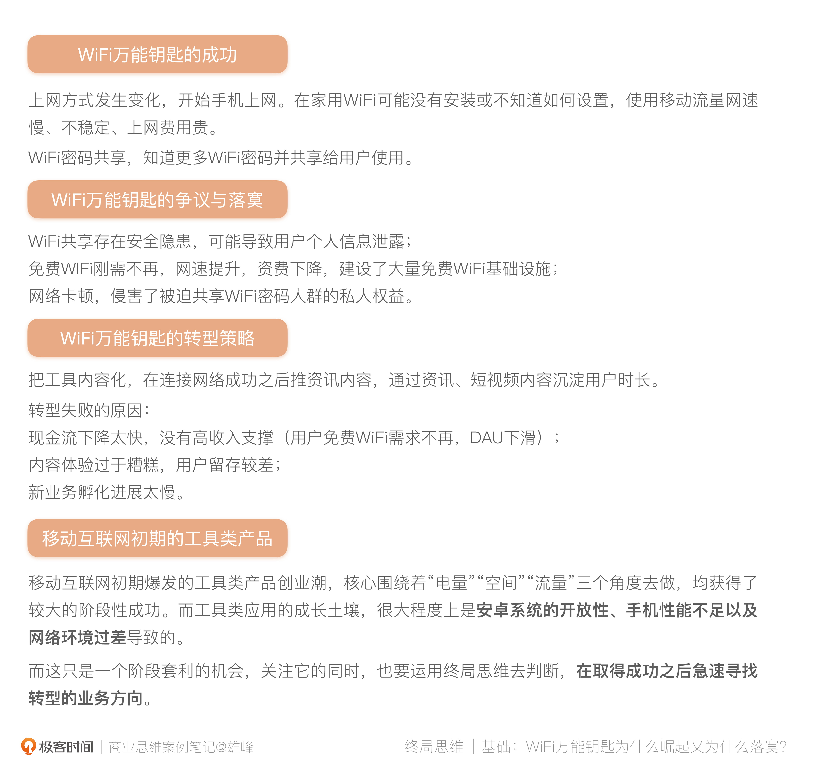
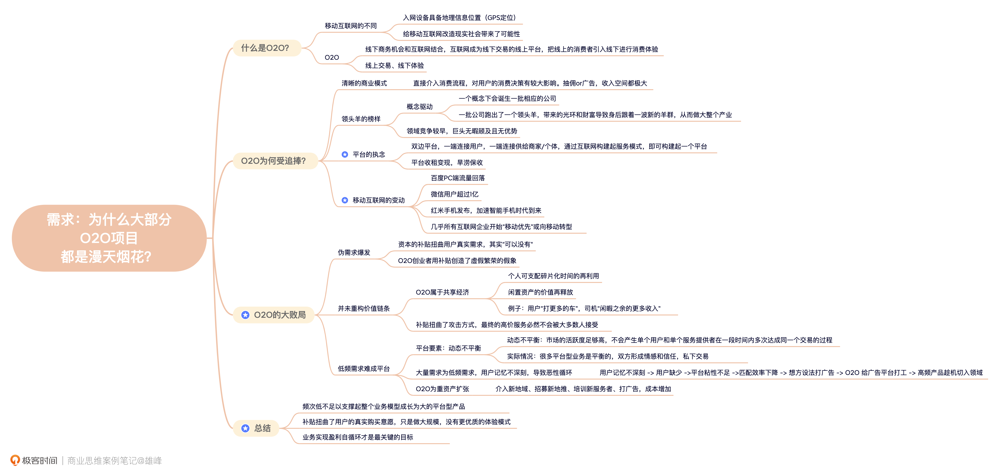
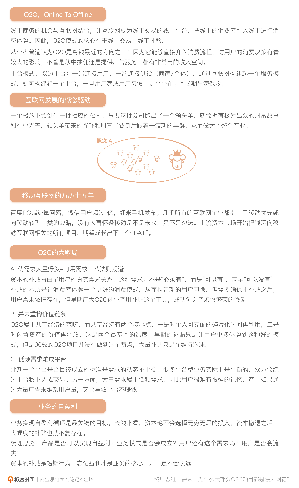
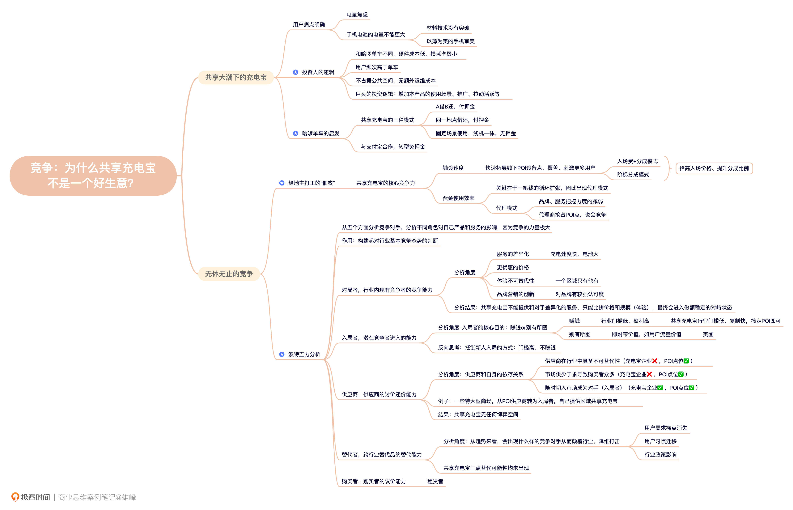
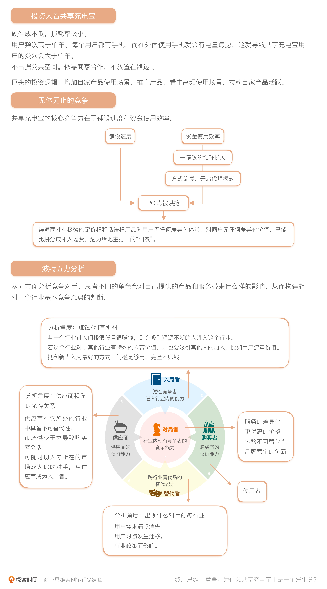

# 复习加餐 | 5组图收获终局思维！

你好，我是晓蕾，又见面啦！

终局思维这个版块难度飙升。我第一次读O2O和共享充电宝这两节课的时候，在中间停下来思考了好久，吸收了前半部分的内容，才开始读课的后半部分——相信我，初稿远比定稿要更长，更难。

也许你读的时候和我一样，又或者现在也在慢慢啃这个版块的内容。不要着急，这次复习课，我就带着梳理思路、提炼总结使命来了！

## 什么是终局思维？

首先，我们先来复习一下什么是终局思维。

- 终局思维，也就是时间是一切事物发展最大的变量，在面对选择时，从终点出发考虑问题，来决定你当下的选择。因为当我们思考任何一个业务机会点或者看到行业热点机会的时候，如果带上了时间这个要素再去判断，可能得出的结论会和过往大相径庭。

但是，终局思维就是要一眼看到头嘛？也不是。它是一种倒序思考模式，每一次的判断和决策都带入时间和环境的考量因素，随着变化而不断调整策略。它可以让你对市场和业务有更深层的思考，判断哪些业务是短期套利机会，哪些业务是长期复利机会。

记得在导读，有同学问过曹老板，什么是短期套利，什么是长期复利，学到现在，相信你也理解了。我们尝试总结一下：

短期套利，可以是 WiFi 万能钥匙一类，短期内获得大量收益，但如果加上时间角度，而业务本身没有及时探索出新的模式变现，那么最终走向没落的产品；

长期复利，可以是短视频这类占据用户时长，用广告或其他方式变现，在业务模式上实现自盈利的产品，这就意味着“野火烧不尽，春风吹又生”的复利。

如果不提业务模式，在工作和生活中，短期套利可能就是坑蒙拐骗之后的获利，但再无后续机会，而长期复利，是不断学习，输入和输出的正循环，更是真诚和善良带给我们的更多选择。

P.S. 以上内容经过曹老板审核，@AlanHalo 同学补充，知识点无误，童叟无欺。

好了，整体复习之后，接下来，我们就深入到每一节课，看看这些案例都带给了我们什么样的启发。

## 平台还是管道？

- 商店业务的特殊性在于，内容既是吸引用户来使用产品的原因，又是平台进行变现的基础。而变现的前提条件是具备对产品的调控权。但如果用户要找的是微信呢？

问题分析：

91 手机助手卖掉为什么是明智的选择？

思维导图：

重点卡片：

## 盈利才是目标

- Business is business。如果不考虑最终赚钱，只是在玩击鼓传花的资本游戏，迟早要输掉整个市场，这就是终局思维的思考方式。

问题分析：

哈啰单车为什么可以在一地鸡毛的共享单车中逆势杀出？

思维导图：

重点卡片：

## 基础也会改变？

- “你们要记住，你们肯定是聪明而且努力的，但是比这些更重要的是，你们遇到了一个千载难逢的机会，所以才会有这样的成绩。”

问题分析：

WiFi 万能钥匙为什么崛起又为什么落寞？

思维导图：

重点卡片：

推荐阅读：陈大年的分享自述

## 真需求还是假需求？

- 资本的补贴扭曲了用户的真实需求关系，这种需求并不是“必须有”，而是“可以有”，等到真正用市场价格提供服务的时候，用户用脚投票，那么这种需求就会变成“可以没有”。

问题分析：

为什么大部分 O2O 项目都是漫天烟花？

思维导图：

重点卡片：

推荐阅读：

曹政老师：《万般皆下品，唯有收租高》

字节战略大神朱时雨：《2012：互联网的万历十五年》

## 能在激烈竞争中活下去吗？

- 共享充电宝越来越贵而背后的公司却越来越穷，那钱去哪里了呢？这场战争还能结束吗？

问题分析：

为什么共享充电宝不是一个好生意？

思维导图：

重点卡片：

最后，关于专栏和复习形式，如果你有什么建议或更好的想法，也欢迎分享在留言区，我一定会关注。如果你觉得这门课对你有所帮助的话，欢迎你把课程分享给同事或朋友，我们共同学习进步！
