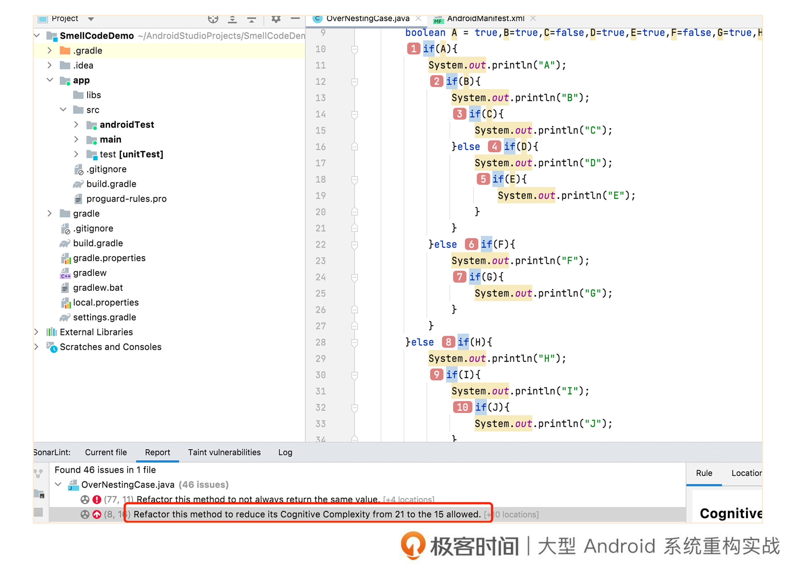
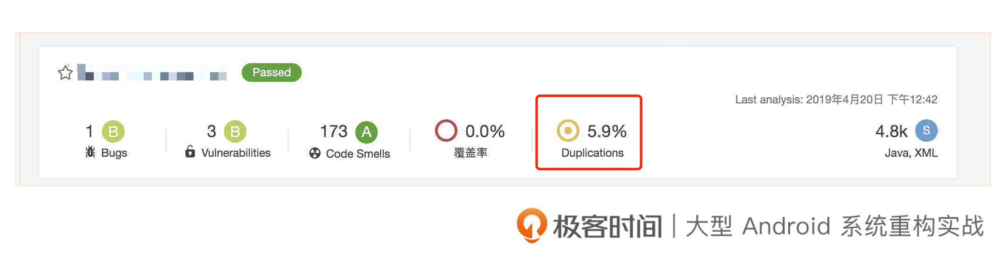
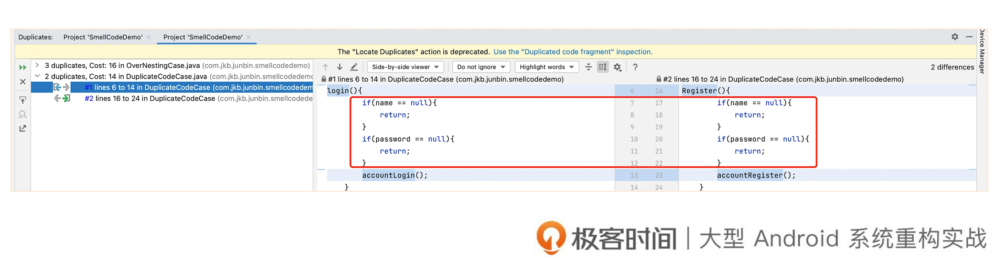
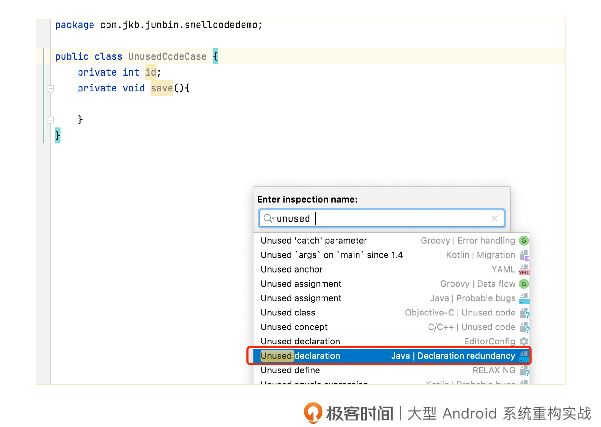
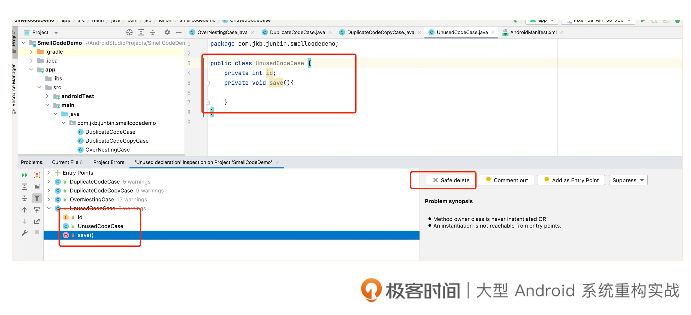
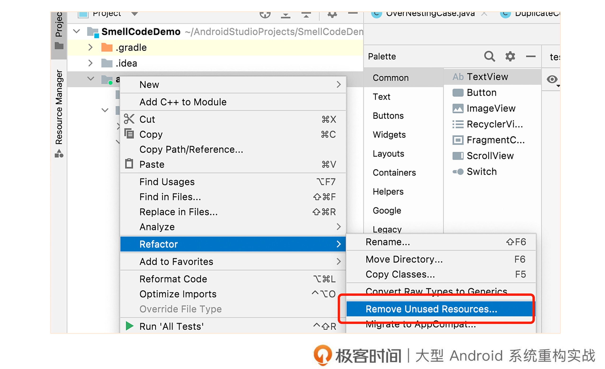
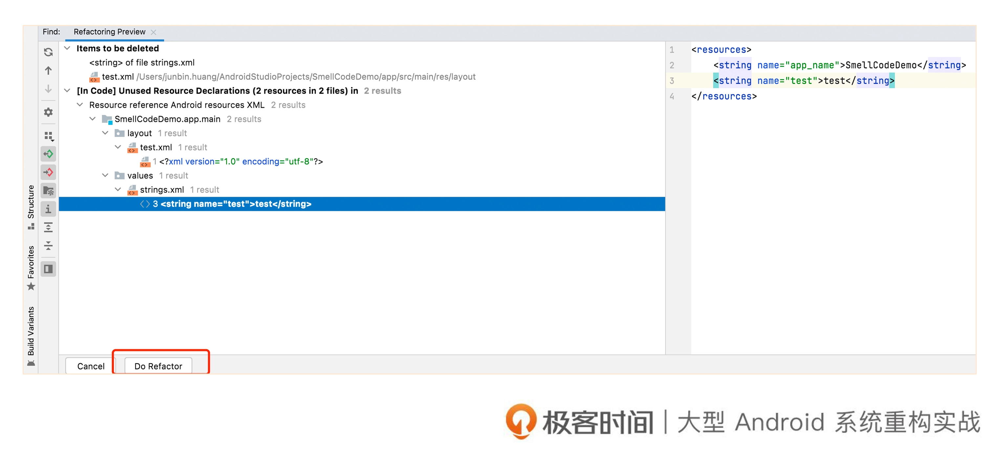
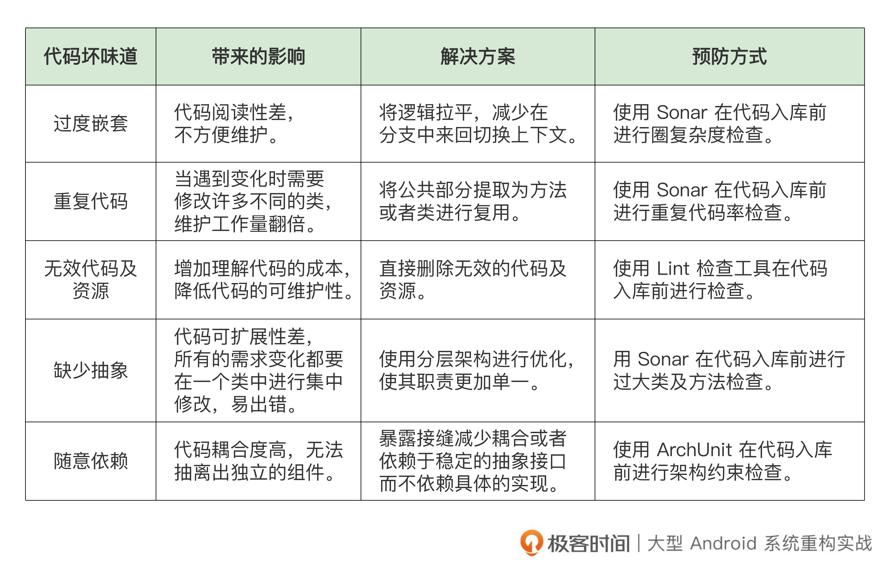

# 08 | 防微杜渐：5类遗留系统典型的代码坏味道

你好，我是黄俊彬。今天我们正式进入到解耦重构篇。在这个章节中，我们将根据“分析设计篇”中分析出的问题清单重构改造 Sharing 项目，最后将设计落地到具体的代码上。

在我过去碰到的很多遗留系统中，代码都存在一些相似的问题，其中最典型的有五种：过度嵌套、重复代码、无效代码及资源、缺少抽象和随意依赖。

千里之堤，溃于蚁穴，遗留系统不是一天造成的，而是在日常开发中不断累积出来的，而这五种典型的代码坏味道其实就是推动系统演化成遗留系统的重要元凶。

所以，在重构 Sharing 项目的代码之前，我们先通过一些示例看看这些代码坏味道带来的影响以及如何解决它们。当然了，最重要的是，我们怎么提前避免这些问题。

## 过度嵌套

我们先来看过度嵌套。过度嵌套指的是代码的圈复杂度过高，存在大量的嵌套逻辑，不方便开发人员维护和扩展功能。首先请你想一下，这个圈复杂度多少算高？多少算低呢？

提出圈复杂度概念的麦凯布给我们的建议是：若一模块的循环复杂度超过 10，需再分割为更小的模块。按照这个阈值来看，如果圈复杂度超过 10，我们就认为圈复杂度过高；如果在 5-10 之间认为是中等，可以接受；如果低于 5，就认为圈复杂度比较低了。

下面我们来看一段圈复杂度超过 10 的代码，你可以细品一下，阅读这段代码时是什么感受。

```java
public void case0(){
   boolean A = true,B=true,C=false,D=true,E=true,F=false,G=true,H=false,I=true,J
   if(A){
       System.out.println("A");
       if(B){
           System.out.println("B");
           if(C){
               System.out.println("C");
           }else if(D){
               System.out.println("D");
               if(E){
                   System.out.println("E");
               }
           }
       }else if(F){
           System.out.println("F");
           if(G){
               System.out.println("G");
           }
       }
   }else if(H){
       System.out.println("H");
       if(I){
           System.out.println("I");
           if(J){
               System.out.println("J");
           }
       }
   }
}
```

你是不是觉得这段代码的逻辑层层嵌套，可读性很差？其实这就是过度嵌套带来的一个主要问题：代码阅读性差，不方便维护。此外，这种代码修改起来也非常容易出错，稍不注意就可能破坏之前的逻辑。

那么如何简化过度嵌套的代码呢？最好的方式就是将逻辑拉平，我们不用在分支中来回切换上下文。

将逻辑拉平的方式有多种，下面我们通过一些示例来看看。

```
boolean isA,isB,isC;
double getAmount() {
   double result;
   if (isA) result = adAmount();
   else {
       if (isB) result = bAmount();
       else {
           if (isC) result = cAmount();
           else result = otherAmount();
       };
   }
   return result;
}
```

对于上面这个例子，我们可以通过“提前 Return”将这个示例的嵌套逻辑拉平（如下所示），你可以对比一下上下两段代码的阅读感受。

```
double getAmountRefactor() {
   double result;
   if (isA) return adAmount();
   if (isB) return bAmount();
   if (isC) return cAmount();
   return otherAmount();
}
```

还有一种常用的简化嵌套逻辑的方式就是 “使用多态 + 路由表”，比如后面这个示例。

```java
public void login(String type) {
   if ("wechat".equals(type)) {
       weChatLogin();
   } else if ("qq".equals(type)) {
       qqLogin();
   } else if ("phone".equals(type)) {
       phoneLogin();
   }
}
```

对于这样的情况，我们就可以提取接口，将各个实现区分开，然后通过路由配置的方式来获取具体的实现（如下所示）。这种方法不仅简化了嵌套，也非常便于后续的代码扩展。

后面是优化之后的代码，你不妨做个对比。

```java
HashMap<String,Ilogin> maps = new HashMap<String, Ilogin>(){
   {
       put("wechat", new WeChatLogin());
       put("qq", new QQChatLogin());
       put("phone",new PhoneChatLogin());
   }
};
public void login(String type) {
  maps.get(type).login();
}
```

事前预防，远胜于事后解决，我们在平时的项目开发中就应该避免过度的代码嵌套。因此，我建议在代码合入之前先进行静态代码扫描，在扫描工具上设置合适的圈复杂度阈值（小于10），一旦发现超过阈值，就提示错误，不让代码合并入库。

对于扫描工具的选择，我推荐使用 Sonar，也就是将 Sonar 作为质量门禁接入到流水线中，检查代码的圈复杂度。如果你的项目有一些约束使用不了，也可以用 SonarLint 插件在 IDE 中扫描检查。



## 重复代码

重复代码指的是在整个项目中有两个地方以上存在相同的代码行，相同部分少则 3-5 行代码，多则可能除了 2 个类小部分逻辑不一样外，其他都是一样的代码。通常来说，重复代码大都是由复制粘贴导致的，那怎么解决呢？下面我们来看两个例子。

首先是对于部分的代码行重复。

```java
public class DuplicateCodeCopyCase {
   String name;
   String password;
   public void login(){
       if(name == null){
           return;
       }
       if(password == null){
           return;
       }
       phoneLogin();
   }
   public void Register(){
       if(name == null){
           return;
       }
       if(password == null){
           return;
       }
       phoneRegister();
   }
   private void phoneLogin() {
   }
   private void phoneRegister() {
   }
}
```

我们可以将共同逻辑提取成公共的方法，来减少重复代码。在上面的例子中，name 和password 的判断就可以提取成公共的方法，具体如下所示。

```
private boolean isInValid() {
   if (name == null) {
       return true;
   }
   if (password == null) {
       return true;
   }
   return false;
}
```

而对于大部分代码重复、只有小部分不同的情况，我们再看一个例子。

```java
public class DuplicateCodeCopyCase {
   String name;
   String password;
   public void login(){
       if (isInValid()) return;
       phoneLogin();
   }
   private boolean isInValid() {
       if (name == null) {
           return true;
       }
       if (password == null) {
           return true;
       }
       return false;
   }
   public void Register(){
       if (isInValid()) return;
       phoneRegister();
   }
   private void phoneLogin() {
   }
   private void phoneRegister() {
   }
}
```

这时候，我们可以把差异部分进行组合或者将公共部分提取为超类，来减少重复代码。在上面的例子中，我们可以将不同方式的登录注册都提取出来。

```java
public class DuplicateCodeCopyCase {
   //将差异的实现通过接口注入进来
   IAccountOperator iAccountOperator;
   String name;
   String password;
   public void login(){
       if (isInValid()) return;
       iAccountOperator.login();
   }
   public void Register(){
       if (isInValid()) return;
       iAccountOperator.register();
   }
   //... ...
  }
```

因为重复代码在遇到变化时，往往要修改很多不同的类，让维护代码的工作量呈指数上升，所以我们应该提前避免在项目中产生这种问题。

同样地，建议在代码合入之前先进行静态代码扫描，在扫描工具上设置合适代码重复率阈值（一般建议低于 5%），如果发现超过阈值，就提示错误不让代码合并入库。



在日常的开发中，你也可以通过 IDE 提前在开发阶段扫描代码中的重复代码，及时做优化。比如使用 Intellij 的 Locate Duplicates 功能，选择：Code→Analyze Code→LocatedDuplicates，就可以扫描了，扫描结果是后面这样。



需要说明的是，因为目前最新版的 Android Studio 还不支持 Locate Duplicates 功能，所以我们要借助 Intellij 来使用此功能。

## 无效代码及资源

接下来我们看看遗留系统中第三种代码坏味道：无效代码及资源。

无效代码及资源指的是在整个项目中没有被任何代码所调用到的类、方法、变量或者资源问题。

一般来说，编译工具在打包时会自动将这些无效的代码移除，不会导致应用的包体积增大。但是无效代码及资源在你编写代码的时候依旧会存在，这会增加代码的理解成本，降低代码的可维护性。

对此可以借助工具自动化识别和去除。我们先来看无效代码的处理，步骤很简单，就是在Android Studio 中选择 Analyze，进而选择 run inspection by name 命令，然后输入unused declaration 来扫描代码。



根据扫描结果，如果扫描的结果显示代码为无效代码，就通过 Safe delete 进行删除。



对于应用资源，可以在 Android Studio 中选择对应的模块，再选择重构菜单，然后选择Remove Unused Resources 进行扫描。



根据扫描结果，如果扫描的资源是无效资源，可以通过 Do Refactor 进行删除。



特别要注意的是，在项目中还有一种常见的情况是“僵尸代码”，这类代码的特点是：代码有引用，但从系统的角度来看，这些代码的逻辑永远不会被触发。通常，我们无法单纯通过工具来识别僵尸代码，需要结合业务具体分析。

相比无效代码，僵尸代码增加的代码理解成本更高，对代码可维护性影响更大，所以要及时定期清理。

总体来说，对于无效代码及资源，我们可以把静态代码扫描工具（Sonar、Lint 等）加入到流水线中及时检查。而对于僵尸代码，则需要加强人工的代码监视来应对。

## 缺少抽象

除了逻辑过度嵌套、重复和无效外，还有一种情况是随着代码复杂度的提高，由于缺少合适的分层设计，所有代码都掺杂在了一个类中。我们将这种代码问题称为“缺少抽象”。

在项目中比较常见的情况是将所有的逻辑都写在一个界面中，这些逻辑包含 UI 操作、业务数据处理、网络操作、数据缓存等等。我们在第 3 节课中讲的代码可测性的例子，就是这种情况。

```java
public class LoginActivity extends AppCompatActivity {
   @Override
   public void onCreate(Bundle savedInstanceState) {
       super.onCreate(savedInstanceState);
       setContentView(R.layout.activity_login);
       final EditText usernameEditText = findViewById(R.id.username);
       final EditText passwordEditText = findViewById(R.id.password);
       final Button loginButton = findViewById(R.id.login);
       loginButton.setOnClickListener(new View.OnClickListener() {
           @Override
           public void onClick(View v) {
               boolean isLoginSuccess = false;
               String username = usernameEditText.getText().toString();
               String password = passwordEditText.getText().toString();
               boolean isUserNameValid;
               if (username == null) {
                   isUserNameValid = false;
               } else {
                   Pattern pattern = Pattern.compile("\\w+([-+.]\\w+)*@\\w+([-.]
                   Matcher matcher = pattern.matcher(username);
                   if (username.contains("@")) {
                       isUserNameValid = matcher.matches();
                   } else {
                       isUserNameValid = !username.trim().isEmpty();
                   }
               }
               if (!isUserNameValid || !(password != null && password.trim().len
                   isLoginSuccess = false;
               } else {
                   //通过服务器判断账户及密码的有效性
                   if (username.equals("123@163.com") && password.equals("123456
                       //登录成功保存本地的信息
                       SharedPreferencesUtils.put(LoginActivity.this, username,
                       isLoginSuccess = true;
                   }
               }
               if (isLoginSuccess) {
                   //登录成功跳转主界面
                   startActivity(new Intent(LoginActivity.this, MainActivity.cla
               } else {
                   //对登录失败进行提示
                   Toast.makeText(LoginActivity.this, "login failed", Toast.LENG
               }
           }
       });
   }
}
```

这种缺少抽象设计的代码可扩展性差，所有的需求变化都要在一个类中集中修改，容易出错。这种问题的解决思路也很清晰，就是分而治之，将不同维度的代码独立开来，使其职责更加单一，这样有需求变化时就能独立演进了。在第 13 节课中，我会具体介绍如何优化缺少抽象设计的过大类。

如果你想提前避免这类缺少抽象设计的代码，可以通过 Sonar 在代码入库前进行过大类及过大方法的检查。具体方式与前面的圈复杂度检查类似，我就不细讲了。

## 随意依赖

我们再来看最后一种代码坏味道：随意依赖。它是指项目中不同分层的代码直接依赖具体的实现，导致彼此之间产生耦合。比较常见的是不同业务模块之间直接依赖，或者一些底层的组件依赖了上层的业务模块实现。

“低耦合高内聚”是我们经常提的一个设计思想，因为代码耦合度低可以减少修改代码引起的风险，同时也是做组件化的重要条件之一。如果代码直接耦合，在拆分成独立的模块后，编译也会直接不通过。

解决这类“随意依赖”问题，要分两种情况。第一种是底层组件依赖上层业务模块的实现，例如一些日志的工具类会直接依赖一些用户模块的个人数据。

```java
public class LogCodeCase {
   public void log(){
       //... ...
       Log.d("log",User.id);
   }
}
```

对此，比较好的解决方式是，通过提取参数或者构造函数注入来解除具体的依赖。

```java
public class LogCodeCase {
   String id;
   public LogCodeCase(String id) {
       this.id = id;
   }
   public void log() {
       //... ...
       Log.d("log", id);
   }
}
```

另一种情况是业务模块之间的直接依赖，例如消息模块直接依赖了文件模块的文件发布。

```java
public void sendMessage(String text){
   //依赖具体的实现
   String url=new FileManager().upload();
   send(url,text);
}
```

这时候，我们可以通过提取接口，依赖稳定的抽象接口来进行解耦。解耦后再通过注入框架，将接口的实现注入到接口的调用类中。对于如何解耦重构组件间的依赖，我会在第 11 节课详细讲解。

```java
IUpload iUpload;
public void sendMessage(String text) {
   String url = iUpload.upload();
   send(url, text);
}
```

为了避免随意依赖的代码，我们同样可以通过守护工具 ArchUnit 在代码合入前进行架构约束检查。这块内容我们在第 7 节课中已经讲过，如果你不太清楚，可以通过文稿的超链接再回顾一下。

## 总结

不积跬步，无以至千里，我们只有在日常开发中重视基本的代码规范和代码质量，才能更有效地避免遗留系统产生。

今天，我给你分享了遗留系统中常见的五种典型的代码坏味道，包括过度嵌套、重复代码、无效代码及资源、缺少抽象和随意依赖，你可以参考我梳理的表格。



下节课，我将给你分享遗留系统中常用的 6 种安全重构手法，教你如何通过 IDE 自动化完成代码的重构，减少人工修改代码。敬请期待。

## 思考题

感谢你学完了今天的内容，今天的思考题是这样的：你的项目的重复代码率有多少？请你通过今天学习的方法对你的项目做一个诊断。

欢迎你在留言区与我交流讨论，也欢迎你把它分享给你的同事或朋友，我们一起来高效、高质量交付软件！
