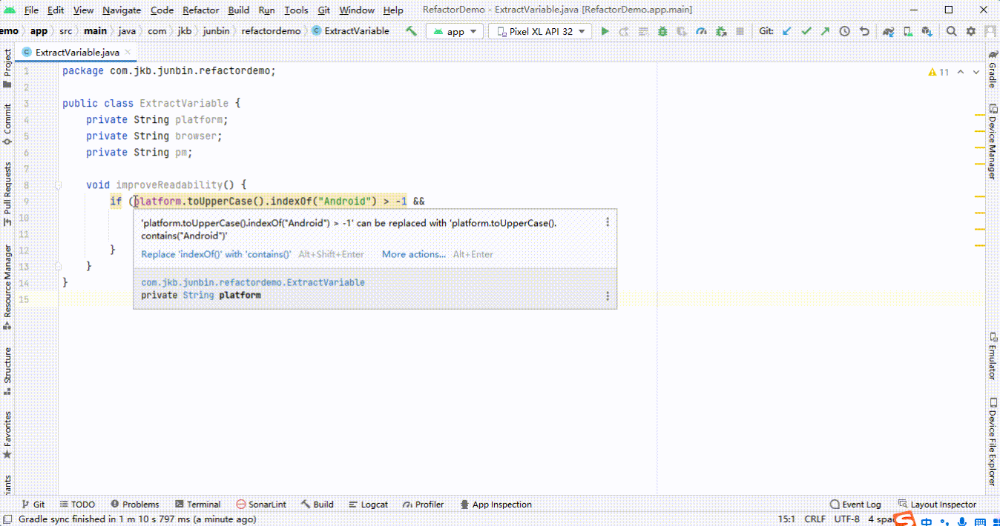
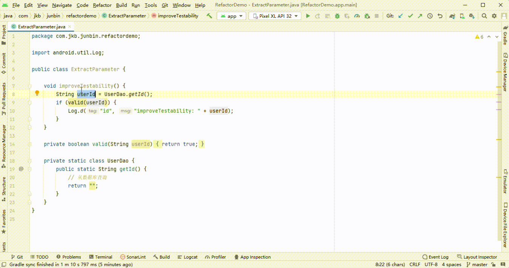
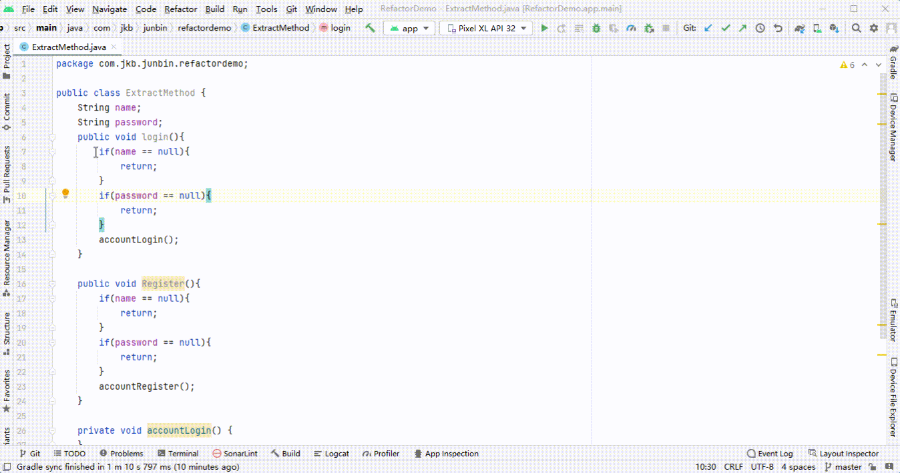
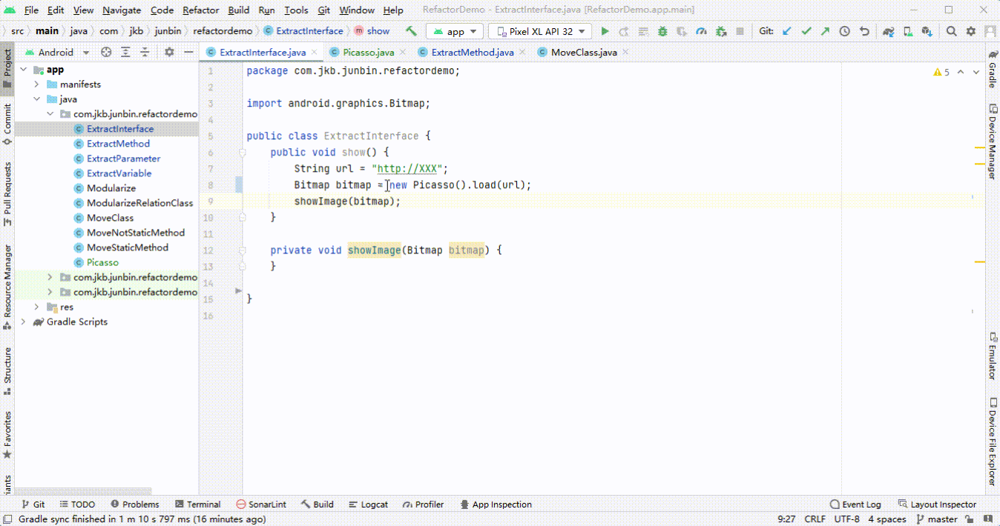
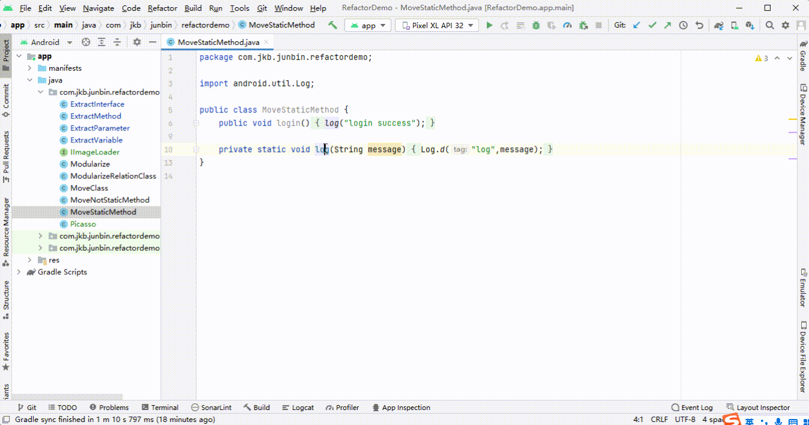
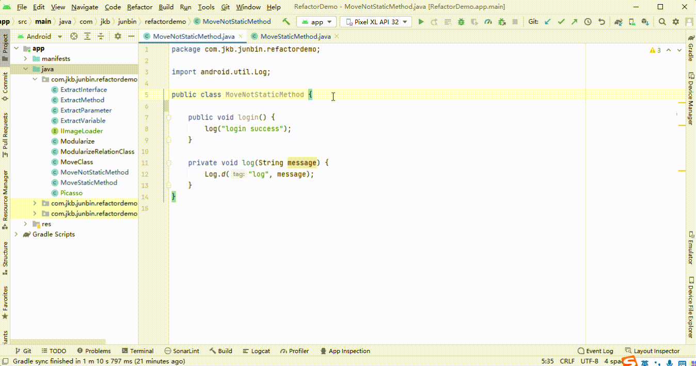
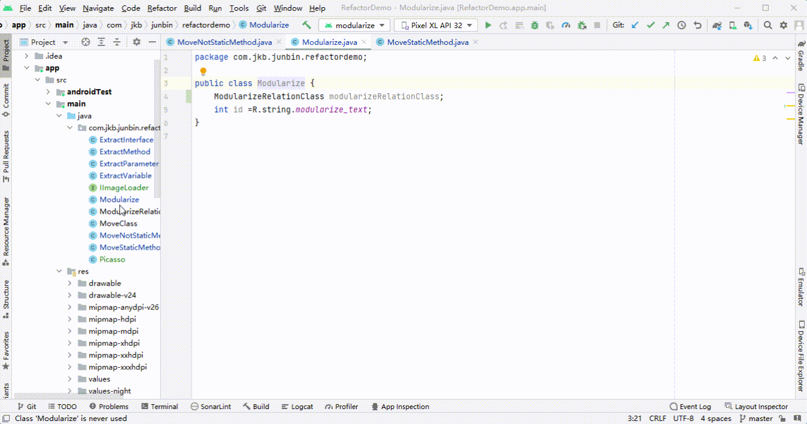
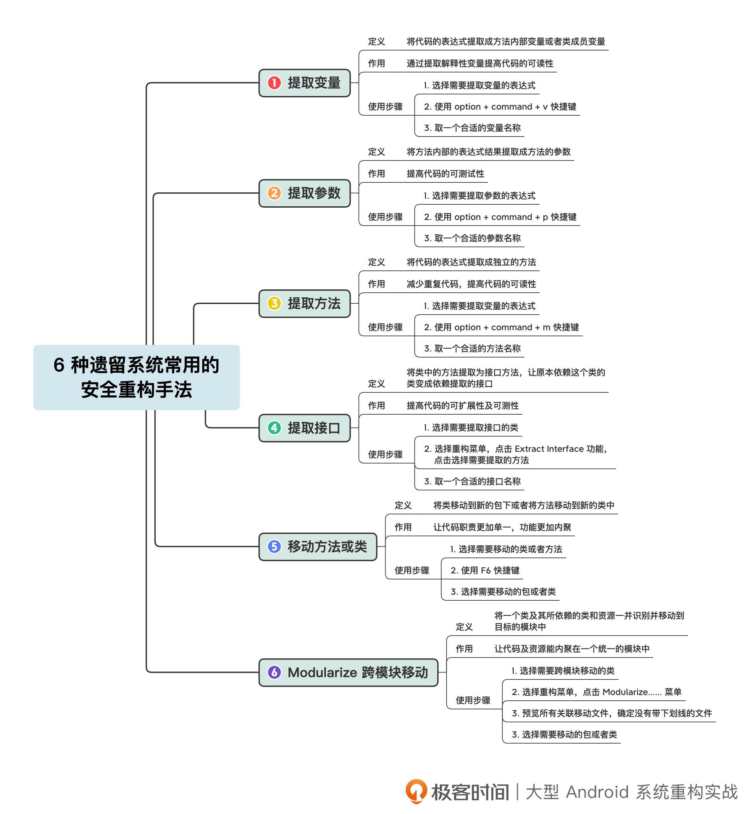

# 09 | 重构手法：6种遗留系统常用的安全重构手法

你好，我是黄俊彬。

上节课，我们学习了 5 种遗留系统里常见的代码坏味道。针对这些代码坏味道，也有一些基本的安全重构手法。这节课我将给你介绍 6 种遗留系统常用的安全重构手法，分别是提取变量、提取参数、提取方法、提取接口、移动方法或类，以及 Modularize 跨模块移动。

安全重构手法就是借助 IDE 自动辅助我们完成代码的重构，让重构更加高效，同时也可以避免人工挪动代码带来的风险。这节课，我会通过示例，给你介绍上述 6 种安全重构手法常见的应用场景，以及如何借助 IDE 进行安全重构。

这 6 种手法也是后续组件化架构重构、分层架构重构的基础，同时你也可以直接将这些重构手法运用到日常的开发中。

## 提取变量

我们先来看提取变量，提取变量是将代码的表达式提取成方法内部变量或者类成员变量。

下面我们来看一段代码示例，代码中有一个 if 语句，其中有三个条件判断。

```
void improveReadability() {
   if (platform.toUpperCase().indexOf("Android") > -1 &&
           browser.toUpperCase().indexOf("Chrome") > -1 &&
           pm.equals("com.tencent.mm")) {
   }
}
```

这段示例代码中的条件判断逻辑相对比较复杂，阅读理解整段含义需要一定的时间。我们可以通过提取合适的解释性变量来说明表达式的含义，从而提高代码的可读性。具体来讲，提取变量的安全重构手法是后面这样。



后面是提取变量重构后的代码。

```
void improveReadability() {
   boolean isAndroid = platform.toUpperCase().indexOf("Android") > -1;
   boolean isChrome = browser.toUpperCase().indexOf("Chrome") > -1;
   boolean isInstallWeiXin = pm.equals("com.tencent.mm");
   if (isAndroid && isChrome && isInstallWeiXin) {
   }
}
```

可以看出，重构代码提取出 3 个解释性变量，提高了代码的可读性，我们能马上看出这个条件判断语句是在判断：字符串标识是否属于 Android 平台以及 Chrome 浏览器并且安装了微信？

在实践中我们需要注意，取一个“名副其实”的命名非常重要，我们要避免使用缩写或者“词不达意”的命名方式。

## 提取参数

第二个重构手法是提取参数。提取参数是将方法内部的表达式结果提取成方法的参数。我们可以通过提取参数对变量的依赖进行解耦，提高代码的可测试性。

我们还是结合一段代码示例来研究。该示例方法依赖了一个 userId 的变量，这个变量需要从数据库中获取，这样会降低代码的可测试性。

```
void improveTestability() {
   String userId = UserDao.getId();
   if (valid(userId)) {
       Log.d("id", "improveTestability: " + userId);
   }
}
```

对此，我们通过提取参数的手法进行重构。



重构后的代码是后面这样。

```
void improveTestability(String userId) {
   if (valid(userId)) {
       Log.d("id", "improveTestability: " + userId);
   }
}
```

可以看到，重构以后该方法不依赖具体的数据库实现，我们可以通过传递参数来测试方法内部的逻辑。但在实践过程中我们需要注意，参数应该是越少越好，如果参数过多就要考虑封装成对象。另外，参数的顺序最好按照方法内部使用的顺序进行排列，这样阅读代码更方便。

## 提取方法

第三个重构手法是提取方法。提取方法是将代码的表达式提取成独立的方法。我们可以通过提取方法来减少重复代码，同时提高代码的可维护性。

下面我们来看一段代码示例。

```java
public class ExtractMethod {
   String name;
   String password;
   public void login(){
       if(name == null){
           return;
       }
       if(password == null){
           return;
       }
       accountLogin();
   }
   public void Register(){
       if(name == null){
           return;
       }
       if(password == null){
           return;
       }
       accountRegister();
   }
   private void accountLogin() {
   }
   private void accountRegister() {
   }
}
```

这是一段重复代码，是上节课我们介绍 5 种遗留系统代码坏味道时使用的例子，里面的判断名称和密码的逻辑是重复的。

这时候，我们可以使用提取方法来重构。



使用提取方法重构后的代码是这样。

```java
public void login(){
   if (isInValid()) return;
   accountLogin();
}
public void Register(){
   if (isInValid()) return;
   accountRegister();
}
private boolean isInValid() {
   if (name == null) {
       return true;
   }
   if (password == null) {
       return true;
   }
   return false;
}
```

对比一下你会发现，提取方法后，我们不仅减少了重复代码，还给判断用户名及密码合法性取了一个合适的名称 “isInValid” 来表达这个方法的含义，这样也可以提高代码的可读性。

这里首先要注意命名的问题，其次需要控制方法的大小。根据我的实践经验，如果一个方法的行数超过了 50 行（超过一屏的大小），就建议做进一步的拆分。当然，如果能将方法控制在10 行左右，那就更好了。

## 提取接口

第四个重构手法是提取接口。提取接口是将类中的方法提取为接口方法，让原本依赖这个类的类变成依赖提取的接口。通常在重构时，我们还会先将一些表达式提取为方法，然后再提取成接口。

提取接口可以让依赖行为更稳定，从依赖具体的实现变成依赖具体的抽象接口，而且这样重构后的代码更容易扩展。

明白了这手法的概念，我们再拿一段代码示例练练手。

在显示图片时，我们需要通过一个网络加载的库下载网络图片，下载完成后显示到界面上。

```java
public void show() {
   String url = "http://XXX";
   Bitmap bitmap = new Picasso().load(url);
   showImage(bitmap);
}
```

由于网络的加载库有可能在迭代的过程中被更换，我们希望代码可以更灵活扩展，显示图片的逻辑不与具体的图片加载框架耦合，对于这种情况，就可以使用提取参数的安全重构手法来解耦。



使用提取接口方法重构后的代码是这样。

```java
private IImageLoader imageLoader;
public void show() {
   String url = "http://XXX";
   Bitmap bitmap = imageLoader.getBitmap(url);
   showImage(bitmap);
}
```

这里我们将原本依赖具体下载图片的实现，重构为依赖具体的抽象接口，当我们需要更换下载图片的实现时，只需要注入对应的实现就可以了。

在实践中我们需要注意，抽取接口也有成本，我们不仅要定义新的接口类，还要将接口实现注入到调用接口的类中。通常来说，我们可以考虑将容易变化或者不稳定的依赖抽取成接口，这样一方面能让程序更容易扩展，另一方面也可以提高代码的可测试性。

## 移动方法或类

这个方法比较简单，我们在第 7 节课中以新的代码架构组织，代码中已经充分运用移动类的重构手法，只需要使用 IDE 的 MOVE 重构功能就可以安全移动类，自动修改引用该类的import。

对于移动方法来说，则相对比较复杂。我们分成两种情况分别讨论，一种是比较简单的移动静态方法，另外一种是相对比较复杂的移动非静态方法。移动静态方法相对比较简单，我们只需要选择方法后使用 MOVE 重构功能，然后选择要移动到的类即可。



对于移动非静态方法，IDE 只支持将该方法移动到成员变量的类中，不能随意移动。我们同样可以使用 MOVE 的重构功能。



这里需要注意，如果你的代码是使用 Kotlin 编写，目前最新的 Android Studio Chipmunk 还不支持移动方法的功能，系统会提示“无法执行重构”。

## Modularize 跨模块移动

最后一个重构手法是 Modularize 跨模块移动，该功能是组件化重构里的重要功能。在组件化的过程中，我们经常需要将一个页面移动到独立的模块中，但是这个页面可能会依赖到其他的类和资源文件，如果一个个靠人工去分析后移动，那么这个工程无疑会非常困难。

而 Modularize 跨模块移动能够将一个类及其所依赖的类和资源，一并识别并移动到目标的模块中。这个功能可以大大减少人工移动代码和资源的效率，下面我给你演示一下如何使用该功能。

这里我们需要将一个类 Modularize 移动到另外的一个独立模块中，这个类依赖了一个关联的类 ModularizeReationClass 和一个字符串资源，需要一并进行移动，那么具体的操作就是后面这样。



在实践的过程中你要注意，当被移动的类的依赖类有被其他文件使用时，用 Modularize 的预览功能预览该文件会有下划线提示，这个时候需要我们先对有下划线提示的文件进行解耦，直至预览功能没有任何的下划线提示时，再确认进行移动。

## 总结

今天这节课，我给你介绍了 6 种遗留系统常用的安全重构手法，分别是提取变量、提取参数、提取方法、提取接口、移动方法或类以及 Modularize 跨模块移动。你可以在日常的编码过程中运用这些重构手法，更加高效地优化代码结构，提高代码的质量。

我将这些安全重构的手法的定义、作用以及使用步骤总结成思维导图，供你参考。



下一节课开始，我们将对 Sharing 项目进行代码重构，也会在项目改造中综合运用这节课的 6种安全重构手法，敬请期待。

## 思考题

感谢你学完了今天的内容，今天的思考题是这样的：你在项目中使用过哪些安全重构的手法，解决了代码的什么问题？

欢迎你在留言区与我交流讨论，也欢迎你把它分享给你的同事或朋友，我们一起来高效、高质量交付软件！
