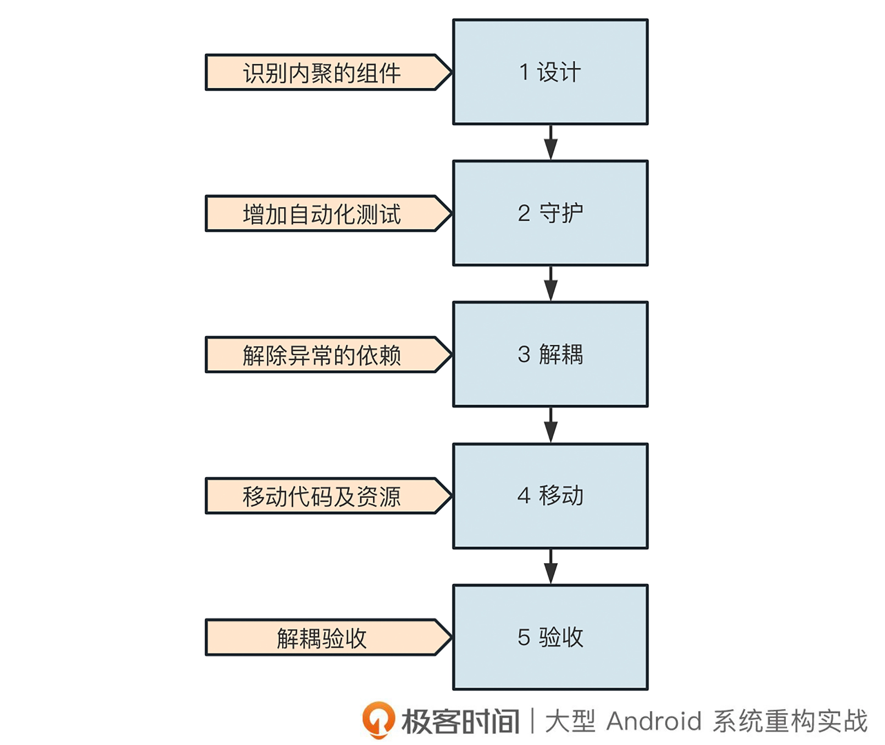
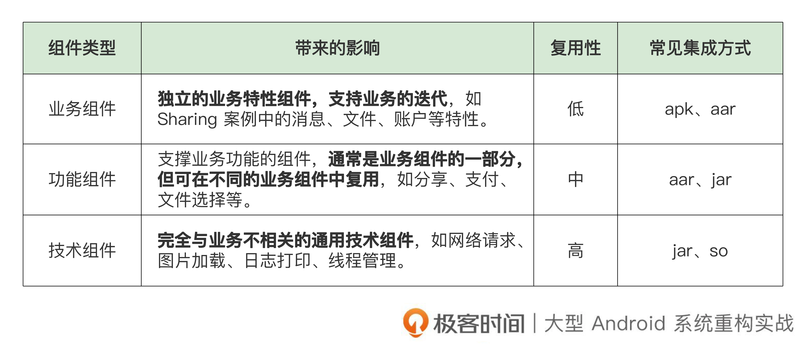
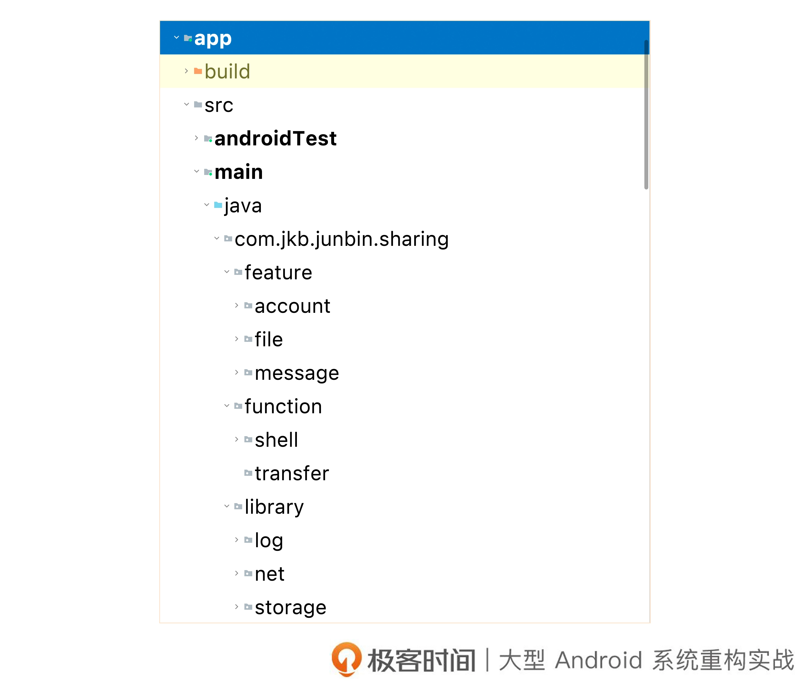
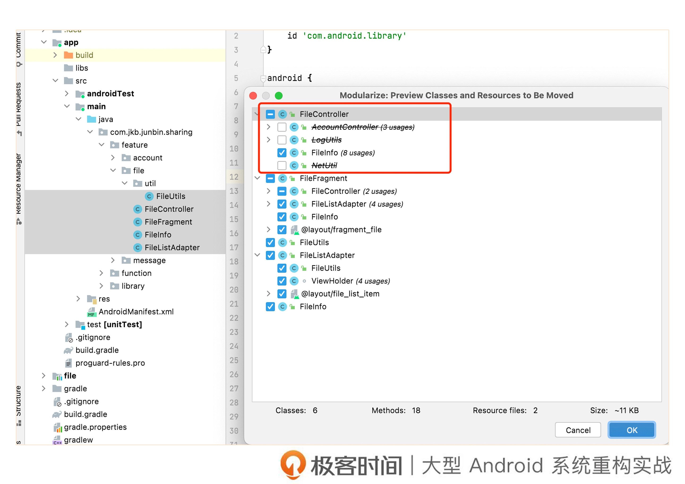
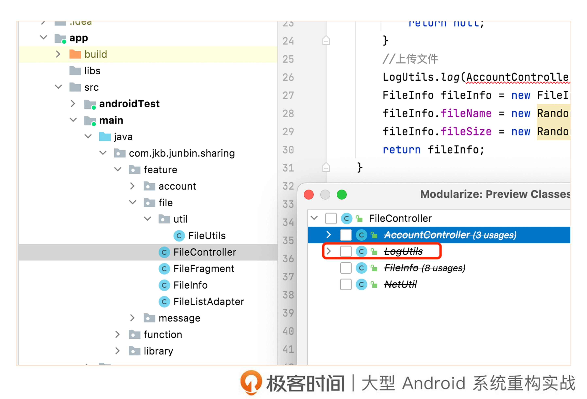
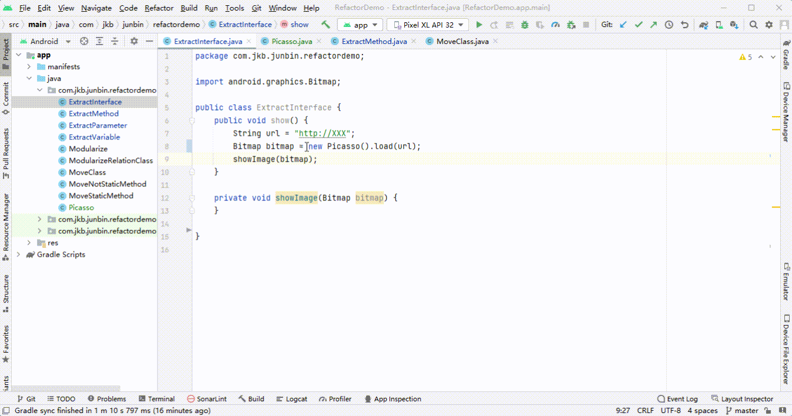
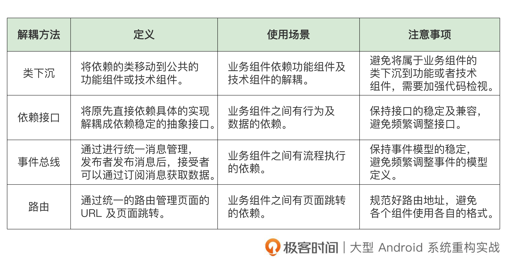

# 10 | 架构改造：5个步骤，高效推动组件化架构重构

你好，我是黄俊彬。

在过去的很多咨询项目中，我发现一个很有意思的现象——项目的架构设计是一回事，代码落地又是另外一回事，很多架构设计最终都只是落在了 PPT 上。发生这类现象，一方面可能是因为后续架构腐化了，缺少守护；另一方面是实际落地到代码的改造环节，它的复杂度比纸上画图高得多。

所以，我根据以往多个大型遗留系统的改造经验，将重构的改造流程分为了 5 个步骤，帮你安全、高效地进行规模化架构重构落地，并通过自动化手段来守护。



如上图所示，这 5 个步骤分别是设计、守护、解耦、移动和验收。在前面的基础篇和分析设计篇，我们已经详细讲过了设计和守护；而移动和验收相对比较简单，我们只要掌握使用 IDE进行自动化移动，并按照验收标准验证就可以了。因此，解耦这个步骤才是落地代码改造的核心步骤。

这节课我会按照第 5 节课的架构设计来重构 Sharing 的代码。这个过程里，我会带你掌握 4种常用的解除依赖的手法，分别是类下沉、依赖接口、事件总线以及路由。

## 第一步：设计，识别内聚的组件

在第 5 节课中我们对组件的类型进行了划分，也对 Sharing 进行了一次全景的组件梳理，把组件分成了业务组件、功能组件和技术组件这三类。



设计这一步其实就是在识别内聚的组件，不过当时我并没有展开说明如何识别这 3 类组件，现在我们就来做个分析。

我们可以参考 UI 上的设计来划分业务组件，通常产品在设计时，都会将相对内聚的功能组织在一个页面上，便于用户使用。所以我们可以从页面入手，接着逐步分析这个页面所依赖的类，将这些类划分到统一的业务组件中。

功能组件通常的特点就是被多个业务组件复用，所以根据代码的依赖情况，就能判断被多处引用的功能，是否属于功能组件。接着我们还需要分析出被业务组件依赖的关键入口类，同时找到该类依赖的相关类，将这些类划分到统一的功能组件中。

对于技术组件，大部分的应用可能都会使用第三方提供的框架。如果你的项目有自己开发的相关技术组件，可以参考功能组件的识别方式进行分析，但是需要注意技术组件与具体的业务无关，我们可以将其用在多个应用上。

最后需要注意，通常在第一步我们可能会把一些类错误划分到某些组件中，不过在后续的解除依赖中，我们仍然可以继续重新调整一些类的划分。

## 第二步：守护，增加自动化测试

由于在第三步我们需要对代码做重构调整，虽然这个过程会借助 IDE 进行安全重构，但由于代码的调整会比较大，所以在动代码之前，我们需要增加基本的自动化测试，以此保证重构不破坏原有的功能。那么需要补充哪些自动化测试呢？

这个步骤有两种类型的自动化测试要补充，第一种是架构守护的自动化测试，你可以参考第7 节课中使用 ArchUnit 为 Sharing 覆盖架构守护测试的做法。

第二种是功能的自动化测试。我们第 3 节课讲测试策略时，曾经给出了针对遗留系统覆盖自动化测试的策略，那就是首先考虑覆盖中大型的测试，然后进行代码重构，重构完成后再及时补充中小型的测试。

这样做有两方面原因：一是因为还未重构的遗留系统可测性很低，覆盖小型自动化测试的成本太高；二来是重构后代码内部的结构会有所调整，如果先覆盖小型测试，后续的测试代码也要相应再次调整。

所以一般来说，守护测试都是中大型的 UI 自动化测试，因为重构并不会改变用户对软件的使用流程。至于如何覆盖中大型的自动化测试，你可以参考第 2 节课的内容。

## 第三步：解耦，解除异常依赖

针对 Sharing 的工程，前面我们已经按照新的包结构组织了代码。



但是如果我们要通过 Modularize 把这些代码移动到独立的模块，IDE 就会提示警告。



这里主要的问题就是要移动的代码依赖目前工程中的代码，只要这个依赖没有解除，我们就无法进行第四步的移动工作。那么怎么来解除依赖呢？

下面我教你四种常用的解除依赖方式，分别是类下沉、依赖接口、事件总线和路由。

### 类下沉

类下沉指的是将依赖的类移动到公共的功能组件或者技术组件中。这个解除依赖的手法适用于业务组件依赖的类属于公共的组件。操作步骤也比较简单，分别是：

- 将具体类移动到适当的公共组件中。

- 调用组件增加对该公共组件的依赖。

由于文件模块依赖了 LogUtils，所以在将文件模块移动到独立的业务组件之前，我们需要将LogUtils 及 NetUtil 等类移动到独立的技术组件中。



在项目中我们需要注意，对于挪动至功能或者技术组件的代码需要严格审核，避免为了解耦强行将一些属于业务组件的类移动到下层的组件中，导致业务组件在下层组件中产生耦合。

### 依赖接口

依赖接口是指将原先直接依赖具体的实现，解耦成依赖稳定的抽象接口。这个解除依赖的手法适用于业务组件之间的依赖。

我们可以将业务组件的直接依赖重构为依赖抽象的接口，这个接口下沉到基座中，具体的实现还是留在各自的业务组件中，后面是操作步骤。

1. 提取独立的方法。

2. 将方法移动到独立的类中。

3. 提取接口，将调用类调整为调用接口。

4. 注入具体的实现。

第 9 节课的时候我给你演示过如何提取接口。这里我们结合当时的示例和操作动图，再复习一下。

重构前的代码是这样：

```java
public void show() {
   String url = "http://XXX";
   Bitmap bitmap = new Picasso().load(url);
   showImage(bitmap);
}
```

操作动图是后面这样。



重构后的代码是这样。

```java
private IImageLoader imageLoader;
public void show() {
   String url = "http://XXX";
   Bitmap bitmap = imageLoader.getBitmap(url);
   showImage(bitmap);
}
```

在项目中我们需要注意保持接口的稳定，如果接口频繁修改，那就意味着所有依赖这个接口的业务组件也要同步修改，这样就和依赖具体的实现没有区别了。

### 事件总线

事件总线指的是通过进行统一消息管理，发布者发布消息后，接受者可以通过订阅消息来获取数据。这个解除依赖的手法同样适用于业务组件之间有行为或数据监听的场景。

例如，当个人中心修改用户信息成功以后，需要在消息模块能同步显示。这时候我建议你采用成熟的事件总线管理框架来管理，比如 EventBus，具体的操作步骤是这样：

1. 定义事件。

2. 发送者发送对应的事件。

3. 接受者订阅事件执行相应的逻辑。

4. 及时移除不需要的事件监听。

结合上面个人中心修改信息同步的例子，我们首先可以定义同步的事件，代码是后面这样。

```python
class UpdateUserInfo{
   private UserInfo userInfo;
   public UpdateUserInfo(UserInfo userInfo) {
       this.userInfo = userInfo;
   }
   public UserInfo getUserInfo() {
       return userInfo;
   }
}
```

接着，在个人中心修改用户信息成功后发生对应的事件。

```
EventBus.getDefault().post(new UpdateUserInfo(new UserInfo()));
```

然后在消息模块中定义事件的接收，并注册相关的监听，同时移除监听。

```java
//注册
EventBus.getDefault().register(this);
//监听
@Subscribe(threadMode = ThreadMode.MAIN)
public void userInfoUpdateEventBus(UserInfo userInfo){
 //刷新相关的数据及页面展示
}
//移除监听
EventBus.getDefault().unregister(this);
```

事件总线与依赖接口一样，需要保持事件模型的稳定性，如果事件模型被频繁修改，那么所有监听事件的组件也要同步修改。

### 路由

路由是指代通过统一的路由来管理页面的 URL 及页面跳转。这个解除依赖的手法适用于解除业务组件页面的路由跳转这类场景。

目前，我们可以采用业内成熟的路由框架方案来进行管理，如 ARouter、WMRotuer 等框架。

操作步骤是这样：首先我们要在跳转类中定义对应的映射路径。然后，在调用处使用对应的路径进行跳转。

下面我们来看一个使用 ARouter 定义的页面跳转示例。

```java
//没有使用路由
fragments.add(FileFragment.newInstance());
//使用路由
//声明
@Route(path = "/feature/file")
public class FileFragment extends Fragment
//调用
fragments.add((Fragment) ARouter.getInstance().build("/feature/file").navigation(
```

最后，我们可以通过运行架构守护用例或者使用 Dependencies 功能，判断是否已经解除了所有的异常依赖。如果所有的依赖都解除了，我们接下来进行第 4 步移动时，就不会出现带下划线的提示了。

## 第四步：移动，移动代码及资源

完成依赖解耦后，我们就可以使用 Modularize 来将整个包移动到独立的模块中去，具体的操作步骤你可以参考第 9 节课的内容。

## 第五步，验收：解耦验收

最后一步是对完成解耦的组件进行验收，这里要满足三个基本的验收条件。

- 编译通过，能够打包出安装包。

- 架构守护用例执行通过。

- 验收自动化测试执行通过。

当这三个条件都满足时，我们可以再进行基本的人工探索性测试，如果没有发现异常，就可以将代码提交入库审核了。

## 总结

这节课我们一起梳理了组件化架构重构的流程，包含设计、守护、解耦、移动以及验收 5 个步骤。

其中，解耦是整个代码落地的关键步骤，我给你提供了 4 种常用的解除依赖的方法。下面我将这 4 种方法的定义、使用场景及注意事项给你总结一下。



下节课，我们会按照这节课组件化架构重构的流程方法，对 Sharing 项目进行改造，敬请期待。

## 思考题

感谢你学完了今天的内容，今天的思考题是这样的：反射也是实现代码解耦的一种方式，你觉得在项目中使用反射有哪些优缺点呢？

欢迎你在留言区与我交流讨论，也欢迎你把它分享给你的同事或朋友，我们一起来高效、高质量地交付软件！
