# 11 | 案例演示：如何将设计最终落地到代码？

你好，我是黄俊彬。

上节课我们学习了组件化架构重构的 5 个步骤，这节课我们将按照这个方法改造 Sharing 项目。在第 7 节课中我们已经按照未来的架构设计，重新设计了代码的包结构，这节课我们要将各个组件拆分到独立的模块工程中，最终将架构设计落地到代码中。

组件化架构重构 5 个关键的步骤分别是设计、守护、解耦、移动、验收。其中设计及守护通常针对的是整个系统，解耦、移动及验收则是针对组件来进行。

前面设计阶段的工作已经完成，那么接下来，我们就来完成守护的步骤，为 Sharing 项目补充基本的功能自动化测试，作为重构的安全网。

## 补充自动化测试

补充自动化测试这一步，我们可以按照用户的核心使用场景来覆盖。以 Sharing 项目为例，用户的主要操作为登录系统，然后查看消息、文件以及个人账户的信息。

我们将这些主要的场景梳理成 4 个 UI 的大型测试，作为基本的冒烟测试。后面是 4 个用例。

1. 用户打开应用，输入正确的账户密码登录成功。

2. 用户进入主页面，切换至到消息页面，能够正常显示消息列表信息。

3. 用户进入主页面，切换到文件页面，能够正常显示文件列表信息。

4. 用户进入主页面，切换到账户页面，能够正常显示登录的个人信息。

接下来，我们将这 4 个核心的用例变成自动化测试用例。

```java
@Test
public void show_login_success_when_input_correct_username_and_password() {
   ActivityScenario.launch(LoginActivity.class);
   onView(withId(R.id.username)).perform(typeText("123@163.com"));
   onView(withId(R.id.password)).perform(typeText("123456"));
   Intents.init();
   onView(withId(R.id.login)).perform(click());
   intended(allOf(
           toPackage("com.jkb.junbin.sharing"),
           hasComponent(hasClassName(MainActivity.class.getName()))));
}
@Test
public void show_message_ui_when_click_tab_messsage() {
   //given
   ActivityScenario<MainActivity> scenario = ActivityScenario.launch(MainActivit
   scenario.onActivity(activity -> {
       //when
       onView(withText("消息")).perform(click());
       //then
       onView(withText("张三共享文件到消息中...")).check(isVisible());
       onView(withText("1.pdf")).check(isVisible());
       onView(withText("2021-03-17 14:47:55")).check(isVisible());
       onView(withText("李四共享视频到消息中...")).check(isVisible());
       onView(withText("2.pdf")).check(isVisible());
       onView(withText("2021-03-17 14:48:08")).check(isVisible());
   });
}
@Test
public void show_show_file_ui_when_click_tab_file() {
   //given
   ActivityScenario<MainActivity> scenario = ActivityScenario.launch(MainActivit
   scenario.onActivity(activity -> {
       //when
       onView(withText("文件")).perform(click());
       //then
       onView(withText("Android遗留系统重构.pdf")).check(isVisible());
       onView(withText("100.00K")).check(isVisible());
       onView(withText("研发那些事第一季.mp4")).check(isVisible());
       onView(withText("9.67K")).check(isVisible());
   });
}
@Test
public void show_account_ui_when_click_tab_account() {
   //given
   ActivityScenario<MainActivity> scenario = ActivityScenario.launch(MainActivit
   scenario.onActivity(activity -> {
       //when
       onView(withText("个人")).perform(click());
       //then
       onView(withText("test")).check(isVisible());
   });
}
```

详细的用例设计及写法，你可以参考第 2 节课和第 3 节课里编写自动化测试的方法。

用例的执行结果是后面这样。

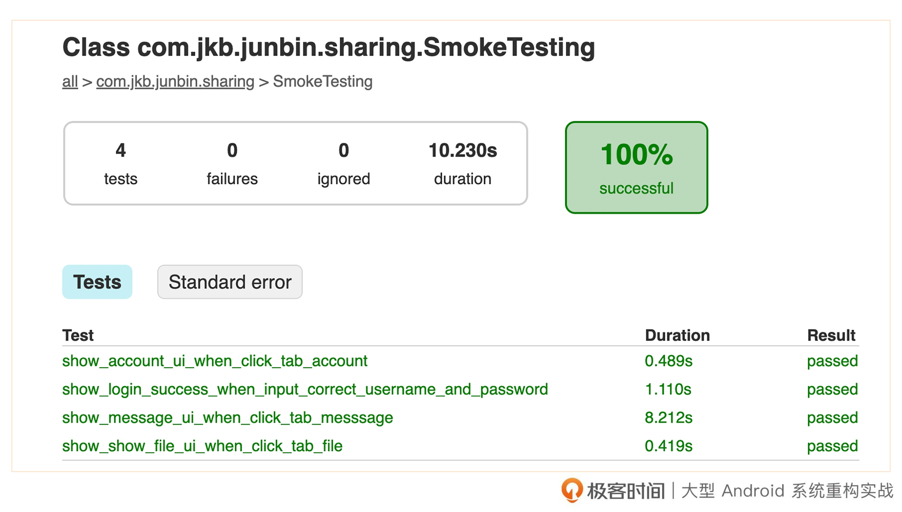

从报告的执行可以看出，一轮基本的冒烟测试执行时间在 10s 左右，我们可以在重构的过程中，频繁地运行这些测试得到反馈。一旦发现代码修改破换了原有的逻辑，就可以马上修复。

在覆盖守护测试这一步，理论上来说覆盖越多场景，那么守护的质量就越高。但是这样做带来的成本也会提高，所以建议在这一步至少覆盖用户核心的使用场景及操作路径。

有了基本的冒烟守护测试，接下来我们就可以开始动手解耦了。我们再来回忆一下，第 7 节课最后总结的 Sharing 异常依赖问题清单列表。

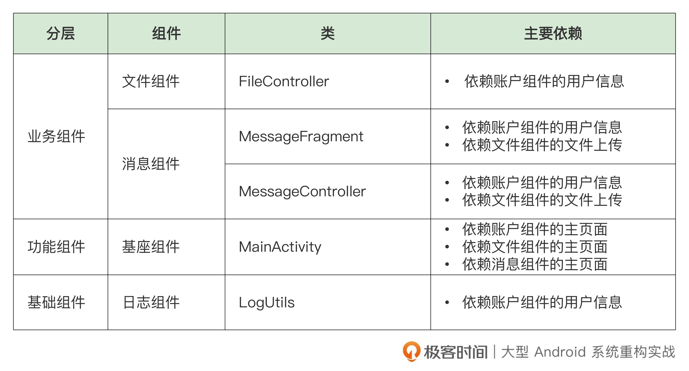

这么多组件，我们应该先从哪些组件入手呢？

我的建议是按从下往上的优先级开始解耦，因为上层的组件依赖下层的组件，所以必须先将下层组件独立出来。

## 日志组件解耦

遵循从下往上解耦的原则，我们先来看看日志组件的解耦。

后面的截图是根据依赖分析扫描后的结果。

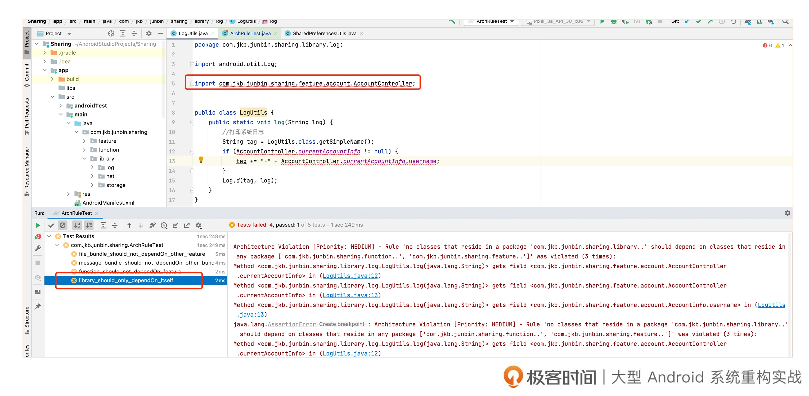

从图里我们可以看出，目前日志组件的主要问题是依赖了账户组件账户信息。LogUtils 类依赖了 AccountController 类中的 username 属性。

针对这个异常的依赖，我们可以采用提取参数的方式来解耦，让日志组件只依赖字符串类型的username，具体的安全重构是后面这样。

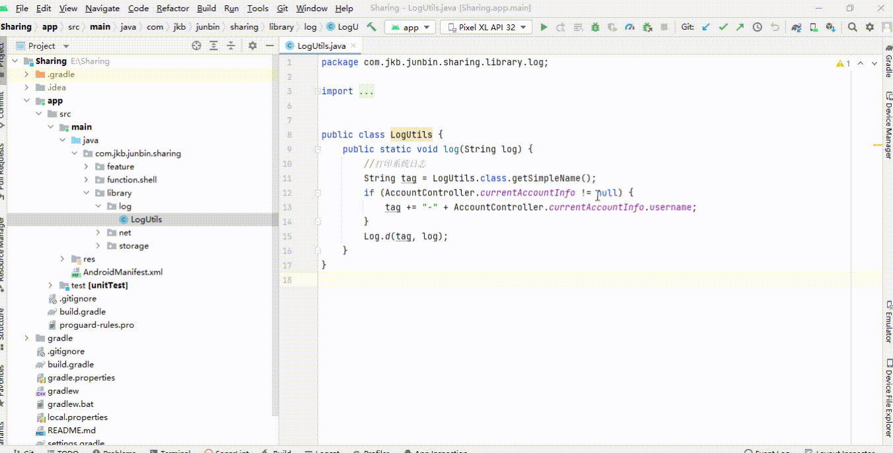

解耦完成以后，我们需要重新运行一下依赖分析工具确认符合架构约束规则，然后就可以移动文件了。如果你还没有新建对应的模块，则需要先建立一个新的模块。

建立完成后，我们需要在 gradle 的配置文件中加入模块的依赖。

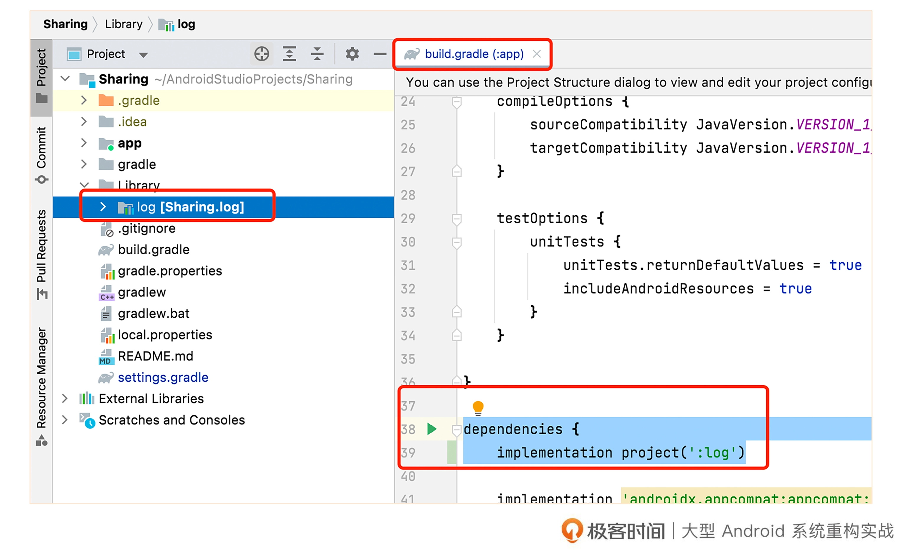

接下来，就可以使用 Modularize 功能移动文件了。

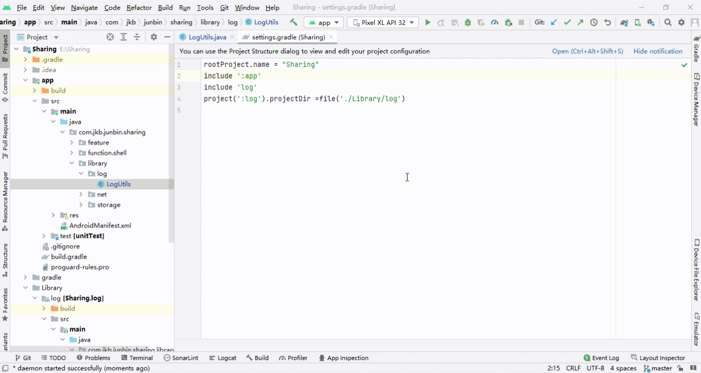

移动完成后，最后一步就是验收阶段，我们需要保证编译通过、自动化守护测试运行通过。

后面截图表示技术组件架构守护用例执行通过，基本的冒烟测试功能验收通过。

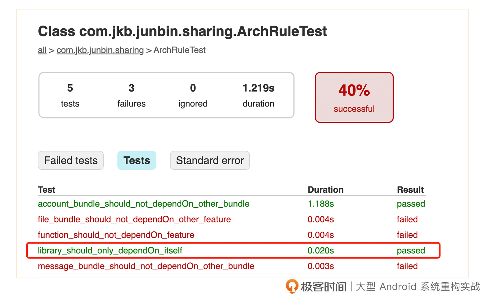

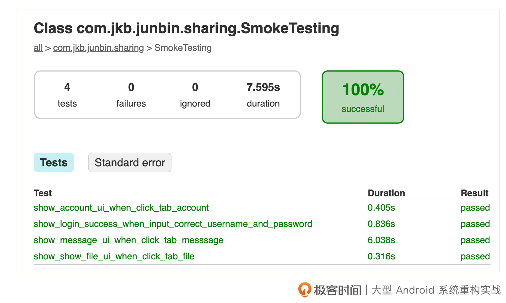

因为各个组件的移动和验收步骤和这里讲的日志组件类似，差异主要在分析解耦和解除依赖上，所以之后学习如何解耦其他组件时，我们主要演示解耦过程，对移动和验收步骤就不再重复讲解了。

## 基座组件解耦

接下来，我们来看基座组件的解耦，我们同样结合依赖分析扫描结果截图来分析。

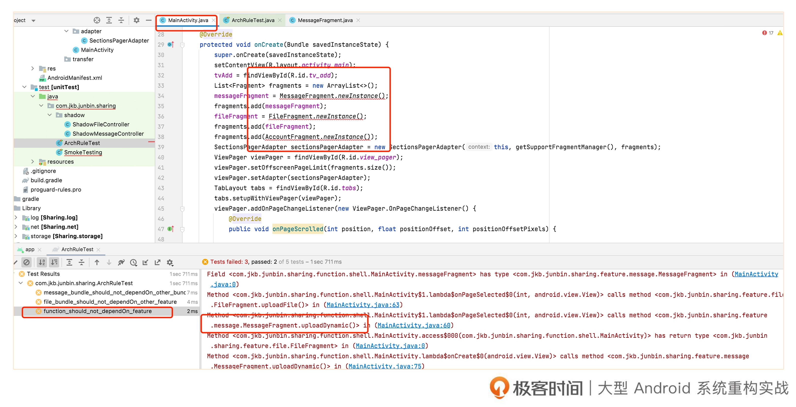

根据依赖分析扫描结果可以看出，目前基座组件主要依赖了各个业务组件的页面以及相关的一些发布功能。MainActivity 依赖了 Message Fragment、FileFragment 以及AccountFragment。另外也依赖了 MessageFragment 中的 uploadDynamic 方法以及FileFragmnet 中的 uploadFile 方法。

针对页面的依赖，我们可以使用路由的方式来解开耦合。这里我先用反射的形式来处理，具体使用路由框架的方式，下节课我会专门讲解。

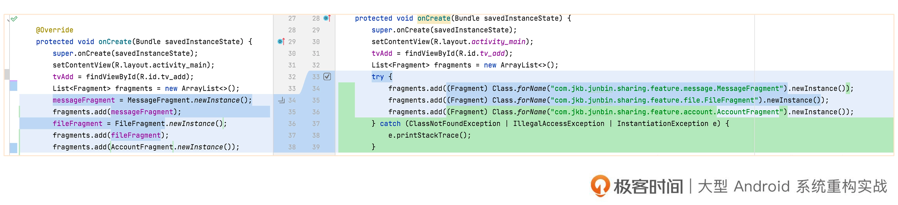

对于基座组件依赖了特性组件的具体行为，这里我们可以采用倒置的方式，让特性组件将行为注入到基座组件，这样才符合架构的约束规则。

我们以 MainActivity 调用 MessageFragment 的 uploadDynamic 方法为例，带你加深理解。

首先定义触发消息模块点击上传的接口。

```java
public interface IMessageAddClickListener {
   public void onClick();
}
```

接着我们将原本依赖 uploadDynamic 的地方，调整为调用 IMessageAddClickListener 接口。

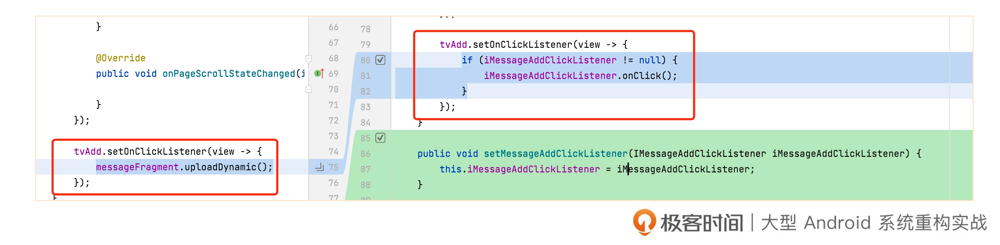

最后在消息模块中将具体的实现注入到基座组件中。

```
//消息页面
((MainActivity) getActivity()).setMessageAddClickListener(() -> uploadDynamic());
```

解耦完成后，我们重新使用工具做检查，结果如下图所示，可以看到，基座组件依赖特性组件的用例已经运行通过。

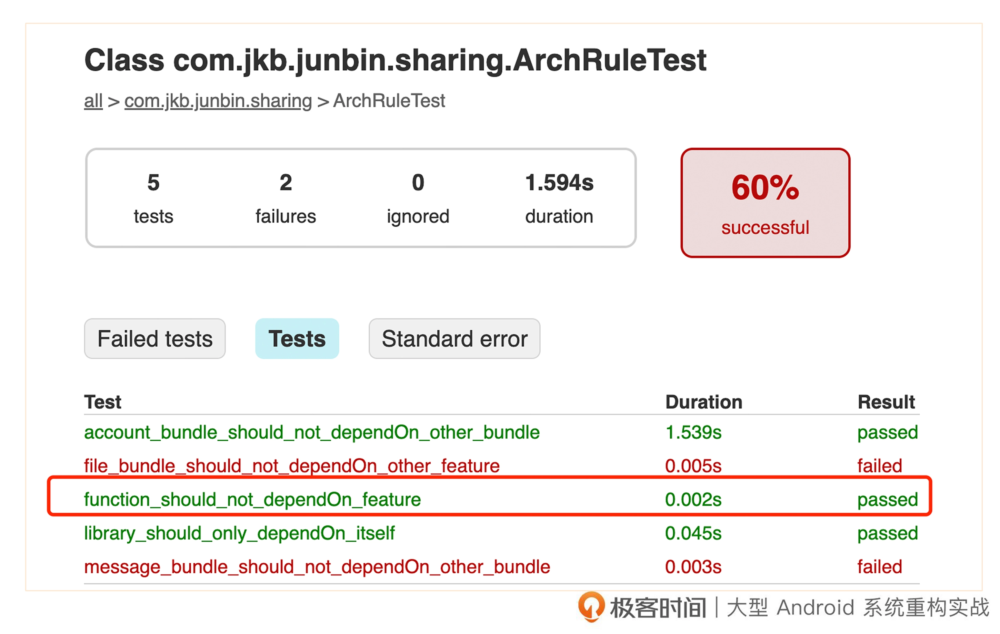

## 文件组件解耦

接下来我们看看文件组件的耦合情况。

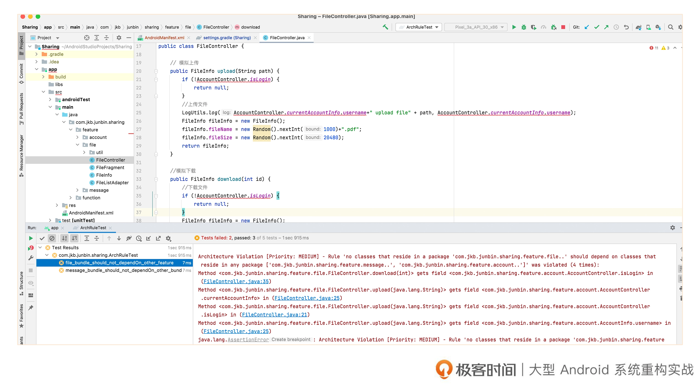

同样，根据依赖分析扫描结果可以看出，目前文件组件的上传及下载功能主要依赖了账户组件的个人信息。FileController 类依赖了 AccountController 类中的 username、isLogin 属性，FileFragment 类同样也依赖了 AccountController 类中的 username 属性。

前面讲架构设计的时候（可以回顾第 5 节课的组件划分），我们提到文件的传输功能会被多个特性组件使用，所以这里除了要解除文件组件和账户模块的依赖，还要把文件模块的上传下载功能独立成一个单独的功能组件。

这里重构的思路是将上传下载相关的代码提取到独立的 FileTransfer 类中，然后通过提取参数的方式与账户模块解耦，最后移动到独立的功能组件中。

具体的重构过程是后面这样。

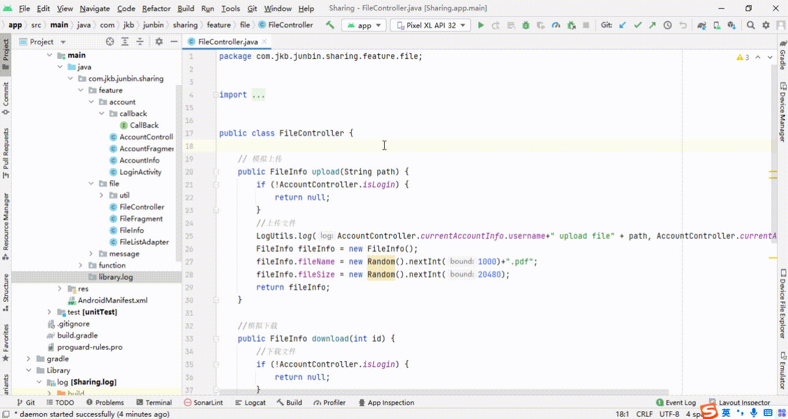

提取文件传输组件后，我们重新来看文件模块的依赖情况。如下图所示，目前主要是FileController 依赖了账户模块的 isLogin 登录状态，FileFragmnet 依赖了账户模块的usename 信息。

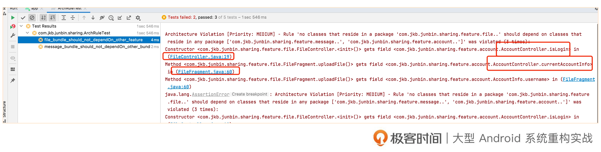

对于特性组件之间的耦合，我们可以采用提取接口的方式来解耦，具体的操作是后面这样。

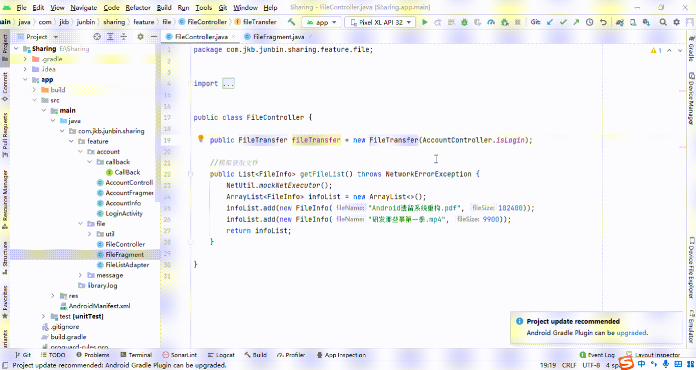

注意重构完成后，接口的注入应该是使用注入框架来实现，这里我们同样先采用反射的机制来完成实现的注入，下节课再具体介绍怎么使用注入框架。

解耦完成后，我们继续使用工具做检查，结果如下图所示，文件特性组件不能依赖账户特性组件的用例已经运行通过。

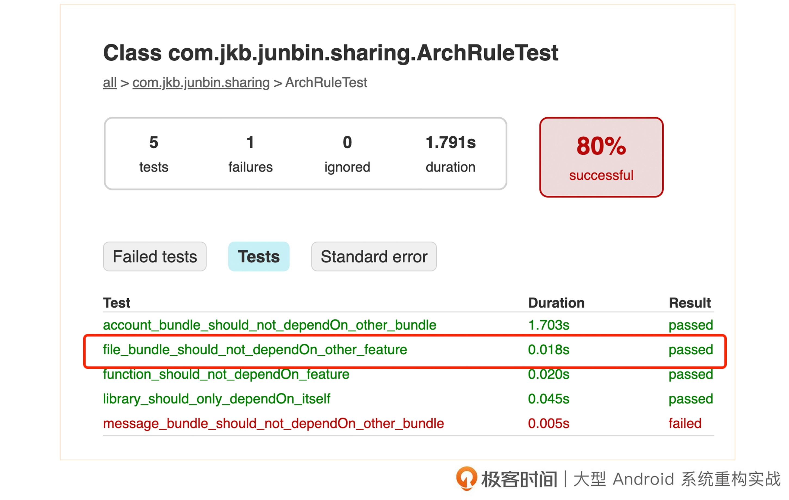

## 消息组件解耦

最后，我们来看消息组件的耦合分析。

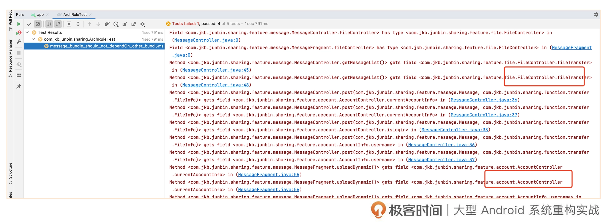

通过上图的依赖分析结果可以看出，消息模块主要依赖文件模块的上传下载功能，另外与文件模块类似，同样依赖了账户模块的账户信息。

针对于与文件模块的耦合，可以直接使用文件传输模块功能组件解耦。对于账户模块的耦合可以参考文件组件解耦的方式，使用 IAccountState 接口来解耦，操作和前面几个组件类似，这里就不再重复演示了。

最后，我们可以看到，随着解耦工作的完成，最终所有的守护用例全部执行通过。

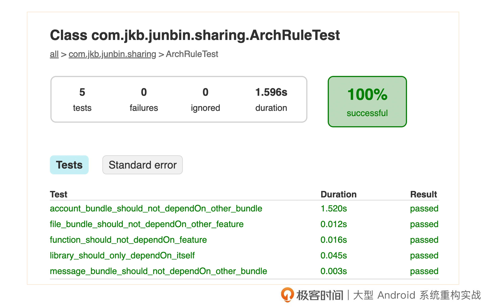

## 总结

今天我们以 Sharing 项目为例，结合上节课组件化架构重构的 5 个步骤，最终将 Sharing 按新的架构设计落地到代码中。

因为上层组件依赖下层组件，所以在重构的过程中，我们按架构从下层到上层的顺序，依次结耦组件解耦。最终，我们来看看架构设计图在代码中的落地情况。

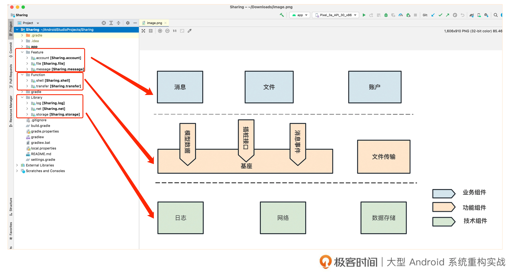

至此，我们也来总结一下组件化架构重构前后的对比。

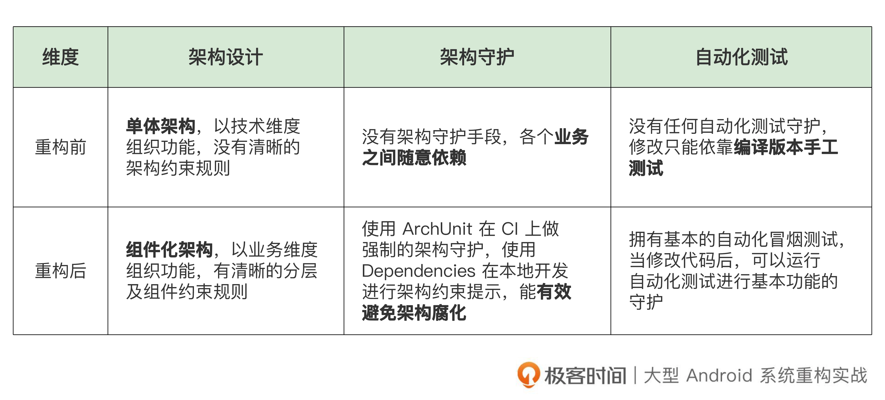

通过对比，我们发现重构后的 Sharing 项目，架构设计更加清晰，并且因为加了自动化的手段守护架构，可以有效地避免架构腐化。同时，自动化测试的加入也能帮助我们更早发现问题，实现测试的左移。

在这节课中，基座组件解耦时，我们使用了反射来实现页面之间的依赖解耦。在文件组件解耦合时，同样使用了反射来解决接口实现注入的问题。细心的你应该也发现了，使用反射虽然能达到解耦的目的，但是代码中也存在了大量的重复代码。

下节课，我会带你学习路由及注入框架，并将其运用到 Sharing 的项目中，敬请期待。

## 思考题

感谢你学完了今天的内容，今天的思考题是这样的：你觉得代码结构直接反映架构设计，带来的好处是什么？

欢迎你在留言区与我交流讨论，也欢迎你把它分享给你的同事或朋友，我们一起来高效、高质量交付软件！
