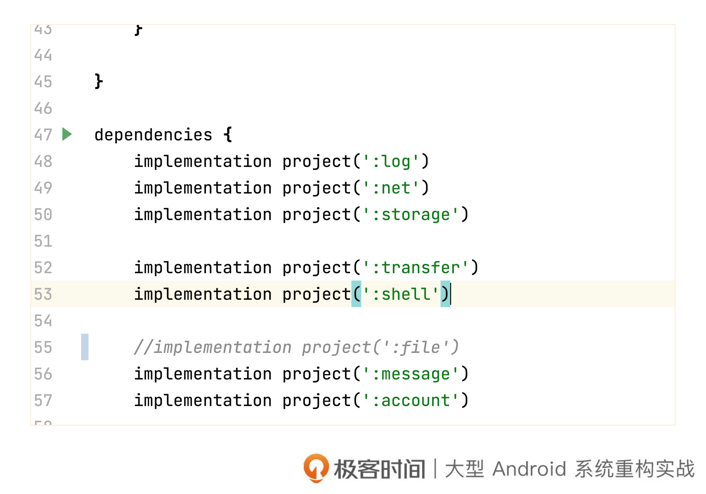
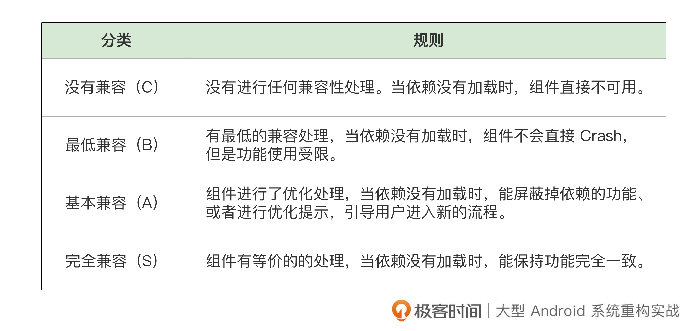
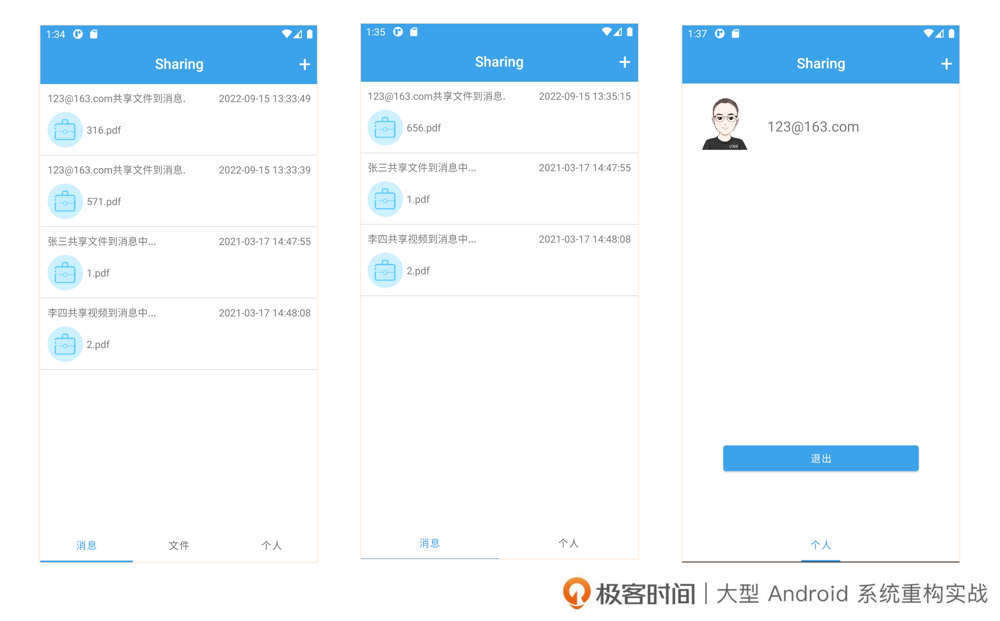
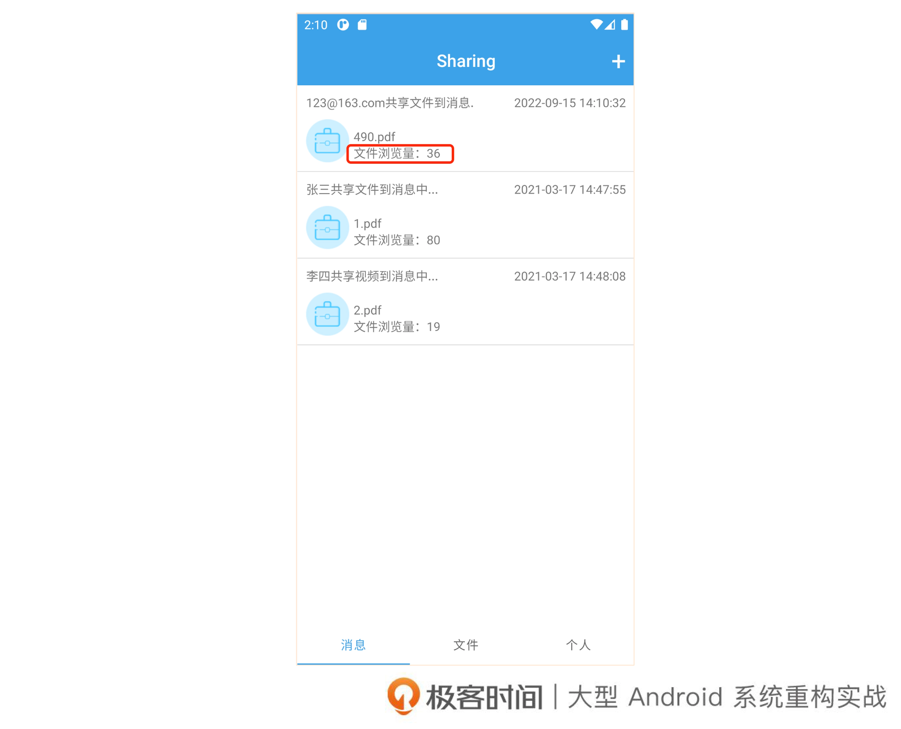
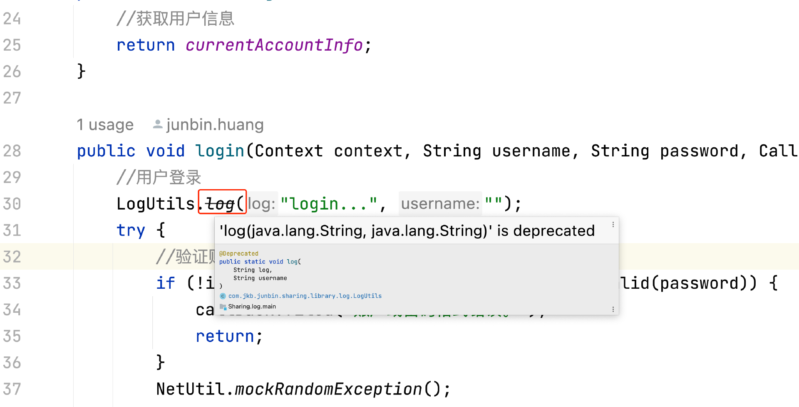

# 13-组件运行时兼容：让组件可以灵活插拔

你好，我是黄俊彬。

上节课我们一起完成了 Sharing 项目的路由与注入改造，目前各个组件在编译时的依赖已经完全解除了。

如果说将代码编译时期的耦合解开，是迈开组件化的第一步，那么完善组件运行时的兼容就是组件化落地的重要验收标准。只有完善组件的运行时兼容，才能真正做到组件的动态插拔。

当组件可以做到灵活的动态插拔，则可以为产品的版本组合带来更加灵活的选择，更加高效地满足不同地区及用户的需求。

今天我们将一起来学习兼容性的定义、3 类组件的兼容性要求以及通过 Sharing 项目来学习如何进行组件运行时的兼容性处理，让组件可以更灵活进行插拔。

## 运行时兼容

我们继续以 Sharing 项目为例，分析一下运行时的依赖具体指的是什么。

在 Sharing 项目中，我们不把文件组件打包到项目中，你可以参考后面这张截图。



由于前面我们已经将编译时期的耦合解开了，所以这里可以正常编译出安装包。但是当我们运行应用时，程序会出现闪退，具体的异常日志如下所示。

```
2022-09-15 09:45:30.940 12820-12820/com.jkb.junbin.sharing E/AndroidRuntime: FATA
   Process: com.jkb.junbin.sharing, PID: 12820
   java.lang.NullPointerException: Attempt to invoke virtual method 'java.lang.C
       at androidx.fragment.app.FragmentTransaction.doAddOp(FragmentTransaction.
       at androidx.fragment.app.BackStackRecord.doAddOp(BackStackRecord.java:183
       at androidx.fragment.app.FragmentTransaction.add(FragmentTransaction.java
       at androidx.fragment.app.FragmentPagerAdapter.instantiateItem(FragmentPag
```

我们再来看看异常对应的具体代码，如下所示。

```
List<Fragment> fragments = new ArrayList<>();
fragments.add((Fragment) ARouter.getInstance().build("/messageFeature/message").n
fragments.add((Fragment) ARouter.getInstance().build("/fileFeature/file").navigat
fragments.add((Fragment) ARouter.getInstance().build("/accountFeature/account").n
SectionsPagerAdapter sectionsPagerAdapter = new SectionsPagerAdapter(this, getSup
```

通过上述代码可以看出，基座代码运行时没有做兼容性处理，这样在组件没有加载的情况下，如果代码上写了直接显示文件主页面，就会有异常。

所以，虽然我们通过路由解除了编译时的依赖，但是在运行时没有兼容处理也会异常，这个就是我们前面说的运行时的依赖。

## 组件兼容性定义

那么你可能会想，组件都不加载了，功能能不受影响吗？

想要回答这个问题，我们需要先对兼容性的定义达成一致，也就是明确兼容性的要求怎么分级。

我们将组件的兼容性划分为 4 个等级，分别为没有兼容（C）、最低兼容（B）、基本兼容（A）、完全兼容（S）。



那么对于前面提到的 3 类组件，也就是业务组件、功能组件以及技术组件，它们的兼容性要求需达到什么要求呢？接下来，我们就结合各个类型的组件特点分析一下。

业务组件虽然在编译上不能直接有相互依赖，但运行上还是不可避免地会有一些功能的依赖。显然如果要做到完全兼容（S）成本会非常高，所以通常情况下对于业务组件的兼容性要求为基本兼容（A）。

至于功能组件及技术组件，通常情况下相对比较稳定，不会有动态插拔的需求。但是这些组件会被上层的业务组件所引用，所以对于功能组件及技术组件的兼容性要求更多的是向上兼容，要保证对外提供的接口稳定，不能随意修改原有接口的方法签名，同时要做好异常的处理，避免出现接口不能按预期的协议返回数据。对于功能及业务组件的兼容性通常要求为基本兼容（A）或者完全兼容（S）。

## Sharing 项目兼容性改造

确定了兼容性的级别，我们这就以 Sharing 项目为例，来看看如何对 3 类组件做兼容性改造，这里我分别挑选了基座组件、消息组件以及日志组件。

### 基座组件改造

基座组件划分在功能组件，但是它在运行时又承担着一个重要的工作，就是集成各个业务组件。拿一开始的运行时兼容的例子，如果没有进行兼容性处理，那么当业务组件没有集成时，基座组件可能完成不可用。

这里对于基座组件来说，兼容的方案是当业务组件被加载时就展示对应的业务组件功能，当没有加载时就屏蔽相关的业务组件的功能。

接下来，我们来看看具体的兼容性代码，目前的逻辑是当路由框架没有加载到对应的业务组件页面时，则屏蔽相关的功能。

```java
//进行非空的兼容性判断
private List<Fragment> getFragmentList(List<Integer> tabTitles) {
   List<Fragment> fragments = new ArrayList<>();
   Fragment messageFragment = (Fragment) ARouter.getInstance().build("/messageFe
   if (messageFragment != null) {
       fragments.add(messageFragment);
       tabTitles.add(R.string.tab_message);
   }
   Fragment fileFragment = (Fragment) ARouter.getInstance().build("/fileFeature/
   if (fileFragment != null) {
       fragments.add(fileFragment);
       tabTitles.add(R.string.tab_file);
   }
   Fragment accountFragment = (Fragment) ARouter.getInstance().build("/accountFe
   if (accountFragment != null) {
       fragments.add(accountFragment);
       tabTitles.add(R.string.tab_user);
   }
   return fragments;
}
//页面根据数据动态展示
public class SectionsPagerAdapter extends FragmentPagerAdapter {
   @Override
   public Fragment getItem(int position) {
        return fragments.get(position);
   }
   @Override
   public int getCount() {
       return tabTitles.size();
   }
}
```

通过增加兼容性处理后，当我们不集成消息组件或者文件组件时，基座组件均可以正常运行，如下图所示。



### 消息组件改造

对于消息组件，产品增加了一个小特性，就是在展示列表信息时，需要展示文件浏览量，如下图所示。



获取文件浏览量是通过文件模块提供的实现得到的，代码是后面这样。

```java
//接口定义
public interface IFileStatistics extends IProvider {
   int getDownloadCount(String id);
}
//调用逻辑
@Override
public void onBindViewHolder(final ViewHolder holder, int position) {
   holder.tvName.setText(infoList.get(position).content);
   holder.tvFileName.setText(infoList.get(position).fileName);
   holder.tvSize.setText(DateUtil.getDateToString(infoList.get(position).date));
   holder.tvCount.setText("文件浏览量：" + iFileStatistics.getDownloadCount(infoLi
}
```

此时，如果我们没有加载文件组件，由于存在运行时的依赖，消息组件就会有异常，日志如下所示。

```
Process: com.jkb.junbin.sharing, PID: 25093
   java.lang.NullPointerException: Attempt to invoke interface method 'int com.j
       at com.jkb.junbin.sharing.feature.message.MessageListAdapter.onBindViewHo
       at com.jkb.junbin.sharing.feature.message.MessageListAdapter.onBindViewHo
```

对于消息组件的兼容性处理，我们当然也可以参考基座组件的方式，当文件组件没集成时，就屏蔽掉相关的展示逻辑。

```java
@Autowired
public IFileStatistics iFileStatistics;
@Override
public void onBindViewHolder(final ViewHolder holder, int position) {
  if(iFileStatistics != null) {
   holder.tvCount.setText("文件浏览量：" + iFileStatistics.getDownloadCount(infoLi
}
}
```

但是如果当依赖组件不可用时，我们就需要有备选的方案，例如可以采用 Mock 的方式定义默认的实现，当依赖不可用就加载 Default 的实现。

但目前 ARouter 框架还不支持一个接口多个实现的机制，这里假设 Arouter 支持通过priority 属性控制多个实现的优先级，Default 实现是后面这样。

```java
@Route(path = "/mock/IFileStatistics", name = "IFileStatisticsMock",priority = 20
public class IFileStatisticsMockImpl implements IFileStatistics {
   @Override
   public void init(Context context) {
   }
   @Override
   public int getDownloadCount(String id) {
       //通过其他的备选方案获取文件的数量。
       return OtherService.getDownloadCount(id);
   }
}
```

### 日志组件改造

因为技术组件通常会被多个功能或业务组件使用，所以做兼容性改造时最重要的一点就是保证向上兼容。也就是说，当内部实现有变化时，要保证好对上接口的兼容性。而且在修改扩展代码时，不能影响原有接口的功能。

对于基础组件来说，兼容方案的要求是当接口功能有修改或者变化时，不能影响原有接口提供的功能。原则上扩展需要增加新的接口，如果涉及调整原有的接口，也应该预留充分的时间给上层的组件修改，避免更新完新版本后出现编译不通过或者运行时异常。

下面我们以日志组件为例做个兼容性改造练习。在之前日志组件提供的 log 方法，需要调用者传入 username 参数，代码是后面这样。

```java
public static void log(String log, String username) {
   //... ...
   Log.d(tag, log);
}
```

对于调用者来说，每次都需要传递 username 参数，这里会有大量的重复代码，难以维护，所以我们可以选择不记录 username 相关信息。但此时如果我们直接修改原有的方法签名，会导致所有升级日志组件新版本的其他组件都需要修改。

这里建议你这样做：将原有废弃的方法加上 @Deprecated 注解，然后定义一个新的方法。

```java
/**
* 请使用新的日志记录方法LogUtils.log(String log)进行日志记录,
*  本方法在XXX版本移除。
*/
@Deprecated
public static void log(String log, String username) {
   //... ...
   Log.d(tag, log);
}
public static void log(String log) {
   //... ...
   Log.d(tag, log);
}
```

当调用了标记 @Deprecated 注解的方法时，IDE 在调用该标记废弃方法的地方会出现警告提示。



最后，在确认已经没有其他组件对废弃方法的使用后，可以移除该方法。另外，如果技术组件也依赖了其他的组件，当依赖不可用时，代码需要做好异常的处理，并按接口协议返回抛出异常，让功能及业务组件能够按预期处理。

## 总结

今天我们一起学习了组件的兼容性定义，还通过 Sharing 项目了解了 3 类组件常用的兼容性处理方法。

对于兼容性，当存在依赖并且依赖不可用时，是没办法做到功能上完全一致的。为此，我们将兼容性分为了 4 个大类，分别为没有兼容（C）、最低兼容（B）、基本兼容（A）、完全兼容（S）。

业务组件兼容性的要求通常为基本兼容（A），当依赖的组件不可用时，我们可以在流程处理上将相关的功能隐藏，减少对用户使用的干扰；对于功能及技术组件，兼容性的要求通常为基本兼容（A）以及完全兼容（S），由于功能及技术组件被其他组件使用，所以可以通过扩展的方式，保证对外提供的接口稳定性。

至此，对于组件化架构的代码改造就告一段落了。从下节课开始，我们会深入组件内部，去对组件内的架构进行重构优化，敬请期待。

## 思考题

感谢你学完了今天的内容，今天的思考题是这样的：如果我们想增加一个动态的机制来控制组件的插拔，你觉得可以采用哪些方式，它们的优缺点有哪些？

欢迎你在留言区与我交流讨论，也欢迎你把它分享给你的同事或朋友，我们一起来高效、高质量交付软件！
