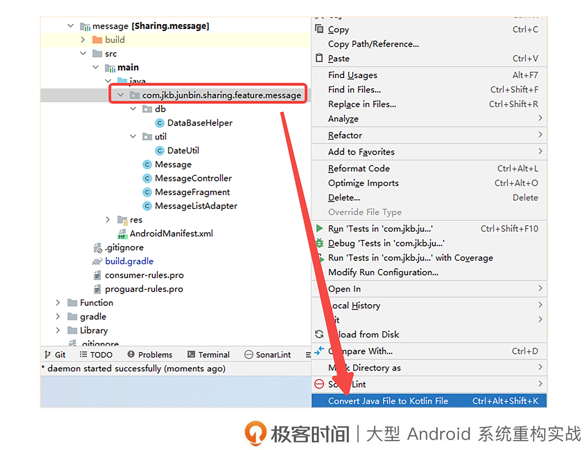
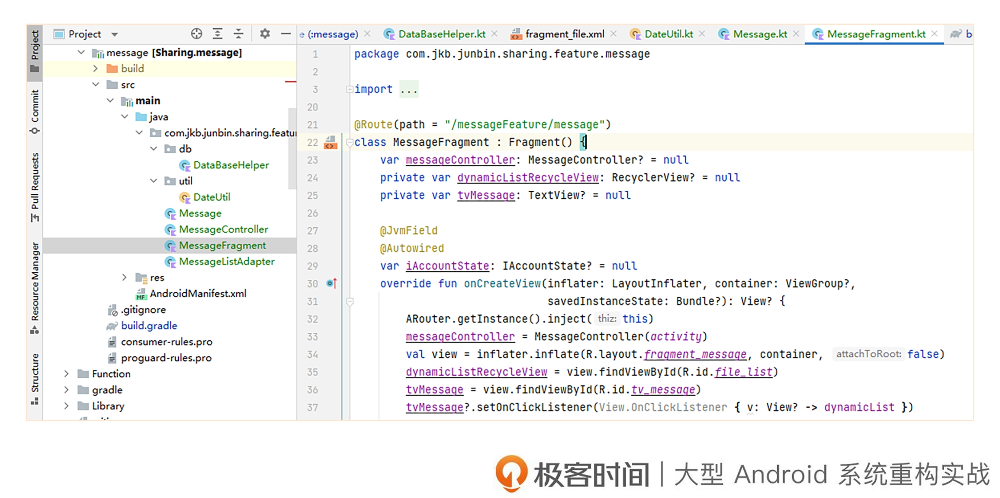
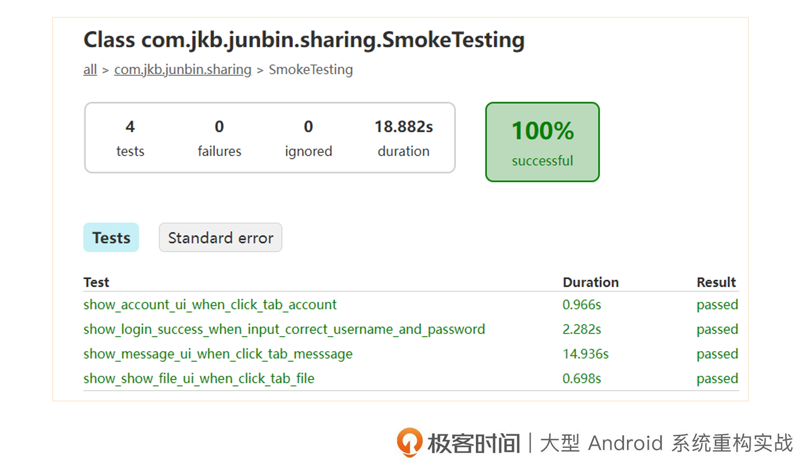
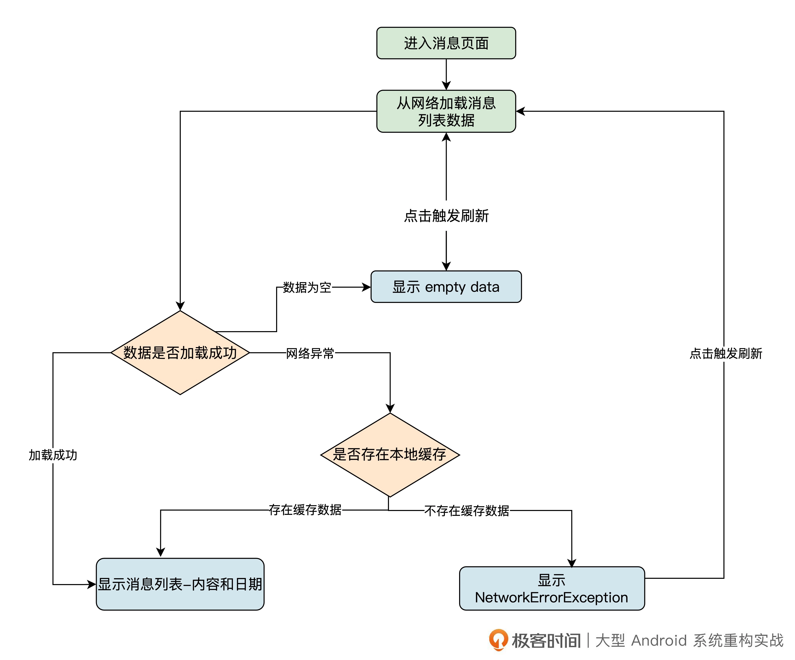
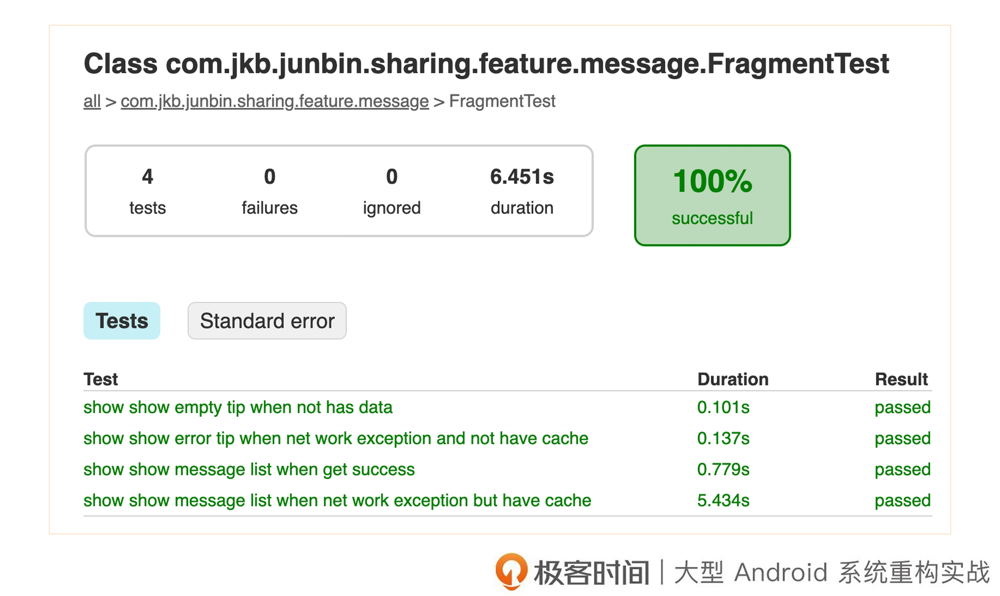
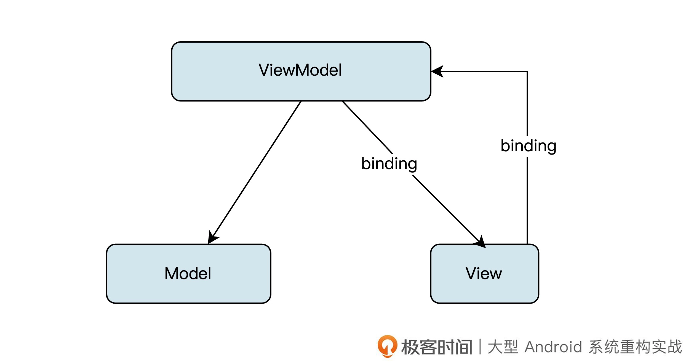
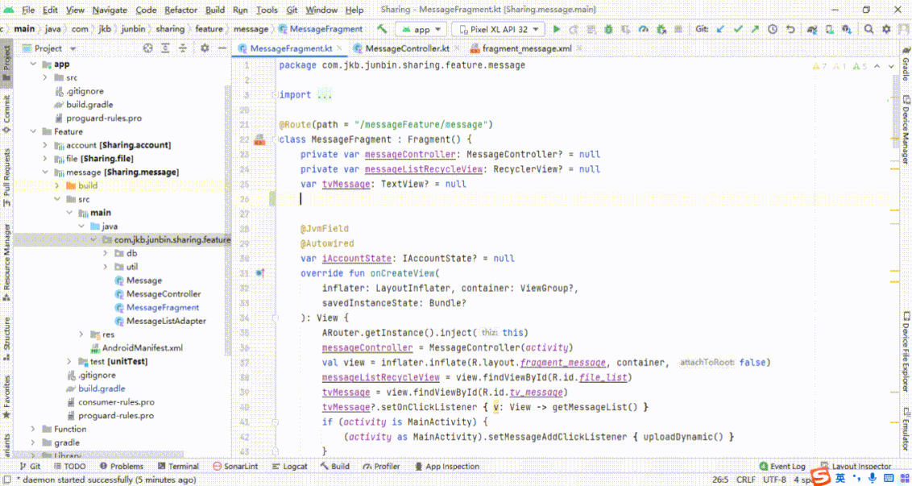
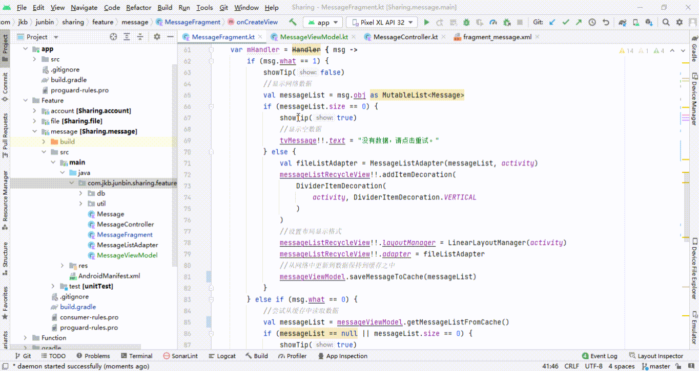
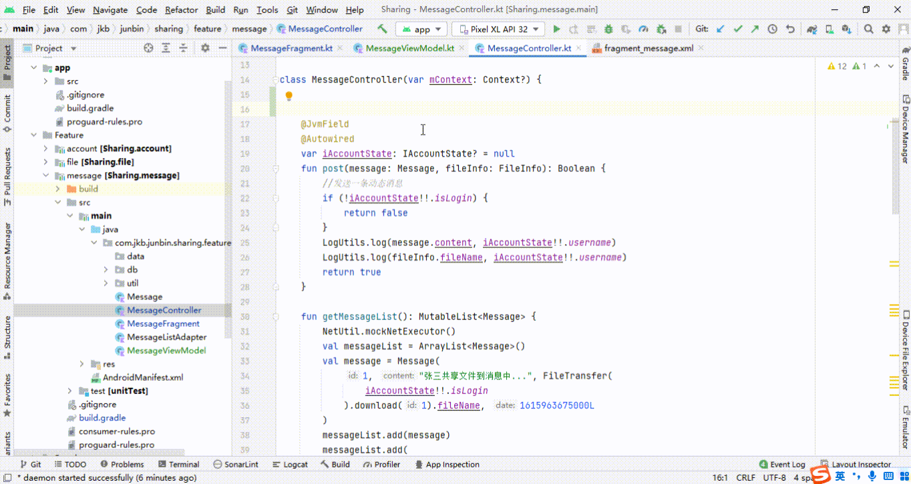
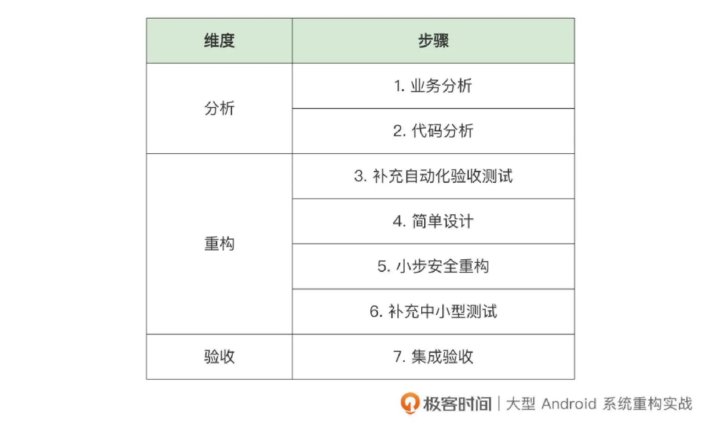

# 16 | 技术栈更新：消息组件Kotlin+MVVM重构

你好，我是黄俊彬。

随着项目不断的迭代，新的技术栈也会持续不断地演进。适时使用新的技术栈，可以帮助我们提高效率以及代码质量。这节课，我们就一起来学习如何安全高效地为遗留系统升级技术栈，具体我们会使用新的语言 Kotlin 以及新的架构模式 MVVM，来重构消息组件。

选择 Kotlin + MVVM，有两方面考量：一方面，Kotlin 从框架层面提供了大量的封装，可以帮我们减少工作量，无需编写大量的模板代码；另一方面，Kotlin 也是官方推荐的开发语言，MVVM 框架则是官方推荐的分层架构，为此 JetPack 也专门提供了相应的框架组件支持快速开发。

不过技术栈不同了，流程方法仍然相同，这里我们会继续使用组件内分层重构的方法。

## 准备：支持 Kotlin

对于遗留系统来说，通常使用的开发语言都是 Java，那么在选择 Kotlin 语言时，我们通常会有 2 种选择：第一种是 Kotlin 与 Java 语言混编，另外一种是完全使用 Kotlin 替换 Java。

至于哪种方式更好，它们之间有什么差异？我们结合例子来分析一下。

第一种方法使用 Java 与 Kotlin 混编，这个做法的好处是我们不需要改动原来的代码，只需要用 Kotlin 语言编写扩展的代码就可以了。但是缺点就是由于 Kotlin 的语言高度依赖编辑器生成转换代码，所以有些语法通过 Java 来调用 Kotlin 会比较啰嗦，例如伴生函数的调用。

```java
//定义
class KotlinClass {
   companion object {
       fun doWork() {
           /* … */
       }
   }
}
//使用Kotlin调用Kotlin
KotlinClass.doWork();
//使用Java调用Kotlin（方式一）
public final class JavaClass {
   public static void main(String... args) {
       KotlinClass.Companion.doWork();
   }
}
//使用Java调用Kotlin（方式二）
class KotlinClass {
   companion object {
       @JvmStatic fun doWork() {
           /* … */
       }
   }
}
public final class JavaClass {
   public static void main(String... args) {
       KotlinClass.doWork();
   }
}
```

从例子可以看出，虽然我们可以通过 @JvmStatic 注解来简化调用，但是始终没有 Kotlin 调用Kotlin 那么方便。

第二种方法使用 Kotlin 替换 Java 的好处就是，可以减少一些跨语言调用编写问题，但是缺点是需要将原有的代码改动成 Kotlin。好在官方也提供了将 Java 语言转换为 Kotlin 语言的功能，转换起来很方便。

对于 Sharing 项目来说，我们已经覆盖了基本的自动化测试功能，可以在转换后进行验证，所以这里我们采用将 Java 代码替换成 Kotlin 代码的方式，具体的操作你可以参考后面的图片。



注意转换完成后如果有一些代码提示编译错误，需要先进行调整，保证基本的编译正常。另外由于是从 Java 代码转换来的，所以有很多代码虽然转换成 Kotlin，但也还带着浓浓的 Java味道，你可以继续结合 Kotlin 的语法特点重构代码。

转换后的代码是后面这样。



最后当确定编译通过后，我们需要运行基本的冒烟自动化测试，保证运行通过。



完成 Kotlin 的转换工作后，接下来我们就可以开启 MVVM 架构的重构改造了。

## 第一步：业务分析

下面我们开始对消息组件进行 MVVM 重构，同样是七个步骤。第一步先来看业务分析。消息组件的展示逻辑基本与文件组件的类似，都有异常逻辑处理的区分。

消息组件与文件组件最主要的区别是增加了本地缓存，当网络异常时会判断本地是否存在缓存数据，如果有，则优先展示缓存数据，如下图所示。



根据流程图我们可以看出，主要的用户操作场景是这样的：

- 当用户进入消息页面时，如果成功从网络上加载消息列表，那么页面会显示消息列表（标题、时间、发布文件信息等）。

- 若从网络上加载消息列表时出现异常，如果存在本地缓存数据时，则显示缓存消息列表信息。

- 若从网络上加载消息列表出现异常且没有本地缓存信息时，用户界面会展示网络异常的提示信息，此时点击提示会重新触发数据的加载。

- 当加载数据为空时，同样会展示数据为空的提示，点击后重新触发刷新。

## 第二步：代码分析

下面我们一起来分析消息组件主页面的关键业务逻辑代码，我们先看看原有代码设计。：

```python
@Route(path = "/messageFeature/message")
class MessageFragment : Fragment() {
  //... ...
   fun getMessageList() {
       Thread {
           val message = android.os.Message()
           try {
               val messageList = messageController?.getMessageList()
               message.what = 1
               message.obj = messageList
           } catch (e: NetworkErrorException) {
               message.what = 0
               message.obj = "网络异常，请点击重试。"
               e.printStackTrace()
           }
           mHandler.sendMessage(message)
       }.start()
   }
   var mHandler = Handler { msg ->
       if (msg.what == 1) {
           showTip(false)
           //显示网络数据
           val messageList = msg.obj as MutableList<Message>
           if (messageList.size == 0) {
               showTip(true)
               //显示空数据
               tvMessage!!.text = "没有数据，请点击重试。"
           } else {
               val fileListAdapter = MessageListAdapter(messageList, activity)
               messageListRecycleView!!.addItemDecoration(
                   DividerItemDecoration(
                       activity, DividerItemDecoration.VERTICAL
                   )
               )
               //设置布局显示格式
               messageListRecycleView!!.layoutManager = LinearLayoutManager(acti
               messageListRecycleView!!.adapter = fileListAdapter
               //从网络中更新到数据保存到缓存之中
               messageController!!.saveMessageToCache(messageList)
           }
       } else if (msg.what == 0) {
           //尝试从缓存中读取数据
           val messageList = messageController?.getMessageListFromCache()
           if (messageList == null || messageList.size == 0) {
               showTip(true)
               //显示异常提醒数据
               tvMessage!!.text = msg.obj.toString()
           } else {
               val fileListAdapter = MessageListAdapter(messageList, activity)
               messageListRecycleView!!.addItemDecoration(
                   DividerItemDecoration(
                       activity, DividerItemDecoration.VERTICAL
                   )
               )
               //设置布局显示格式
               messageListRecycleView!!.layoutManager = LinearLayoutManager(acti
               messageListRecycleView!!.adapter = fileListAdapter
           }
       }
       false
   }
}
```

从上述代码可以看出，消息组件的核心问题有 2 个。第一个问题与文件组件问题类似，主要还是过大类的问题，我们这节课里将其重构为 MVVM 架构。

另外一个问题就是缓存数据保存到数据库操作都是采用 SQL 拼写的方式，这样做有什么缺点你可以做个思考，下节课我们再专门说说如何对它做优化。

## 第三步：补充自动化验收测试

接下来我们进行第三步，补充自动化验收测试。根据前面的业务分析，我们梳理出核心的 4 个用例。

- 测试用例 1：当用户进入消息页面时，正常请求到数据，显示消息列表。

- 测试用例 2：当用户进入消息页面时，网络异常，但有本地缓存数据，显示缓存消息列表。

- 测试用例 3：当用户进入消息页面时，网络异常，但无本地缓存数据，显示异常提示。

- 测试用例 4：当用户进入消息页面时，数据为空，显示空提示。

我们将这些用例进行自动化，代码是后面这样。

```
//测试用例1
@Test
fun `show show message list when get success`() {
   //given
   ShadowMessageController.state = ShadowMessageController.State.SUCCESS
   //when
   val scenario: FragmentScenario<MessageFragment> =
       FragmentScenario.launchInContainer(MessageFragment::class.java)
   scenario.onFragment() {
       //then
       onView(withText("张三共享文件到消息中...")).check(matches(isDisplayed()))
       onView(withText("大型Android遗留系统重构.pdf")).check(matches(isDisplayed())
       onView(withText("2021-03-17 14:47:55")).check(matches(isDisplayed()))
       onView(withText("李四共享视频到消息中...")).check(matches(isDisplayed()))
       onView(withText("修改代码的艺术.pdf")).check(matches(isDisplayed()))
       onView(withText("2021-03-17 14:48:08")).check(matches(isDisplayed()))
   }
}
//测试用例2
@Test
fun `show show message list when net work exception but have cache`() {
   //given
   ShadowMessageController.state = ShadowMessageController.State.CACHE
   //when
   val scenario: FragmentScenario<MessageFragment> =
       FragmentScenario.launchInContainer(MessageFragment::class.java)
   scenario.onFragment() {
       //then
       onView(withText("张三共享文件到消息中...")).check(matches(isDisplayed()))
       onView(withText("大型Android遗留系统重构.pdf")).check(matches(isDisplayed())
       onView(withText("2021-03-17 14:47:55")).check(matches(isDisplayed()))
       onView(withText("李四共享视频到消息中...")).check(matches(isDisplayed()))
       onView(withText("修改代码的艺术.pdf")).check(matches(isDisplayed()))
       onView(withText("2021-03-17 14:48:08")).check(matches(isDisplayed()))
   }
}
//测试用例3
@Test
fun `show show error tip when net work exception and not have cache`() {
   //given
   ShadowMessageController.state = ShadowMessageController.State.ERROR
   //when
   val scenario: FragmentScenario<MessageFragment> =
       FragmentScenario.launchInContainer(MessageFragment::class.java)
   scenario.onFragment() {
       //then
       onView(withText("网络异常，请点击重试。")).check(matches(isDisplayed()))
   }
}
//测试用例4
@Test
fun `show show empty tip when not has data`() {
   //given
   ShadowMessageController.state = ShadowMessageController.State.EMPTY
   //when
   val scenario: FragmentScenario<MessageFragment> =
       FragmentScenario.launchInContainer(MessageFragment::class.java)
   scenario.onFragment() {
       //then
       onView(withText("没有数据，请点击重试。")).check(matches(isDisplayed()))
   }
}
```

这里补充一个编程技巧，用 Kotlin 语言编写测试用例的时候，建议你使用引号来标识用例名，避免用下划线串联用例名，这样代码阅读体验更好。

后面是测试用例的执行结果，用例成功通过。



## 第四步：简单设计

下面我们来进行简单设计，这次的分层架构我们选择使用 MVVM。

首先我们来了解一下 MVVM 的架构设计模式，以及基于该模式我们需要定义哪些核心的类以及数据模型。

### 1. MVVM 架构

MVVM 架构的主要特点是业务逻辑和视图分离，ViewModel 和视图之间通过直接绑定，不用定义大量的接口。你可以结合后面的 MVVM 架构设计图来加深理解。



### 2. 关键绑定数据定义

ViewModel 与 View 之间会通过 DataBindng 自动进行双向同步，所以我们需要先定义好关键的数据。

```
// 数据列表
val messageListLiveData: LiveData<List<Message>>
// 异常信息
val errorMessageLiveData: LiveData<String>
```

### 3. 集成第三方框架

由于 MVVM 需要用到双向绑定，所以通常情况下使用 MVVM 架构都会沿用官方提供的组件进行开发，这里我们需要引入对应的组件。

```
//使用LiveData及ViewModel来管理数据及与View交互
implementation 'androidx.core:core-ktx:1.3.2'
implementation 'androidx.lifecycle:lifecycle-livedata-ktx:2.3.0'
implementation 'androidx.lifecycle:lifecycle-viewmodel-ktx:2.3.0'
//使用协程管理线程调度
implementation 'org.jetbrains.kotlinx:kotlinx-coroutines-core:1.4.1'
implementation 'org.jetbrains.kotlinx:kotlinx-coroutines-android:1.4.1'
```

## 第五步：小步安全重构

做完设计，我们就可以进行小步安全重构了。

我将整个重构分为了几个关键的步骤，每个步骤都附上了用编辑器自动化重构的演示动图。由于 Kotlin 语言 IDE 不支持移动方法，所以在操作过程有很多地方需要用手工进行移动，你可以参考对比一下上节课，感受一下自动和手动的差别。

### 1. 将业务逻辑移动至 ViewModel 类中

首先将 MessageFragment 以及 MessageController 中的主要业务逻辑移动至独立的ViewModel 类中，包含获取列表、上传消息以及缓存消息。



从上面的演示可以看出，手动挪动代码的问题就是效率低，而且非常容易出错。

### 2. 提取公共的 UI 展示方法

然后将展示列表数据、展示异常信息以及空数据等操作提取为独立的方法。



### 3. 定义 LiveData，使用协程管理异步数据

接下来我们在 MessageViewModel 类中添加对应的 LiveData 数据，同时将原本使用 Thread创建异步的方法调整为使用协程来进行统一管理。

由于这部分都是新增代码，所以下面我直接展示调整后的最终代码。

```python
class MessageViewModel(mContext: Context?) : ViewModel() {
   val messageListLiveData: MutableLiveData<MutableList<Message>> = MutableLiveD
   val errorMessageLiveData: MutableLiveData<String> = MutableLiveData();
   fun getMessageList() {
       viewModelScope.launch {
           try {
               val messageList = messageRepository.getMessageList()
               messageListLiveData.value = messageList
               saveMessageToCache(messageList)
           } catch (e: NetworkErrorException) {
               val messageList = getMessageListFromCache()
               if (messageList == null || messageList.isEmpty()) {
                   errorMessageLiveData.value = "网络异常，请点击重试。"
               } else {
                   messageListLiveData.value = messageList
               }
           }
       }
   }
}
```

### 4. 使用 Repository 仓储模式管理数据源

我们继续对数据源进行管理，通过提取 DataSource 接口来管理本地的缓存数据读取。



### 5. 使用 DataBinding  进行双向绑定

最后，我们可以通过配置 databinding 来绑定数据。

```xml
<?xml version="1.0" encoding="utf-8"?>
<layout xmlns:android="http://schemas.android.com/apk/res/android">
   <data>
       <import type="android.view.View" />
       <variable
           name="message"
           type="com.jkb.junbin.sharing.feature.message.Message" />
   </data>
   <RelativeLayout
       android:layout_width="match_parent"
       android:layout_height="wrap_content"
       android:orientation="horizontal"
       android:padding="10dp">
       <TextView
           android:id="@+id/tv_date"
           android:layout_width="wrap_content"
           android:layout_height="wrap_content"
           android:layout_alignParentRight="true"
           android:layout_gravity="right"
           android:text="@{message.formatDate}" />
       <TextView
           android:id="@+id/tv_content"
           android:layout_width="wrap_content"
           android:layout_height="wrap_content"
           android:layout_alignParentLeft="true"
           android:layout_gravity="left"
           android:layout_toLeftOf="@id/tv_date"
           android:text="@{message.content}" />
       <LinearLayout
           android:layout_width="match_parent"
           android:layout_height="wrap_content"
           android:layout_below="@id/tv_content"
           android:layout_marginTop="10dp">
           <ImageView
               android:layout_width="50dp"
               android:layout_height="50dp"
               android:src="@mipmap/icon_qz" />
           <LinearLayout
               android:layout_width="match_parent"
               android:layout_height="wrap_content"
               android:layout_below="@id/tv_content"
               android:layout_marginTop="10dp"
               android:orientation="vertical">
               <TextView
                   android:id="@+id/tv_filename"
                   android:layout_width="wrap_content"
                   android:layout_height="wrap_content"
                   android:layout_marginLeft="5dp"
                   android:text="@{message.fileName}" />
               <TextView
                   android:id="@+id/tv_count"
                   android:layout_width="wrap_content"
                   android:layout_height="wrap_content"
                   android:layout_marginLeft="5dp"
                   android:text='@{"文件浏览量："+message.downloadCount}'
                   android:visibility='@{message.downloadCount==null?View.GONE:V
           </LinearLayout>
       </LinearLayout>
   </RelativeLayout>
</layout>
```

具体调整代码比较多，但调整思路和上面的例子类似，就不在这里一一展示了，你可以通过这个链接查看整体的代码。

## 第六步：补充中小型测试

至此我们已经完成了整体的重构工作，恭喜你学到这里。

下面我们以 MessageViewModel 为例，对它补充对应的中小型测试。MessageViewModelTest 将对主要的业务逻辑进行测试，同样也不会涉及 UI 部分，只会校验最终 LiveData 的数据是否正确。

```python
class DynamicViewModelTest {
   private val testDispatcher = TestCoroutineDispatcher()
   @get:Rule
   val rule = InstantTaskExecutorRule()
   @Before
   fun setUp() {
       Dispatchers.setMain(testDispatcher)
       ARouter.openDebug()
       ARouter.init(ApplicationProvider.getApplicationContext())
   }
   @After
   fun tearDown() {
       Dispatchers.resetMain()
       testDispatcher.cleanupTestCoroutines()
   }
   @Test
   fun `show show message list when get success`() = runBlocking {
       //given
       ShadowMessageRepository.state = ShadowMessageRepository.State.SUCCESS
       val messageViewModel = MessageViewModel(ApplicationProvider.getApplicatio
       //when
       messageViewModel.getMessageList()
       //then
       val messageOne = LiveDataTestUtil.getValue(messageViewModel.messageListLi
       assertThat(messageOne.id).isEqualTo(1)
       assertThat(messageOne.content).isEqualTo("张三共享文件到消息中...")
       assertThat(messageOne.fileName).isEqualTo("大型Android遗留系统重构.pdf")
       assertThat(messageOne.formatDate).isEqualTo("2021-03-17 14:47:55")
       val messageTwo = LiveDataTestUtil.getValue(messageViewModel.messageListLi
       assertThat(messageTwo.id).isEqualTo(2)
       assertThat(messageTwo.content).isEqualTo("李四共享视频到消息中...")
       assertThat(messageTwo.fileName).isEqualTo("修改代码的艺术.pdf")
       assertThat(messageTwo.formatDate).isEqualTo("2021-03-17 14:48:08")
   }
   @Test
   fun `show show dynamic list when net work exception but have cache`() = runBl
       //given
       ShadowMessageRepository.state = ShadowMessageRepository.State.CACHE
       val messageViewModel = MessageViewModel(ApplicationProvider.getApplicatio
       //when
       messageViewModel.getMessageList()
       //then
       val messageOne = LiveDataTestUtil.getValue(messageViewModel.messageListLi
       assertThat(messageOne.id).isEqualTo(1)
       assertThat(messageOne.content).isEqualTo("张三共享文件到消息中...")
       assertThat(messageOne.fileName).isEqualTo("大型Android遗留系统重构.pdf")
       assertThat(messageOne.formatDate).isEqualTo("2021-03-17 14:47:55")
       val messageTwo = LiveDataTestUtil.getValue(messageViewModel.messageListLi
       assertThat(messageTwo.id).isEqualTo(2)
       assertThat(messageTwo.content).isEqualTo("李四共享视频到消息中...")
       assertThat(messageTwo.fileName).isEqualTo("修改代码的艺术.pdf")
       assertThat(messageTwo.formatDate).isEqualTo("2021-03-17 14:48:08")
   }
   @Test
   fun `show show error tip when net work exception and not have cache`() = runB
       //given
       ShadowMessageRepository.state = ShadowMessageRepository.State.ERROR
       val messageViewModel = MessageViewModel(ApplicationProvider.getApplicatio
       //when
       messageViewModel.getMessageList()
       //then
       val errorMessage = LiveDataTestUtil.getValue(messageViewModel.errorMessag
       assertThat(errorMessage).isEqualTo("网络异常，请点击重试。")
       val messageList = LiveDataTestUtil.getValue(messageViewModel.messageListL
       assertThat(messageList).isNull()
   }
   @Test
   fun `show show empty tip when not has data`() = runBlocking {
       //given
       ShadowMessageRepository.state = ShadowMessageRepository.State.EMPTY
       val messageViewModel = MessageViewModel(ApplicationProvider.getApplicatio
       //when
       messageViewModel.getMessageList()
       //then
       val messageList = LiveDataTestUtil.getValue(messageViewModel.messageListL
       assertThat(messageList).isEmpty()
   }
}
```

## 第七步：集成验收

最后一步就是集成进行验证，我们应该保证 APP 模块中的架构守护测试用例和基本冒烟测试通过，操作和上节课类似，这里我就不再进行演示了。

相比重构前 MessageFragment 将所有的逻辑都写在一个类中，这次重构，解决了业务与 UI的逻辑分离、线程调度管理、覆盖自动化测试等问题。

## 总结

今天我们继续使用分层架构重构的流程方法重构了消息组件。不过，这次我们使用了新的语言Kotlin 以及新的分层架构 MVVM。

可以看到尽管使用的语法与架构不一样，但是流程方法还是一样都是相通的，你可以参考下表所示的 3 个维度和 7 个步骤。



在实际的重构过程中需要注意，如果之前的代码都是采用 Java 语言开发，虽然 Kotlin 语言支持混编，但是 Java 代码调用 Kotlin 代码还是比较麻烦，需要进行一些特殊的处理。另一种选择是使用工具将原有的代码转换成 Kotlin 代码，但是这也会引入新的问题，就是转换后代码还需要继续进行优化调整，才能编译通过。

在实际的项目中，你可以结合团队成员技术栈以及代码规模来考虑选择哪种方式。另外还要注意，由于 Kotlin 语言 IDE 不支持移动方法，所以重构时会比较麻烦，需要部分进行手工移动代码，我们需要在移动后频繁运行守护测试，避免修改出现问题。

在代码分析步骤提到的另外一个问题就是，消息组件中的缓存数据保存到数据库操作都是采用SQL 拼写的方式。下节课，我们将继续对消息组件的数据库操作部分进行重构，敬请期待。

## 思考题

感谢你学完了今天的内容，今天的思考题是这样的：在你的项目上有没有使用 Java 与 Kotlin混编，你有遇到什么问题吗？

感谢你学完了今天的课程，欢迎你把它分享给你的同事或朋友，让我们一起来高效高质量交付软件！
