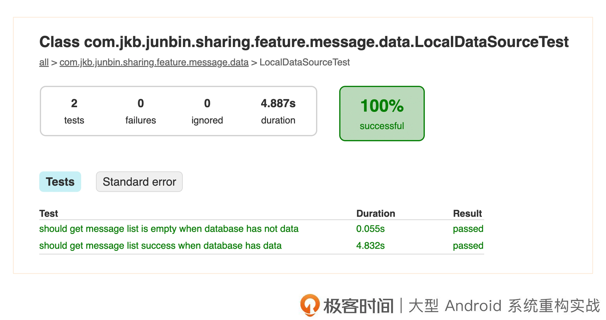
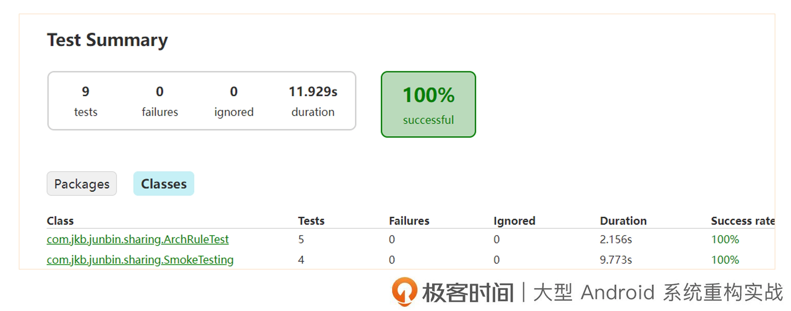
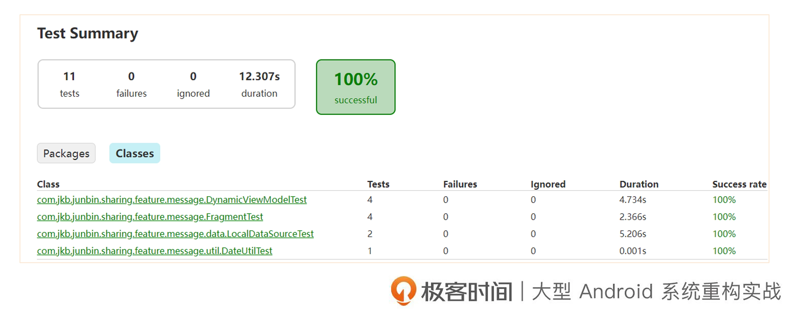

# 17 | 框架升级：如何小步安全地升级数据库框架？

你好，我是黄俊彬。

上节课我们重构了消息组件，最后遗留了一个问题，就是消息组件的数据存储都是采用 SQL拼写的方式来操作，这样不便于后续的扩展及维护。

除此之外，相比前面的其他重构，升级数据框架需要考虑的场景会更多，例如升级框架以后用户的重要数据不能丢失。

今天我们以 Sharing 项目为例，一起把项目中原先采用 SQL 拼写的方式替换为使用 Room 框架来统一管理缓存数据。在这个过程中我会与你分享如何小步安全重构，分阶段完成数据库框架的升级。为了确保重构完的代码不会破坏原有功能，还有用户的关键数据不丢失，我还会讲解如何给数据操作相关功能做自动化测试覆盖，以及如何实现更安全的数据迁移。

## 代码分析

我们先一起来看看消息组件中创建数据库表的相关操作，核心代码是后面这样。

```sql
//数据库表的创建
class DataBaseHelper(context: Context?) : SQLiteOpenHelper(context, "message.db",
   override fun onCreate(db: SQLiteDatabase) {
       createTable(db)
   }
   override fun onUpgrade(db: SQLiteDatabase, oldVersion: Int, newVersion: Int)
   fun createTable(db: SQLiteDatabase) {
       val createTableSql = """CREATE TABLE IF NOT EXISTS $message_info(
  $id INTEGER PRIMARY KEY AUTOINCREMENT,
  $content VARCHAR(1024) ,
  $fileName VARCHAR(1024) ,
  $date LONG
)"""
       try {
           db.execSQL(createTableSql)
       } catch (e: Exception) {
           Log.d("Task:Sql", e.message!!)
       }
   }
   companion object {
       var message_info = "message_info"
       var id = "id"
       var content = "content"
       var fileName = "fileName"
       var date = "date"
   }
}
```

我们从上述核心代码，可以看出 Sharing 项目主要通过 SQLite 提供的 SQLiteDatabase 以及SQLiteOpenHelper 来创建数据表。

目前 Sharing 项目仅有一个表以及简单的几个字段，通过 SQL 拼写的方式看起来也还好维护，但是如果现在面临的是几十个表以及几百个字段，那么管理和维护这些拼写的 SQL 字符串就会非常困难，当有修改的时候也非常容易出错。

我们继续来看数据的缓存以及读取操作。

```sql
//进行信息缓存以及读取的代码
class LocalDataSource constructor( private var mContext: Context) : IDataSource {
   override fun getMessageListFromCache(): MutableList<Message> {
       val messageList: MutableList<Message> = ArrayList()
       val dataBaseHelper = DataBaseHelper(mContext)
       val c = dataBaseHelper.writableDatabase.query(
           DataBaseHelper.Companion.message_info, null,null, null, null, null,nu
       if (c.moveToFirst()) {
           for (i in 0 until c.count) {
               c.move(i) //移动到指定记录
               val id = c.getInt(c.getColumnIndex(DataBaseHelper.Companion.id))
               val content = c.getString(c.getColumnIndex(DataBaseHelper.Compani
               val fileName = c.getString(c.getColumnIndex(DataBaseHelper.Compan
               val date = c.getLong(c.getColumnIndex(DataBaseHelper.Companion.da
               messageList.add(Message(id, content, fileName, date))
           }
       }
       return messageList
   }
   override fun saveMessageToCache(messageList: List<Message>) {
       val dataBaseHelper = DataBaseHelper(mContext)
       if (messageList.isNotEmpty()) {
           dataBaseHelper.writableDatabase.delete(
               DataBaseHelper.Companion.message_info, null,null)
           for (message in messageList) {
               val cv = ContentValues()
               cv.put(DataBaseHelper.Companion.id, message.id)
               cv.put(DataBaseHelper.Companion.content, message.content)
               cv.put(DataBaseHelper.Companion.date, message.date)
               cv.put(DataBaseHelper.Companion.fileName, message.fileName)
               dataBaseHelper.writableDatabase.insert(
                   DataBaseHelper.Companion.message_info,null,cv)
           }
       }
   }
}
```

通过上述代码可以看到，减少虽然 SQLite 提供了 query 以及 delete 等操作方法，我们可以减少编写 SQL 字符串，但是我们仍然需要去编写大量的对象转换代码。

其实这些代码都是我们前面提到的非业务的模板代码，这会大大增加我们维护代码的成本。为了解决这些问题，官方也提供了新的数据库框架 Room。官方文档强烈建议使用 Room，而不是直接使用 SQLite API。

下面我们就一起来看看如何安全地升级 Room 框架。

## 补充自动化守护测试

首先第一步还是需要先做基本的自动化测试覆盖，作为后续重构的安全守护网。

这里我们主要针对 LocalDataSource 类来做测试，保证基本的数据缓存以及读取功能是正确的。用例设计是这样的。

- 测试用例 1：当 message 数据表没有缓存数据时，获取的缓存数据为空。

- 测试用例 2：当 message 数据表中有缓存数据时，能够成功获取缓存数据。读取的缓存数据内容需要与保持的缓存数据内容一致。

现在，我们需要将测试用例转换成自动化测试用例。

```python
class LocalDataSourceTest {
   //用例1
   @Test
   fun `should get message list is empty when database has not data`() = runBloc
       //given
       val localDataSource = LocalDataSource(ApplicationProvider.getApplicationC
       //when
       val messageListFromCache = localDataSource.getMessageListFromCache()
       //then
       assert(messageListFromCache.isEmpty())
   }
   //用例2
   @Test
   fun `should get message list success when database has data`() = runBlocking
       //given
       val localDataSource = LocalDataSource(ApplicationProvider.getApplicationC
       localDataSource.saveMessageToCache(getMockData())
       //when
       val messageListFromCache = localDataSource.getMessageListFromCache()
       //then
       val messageOne = messageListFromCache[0]
       Truth.assertThat(messageOne.id).isEqualTo(1)
       Truth.assertThat(messageOne.content).isEqualTo("张三共享文件到消息中...")
       Truth.assertThat(messageOne.fileName).isEqualTo("大型Android遗留系统重构.pdf
       Truth.assertThat(messageOne.formatDate).isEqualTo("2021-03-17 14:47:55")
       val messageTwo = messageListFromCache[1]
       Truth.assertThat(messageTwo.id).isEqualTo(2)
       Truth.assertThat(messageTwo.content).isEqualTo("李四共享视频到消息中……")
       Truth.assertThat(messageTwo.fileName).isEqualTo("修改代码的艺术.pdf")
       Truth.assertThat(messageTwo.formatDate).isEqualTo("2021-03-17 14:48:08")
   }
}
```

后面是执行测试用例的结果。



## 小步安全重构

有了基本的测试守护以后，接下来我们就可以小步地做安全重构，注意在过程中每当我们完成一步重构后，都可以频繁运行测试来验证是否有破坏原有的逻辑。

拆分重构过程的要求是，每一小步的重构都不能破坏之前的功能，而且全部步骤都完成之后即可完成整体的重构。

这里我们结合 Room 框架的设计，把整个重构分成下面这 5 个步骤。

第一步是使用 Room 注解更新实体。

第二步是使用 Room 的 SupportSQLiteOpenHelper 进行 SQL 操作。这 2 个步骤完成后，不会修改原有的查询及删除操作代码。

接下来是第三步，进阶使用 Room 的 Dao 注解方式来管理数据的增删改查，替换掉原有的查询及删除代码。第四步是优化操作，使用协程来优化 IO 的异步操作。最后是第五步，迁移旧数据。

1. 使用 Room 注解更新实体

首先我们来看第一步，这一步相对比较简单，使用 Room 的注解标记新的实体代码就可以了。

```python
@Entity(tableName = "message_info")
class Message(
   @PrimaryKey @ColumnInfo(name = "id") var id: Int,
   @ColumnInfo(name = "content") var content: String,
   @ColumnInfo(name = "fileName") var fileName: String,
   @ColumnInfo(name = "date") var date: Long
) {
   @Ignore
   val formatDate = DateUtil.getDateToString(date)
   @Ignore
   val downloadCount = ARouter.getInstance().navigation(IFileStatistics::class.j
       ?.getDownloadCount(id.toString())
}
```

2. 使用 Room 的 SupportSQLiteOpenHelper 进行 SQL 操作

Room 提供了 SupportSQLiteOpenHelper 类，可以用它替换 SQLite 中的SQLiteOpenHelper，我们将原本使用 SQLiteOpenHelper 的地方替换为使用 Room 的SupportSQLiteOpenHelper。

```python
@Database(entities = [Message::class], version = 1)
abstract class AppDatabase : RoomDatabase() {
}
class LocalDataSource constructor(
   private var mContext: Context
) : IDataSource {
   val db = Room.databaseBuilder(
       mContext,
       AppDatabase::class.java, "message.db"
   ).build()
  override fun getMessageListFromCache(): MutableList<Message> {
   val messageList: MutableList<Message> = ArrayList()
   val dataBaseHelper = db.openHelper
   //... ...
   return messageList
 }
 override fun saveMessageToCache(messageList: List<Message>) {
   val dataBaseHelper = db.openHelper
    //... ...
   }
}
```

3. 使用 Dao 注解方式来管理数据的增删改查

接下来，我们可以选择将 query 及 delete 等的操作，使用 Room 的 Dao 注解做替换。

```sql
@Dao
interface MessageDao {
   @Query("SELECT * FROM message_info")
   suspend fun getAll(): List<Message>
   @Insert
   suspend fun insertAll(vararg message: Message)
   @Query("DELETE FROM message_info")
   suspend fun deleteAll()
}
```

完成后，就可以将 LocalDataSource 的实现替换为使用 MessageDao 进行操作了。

```python
class LocalDataSource constructor(
   private var mContext: Context
) : IDataSource {
   val db = Room.databaseBuilder(
       mContext,
       AppDatabase::class.java, "message.db"
   ).build()
   override suspend fun getMessageListFromCache(): MutableList<Message> {
       return db.messageDao().getAll().toMutableList()
   }
   override suspend fun saveMessageToCache(messageList: List<Message>) {
       messageList.let {
           db.messageDao().deleteAll()
           db.messageDao().insertAll(*it.toTypedArray())
       }
   }
}
```

至此我们完成了 Room 框架的升级，你可以对比一下 LocalDataSource 改造前后的代码，使用 Room 框架大大帮我们减少了模板代码的编写，代码更加容易维护。

4. 数据迁移

如果我们升级数据库框架时，调整过表结构的话，这时就可以用 Room 提供的 Migration 机制升级数据。

例如 Sharing 项目在升级 Room 框架时，我们新增了一个 count 字段用于缓存文件的下载数量，但是在旧的数据表中并没有这个字段，这时就可以使用 Migration 机制来迁移升级数据。

```sql
private val MIGRATION_1_2 = object : Migration(1, 2) {
   override fun migrate(database: SupportSQLiteDatabase) {
       database.execSQL("ALTER TABLE message_info RENAME TO message_info_back_up
       database.execSQL("CREATE TABLE message_info ( id  INTEGER PRIMARY KEY NOT
       database.execSQL("INSERT INTO message_info (id, content,date，0) SELECT i
   }
}
private val db = Room.databaseBuilder(
   mContext,
   AppDatabase::class.java, "message.db"
).addMigrations(MIGRATION_1_2).build()
```

在实际的项目中，我们需要根据数据对用户的重要性，来决定是否要做数据的迁移。例如一些缓存数据只是提高用户的体验，哪怕这部分数据没有了，从网络获取它也很方便，我们就不必迁移数据。

但如果对用户来说是关键的数据，就必须迁移和做专项的测试。例如一个短信息的 APP（信息只缓存在本地），当升级框架后，迁移这些短信息就非常重要，因为这部分数据丢失的话，对用户来说是非常糟糕的体验。更多迁移数据的方法，你可以参考官网的说明。

## 集成验收

跟之前的组件内分层架构重构一样，完成重构后我们需要完成最后的集成验收。

验收有三个标准：第一是编译通过，能够打包出安装包；第二是架构守护用例执行通过；第三是验收自动化测试执行通过。

下面我们来看看改造后相关的自动化测试运行结果。

基本冒烟及架构守护用例自动化测试报告如下：



消息组件自动化测试报告如下：



至此，我们完成了对 Sharing 项目的数据库框架升级重构。

## 总结

今天我给你讲解了如何小步安全地升级数据库框架。

改造前 Sharing 项目使用了 SQLite 来管理数据库，这个方式主要存在 2 个问题。第一个是使用拼写 SQL 方式来管理表创建，不便于扩展；第二个是存在大量的对象转换重复代码，不便于维护。所以我们根据官方的建议，使用 Room 框架来帮我们完成这些重复的工作，让我们可以更聚焦在业务开发上。

Room 框架的升级可以分 2 个阶段完成。

第一个阶段是先引入 Room 框架，将原本使用 SQLiteOpenHelper 操作数据库的方式，调整为使用 Room 提供的 SupportSQLiteOpenHelper 来进行管理，此时不会修改原有的查询及删除操作代码。

第二个阶段可以使用 Room 提供的 Dao 注解方式，替换掉原来的 insert、query 等方法，完成后可以减少大量的增删改查模板代码。此时你就可以充分感受到使用框架带来的收益。同样完成一个功能，我们可以少写很多模板的代码。

特别需要注意的是，如果在改造过程中，如果数据表结构有变化，我们需要采用 Room 框架提供的 Migration 机制来迁移数据。

至此，我们已经完成了第三篇解耦重构篇的学习。接下来我们将进入第四篇持续交付篇的学习，让我们一起学习组件化架构持续交付的核心实践，帮助我们更好提高版本发布的效率及质量，敬请期待！

## 思考题

感谢你学完了今天的内容，今天的思考题是这样的：曾经在一个项目上有一个同学问我说我们团队就想使用 SQL 拼写的方式，因为这样能做到最极端的性能优化，你怎么看这个问题呢？

感谢你学完了今天的课程，欢迎你把它分享给你的同事或朋友，让我们一起来高效高质量交付软件！
