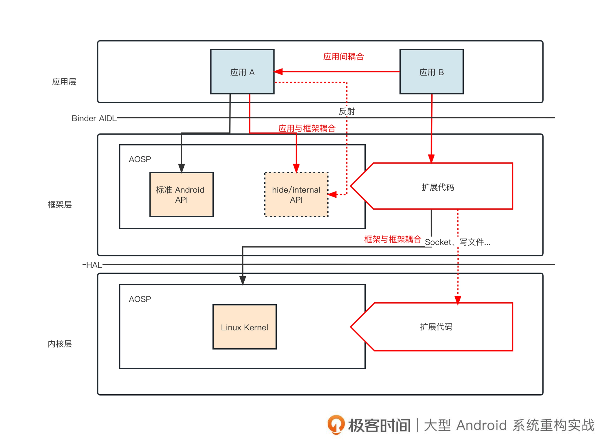
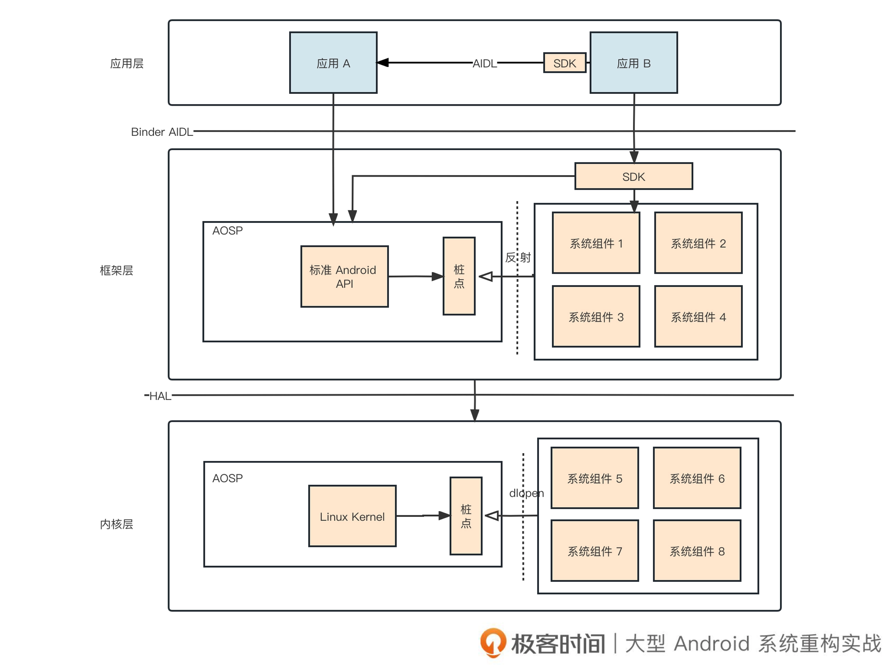
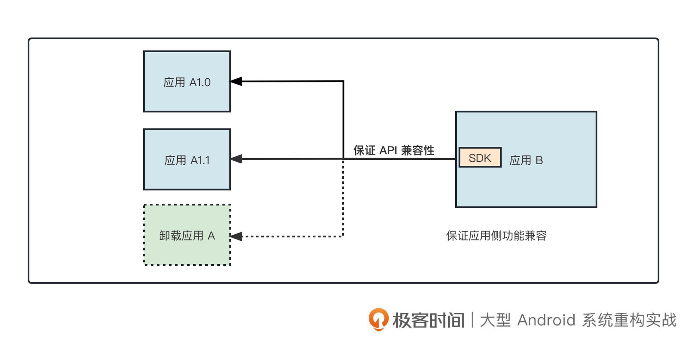
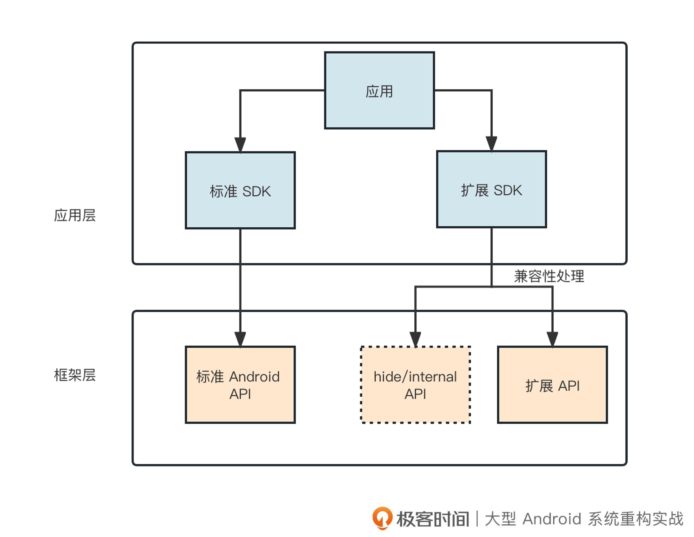
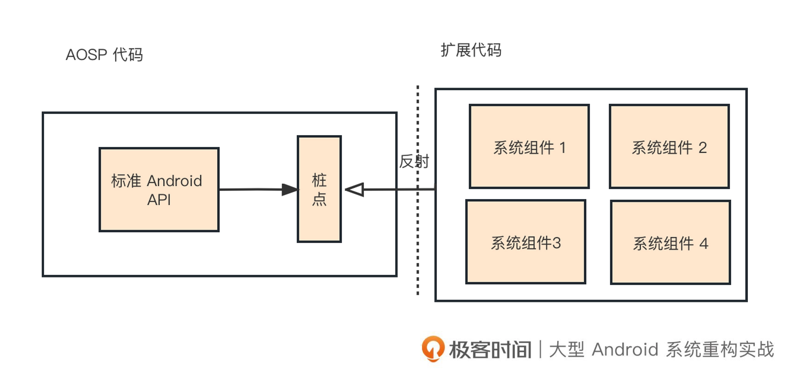
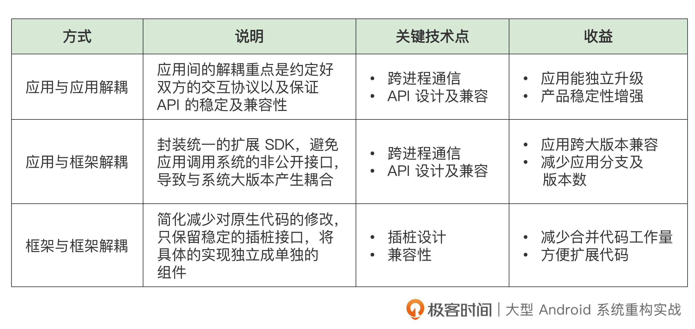

# 25 | Android系统解耦：殊途同归，Android系统组件化之路

你好，我是黄俊彬。

上节课，我们一起了解了 Android 系统的架构，讨论了厂商在定制 Android 系统过程中一些常见的耦合问题。耦合不仅仅是一种代码上的问题，也给产品的质量以及团队的效率带来了非常大的影响。

这节课，我们将会学习整机组件化的架构设计，看看如何来解决上节课提到的耦合问题。接着针对这些耦合问题，探讨具体有哪些针对性的解耦策略。

## 整机组件化

通过上节课的学习，我们知道了 Android 的架构设计本身就是采用了分层组件化的方式，只是由于厂商在定制的过程中，没有遵循架构设计来扩展，才出现了腐化。典型的问题包括应用间的耦合、应用与框架的耦合以及框架与框架间的耦合，如下图所示。



但是定制就意味着增加代码，所以关键问题是如何管理扩展的代码，才能把对原生代码的侵入降到最低，同时又要让系统更独立地演进。

其实解决方法也很简单，就是沿用 Android 系统的架构，让我们自己扩展的代码也形成组件，能够在 Android 原生系统之上灵活插拔，你可以对照下图来理解。



可以看出，厂商主要定制的代码分布在应用、框架与内核层。我们分别从这几层来看看组件化改造的思路。

### 应用层

第一个是应用层。应用层其实分 2 种类型，第一种是完全自己定制的应用，第二种是扩展AOSP 中原有的应用（例如桌面、电话本、短信等）。

我们先来聊聊第一种类型，应用本来的构建就是独立的二进制组件（APK），但就像上节课我们提到的，这样组件无法复用，效果大打折扣。所以我们需要解耦，不让应用与特定的系统版本耦合。

特别需要注意的是第二种类型，扩展 AOSP 的应用。

由于 Google 在大版本升级的时候，也可能会同步升级这些应用的代码，所以如果想让同步的代码是最新的，就需要保证对原生代码的扩展是相对独立的，否则也会有不少同步代码的工作量。

而很多厂商的处理方法是基于某个 Android 版本扩展以后就独立演进，不再同步上游的代码。这种方式有得有失，好处是减少了同步的工作量（Google 有些应用可能在某个大版本变化比较大，例如短信从 MMS 升级到 Message，基本变成 2 个应用），坏处是不能及时同步到一些新的代码。

总的来说，应用本身天然就是以二进制组件的形式与整机集成。所以针对应用层组件化关键的举措就是解耦，让组件能够复用。

### 框架与内核层

框架与内核层的修改与应用层的修改恰恰相反，大多数的扩展修改都比较零散，而且都是直接在 AOSP 原生的文件中直接修改的。有些比较独立的扩展，会采用新增文件或者新增方法放到 AOSP 文件尾部的形式，但是有些修改就不得不在原生代码方法中间增加一些代码，这也就是我们上一节课说的框架与框架之间的耦合。

那么，针对框架的修改要如何做组件化的设计呢？我推荐的方式就是减少对原生代码的修改，将扩展的代码独立成二进制的文件（Jar、So、Apex）。

要满足这个设计，需要先满足两个前置条件。

第一个条件，能从散落在各个源码修改的文件中的扩展代码梳理出逻辑内聚的组件。举个例子，假如扩展一个应用保活的特性，需要在 AOSP 中的 AMS、PMS 等类中插入一些代码，如果我们要抽取一个应用保活的组件，就得先把这个特性涉及到修改的地方都分析出来。

第二个条件是需要设法将更多的修改独立出来，尽量减少对源码的修改，我们在后面的解耦设计中，还会详细讨论这个问题。

对于框架代码扩展来说，由于修改比较零散，而且对 AOSP 源文件的侵入性修改，相比应用来说，它的组件化改造挑战更大。

## 组件化解耦

前面我们讨论了整机组件化整体的设计思路，接下来我们再一起看看具体的解耦方法。

### 应用与应用解耦

首先来看应用与应用间的解耦。应用间的解耦重点是约定好双方的交互协议以及保证 API 的稳定及兼容性，你可以参考后面的示意图来理解。



首先需要保证 API 的稳定，尽可能保证扩展但不修改，避免在多个版本出现不兼容问题。另外，当依赖的应用不存在时，调用方需要保证功能的兼容性，可以将相关的特性屏蔽，更多关于兼容性的处理方法，你可以参考第 13 节课的内容。

特别需要注意的是，封装 API 的时候最好是基于数据的封装，而不是基于界面的封装。例如应用 B 需要展示应用 A 的一些内容，如果应用 B 直接通过 API 获取应用 A 的 View 来展示，就可能导致当应用 A 与应用 B 之间需要统一视觉风格时，版本之间会存在强依赖。但如果只是数据的依赖，则会更加稳定，应用 B 的视觉风格变化不依赖应用 A 的修改。

### 应用与框架解耦

对于应用与框架的耦合，解耦重点是封装统一的扩展 SDK，避免应用调用系统的非公开接口，导致与系统大版本产生耦合。你可以对照后面的示意图来加深理解。



对照图片可以看出，我们的策略是通过扩展的 SDK 封装原先对系统的非公开接口和扩展的API，并且做好大版本的兼容性处理，应用会统一使用扩展的 SDK 来增强系统的能力。这样对于应用来说，就不用做大量的版本判断代码，同时也能有统一的入口来管理版本的 API。

需要注意的是，扩展 SDK 有些方法仍然没有办法做到百分之百的兼容。比方说在 T 版本上有A 接口，但是在 S 版本上没有等价的实现，那么我们同样需要在应用侧进行兼容性判断处理。但是使用统一的扩展 SDK 还是有好处的，这么做能帮助应用简化 90% 以上的兼容性维护工作，并且能统一规范。

### 框架与框架解耦

最后我们来看框架间的耦合，框架与框架的解耦重点是减少对原生代码的修改，只保留稳定的插桩接口，将具体的实现独立成单独的组件。



首先我们需要定义桩点接口，为了减少编译时的耦合，可以采用反射的机制去查找接口的实现。

我来举个例子，AOSP 中有一个类为 AMS，其中有一个方法为 onCreate()，原先在这个方法里面插入了代码，此时我们可以定义一个 IAMS 的接口，抽象一个 onCreate() 的桩点接口，然后将实现代码移动至 IAMS 的实现类中。

伪代码是后面这样。

```java
//解耦前：
class AMS{
 public void onCreate（）{
   //原生代码... ...
   //扩展代码
   xxx
   yyy
   zzz
   //原生代码... ...
 }
}
//解耦后：
interface IAMS{
 onCreate（）；
}
//AOSP代码
class AMS{
 public void onCreate（）{
   //原生代码... ...
   //扩展代码
   IAMS.instance().onCreate();
   //原生代码... ...
 }
}
//扩展组件
class AMSImpl{
 public void onCreate（）{
  //扩展代码
   xxx
   yyy
   zzz
 }
}
```

我们在解耦框架的时候，同样也需要注意兼容性的问题。当桩点接口找不到具体的实现时，需要注意不能破坏原有框架的逻辑执行。另外，我们应该保证桩点接口的稳定性，并且控制其数量，避免出现大量重复以及缺少抽象设计的桩点，不然就违背了前面提到的最少侵入修改原则。

## 组件化收益

还记得上节课，我们提到了代码耦合带来的诸多隐患（大量的分支合并工作、多版本维护工作以及产品质量问题）么？

现在，我们就来分析一下，组件化解耦对我们解决这些耦合问题有哪些帮助。

### 1. 减少大量代码合并工作

当大量的组件被抽离成独立的组件化后，对于 AOSP 源码的修改其实只保留了最小的桩点接口，这样当有代码合并时，就能有效减少合并的工作量。

另外，由于抽离出来的系统组件也能以独立的二进制交付，后续对项目相当于就是 AOSP 源码 + 桩点接口 + 扩展组件集成（应用组件、系统组件等）。如果我们能保证好组件的质量，就能避免各个项目都拉取独立的分支问题，减少分支的数量。

### 2. 减少并行的版本维护工作

组件化的设计要求各个组件必须同时做好兼容性处理，当组件能够满足这个要求时，就能做到一个版本兼容多个系统版本，那么就可以减少版本的维护工作。例如，当修改一个 bug 时无须在多个分支上同步、当增加一些特性时也无须在多个分支上同步等，团队能够更聚焦在组件自身的功能开发和质量提升上。

### 3. 减少质量隐患，缩短问题定位时间

组件化最明显的好处就是能够将关联的逻辑内聚到一个组件中，同时组件之间能够有更清晰的边界及职责。这样，我们修改扩展多组件的代码时，产生的影响围通常就会控制在当前组件中，这不容易产生连带的问题。

另外，由于组件的边界更加清晰，发现问题时也更加方便我们去定位排查，有效缩短定位问题的时间。

### 4. 提高产品的响应力

由于组件间已完成解耦，应用组件就能够独立实现升级和发布，不与系统版本耦合。出现问题的时候，能够快速发布，不必跟随整机系统一同发布。对于框架组件也一样，Google 官方提供了 Apex 格式也支持独立的更新，这样系统内组件有 Bug 时，同样也能够独立地发布更新。这将大大提高各个组件的响应力，无须跟随整机一起进行 OTA 的升级。

## 总结

今天，我们一起学习了 Android 系统组件化的设计，讨论了针对常用耦合问题的解耦思路。

组件化设计就是将自己扩展的代码独立成内聚的组件，以二进制与整机集成，尽量减少在AOSP 框架中的代码修改量。下面我给你总结了组件化解耦常见的 3 种情况，你可以通过后面的表格回顾。



实施组件化有很多好处，一方面，能够帮助我们有效减少分支数量、多版本维护工作，让团队更聚焦在高价值的业务研发和质量打磨工作中。另一方面，也能帮助我们减少产品的质量问题、提高产品的响应力。

通过扩展篇的学习，我们深入探索了 Android 系统的架构，了解了研发过程中常见的耦合以及解耦的一些思路。

相比应用的解耦，系统解耦的复杂度和需要处理的耦合场景更多，特别是相对于框架的解耦，编译调试验证的难度更大。相同之处则是都要采用同样的组件化思路，以业务内聚组件，让组件独立做演进。

下节课，我会你了解一个实用的工具——组件成熟度评估模型，同时也邀请你对自己的项目做一次成熟度评估，敬请期待。

## 思考题

感谢你学完了今天的内容，今天的思考题是这样的：你觉得在落地组件化的改造时，可能遇到的最大挑战是什么？有什么解决之法吗？

欢迎你在留言区与我交流讨论，也欢迎你把它分享给你的同事或朋友，我们一起来高效、高质量交付软件！
