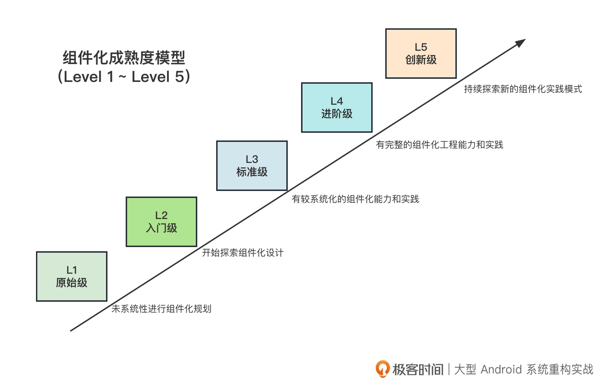
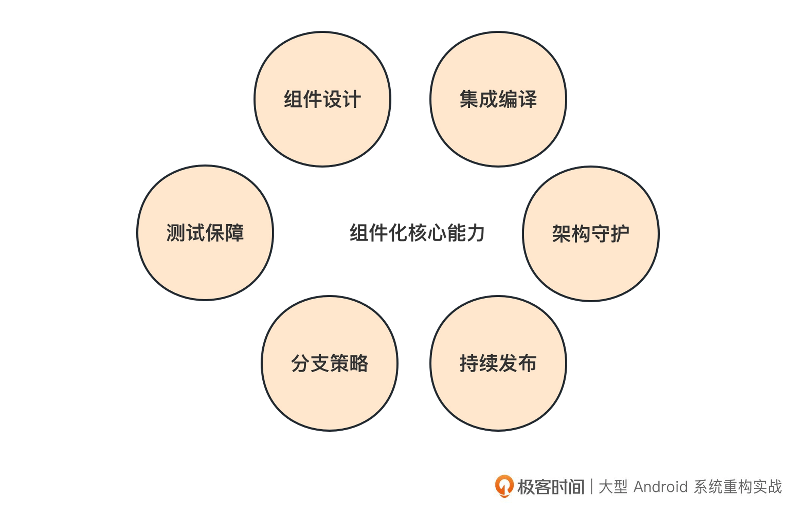
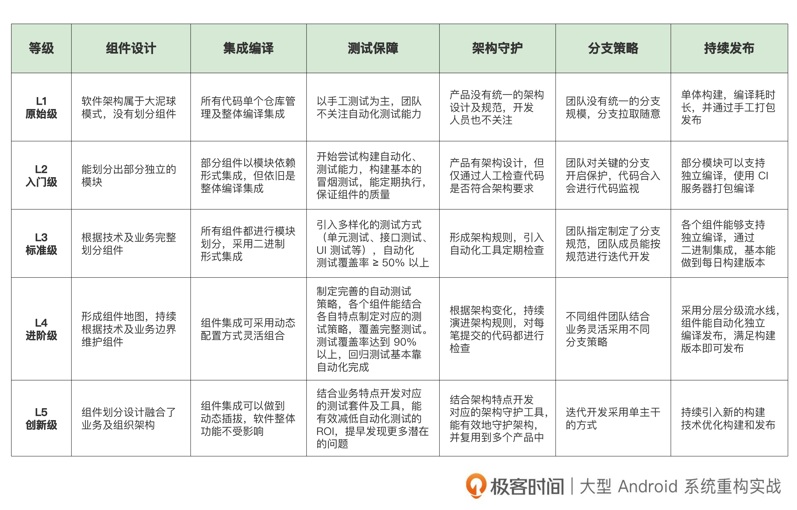
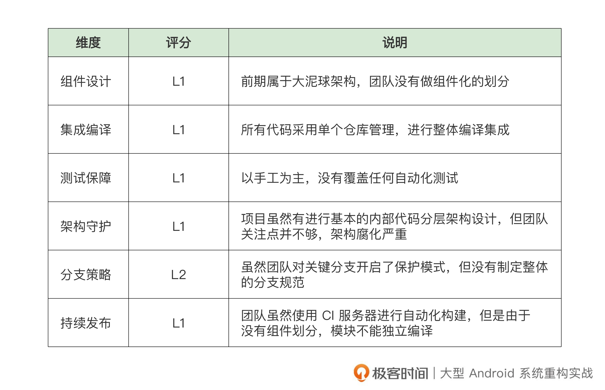
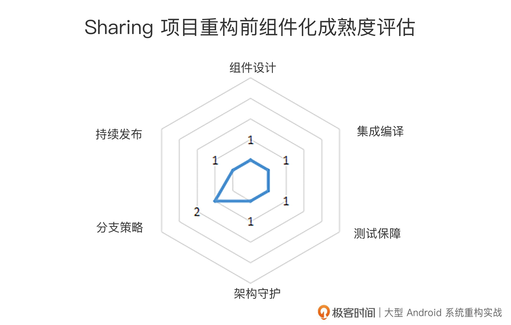
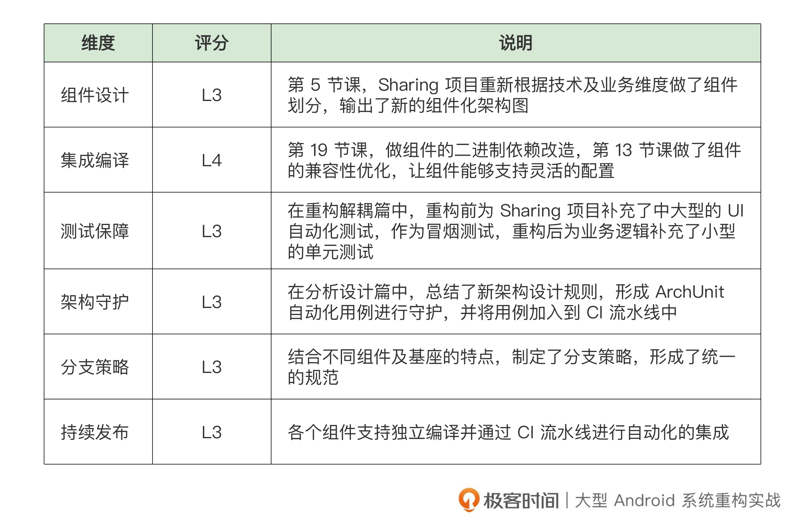
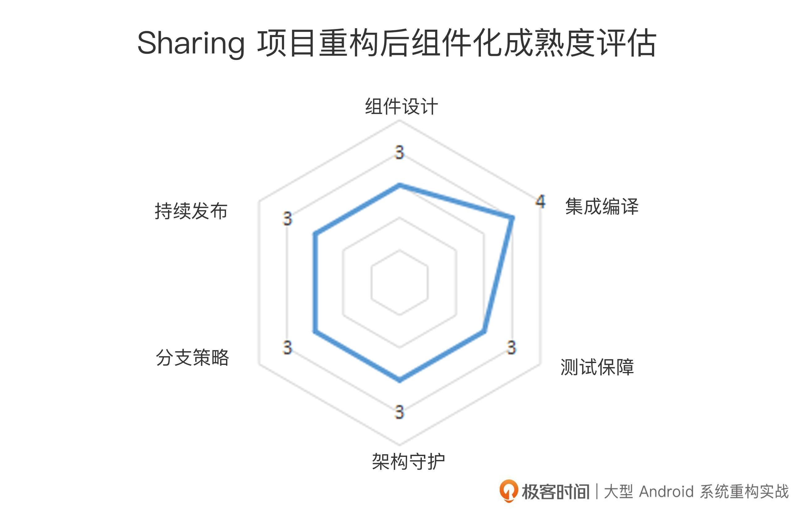

# 加餐 | 组件化成熟度评估，你的目的地在哪里呢？

你好，我是黄俊彬。

前面我们学习了很多系统重构的知识，不过，估计你还是有个疑问：怎样才能衡量项目改进的效果，让团队充分感知到重构的收益呢？

就像之前课里强调的那样，以终为始才能更好帮助我们找到方向，但是我们又有什么参考可以来帮助我们制定改进目标呢？

今天这期加餐内容，我想给你分享一个实用的工具——组件化成熟度模型，并以 Sharing 项目为例，带你一起对改进前后的项目做一次组件化成熟度评估。

学完今天的内容，你不妨用这个模型评估一下自己的产品情况，这样能帮你发现项目当前的问题、更好地制定改进计划，最终提高团队的效率和产品的质量。

## 组件化成熟度模型

组件化成熟度模型可以帮助我们全局去思考当前的现状，并制定更有针对性的改善目标。

成熟度模型包括 5 个级别的成熟度等级，还有 6 个成熟度衡量维度，我们依次来看看。

### 成熟度等级

组件化成熟度等级分为 5 个级别，依次为原始级、入门级、标准级、进阶级以及创新级。

原始级主要表现为产品没有系统性地做组件化规划，入门级表现为产品开始探索组件化设计，标准级的表现为产品有较系统化的组件化能力和实践，进阶级的表现为产品有完整的组件化工程能力和实践，创新级的表现为产品已经在持续探索新的组件化实践模式。

你可以对照后面的图来理解。

### 成熟度维度

组件化成熟度的评估分为 6 个维度，依次为组件设计、集成编译、测试保障、架构守护、分支策略以及持续发布，可以帮我们综合评估项目的架构设计、核心工程实践等组件化核心能力。

其中，组件设计主要评估目前代码的工程结构以及组件的划分设计，集成编译主要评估组件的集成以及配置能力，测试保障主要评估组件质量守护的能力，架构守护主要评估组件化架构的守护能力，分支策略主要评估组件的分支管理模式，持续发布主要评估组件的持续集成发布能力。

每个维度同样细分为 5 个等级，你可以参考后面的表格。

当然这里需要注意，模型的作用是帮助我们从多个维度去思考当前的现状，然后去制定改进的目标，模型的维度自然也要持续不断去演进。

## Sharing 项目成熟度评估

了解了成熟度模型，我们就可以对 Sharing 项目做组件化成熟度评估了。在第 5 节课中，在组件化重构前我们梳理了 Sharing 项目的现状，现在，我们就尝试引入组件化成熟度评估模型来评估改造前的 Sharing 项目，你可以参考后面的表格。

最终 Sharing 项目在组件化重构前的成熟度评估为 L1。

经过我们前期的分析设计、重构解耦以及持续交付的改造，我们重新按照组件化成熟度评估模型来评估组件化重构后的 Sharing 项目，情况如下表所示。

最终 Sharing 项目在组件化重构后的成熟度评估为 L3。

## 总结

今天我们一起学习了组件化成熟度评估模型。该模型分为 5 个等级，分别为原始级、入门级、标准级、进阶级以及创新级。同时从组件化的核心能力体现为 6 个维度，包括组件设计、集成编译、测试保障、架构守护、分支策略以及持续发布，每个维度同样也有 5 个等级，最终要以最低得分的维度作为最后的评估等级。

成熟度模型一方面可以帮助我们制定改进目标，另一方面也可以帮助我们更好地度量结果，从而帮助我们去持续改进。就拿 Sharing 项目来说，我们借用组件化成熟度模型，给改造前后的Sharing 项目分别做了一次评分，通过了我们持续改造，最终 Sharing 项目从 L1 提升到 L3。

当然，模型只是一个补充的视角让我们能客观去评估现状以及制定改进的目标，最重要还是我们借此审视项目质量，持续改进。

## 思考题

感谢你学完了今天的内容，今天的思考题是这样的：你的项目现在的组件化成熟度得分是多少呢？请你使用组件化成熟度模型来进行一次自评。

欢迎你在留言区与我交流讨论，也欢迎你把这节课分享给你的同事或朋友，我们一起来高效、高质量交付软件！
