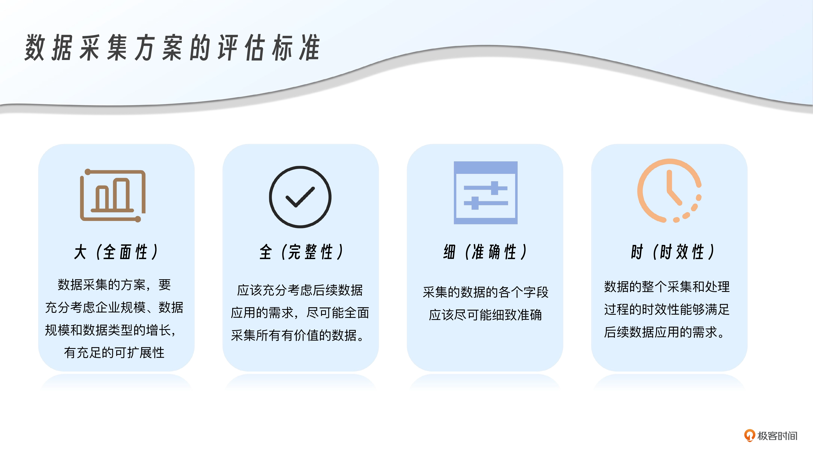
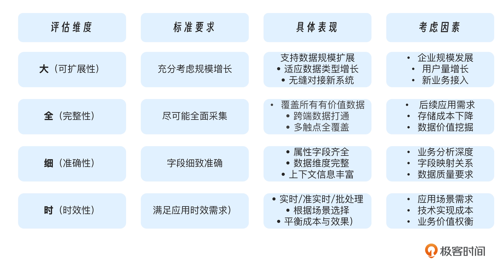

# 02 | 数据采集（上）：优秀数据采集方案的设计标准

你好，我是曹犟。

上一节课中，我们整体介绍了一个典型的大数据系统的基本架构与设计，从这一节课开始，我们要开始逐渐深入系统的每一个关键步骤。这节课，我们先讨论数据流角度上的第一个环节——数据采集。

不知道你会不会碰到类似这样的问题，例如：老板让我开发一个数据中台，那么我到底应该要收集哪些数据呢？或者是：我现在的数据收集方案，是最有效的吗？能够满足未来需求的扩展吗？这节课，我们将针对类似的问题，进行讨论。

课程中，我们将为了满足数据统计、分析、挖掘的需要，搜集和获取各种数据的过程，统一叫做数据采集。

从我过去接近 20 年构建大数据系统的经验来看，任何大数据系统的构建都始于数据采集。数据采集的覆盖范围与完整性，也直接决定了系统最终的应用的质量。没有高质量的数据采集环节，采集的数据不够全面、不够准确，那么不论后续的处理技术多么先进，也无法从数据中获得有用的价值。

国际数据公司（IDC）在《数据时代 2025》报告对于数据质量的重要性也表达了类似的观点。而 Gartner 的研究表明，企业中约 40% 的决策失误归因于低质量的数据，而 70% 的数据质量问题可追溯至采集环节。

因此，要构建一个好的大数据系统，发挥出数据的价值，首先必须保证要设计出一个好的数据采集方案。

我们首先要讨论：一个好的数据采集方案，应该是什么样的？需要解决什么问题？

## 数据采集方案的评估标准

神策数据在创业过程中，针对在大数据时代，什么样的数据采集方案才算好，曾经提出了“大”“全”“细”“时”这样一个判断标准。

所谓“大”，是指数据采集的方案，要充分考虑企业规模、数据规模和数据类型的增长，有充足的可扩展性。随着企业的发展，业务规模的增加，各种新系统的引入与用户量的增长都会导致企业每天所产生的数据也会随之增加。

同时，随着数据应用的深入，以前可能觉得并不需要用到的数据也会逐渐被应用起来，需要采集的数据类型也会不断丰富，从最初的结构化数据，扩展到半结构化、非结构化数据，如日志文件、音视频信息等。这就要求我们在设计数据采集方案时，应能灵活应对数据规模的增长，也能够与企业不断引入的新系统、新工具无缝对接。

所谓“全”，则是指应该充分考虑后续数据应用的需求，尽可能全面采集所有有价值的数据。例如，我们分析一个典型的互联网产品的用户行为，那么，就希望我们全面采集这个互联网产品各个端，包括 App、网页、微信小程序、微信公众号上的所有的用户行为，并且能够将这些用户行为跨端打通后一起建模。毕竟随着技术的进步，和数据本身的价值相比，存储数据所需要的硬件价格已经非常廉价了。

所谓“细”，是指采集的数据的各个字段应该尽可能细致准确。例如，我们在采集某个电商产品的用户在 App 上的某一次 “添加购物车” 行为时，应该把这次行为对应的各个字段，如商品名、商品类别、商品价格、用户 ID、机器型号、App 版本、操作系统版本等尽可能地采集齐全。

所谓“时”，则是指数据的整个采集和处理过程的时效性能够满足后续数据应用的需求。例如，我们需要每天出前一天的统计报表，那么，数据采集每天一次可能也就足够了；但是，假设我们期望把数据用在个性化 feed 流上，并且期望用户的一次点击行为能够很快就影响到下一次给用户推送的内容。那么，就需要整个数据采集和后续处理的过程都是纯实时的。

当然，并不是说我们总要保证这么高的数据采集及时性，因为毕竟及时性越高，一般技术成本也就越高，而是应该尽量根据实际的数据应用选择一个合适的数据采集方案。

除了上面描述的“大”“全”“细”“时”之外，数据的准确性，也是需要在整个大数据系统的设计中，从数据采集到数据应用的各个环节里通盘考虑的。后面我在第 12 节课里还会和你详细讨论数据准确性的话题。

值得一提的是，准确性也是一个天花板很高的问题，并且存在很多影响数据准确性的问题是难以得到彻底解决的。所以，很多时候也需要衡量成本与收益，选择一个准确性上符合后续数据应用实际需求的数据采集方案就可以了。

## 案例：一个大全细时的数据采集方案设计

为了帮助你更好地理解大、全、细、时这四个标准，我们来看一个具体的案例。

我们现在要为一个中型电商平台设计数据采集方案，这个电商有 PC 网站、移动 App、微信小程序等多个触点，数据应用上有报表、商品推荐、营销活动、用户画像等多种数据应用需求。

“大”的体现：

- 采用客户端 SDK 采集，天然就是分布式的，只要数据接收端能够支持，则每日百万级用户行为数据的采集没有问题，当用户规模增长时，采集能力也不会变成瓶颈。

- 在数据 Schema 上要预留充足的扩展性，能够快速接入未来可能新增的抖音小店、快手小店等新的数据源，以及能够适配从天猫、京东等第三方平台获取的有限度的数据。

“全”的体现：

- 全面采集用户在各个触点的各种行为：浏览商品、搜索、加购物车、下单、支付、评价等。

- 跨端用户身份打通，基于用户的注册手机号，通过 ID-Mapping 技术将同一用户在不同端的行为串联起来形成完整的用户旅程。

- 除了采集用户行为以外，还采集数据库对应的业务表、后台管理系统日志等业务数据。

“细”的体现：

- 用户浏览商品时，不仅记录商品 ID，还记录商品名称、类别、品牌、价格、库存状态、页面位置、推荐来源等详细信息。

- 记录设备环境信息，如操作系统、浏览器版本、屏幕分辨率、网络类型等。

- 采集完整的页面上下文，包括用户从哪个页面进入、停留时长、滚动深度等。

“时”的体现：

- 商品推荐系统需要准实时的用户行为数据，因此在采集的时候，需要通过客户端 SDK 来及时发送数据，确保用户的点击行为能在 1 分钟内影响推荐结果。

- 库存预警系统需要实时数据，因此要在内网的库存服务模块中，通过同步的网络请求技术采集数据，确保库存变化信息能够立即被检测到。

- 用户画像和日常运营报表每天计算一次就可以，其中用到的用户行为数据采集时效性能够做到分钟以内，满足了需求，而计算需要用到的业务表，按照每天一次的粒度进行采集即可。

通过这个案例我们可以看到，一个好的数据采集方案需要在这四个维度上都有周全的考虑，并且要根据具体的业务场景和应用需求，在各个维度上找到合适的平衡点。

## 如何确定要采集的数据范围？

在确定什么是一个好的数据采集方案之后，我们还有一个重要的问题需要解决——在一个大数据系统建设的时候，我们到底要采集哪些数据？

针对这个问题，存在两种不同的方法论。

第一种方法论是目标导向性的，根据具体的应用来决定要采集哪些数据，以明确的应用为出发点，反推所需数据的范围、维度和粒度，只采集与应用直接相关的数据。

这种方法论的优势是只采集了确定有用的数据，所以资源利用率比较高，项目落地周期相对而言也比较短。但是受限于当前对业务的认知，可能忽略未来新应用场景所需的数据，并且当业务方向调整时，已采集的数据可能无法支撑新需求，需重新设计采集方案。而且，类似于用户行为这样的很多数据一旦之前没有采集，都是没有办法回溯的。

第二种方法论则是建设导向性的，暂时不管或者此时并没有明确的数据应用，而是本着数据就是宝贵的财富，能采则采，应采尽采。在消耗更多资源与花费更多项目周期的同时，能够满足未来各种潜在的数据应用的需求，同时也符合数据资源入表这个目前的流行趋势。

从神策过去十年累计服务两千多家企业的实践上来看，一般规模没有那么大，或者内部组织架构流程比较简单的企业，会倾向于采用第一种方法论，是现有具体的应用目标，然后快速完成数据采集，快速看到效果。有新的数据应用时，再根据新的应用需求持续迭代自己的数据采集方案。

而很多类似于银行这样的国央企企业，则会更多从数据资产建设的角度，先尽可能采集所有的数据，构建自己的所谓“数据中台”，再去考虑基于已经采集的这些数据，能够有什么具体的应用。

关于具体不同的应用，应该如何确定要采集哪些数据，在后面章节介绍具体的数据应用场景时，我们会进一步展开。

## 可采集的数据一共有哪些类型？

确定要采集哪些数据之后，我们就要设计采集的具体技术方案了。而要采集的数据类型不同，采用的技术方案也不同，需要区别对待。

如果按照数据所有者，一个企业要采集的数据，主要可以分为私域数据和公域数据。

私域数据一般也叫第一方数据，是我们通过自身运营场景能够直接获取、拥有完全所有权和控制权的数据。

我举几类典型例子。

- 企业内部 CRM、ERP 等系统内的客户数据、交易数据、物流数据。

- 企业自有用户触点，如官网、App、小程序上的用户行为数据。

- 用户在企业自有平台上产生的所有权归属于企业的内容数据，如文章、评论等。

这里要强调一下，私域数据虽然归属于企业所有，但是在采集私域数据时，也需要遵守必要的法律法规。

公域数据也叫第三方数据，它的归属权就不属于企业了，而是归属于公共机构、第三方合作伙伴或者公开渠道，是企业通过合法方式能够获取的数据。

我们同样来看几个例子，帮你加深理解。

- 政府部门、事业单位等公布的天气、报告、GDP 等公开数据。

- 社交媒体（微博、小红书、抖音）上的公开的话题、帖子、评论、热搜等数据。

- 电商平台公开的商品信息、排行榜、价格等数据。

- 第三方数据服务商在符合法律法规前提下售卖一些匿名化的用户行为、用户标签等数据也算作公域数据。

第三方数据的采集存在一定的灰色地带，作为一个守法的企业公民，还是应该也遵循法律法规和类似于 spider 声明之类的行业公约，同时不要因数据采集行为给第三方带来负面影响为宜。

而如果从技术视角根据数据产生的方式进行划分，对一个典型的拥有线上业务的企业，数据又可以分为如下几类。

- 用户类数据：广义上的用户在企业所有触点上产生的行为数据，以及用户主动填写的自然属性、兴趣爱好等属性数据。

- 业务类运行数据：企业内容自建或者采购的 ERP、CRM 等系统运行时产生的日志类数据，和在数据库中保存的各种类似于订单表、商品表、物流表等数据。

- 内容类数据：除了上文中提高的 PGC 数据外，企业自己在生产过程中也会产生内容数据，例如官网文章、宣传图片、直播视频等。

- IOT 数据：这一类数据就是各种硬件传感器产生的数据，不仅仅是用户的终端有数据会产生，企业线下的生产、销售场所，例如货架、门店摄像头、生产线也会产生各种数据。

- 第三方接口数据：这主要就是指通过合法接口获取的第三方数据。

上述各种数据有的是结构化数据，有的是非结构化数据，有的是文本数据，有的是多媒体数据。

关于每一类数据采集时需要采用什么样技术手段和方案，我们会在下节课中进行展开讨论，敬请期待。

## 课程总结

在这节课里面，我们讨论了一个好的数据采集方案应该是什么样的，以及应该如何从实际的应用出发，确定要采集哪些数据。

对于这节课程中提到的如果评估一个数据采集方案，我准备了一个表格，帮助你复习和使用。

同时，我们还对可采集的数据类型，从两个不同的角度，做了一个大致的分类，也为我们下节课针对不同类型数据如何选择采集技术手段的话题打下了基础。

另外再提醒一下，数据采集方案的设计，对于数据开发工程师、数据产品经理非常重要，是这两个岗位工作职责中非常重要的一部分。同时，产品经理、数据分析师这两个角色，作为数据的应用方，也应该了解数据采集方案的基本准则。他们应该在数据采集阶段就深度参与，从应用者的视角来一起设计一个合理的数据采集方案。

## 思考题

在过往的工作过程中，相信同学你可能参与过或者看到过一些大数据系统的数据采集方案。那么，根据这节课的内容，请你重新对这些数据采集方案做一个评估：

- 这些数据采集方案，是否是一个好的数据采集方案；

- 这些数据采集方案中所采集的数据，是否满足了后续数据应用的需要，是否有足够的可扩展性。

期待你在留言区分享你的思考。如果这节课对你有启发，也推荐你把它分享给身边更多朋友。
