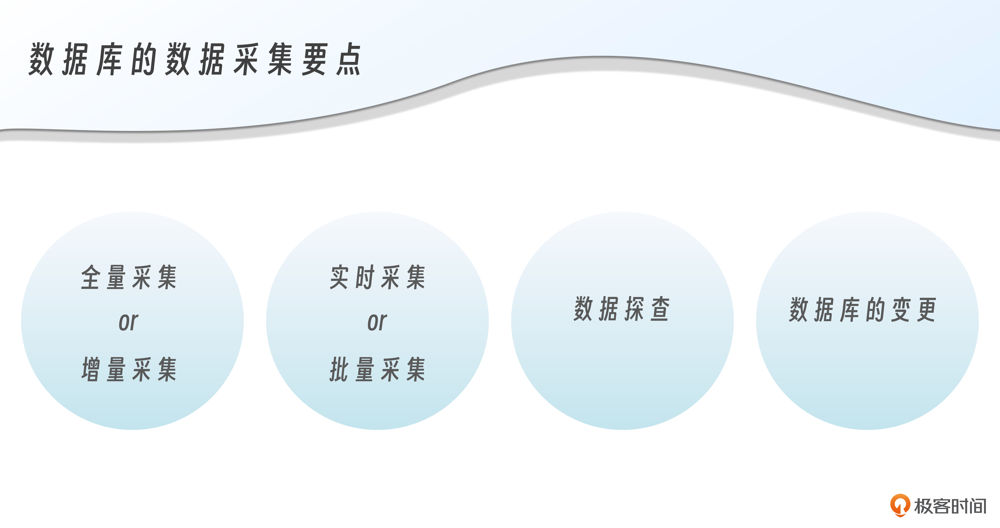
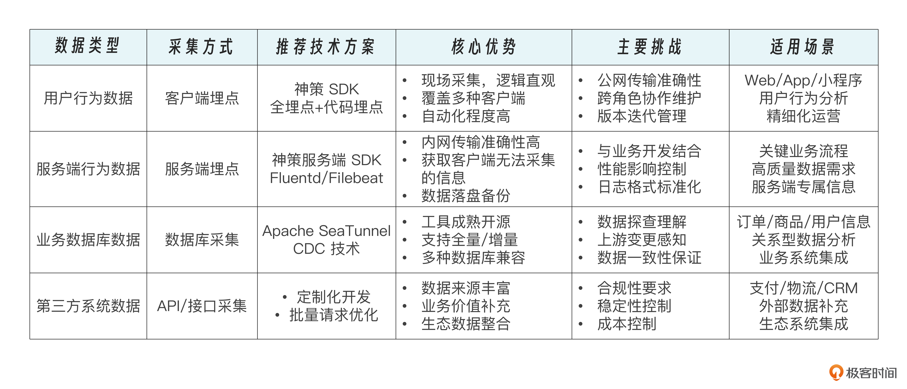

# 03 | 数据采集（下）：不同类型数据采集的技术方案

你好，我是曹犟。

在上一节课中，我们讨论了什么是一个好的数据采集方案，如何根据业务需求确定要采集的数据范围，以及通常有哪些类型的数据需要采集。这节课中，我们则会针对主要的数据类型，来学习每类数据分别应该采用什么样的技术方案进行采集。

由于我们在第 23 节课中会专门讨论大模型带来的多模态数据的处理，因此在这节课中，我们暂时先不专门针对多模态数据采集的技术方案做讨论。

为了便于同学们在学习后能够马上用到自己的项目之中，我们依然会以免费的或者开源的方案为主。

随着互联网的发展进入到红海阶段，对于用户的精细化经营成为几乎每家公司的必备。在这种情况下，用户行为数据的价值有了巨大的提升。而采集用户行为主要是在客户端进行采集，所以我们首先来看这个技术方案。

### 客户端埋点

客户端的范围一般包括 Web、App、小程序，甚至车机、智慧大屏等。广义上，所有用户直接交互、打交道，并用它完成特定任务的软硬件，都可以叫做客户端。

在客户端采集数据在行业内有一个比较通用的术语，叫做埋点。客户端埋点可以在用户使用客户端的过程中，一个行为发生或者属性变化的现场就完成数据的采集，是一个从逻辑上非常直观的采集方式，因此也成为了当前用户行为和用户属性数据采集的主流方案。

对于客户端埋点，神策开源了几十种不同的客户端 SDK，覆盖了各种主流的开发语言、编程框架，大家在 GitHub 上搜索后直接集成即可。SDK 本身的使用比较简单，这里就不展开了。

在采集用户行为数据方面，客户端 SDK 提供了自动化采集数据的“全埋点”模式和需要手动写代码进行设置的“代码埋点”两种模式。顺带一提，这两种模式的名字本身也是我取的。

全埋点的优势是无需开发，会自动采集一些预制的属性和事件，非常适合于项目的快速启动。而代码埋点相比全埋点，采集的属性和事件都可以预定义，但是需要写一部分的代码。从我们过往的工程实践经验来看，通常情况下，采用全埋点加代码埋点结合的方式是一个比较好的方案。即在全埋点的基础上，对于部分信息密度比较高的用户行为，采用代码埋点的方式进行采集。

为了避免阻塞客户端的使用，埋点的数据是需要本地缓存然后异步传输的。这方面神策的SDK 都已经进行了处理，就不展开了。

由于客户端数据的采集需要通过公网进行传输，所以强烈建议采用 HTTPS 作为传输协议。神策开源的 SDK 已经提供了相应能力。同时，对于部分敏感字段，如手机号等，则建议在 SDK侧也进行加密。

不过需要提醒一下，在公网传输中，虽然已经采用了类似于本地缓存、批量压缩等各种技术手段，但依然难以保证数据的 100% 准确。因此对于那些非常强调数据准确性的应用，它所需要的一些关键数据，应该考虑直接采集服务端日志或者业务数据库中的数据等方式。

刚刚我们了解了客户端埋点的主要技术方案。但是在实际的工作过程中，客户端埋点还有一个挑战，就是如何与我们的工作实践结合起来。

在大多数情况下，使用数据的人，如产品经理和分析师，和埋点开发的人，如 iOS 或者安卓开发工程师，并不是同一个角色，甚至不在同一个部门。我们见过很多运动式的埋点项目。当时可能完成了一次比较全面的埋点，满足了数据质量要求。但是随着客户端的逐渐迭代，埋点渐渐也会有缺失或者错漏，数据质量也会逐渐变差，直至最终满足不了后续应用的需求。

因此，客户端埋点的维护工作反而是具有相当挑战的。一个好的实践是，在组织内部，应该将埋点视作是开发工作的一部分，而不是一种额外的负担。埋点应该贯穿在整个开发流程之中。

- 在技术设计环节，就要充分考虑关于埋点变更部分的内容。

- 在开发自测环境，埋点也应该与常规的业务代码得到同等对待。

- 在测试环境，测试工程师也同样需要测试埋点的正确性。

- 上线变更后，对于埋点的确认也需要作为上线验收的一个环节。

客观来说，维护一个好的埋点体系还是有相当挑战性的，虽然市面上有类似于神策提供的专门的埋点管理平台，但是依然是一个需要组织重视、多角色协同的过程。在有了大模型之后，让大模型在业务代码的基础之上，自动添加和维护埋点的代码，是一个我们正在尝试的有趣的实践。

与此同时，随着 GDPR、个保法等法规法律的发布，我们在客户端采集数据时，有非常多需要遵循的规范，其中一些还需要进行具体的技术实现。这些我们会在第 15 节中具体讨论。

在介绍完客户端埋点后，让我们来继续介绍服务端埋点。

### 服务端埋点

相对于客户端，服务端主要是指我们部署在内网的，负责接收客户端请求进行业务逻辑处理的模块。服务端埋点通常情况下会作为客户端埋点的补充。对于部分质量要求非常高的数据，服务端埋点可以走内网传输，准确率能得到更好的保障。同时，有时候也会有部分信息在客户端拿不到，在服务端进行埋点也是唯一的选择。

通常情况下，我们不建议服务端直接把数据往后传输，而是建议先把数据落地到日志文件，然后再采集日志的增量。一方面是数据先落盘，相当于有一个冗余的备份；另一方面，数据采集本身也并不值得同步的网络传输开销，不应该影响服务端的性能。

服务端记录日志本身是一个相对而言比较有挑战的项目，同样建议使用神策开源的一系列服务端采集 SDK。而对日志文件增量做实时采集，则 Fluentd Agent，或者 Filebeat 结合Logstash 都是非常现成可用的方案。

与客户端埋点一样，服务端埋点的主要挑战也是怎么把埋点与业务变更结合起来。这里面的核心指导思想与客户端埋点也是一样的，需要把埋点视作是开发过程的一部分，而不是额外的负担。

客户端和服务端埋点虽然技术实现不同，但是主要采集的都是用户行为和用户属性数据。而我们在日常的数据开发中，除了要采集这些用户数据之外，很多时候也需要采集类似于订单信息、快递信息、商品信息等数据。这些数据虽然内容上各不相同，但是载体通常都是以MySQL、PostgreSQL 为代表的关系型数据库中的数据表。因此，接下来我们将讨论如何采集业务数据库中的数据。

### 业务数据库数据采集

感谢开源社区的贡献，让技术更加普惠，极大地方便了我们从业务数据库中采集数据。Apache SeaTunnel 就是一个非常好用的业务数据库的数据集成产品。基于 SeaTunnel，我们可以更多地关注于业务数据库中的数据内容，而不需要再去重新进行工具层面的开发。

而要进行数据库的数据采集，通常需要考虑以下几个关键方面。

首先是全量采集还是增量采集。全量采集适合数据量较小或首次同步场景。增量采集通过CDC（Change Data Capture）技术，只同步变更数据，效率更高。在日常实践中，对于比较小的，或者说更新比例比较大的表，我们采用全量采集覆盖数据的方案。而对于比较大的，或者更新比例不大的表，我们一般在初始全量采集之后，采用增量采集的方案。

其次是实时采集还是批量采集。实时采集能够秒级感知数据变化，适合时效性要求较高的业务。批量采集按固定时间间隔执行，适合对实时性要求不高的分析场景。根据我个人过往的实践经验，我不太推荐对于数据库中的表的内容采用实时采集的方案。如果下游实时的数据应用真的强依赖数据库中的实时内容变更，那么更应该考虑在数据库的上游，例如业务模块中实时采集日志。

第三是数据探查。在很多情况下，由于历史间隔、组织或者人员变动等原因，我们对于数据库中某些表的某些字段，具体是什么含义可能并不清楚。因此，相比较技术挑战，进行数据探查，充分了解业务数据库的数据内容反而是更具挑战性的。

数据探查核心要弄明白表字段的含义、数据的分布、空值和异常值等代表的数据质量，同一个字段在不同表格中的一致性等。这里面需要非常细致地与业务团队进行沟通，产出并且维护好一份数据字典。目前我们也没有找到特别好用的开源工具可以使用。

第四是数据库的变更。如果因为业务方的变更，导致数据库中的字段、内容、数值分布、关联关系等发生变更，而数据采集方不知晓，则会直接影响数据质量。为了应对这个问题，一方面是需要建立比较好的沟通协作机制；另一方面，在技术上，也可以增加各种监控项，当上游数据表发生变更时，及时将问题暴露出来。

除了要采集关系型数据库中的数据表，很多时候我们也需要采集在已有的数据仓库、数据湖中的数据，SeaTunnel 同样提供了很好的工具支持，需要遵循的原则也都是一样的。

刚刚介绍的埋点和数据表的采集，都是采集我们自己系统的数据。而在实践中，我们很多时候还需要采集第三方数据。

### 第三方数据采集

第三方是一个非常广泛的概念。对于电商企业来说，他们需要能够获取支付系统、物流系统、第三方 CRM 等系统的数据。对于游戏公司来说，他们想要采集用户在游戏论坛中的评论信息。这些不归属于我们的数据，都可以称作第三方数据。

与自有业务系统相比，第三方系统的数据采集面临着更多的技术挑战和业务约束。在北美比较成熟的 SaaS 生态下，有类似于 Fivetran 这样的自动数据集成公司，帮忙完成了常见的系统数据集成。同时，北美 SaaS 生态本身相对而言也比较看重互相之间的数据联通，在 API 等方面都有很好的设计。

而在国内，则会面临更大的挑战，我们不得不针对不同的第三方系统单独开发数据采集方案。而在开发数据采集方案时，有一些共性问题需要注意。

首先是合规。一定是要在第三方服务允许的前提下，使用合法合规的方式来采集数据。如果是我们自己购买的第三方开发的 CRM 系统，那么我们当然可以采集数据。或者如果是支付系统允许我们获取的数据，那么采集也没有任何问题。但是，类似于在 Spider 声明中明确禁止却依然去用各种手段抓取网页，或者说明明没有提供数据接口，但是我们依然用 hack 的方式去抓取数据的情况，则应该避免。

其次是要注意数据的一致性。 由于无法直接访问第三方系统的底层数据存储，我们往往需要依赖其提供的增量数据接口或时间戳字段来实现增量同步。这就要求我们建立完善的数据校验机制，通过 checksum、数据量对比等方式确保数据传输的完整性和准确性。

第三是稳定性和容错处理。第三方系统的可用性往往不在我们的控制范围内，网络波动、系统维护、接口变更都可能导致数据采集中断。因此，我们需要设计鲁棒的重试机制、熔断保护和降级方案，确保采集任务的稳定运行。同时，建立完善的监控告警体系，及时发现和处理异常情况。

最后是成本控制与效率优化。许多第三方系统按 API 调用次数或数据传输量收费，这就要求我们一方面是根据数据应用的需要，只采集需要采集的数据；另一方面则是在保证数据时效性的前提下，通过批量请求、智能缓存、压缩传输等手段降低采集成本。

### 课程总结

在这节课中，我们对于常见的数据，都提供了可以直接参考的采集方案。同时，我们也指出，很多时候，采集数据的主要挑战并不在技术本身，而更多是如何在组织内部，不同角色之间进行高效的协作。只有这样，才能保证数据采集不是一个一次性的“运动”，而是可以长期持续下去，保证数据质量。关于数据质量的更多内容，我们会在第 12 节课中讨论。

在当今越来越重视隐私与合规的时代，在设计数据采集方案时，隐私与安全是完全无法绕过去的话题。相比较满足业务需要，保证安全合规才是更重要的。

对于这节课程中提到的不同数据类型的技术采集方案，我也准备了一个表格，方便你复习和参考。

数据产品经理的重要职责就包括确定数据采集方案，了解每类数据采集的技术方案。掌握这些，对于你和开发同学的沟通、协调非常有帮助。

而对于产品经理、分析师等角色而言，虽然不负责完成数据采集工作，但了解一下不同类型的数据在采集方面的局限性，对于基于数据做业务决策也会带来很大启发。

这节课我们介绍了数据采集的方案，而采集到的数据，都要通过数据接入与传输层，传递给后续的存储和计算系统。所以下节课，我们将继续探讨接入与传输的相关内容。

### 思考题

- 你所在的组织中，目前使用什么样的技术方案采集了哪些数据？这些技术方案可以满足下游的数据应用吗？

- 在你所在的组织中，数据采集和业务开发这两件事情，是否得到了有效的结合？如果没有，带来了哪些数据质量方面的问题？

期待你在留言区留下你的思考。对于课程中一些没能展开的内容，如果希望有更深入的了解，也欢迎留言与我直接交流。
