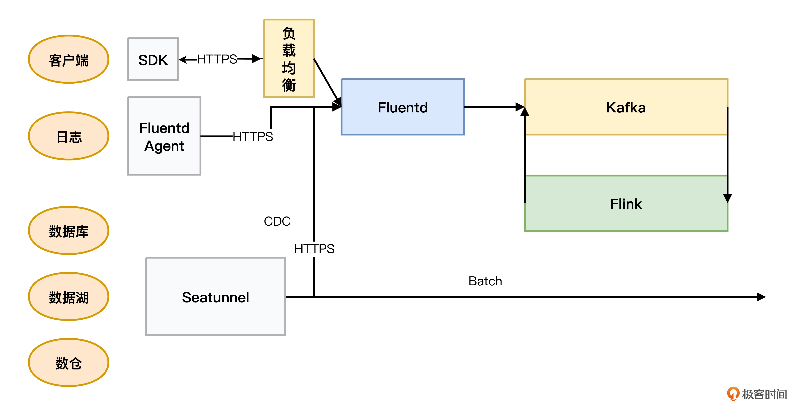
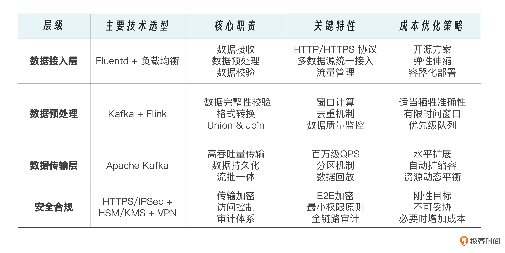

# 04 | 接入与传输：成本、可靠性、时效性与安全合规应如何平衡？

你好，我是曹犟。

在上一节课中，我们讨论了怎么样针对不同的数据源，设计不同的数据采集方案。而数据在采集了之后，就需要通过网络，传输到大数据系统中。负责接收这些通过网络传输过来数据的，就是数据接入层。而数据在接入之后，需要在系统的各个组件之间进行可靠高效的传输，这就是数据传输层需要解决的问题。

在这节课中，我们首先会结合实际应用中的挑战，来讨论数据接入层和传输层的设计与实现。为了方便大家应用在自己的项目之中，我们依然会以开源免费方案作为核心技术选型，同时，在架构设计上尽量保证对不同类型应用的通用性。

同时，在过往的实践中，我发现在成本有限的情况下，同时兼顾可靠性、时效性和安全性会是一个主要的技术挑战，在这节课中，也会对此进行讨论。

### 数据接入层的选型与实现

数据接入层可以看作一个大数据系统的“门户”。我们通过各种方式采集的数据，都需要通过公网或者内网以网络传输的方式发送给接入层。

数据接入层的选型和数据采集方案是紧密相关甚至是应该一体化的。

简单回顾下，我们在上一节的数据采集课程中，对于流式数据源，主要使用神策的客户端SDK 采集公网的客户端数据，使用 Fluentd Agent 来采集服务端日志，使用 Seatunnel 来采集数据库的增量数据。

因此在数据接入层的选型方面，就可以考虑统一使用 Fluentd，通过 HTTP/HTTPS 协议来承接所有的流式数据流。只不过针对不同的数据源，在采集的数据包中，可以增加类似于随机的trackID、数据来源标签、机器名、IP 等额外字段，用于后续的数据处理。

对于公网的传输，在 Fluentd 之前需要部署负载均衡，这里就不再重复了。

这里有一个实际的案例分享给大家。在 2015 年创立神策数据的时候，我们是选择了用 Nginx来接收公网用 SDK 传输过来的不同类型的数据，并将接收到的数据以日志的形式落地。然后自己开发了一个 LogAgent 模块，来读取 Nginx 的日志。整个实现是可以正常工作的，但是在实际的实践过程中，也逐渐需要增加例如进度保存、故障恢复等功能，针对不同客户独特的软硬件环境也有非常多需要自己实现的工作。

十年后的现在，开源社区提供了类似于 Fluentd 和 Seatunnel 这类更好的成熟技术方案，在可维护性、开发成本方面都有很大的优势，也让我们在此时此刻搭建一个大数据系统的接入层，有了更好的技术选型。

而对于批量数据流，上节课中我们推荐使用 Seatunnel 来采集数据库、数仓和数据湖中的表，那么为了保证架构的简洁，在数据接入层方面，则建议采用直连的方式，将数据写入到存储中。

下图是一个典型的数据接入层的实现，供你参考：

### 接入层的数据预处理

数据接入层除了要提供数据接收的能力外，还承载着多重职责。在数据被接收之后，包括对数据进行预处理，对数据的完整性进行验证、对数据格式进行标准化等

对于流式数据流，完成这些职责的一个最主流的技术选型就是 Kafka + Flink 的方案。Fluentd接收到不同来源的数据，将数据根据来源写到不同的 topic 中，然后在 Flink 中根据实际的业务逻辑，开发相应的工作。这也是数据开发工程师在数据接入层这里的核心工作。

对于批量数据流，则可以继续使用 Seatunnel 中提供的数据 ETL 能力，以配置和低代码的方式来完成这部分工作。

在确定完技术选型之后，我们看看这部分工作具体包括哪些内容。

首先是对数据完整性的校验与处理。数据接入层必须确保接收到的数据完整可靠，防止脏数据污染后续处理链路。具体包括以下几方面。

- 对接收到的数据进行多层次校验，例如基础的数据类型验证，验证数值的范围、字符串的长度、日期格式等，也包括业务规则验证，如订单金额不能为负、用户 ID 必须存在等，以及跨字段关联性检查。

- 验证数据的完整性，检查数据包是否完整传输，必填字段是否缺失等。

- 进行数据重复性检测，Flink 有很好的窗口计算能力，实现去重机制，基于业务主键或上文中我们提到的随机 trackID 来识别重复数据，尽可能避免重复处理造成的业务异常。

- 建立数据质量评估能力，建立数据质量指标体系，实时监控数据质量状况，对异常数据进行标记和预警。包括空值率、异常值率、格式错误率等关键指标。

其次是数据格式的转换。不同采集工具都有自己的数据格式，需要将他们统一转换为系统内部的标准数据结构。这里还涉及字符编码处理（UTF-8、GBK 等）和数据类型映射，也就是字段映射与重命名。不同数据源的字段命名规范可能不同，这里需要维护字段映射表，将外部字段名映射为内部标准字段名，确保数据的一致性。

此外，还包括对不同数据源的 Union 和 Join 的处理。

我们分别结合例子来理解。一个 Union 的例子是将通过 SDK 采集到一类用户事件与通过日志采集到的同类用户事件进行合并，有时候还需要按照时间顺序调整。再来看一个 Join 的例子，在 SDK 采集了用户的购买行为时，其中一个字段商品 ID 的实际内容则需要和用Seatunnel 导入的商品表进行 Join 后得到补充。

在批数据流中，Seatunnel 提供了很好的表之间的 Union 和 Join 能力。而在流式数据流中，这部分能力则需要我们结合 Flink 自己的双流 Join、窗口聚合 Join、实时维度表这些能力来自己实现了，具有相当大的技术挑战。

作为一个大数据系统的实现，很多时候我们的下游应用并不要求 100% 的数据准确性，因此，我们在实现时候也需要做必要的折衷，部分时候是需要牺牲一部分数据准确性来换取更低的成本、更简单的技术实现和更好的时效性。

例如，神策分析在接收公网传输的用户行为数据时，是有一个有限的时间窗口来进行数据去重的。不过，考虑到用户行为下游的应用本身也并不应该需要 100% 的数据准确性，所以，为了性能考虑，这个时间窗口并没有设置特别大。

前面描述的这些工作在本质上也是整个系统 ETL 的一部分，我们在第 11 节课中再专门讨论一下。

### 接入层的流量管理

数据接入层需要具备强大的流量管理能力，保障系统在高并发场景下的稳定性。需要能够处理突发的数据洪峰，如电商大促、金融交易高峰期时十倍增长的数据量。

这些流量管理能力包括四个方面。

首先是多维度的限流能力。包括基于客户端 IP 段的限流、基于数据内容的限流、基于 API 接口的限流、基于用户身份的限流等。神策的 SDK 提供了一些在采集端的限流能力，在服务端的实现，则需要我们结合实际的应用需求在 Fluentd 上自己开发配置了。

其次是弹性伸缩，基于实时流量监控，自动调节接收和处理资源。在流量峰值时能够快速扩容接收实例，在低谷期回收资源，实现成本效益的动态平衡。这方面，我们的技术选型，如Fluentd、Kafka、Flink 等，在这方面都已经有了成熟的能力，基本上能够满足需求。如果使用的是这些系统的云原生方案，就更容易实现了。

之后还有优先级队列。根据不同数据的重要程度和时效性要求，按照不同的优先级进行处理。从我们的实践上来看，Fluentd 也就是数据接收这部分的容量通常都是大大高于 Flink 也就是数据预处理部分的容量。因此，优先级队列主要是要在 Flink 这一层实现。关键业务需要的数据、时效性要求更高的应用需要的数据，在处理时应该享有更高优先级，确保核心业务不受一般数据洪峰影响。

最后还有灾备能力。一个大数据系统，非常重要的就是需要能够在网络中断、系统故障时保证数据不丢失。这方面我们主要还是依赖于我们技术选项上选择的各个模块自身具备的能力，当然，一些必要的数据冗余，例如 Kafka 中数据保存时间适当延长、Fluentd 通过日志来对数据做备份等，也都是必须的。

### 数据传输层的选型与实现

了解了数据接入层后，我们再来看看数据传输层的选型和实现。

在一个大数据系统中，数据传输层相当于是核心的数据管线，负责在各个组件间可靠、高效地传输数据。优秀的数据传输层设计需要考虑以下关键特性。

- 高吞吐量：能够处理每秒数百万条消息的传输需求。

- 低延迟：确保数据能够快速从源头传输到目标系统。

- 高可用性：通过冗余和故障转移机制保证服务连续性。

- 数据一致性：确保数据在传输过程中不丢失、不重复、不损坏。

- 可扩展性：支持水平扩展以应对不断增长的数据量。

这其中，Apache Kafka 就是最理想的技术选型。它有百万级 QPS 的处理能力，有持久化存储，支持数据回放，还有分区机制支持水平扩展。如果我们实际的场景中，有多租户、跨地域数据传输等需求，也可以考虑 Apache Pulsar。

一个考虑流批一体需求的数据传输设计，就是使用 Kafka 作为数据管线，流式应用直接从Kafka 中订阅数据。同时，Kafka 的数据也实时写入到存储组件中，满足后面的 adhoc 查询、周期性计算等批量应用的需求。

### 成本考虑与折衷

在大数据系统设计中，成本控制往往是决定架构方案可行性的关键因素。很多时候，看起来技术最先进，直面性能最好的方案，往往因为成本的原因，并不是最合适的方案。

数据接收层和传输层的成本主要包括硬件成本、软件成本和运维成本。在前面讨论接入层和传输层的实现细节时，我们也一直遵循了一个原则，就是在成本、可靠性、时效性三方面根据业务需要做折衷。

在技术选型上，我们主要是选择开源免费方案，以节省软件成本。在系统设计上，我们的方案具备弹性伸缩的方案，基于流量模式配置自动扩缩容，避免资源浪费。我们的选型也都支持容器化部署，来实现资源的高效利用。讨论数据预处理方案的时候，我们也提出要结合实际的成本目标，在业务允许的情况下，放弃部分数据准确性。同时，我们的整体设计以主流开源方案为主，具有很好的故障恢复和灾备能力，对于运维比较友好，节省了运维成本。

最近我们也看到了一些新的对成本控制有帮助的新的技术发展趋势，也做了一些尝试。例如：

- 云原生标准化，容器化、服务网格、可观测性将成为大数据基础设施的标准配置，运维复杂度有望显著降低。

- 数据处理将向边缘节点下沉，减少数据传输成本，提升响应速度。

- 边缘 - 云协同架构将成为新的标准模式。

- 基于机器学习的异常检测、自动扩缩容、智能调优将大幅提升系统的自愈能力，降低人工运维成本。

### 安全合规不能折衷

成本一定的情况下，时效性、可靠性可以做牺牲，但是安全合规这一个目标，却更多应该是一个刚性目标，不应该被牺牲。必要时候，为了安全合规，增加成本都是必要的。

在本节课设计的内容中，安全一方面包括数据传输过程中的安全。我们应该采用合理的数据加密策略，使用 HTTPS 通信协议甚至 IPSec 专线连接来保证传输过程中的加密；在应用层对于部分敏感字段，要做 E2E 加密，即使中间节点被攻破也无法读取数据；采用 HSM（硬件安全模块）或云 KMS 服务管理加密密钥。

安全策略也包括访问控制与身份认证。对于数据接入层和传输层的访问，应该结合 IP 白名单、VPN、API Key 等方式，以每个服务只获得完成任务所需的最小权限为原则，以操作审计为兜底能力，尽可能减少不必要的数据访问风险。

在合规层面，我们也需要建立从数据接收到传输全链路的审计体系。尽可能记录每条数据怎么采集、从哪来、经过哪些节点、到哪去，甚至在必要时需要添加特定的字段。结合我们的展业区域和行业，需要针对 GDPR、SOX、PCI-DSS 等法规要求，建立对应的技术控制措施和流程规范。

### 课程总结

这节课中，我们讨论了数据接入和传输这两部分的设计思路与一个典型的实现方案。在整个讨论过程中，我们一直都在成本、可靠性、时效性方面做权衡。同时，也提出安全合规是刚性目标，是不能做权衡的。

针对本节课程的内容，我也增加了一个表格，用于帮助你回忆和复习。

对于数据开发工程师来说，希望你能通过这节课意识到，技术在快速发展，各种可以使用的组件层出不穷，但是架构设计的核心思维方式是相对稳定的。掌握权衡分析的方法论，建立成本意识和风险意识，始终以业务价值为导向进行技术选择，这些能力对于我们从事任何系统开发都是非常有意义的。最好的架构不是最先进的，而是最适合的。

对于产品经理和分析师来说，我们是大数据系统的使用方，很多时候，我们也需要理解系统设计的限制，在提需求时，也应该有成本意识。我们应该尽可能想清楚我们的需求的收益，从而估算出整体的 ROI。同时，有时候部分需求是有安全合规风险的，一定要谨慎。

### 思考题

- 你过往在做系统架构设计时，有哪些根据成本对设计目标做折衷的实际例子吗？

- 你所在的组织中，在数据接入和传输方面，有哪些地方可能存在安全合规风险？

期待你在留言区留下你的思考。对于课程中的内容，如果希望有更深入的了解，也欢迎留言与我直接交流。
