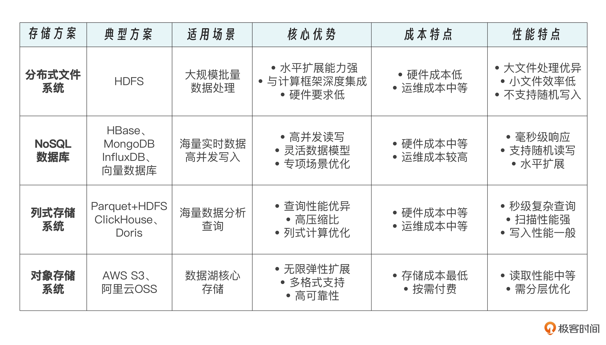

# 05 | 数据存储：容量、性能与成本应如何取舍？

你好，我是曹犟。

在前面一节课中，我们学习了一个大数据系统的接入和传输系统应该如何设计。而数据在完成接入之后，需要作为数据资产存储下来。存储方案的选型，与后续我们要讲解的数据的计算和应用都是紧密相关的。

在这节课中，我们首先讨论存储系统设计上应该有哪些需要考虑的点，然后对主流存储方案进行一个典型的对比和分析，最后我还会带你结合实战场景，看一下应该如何设计一个具体的存储方案。

首先，我们需要讨论一下存储方案做技术设计时需要考虑哪些问题。

### 存储方案的重要性

在大数据系统的整体架构中，数据存储层扮演着至关重要的角色，是整个大数据处理链路的性能和成本控制核心。可以说，存储层的设计质量直接决定了大数据系统能否高效处理 PB 级别的数据。

然而，在实际构建大数据系统时，我们经常面临一个看似简单却极其复杂的问题：如何在容量、性能和成本之间找到最佳平衡点？

这三者构成了一个经典的“不可能三角”。想要支撑海量数据存储？成本必然急剧上升。想要满足毫秒级查询性能？可能又存储不了太多数据。想要控制总体成本在合理范围？可能就要在存储容量或查询性能上做出妥协。

让人头疼的是，大数据存储决策一旦失误，代价往往是巨大的。

这里我想分享给你一个实际的案例。神策数据在创立十年以来，底层存储系统曾经发生过两次变化。第一次，是在 2016 年左右，为了适应客户的需要，提升系统的可扩展性，将存储系统从某分布式 OLAP 数据库替换成 HDFS + Apache Kudu 的方案。我们先不提存储系统架构变化带来的开发成本，仅仅讨论迁移成本就让人印象深刻。

由于神策提供的是可以私有化部署的商用软件，所以当时决定提供一个可以原地升级的方案。在完成工具的开发之后，所有的运维和研发工程师一起动手，依次为每一个客户系统进行操作，大约用了好几个月才完成所有的本地升级工作。而在这个过程中，由于升级是需要停服务的，会影响客户使用，也给客情带来了很大影响。幸好当时我们服务的客户数量只有今天的几分之一，最终还是完成了整个的存储架构迁移工作。

由于这次迁移成本巨大，在这之后，我们选择的整体存储架构基本只有一些小修小补，没有大的变化。而此时此刻，由于软硬件技术的进步积累到了一定程度，我们在考虑面向未来十年的存储方案重构，这个时候要面临的挑战和需要付出的成本，就是当时的很多倍了，下决策的难度也要大很多。

这就是为什么我们在进行存储方案设计的时候，不仅要在容量、成本、性能三方面仔细权衡做取舍，还要充分考虑未来技术发展，尽可能选择有技术前瞻性的主流技术方案，减少存储重构的可能性。

### 设计的核心考量

一个好的存储方案，应该能够满足如下条件。

首先需要很好地适配数据的规模化增长。数据的规模化增长带来的不是简单的多买硬盘，而是需要系统架构本身具有足够的可扩展性，尽量减少迁移、重构等颠覆性操作。

同时，从成本的角度来看，我们也需要扩容本身是一个低成本的操作，使得我们的硬件成本不需要超前储备。因此，我们在设计存储方案的时候，不仅软件系统本身是易于扩容的，在盘位、机架上，也应该尽可能提前做好储备，或者将这部分工作交给公有云厂商。

其次是要能够有效存储多样性的各类数据。大数据系统中的数据类型呈现出明显的多样性特征。虽然在数据接入层已经做了必要的数据预处理，但是各类数据本身的特征是没有改变的。

例如，结构化数据，如用户行为日志、交易流水，通常具有明确的 Schema，适合使用列式存储，如 Parquet、ORC 或时序数据库；半结构化数据，如 JSON 日志、XML 文档，适合文档型数据库或数据湖；而非结构化数据，如图片、视频、文本文件，则更适合对象存储或分布式文件系统。

第三是分层存储策略的设计。大数据系统有一个显著的特点，就是数据作为资产虽然重要，但是并不是所有的数据都会有同等的访问频率。因此，我们应该将数据按照访问频率和业务重要性分为热数据、温数据、冷数据和归档数据。

这四类数据，数据规模逐渐扩大，但是承载的访问量逐渐减少。特别是归档数据，仅仅是法规要求或历史备份数据，访问频率极低但又必须长期保存。我们的方案需要能够每个层次采用不同的存储技术和成本结构，实现整体成本的最优化。

第四是数据全生命周期管理。生命周期管理策略，不仅能有效控制存储成本，还能提升系统整体性能。

典型做法包括以下几种。

- 基于数据的访问模式自动将数据在不同存储之间迁移。

- 根据业务需求和法规要求，自动清理过期的数据。

- 对冷数据采用更高压缩率，牺牲访问性能换取成本节省。

第五是不同应用下的读写模式优化。大数据系统的读写模式与传统业务系统有显著差异，我们选择的存储方案，需要针对应用的读写特点有针对性的优化。

- 批量分析场景，例如离线数据处理、ETL 等，通常采用列式存储格式（Parquet、ORC），优化扫描性能；要使用数据分区和分桶策略，减少查询时的数据扫描量；利用向量化计算，提升批量数据处理效率。

- 流式处理场景，如实时日志收集、事件流处理，则可以选择采用 LSM-Tree 结构，以及采用Write Ahead Log 机制的，专门为写优化的一些存储系统，如 HBase 等，并在实际实践中需要做好负载均衡，避免写入热点。

- adhoc/ 交互式查询场景，如用户行为分析、BI 等，则应该在批量分析场景使用列存储、数据分区和分桶策略的基础上，广泛结合内存计算引擎来提升查询响应速度，同时也可以适当使用预计算和物化视图，加速复杂分析查询。

第六是需要进行整体的成本控制。总成本包括以下几个方面：硬件成本（通常占总成本的一半）、软件成本（通常占四分之一）、运维成本（通常占四分之一）。

我们在进行存储选型时，不能只关注硬件采购成本，而忽视了软件授权特别是运维成本。硬件成本通常是容易预估和控制的，软件方面现在也有非常多的免费开源方案使用，而运维成本，则很多时候非常容易发生雪崩效应，大大超出我们的预算。在我们进行存储方案设计的时候，需要认真考虑整个架构的可运维性，包括常见运维操作，如扩容、缩容、迁移等的成本，故障监控与恢复的方便程度。

最后则是对于安全合规方面的考量。当下的大数据系统，安全合规是重中之重。一个好的存储方案，在设计的第一天起，就应该考虑到如何满足安全合规方面的需求，包括字段加密、权限隔离、日志审计等。

刚才我们系统梳理了一个现代大数据系统的存储方案在设计时应该考虑哪些问题。接下来，我们对当前主流存储方案进行一个简单的分析。

### 典型存储方案分析

现在主流的可供大数据系统选择的存储方案有以下几类，它们分别有各自适宜的应用场景。

分布式文件系统，典型代表是 HDFS。分布式文件系统是大数据存储的基础设施，特别是Hadoop 生态系统的核心组件。它比较适用于大规模批量数据处理和分析场景，能够存储 PB级别的非结构化和半结构化数据，与 MapReduce、Spark 等计算框架深度集成，支持数据的顺序写入和批量读取。

这类系统水平扩展能力强，可线性扩展到数千个节点；大文件处理性能优异，但小文件处理效率低下；写入一次读取多次的访问模式，不支持随机写入。硬件要求相对较低，可使用普通服务器；运维复杂度中等，需要专业的大数据运维团队。

大数据 NoSQL 存储系统，典型代表是 HBase、MongoDB。NoSQL 数据库在大数据场景中发挥重要作用，为海量实时数据的存储和查询提供了专门的解决方案。

其中，HBase 和 Cassandra 等列式数据库适合海量时序数据的高并发写入场景；MongoDB等文档数据库适合半结构化数据的存储和复杂查询；时序数据库如 InfluxDB 和 TDengine 则专门针对时序大数据优化。

而在大模型流行之后，向量数据库的重要性大大提升，非常适合各类大模型应用场景下的特征向量数据的高速存储和检索。

列式存储系统。列式存储系统通常有两种方案，一种是在分布式文件系统，如 HDFS 上结合特定的文件存储格式，如 Parquet 和 ORCFile；一种则是类似于 ClickHouse、ApacheDoris、和 Apache Kudu 这样的分析型数据库。这类存储方案通常都是为了查询优化，适用于海量数据的分析场景。

对象存储系统。对象存储扮演着数据湖的核心角色，为海量非结构化和半结构化数据提供统一的存储平台。

对象存储在理论上可以无限弹性扩展，无容量上限，支持各种格式化和半格式化的数据类型，灾备和数据可靠性方面有保证，而且一般具有比较典型的成本优势。它是目前数据湖方案的主流存储方案，跟现代大数据处理引擎都有深度集成。只不过通常情况下，它的读取性能可能会略微有一些损失，需要在系统设计时结合分层策略做优化。

在实践过程中，因为应用的复杂性，通常都是将不同类型的主流存储方案结合来使用，接下来我们结合实战场景，来看一下具体应该如何进行存储方案设计。

### 存储方案演进的实战案例

这个案例来自某个中型互联网公司过去 10 年的大数据系统的存储架构演进之路。

在初期阶段，该公司的大数据系统数据量小于 10TB，数据主要是用户行为日志、系统监控数据、业务数据库定期导出，公司搭建了一个典型的 3 节点的 HDFS 集群。文件格式主要使用JSON 等文本格式，少量使用 protobuf。计算时候主要使用 Hive 对数据做批量的处理和分析。

因为每天有上万小文件，NameNode 内存压力大，因此也做了定时的文件合并任务。由于查询的性能较低，不太复杂的计算都需要 30 分钟以上，因此也尝试按照日期和业务线进行数据分区，减少不必要的全表扫描，来优化查询性能。

但是，随着用户活跃度的激增，每天的数据量也有了十倍的增长，集群的规模也需要扩容。同时也面临一系列新的实时化和半实时化的需求。

这些需求包括：

- 产品经理和分析师需要能够在秒级响应时间内，分析复杂的用户行为。

- 前端应用需要在亚秒级能够展示部分数据的统计结果。

- 内部的设计和风控系统也需要能够流式地对数据进行分析和告警。

你可以想一想如果你是这家公司的大数据架构师，会从哪些方面、采取哪些方式来推进技术升级，应对新的需求？然后再继续听我分享这家公司的升级思路。

该公司做了一次比较完整的存储技术升级，这些升级具体包括：

- 引入 12 节点的 Kafka 集群来支持对部分用户属性和行为的实时吞吐。

- 引入 20 节点的 HBase 集群来对部分统计型的用户属性进行毫秒级的随机对写，以便在属性实时更新的前提下能够响应前端应用的查询请求。

- 将 HDFS 扩容到 50 节点，也引入 Spark 替代 MapReduce，引入 Parquet 列存储文件格式，来响应产品经理和分析师的 adhoc 类型查询。

在做了这些升级之后，在引入了实时数据处理能力的同时，批量处理和 adhoc 类查询的性能也得到了 10 倍量级的提升，Parquet 在分列存的同时，也提供了更好的文件压缩比，节省了存储空间。

当然，事物都是两面的，这个架构设计也导致架构复杂度激增，需要维护多套存储系统，运维成本大幅度上升。而且批流计算结果的偶发不一致，也会带来内部的沟通协作成本。

而且，数据会进一步增长的，存储成本会越来越高，但是没有人有决心删除掉 7 年以前看似再也不用的用户行为数据。再加上随着公司内部数据科学团队成立，机器学习需求爆发式增长；内部组织架构也需要统一的数据治理体系；监管合规对数据血缘追踪和隐私保护也提出了更高要求。

因此，该公司的大数据系统，又进行了一次大数据系统的架构升级。这其中的核心是在元数据管理和数据治理体系建设方面的投入。

而在存储方面，最核心的技术变化是选择了某公有云的对象存储和本地 HDFS 混合部署方案。其中，把热数据存放在本地 HDFS 中，温数据和冷数据则选择了该公有云 OSS 提供的不同标准的存储中，这一数据分层方案大大节省了成本，也避免了 HDFS 集群持续扩容带来的运维压力。

同时，由于数据科学团队对于复杂类型分析的需求进一步旺盛，该公司将部分价值密度最高的数据使用了专门搭建的 Doris 进行存储。Flink 实时把数据写入到 Doris 中，同时也有定期的数据淘汰机制。而 Doris 相比之前的 Spark + HDFS + Parquet + 自己设计的简单数据分群策略，提供了好得多的查询性能，一体化的方案也降低了运维压力。

通过十年三次的架构升级，该公司最终建立起来一个能够支撑 PB 级数据的现代化大数据平台。这个平台满足了快速增长和变化的业务需求，也为这几年的数据科学和机器学习这类应用提供了支撑。

整个过程中，充分体现了在容量、性能和成本之间寻找平衡点的决策模式。

### 课程总结

在这节课程中，我们讨论了一个大数据系统，在设计存储方案时，应该考虑哪些问题，对市面上主流存储方案做了分析和对比。同时，我们也展示了一个客户完整的存储方案演进的案例，希望能够帮助你理解大数据系统的复杂性和决策的长远影响。

在这里，我们也用一个表格，对于本节课程中提到的各种存储方案做了一个总结和对比，方便你后面复习和使用。

对于数据开发工程师，这节课的重点是掌握存储系统选型的核心考量因素，了解主流存储方案的适用场景，知道如何优化存储系统的成本和性能。这样你才能科学评估存储架构变更的巨大成本，提高架构前瞻性，理解运维成本控制的重要性。培养数据基础设施的整体认知，也能为向数据架构师发展奠定基础。

对于产品经理和数据分析师这些系统的使用者，希望这节课能够帮你学会从成本角度思考数据需求，避免提出不合理的性能要求，理解技术团队在存储选型时面临的复杂权衡，掌握如何在应用层面配合技术团队进行查询优化。

### 思考题

1. 在你实际工作的组织中，你们所运维的大数据平台，运维成本能够占到总成本的多大比例？运维成本主要发生在什么场景？哪些因素可能导致运维成本的“雪崩效应”？

2. 在你实际工作的场景中，你们对于数据的隐私和安全做了哪些控制？这些控制能够满足安全合规方面的需求吗？

3. 假设你负责设计一个电商平台的数据存储方案，该平台每日产生用户行为数据 500GB，交易数据 50GB，商品数据 10GB。业务方提出以下需求：

- 近 7 天的数据的某些累加指标需要支持毫秒级、数千 QPS 的查询响应；

- 近 30 天的数据需要支持秒级的复杂分析查询；

- 历史数据需要保存 3 年用于合规审计；

请设计一个分层存储方案，说明你如何在容量、性能、成本三者间进行权衡，并解释你的决策理由。

期待你在留言区分享你的思考。如果这节课对你有启发，也推荐你把它分享给身边更多朋友。
