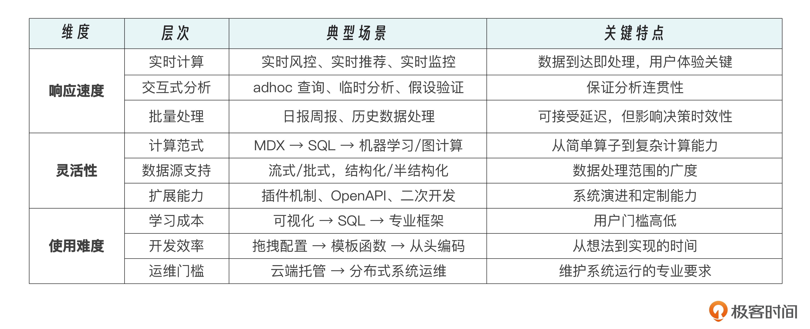
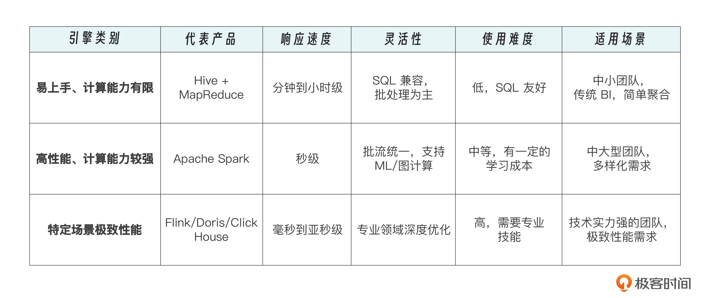

# 06 | 数据计算：响应速度、灵活性与使用难度如何适配？

你好，我是曹犟。

在上一节课中，我们讨论了大数据系统的存储方案应该如何设计。而数据在存储好了之后，就要对数据进行分析和处理，从中挖掘价值。而这就是数据计算层的核心价值。

今天这节课，我们就来深入聊聊计算层的设计与选型。

## 设计目标中的三个维度

我想先跟大家分享一个我自己亲身经历的案例。

在过去十年中，神策数据的用户行为分析产品神策分析，不仅存储系统的设计经历了三次重构（可以回顾上节课内容），计算引擎也是如此。

十年前创业之初，我们选择了某个商业化的 OLAP 数据库，作为整体的存储和计算系统。而在一年多以后，为了支撑更大的数据量和更复杂的分析需求，将存储系统重构到 HDFS +Kudu 架构外，批量查询引擎也调整为 Impala。同时，也引入了 Flink 作为实时计算引擎来完成实时流上的数据处理和加工工作。

而此时此刻，为了得到更极致的分析性能，我们正在考虑重构计算引擎，比如基于 Doris 这类现代化的 MPP 分析型数据库来进行重新设计。

其实，每一次计算引擎的重构，对于应用层来说，都是一个不小的变动。那么，为什么要进行重构呢？是否存在一种完美的计算引擎，能够一直满足我们的需求呢？

答案当然是否定的。每一种计算引擎，在设计上，都是有所折衷的，这种折衷体现在响应速度、灵活性和使用难度这三个方面：

- 响应速度决定了能多快得到计算结果。

- 灵活性决定了能够处理多复杂的计算逻辑。

- 使用难度则决定了系统使用者能否高效使用系统。

让我们来仔细分析一下这三个维度。

### 响应速度维度

响应速度是用户使用一个大数据系统时最直观的感受。在一个大数据系统中，响应速度可以分为如下几个层次。

第一个层次是实时计算，追求的是毫秒级响应。主要出现在流处理的场景。比如实时风控、实时推荐、实时监控告警等。这些场景要求系统能够在数据到达的瞬间就完成处理并给出结果。举个例子，当一个用户在电商平台下单的时候，风控系统需要在几十毫秒内判断这个订单是否存在欺诈风险。如果判断时间太长，用户体验就会很糟糕。

第二个层次是交互式分析，追求的是秒级响应。主要应用在 adhoc 的查询场景。比如产品经理想要临时分析用户行为，数据分析师想要验证某个假设。用户希望在几秒钟内就能看到查询结果，这样才能保证假设、验证、修正后再次假设的分析连贯性。

第三个层次是批量处理，可以接受分钟到小时级的响应时间。主要用于离线分析场景。比如日报、周报的生成，历史数据的回填等。虽然不要求实时响应，但也不能太慢，否则会影响决策的时效性。

很显然，不同业务场景对响应速度的真实需求是不一样的，我们需要区分能够真实性能需求和感知性能需求。比如说，同样都是报表类需求，如果一个报表如果用户每天只看一次，那么10 分钟和 1 分钟的差别其实不大。但如果是一个需要放在公司门口的监控大屏上的报表，那么响应时间就很关键了。

### 灵活性维度

灵活性主要体现在计算能力的丰富程度上，它包括后面这几方面。

首先是支持的计算范式。例如，最简单的计算引擎因为性能要求，可能连完整的 SQL 语义都不能支持，只能响应有限的算子，例如只能做到 MDX（多维分析）兼容，甚至更弱。

很多主流的计算引擎，基本上可以大致做到 SQL 兼容，可能因为各种 SQL 方言的存在有所区别，但基本能够做到计算能力上与 SQL 等价，对于基础的数据分析来说已经够用了。有些计算引擎在 SQL 的基础上可以支持复杂的窗口函数、用户自定义函数等，就能适配更丰富的场景了。但是，如果我们需要做机器学习、图计算等，SQL 的表意能力就远远不够了，需要计算能力更强大的引擎。

其次是支持的数据源和数据格式。有些引擎只能处理流式的数据源，有些引擎只能处理部分结构化数据，有些可以处理半结构化甚至非结构化数据。这种限制，也会对应用场景有所限制，而要突破这种限制，很多时候都需要进行更加复杂的数据预处理了。

最后是扩展能力。有些计算引擎提供了丰富的插件和 OpenAPI 机制，可以很容易地通过二次开发来扩展自己支持的计算范式、数据源和数据格式。有些相对而言则比较封闭，扩展起来比较困难。

### 使用难度维度

使用难度会影响团队的开发效率和维护成本，可以从以下几个方面来考虑。

首先是学习成本。也就是使用者在使用系统之前需要越过多高的门槛。SQL 对于大部分数据从业者来说都是熟悉的，但是，如果是分专业的使用者，例如产品经理、运营人员，则 SQL通常也太难，可能需要进一步简化。基于 SQL 扩展自定义函数需要一定的开发能力，但通常也不会太复杂。最复杂的是那些需要深入理解系统原理的框架。比如 Flink 的状态管理、检查点机制，这些还是需要一些经验积累的。

其次是开发效率。也就是我们从有想法，到基于系统实现我们想法的时间。有些系统提供了可视化的开发界面，拖拖拽拽就能完成复杂的数据处理流程。有些系统有丰富的内置函数和模板，可以快速实现常见的业务逻辑。而有些系统则需要从头开始编写代码，开发周期会比较长。

最后是运维门槛。这是指维护系统正常运行需要的专业技能。简单的云端托管服务几乎不需要运维。而复杂的分布式系统则需要专业的大数据运维团队。这包括集群部署、性能调优、故障排查、容量规划等各个方面。特别的，如果使用的是开源系统，社区资料是否丰富也是一个非常关键的要素，要尽量使用那些主流的开源系统，有了问题社区有积极的回馈和响应，避免“炒股炒成股东”。

### 三个维度不可兼得

我们已经了解了在设计一个计算系统时需要考虑的三个主要维度，在大部分时候，这三个维度是不可兼得的，需要做出取舍。我举几个例子来说明。

例如响应速度和灵活性的矛盾。追求极致的响应速度，往往意味着要做各种优化和限制。这会牺牲系统的灵活性。比如说，为了实现毫秒级的查询响应，我们可能需要预计算大量的结果。这就限制了能支持的查询模式。

再比如灵活性和易用性的矛盾。功能越强大、越灵活的系统，通常使用难度也越高。比如Apache Flink 能处理非常复杂的流计算逻辑。但它的学习曲线非常陡峭。开发者需要掌握分布式系统、事件时间、状态管理等各种概念。

除此之外，还会出现团队能力与需求的错配。很多团队在做技术选型时，容易盲目求新，使用那些看起来很热门的系统，从而出现能力与需求不匹配的问题。要么是选择了过于复杂的技术栈，团队驾驭不了。要么是选择了过于简单的方案，无法满足业务需求。

这些矛盾的存在，就是为什么我们要深入理解这三个维度，学会在它们之间做出合理的权衡。

## 主流计算引擎的对比

明确三个维度的含义后，我们来看看主流的计算引擎是如何在这三个维度上表现的。根据我的经验，我把主流的计算引擎分为三个类别。每个类别都有自己的特点和适用场景。

### 易上手、计算能力有限的引擎

这一类引擎的特点是上手容易，但灵活性相对有一些限制。

Hive 配合 MapReduce 是这类的典型代表。它的最大优势是 SQL 友好。对于熟悉传统数据库的用户来说，几乎没有学习成本。但是它只支持批处理，不支持实时计算。同时，响应速度相对较差，通常需要几分钟到几小时才能完成查询。在灵活性上，虽然支持用户自定义函数，但总体来说计算范式有局限。不过，这类系统一般鲁棒性很好，运维起来比较容易。

这类引擎的适用场景，主要是中小团队、传统 BI 分析、简单聚合计算。如果你的团队主要是业务分析师，需求以报表和简单的数据分析为主，那么这类引擎是最合适的选择。

### 高性能、计算能力较强的引擎

这一类引擎的特点是性能不错，计算能力也比较强。

Apache Spark 是这类的典型代表。它最大的特点是批流统一，既支持批处理也支持流处理。在计算能力上，除了基础的 SQL，还支持机器学习、图计算、流处理等。在响应速度上，通过内存计算可以达到很好的性能，比传统的 MapReduce 快一个数量级，达到秒级。使用难度上，虽然有一定的学习成本，但由于相关的资源比较多，整体越过门槛后还是容易掌握的。只不过由于为了追求高性能广泛使用内存计算，所以它在错误恢复、容灾方面，需要更多的处理和设计。

这类引擎的适用场景，主要一定技术能力的中大型团队，以及对响应速度有一定需求的场景。如果你的团队既有数据开发工程师，也有数据科学家，需要支持从基础报表到机器学习的各种需求，那么这类引擎是比较好的选择。

### 特定场景极致性能的引擎

这一类引擎通常不追求能够覆盖所有应用，但是在特定的场景上做到了极致性能和最强计算能力。

Apache Flink 是低延迟流处理的王者。它在响应速度上可以达到毫秒级甚至亚毫秒级的处理延迟。在灵活性上支持复杂事件处理、精确一次语义、复杂的状态管理等高级功能。但在使用难度上，需要深入理解分布式流处理的各种概念，学习成本很高。

Apache Doris 和 ClickHouse 则是专门针对 OLAP 场景优化的列式数据库。在响应速度上，可以达到亚秒级的查询性能。在灵活性上，虽然主要专注于分析查询，但支持复杂的聚合分析和实时数据摄入。使用难度上，对于熟悉 SQL 的用户来说比较容易上手。

除此之外，一些大公司会针对特定场景深度优化自己的计算引擎方案。比如字节跳动的ClickHouse 优化版本 ByteHouse、阿里在 Flink 基础上高度定制的 Blink 等。

这类引擎在特定场景下可以达到极致的性能，计算能力也是完全定制化的。这类引擎的适用场景，是那些团队技术实力很强、需要极致性能和计算能力的场景。比如大用户量下的实时推荐系统、金融机构的实时风控系统、给海量广告主的广告报表系统等。它的使用难度也是最高的，很多时候需要专门的团队来进行代码层面的维护。

## 如何做出正确决策

我们刚刚学习了做计算层设计时需要考虑的三个维度，也对比了主流的计算引擎，我们应该如何做出正确的技术决策呢？

我觉得首先还是要回到应用场景，看看应用场景对于系统到底有什么样的期望。其次团队自身能力也非常重要，尽量要选择那些团队有能力、有意愿来学习、维护的技术方案。第三则是演进路径上的考虑，一方面不要超过场景需求太多，过度设计，一方面也要考虑方案本身在未来是有扩展空间的，为未来的技术演进留下空间。

这里提供一个我自己真实经历过的案例，我们回到这节课最开始介绍的神策分析系统的计算引擎重构过程。假设“时光穿越”，回到了 2016 年，你是神策的 CTO，你会如何进行计算层的技术决策呢？

首先看看我们要面对的应用场景。神策分析是解决用户行为分析问题，目标是给产品经理、运营经理、分析师等岗位提供一个好用的、交互式探索的用户行为分析系统。

交互式探索分析，意味着响应速度需要达到秒级，才能保证分析与探索的连贯性。用户行为分析，则意味着系统的计算灵活性，在传统的多维分析（MDX）基础上，还要能够支持行为序列等时序性分析能力。

而由于产品经理、运营经理等岗位很多都是没有写 SQL 能力的，则意味着在使用难度维度上，需要提供比 SQL 更低的上手门槛。同时，对于用户行为分析场景场景，它的数据模型相对而言是比较清晰的，采集后的数据做 ETL 的逻辑也比较简单。

再来看团队自身的能力。神策的创始团队大部分在百度都有多年的大数据经验，特别是好几个工程师都是现在开源的 Apache Doris 的原生系统的核心开发者，对于 Impala 这样的 MPP 架构的查询引擎有丰富的代码级的开发能力和经验。

而从技术演进的角度看，在 2016 年，类似于 Doris、Clickhouse 等开源系统要么还没有开源，或者本身还不够成熟，Impala 背靠 Cloudera，在当时也是有比较丰富的社区支持，本身的性能也还不错，并且 license 也足够友好，看起来是一个有光明未来的选择。

面对这些内外部需求和条件，在当时，作为 CTO，我做的核心技术决策是：

1. 以 Impala 作为计算层的查询引擎，同时，对 Impala 进行代码级的改造，例如，扩展它的时间窗口能力等，让它在时序性查询上有更好的性能。

2. 在 Impala 的 SQL 接口之上，对常见分析需求进行抽象，提供可视化的配置能力，方便没有 SQL 能力的用户使用，同时，也保留 SQL 能力作为兜底。

3. 将主要的 ETL 逻辑尽可能前置，在采集层或者在接入层写入存储之前完成，尽量减少对计算层做 ETL 能力的要求。

4. 在计算选型确定的基础上，存储上将热数据写入 Kudu，冷数据写入 HDFS。此外，根据用户行为分析的特点，在 HDFS 上做了非常精细化的数据分区设计，同时加上索引和压缩等策略的优化，尽可能提升响应速度。

整体上看，这个技术决策是符合我们当时面临的实际应用需求的，我们打造了一个上手简单、响应速度秒级，分析能力能够覆盖用户行为分析场景的产品，很快成为中国用户行为分析市场的第一名。

而在随后的九年里，随着应用场景的进一步扩展，特别是进入营销自动化场景和实时用户数据中台（real-time CDP）领域需要更强的实时计算能力，这个系统也为我们引入 Flink 提供了足够的可扩展性。

至于在此时此刻，考虑基于 Apahce Doris 和其它向量数据库进行再一次的技术重构，则主要有以下一些原因：

- 国央企客户对于信创有明确要求，对于供应商的技术选型有明确限制；

- 国央企客户希望系统能够跟自己已有的大数据组件进行混合部署，因此我们需要精简我们的架构设计；

- 从社区活跃度角度来看，Apache Doris 社区远远比 Impala、Kudu 社区要活跃的多，也代表了开源技术的发展方向；

- 在部分查询场景下，我们期望能够得到更快的响应速度；

- 为研发 Data Agent 和下一代 AI Native 的产品提供更好的基础设施。

在多年的实践经验之后，我总结了四个重要的原则。

第一，不要追求技术的“先进性”，要追求“适用性”。很多团队容易被新技术吸引，觉得用了最新的框架就代表技术水平高。但实际上，最适合的技术才是最好的技术。

第二，团队能力建设要先于技术架构升级。技术是由人来使用和维护的。如果团队驾驭不了复杂的技术，那么再先进的方案也没有用。

第三，渐进式演进比一步到位风险更小。大规模的技术栈切换风险很高，成本也很大。通过渐进式的演进，可以逐步积累经验，降低风险。当然，如果真到了需要重构的时候，也要敢于做决策。

第四，重视运维能力建设，不能只关注开发。很多团队在选择技术时只考虑开发的便利性，忽视了运维的复杂性。但实际上，系统上线后的运维成本往往远高于开发成本。

## 课程总结

今天我们讨论了数据计算引擎选型的核心问题。如何在响应速度、灵活性和使用难度三个维度间进行权衡，对于主流的计算引擎也做了对比，并且用一个真实案例来探讨了如何从应用场景和团队实际状况来进行合理的技术决策。

我也准备了两个表格，放在文稿中，希望对你的学习和总结有帮助。

如果你是数据开发工程师，希望今天的内容能帮你更好地平衡技术挑战与团队现实。要深入理解业务需求，不要盲目追求先进技术，根据实际场景选择合适的工具。

对于产品经理和分析师等系统使用者来说，要理解技术的复杂性，合理设定性能预期，不要提出不切实际的需求。

## 思考题

- 在你的组织中，数据计算的主要瓶颈是响应速度、灵活性还是使用难度？你是如何做评估和取舍的？现在的技术选择有哪些改进的地方？

- 什么情况下值得承担更高的使用难度，来换取强大的计算能力？什么情况下应该选择"够用就好"的方案？

期待你在留言区留下你的思考。对于课程中的内容，如果希望有更深入的了解，也欢迎留言与我直接交流。
